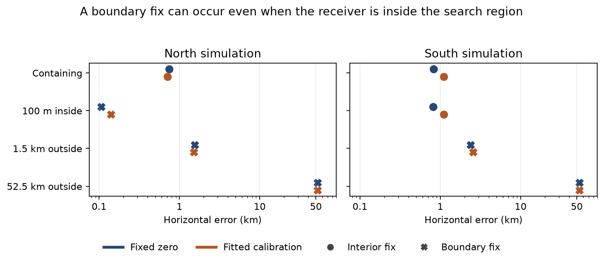

# Testing whether a constrained position identifies a missing search region

If either calibrated endpoint lies on the boundary of the offered square, the constrained position alone gives limited information about the receiver outside that square. This experiment tests treating such a result as a reason to withhold. It uses the released local coordinate transform and a tolerance of 32 representable coordinate steps to allow for converting published latitude and longitude back to local coordinates. There is no distance cutoff fitted to an installation.

First inspect already published DS30 and regional endpoints. Then, on the existing northern and southern simulated waveforms, place the true point **100 m inside** one face of the original 25 km search square. Derive the direction from the opaque recording name before fitting. These are public development simulations. The scorer constructs the offers, while inference receives only the offer, the prior detector output, and the capture-time orbit archive. A constrained fix on a containing offer falsifies use of this diagnostic as a general proof that the receiver is outside. No withholding or PNG savings from this study count toward the runtime target.

| Evidence | Returned decisions | Either calibration arm on a face | Interpretation |
|---|---:|---:|---|
| Published physical DS30 endpoints | 439 of 455 | 0 | The station was well inside its standard offer throughout. |
| Published two-site containing offers | 2 of 2 | 0 | Both returned interior positions. |
| Published two-site omitted and far offers | 4 of 4 | 4 | Both arms clipped in every case. |
| New near-edge containing offers on the same public waveforms | 2 of 2 | 1 | Both arms clipped on the northern recording despite the true position lying inside. |

The northern near-edge fix was **106 m from truth with fixed-zero calibration and 141 m with fitted calibration**. An unconditional boundary guard would discard both. The southern near-edge errors were 817 m and 1,101 m, and both endpoints were interior. These are saved-detection runs of the current combined solver with its original search and robust likelihood. The test establishes an actual false withholding case that the 439 real roof fixes and the six previously published regional offers did not expose. [Scored historical endpoints](measurements/edge-history.json.gz) · [New solver outputs and offers](measurements/edge-solvers.json.gz) · [Evaluator](edge_trial.py)

The inexpensive collapsed solver was also checked on the usual southern containing offer and northern far offer. It produced all eight figures in both cases. On the southern recording the two errors were 0.296 and 0.607 km. On the northern far offer it still published false fixes 52.472 and 52.445 km from the receiver. Lower runtime on that wrong region does not resolve region omission. [Collapsed solver](solver-collapsed.md)

