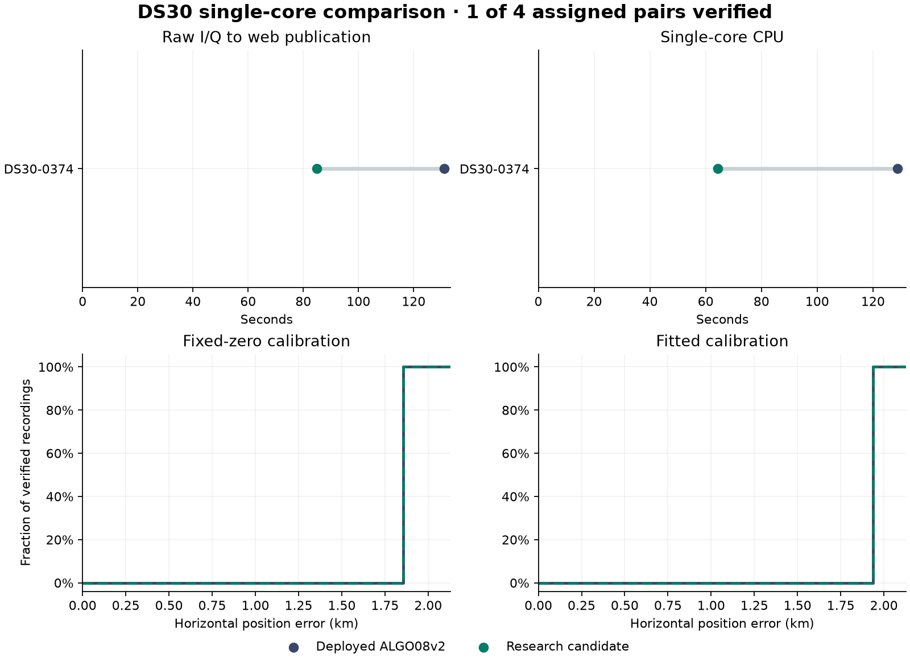

# First physical publication with all-factor exact scoring and direct solver assembly

The northern and southern raw simulations verified the scoring and solver changes on cached input. This check asks whether the same frozen build activates those changes and the bounded next-member read hint with a production-size physical recording. It uses only DS30-0374, the first recording in the pre-existing DS30 order. Its roof and results on earlier builds are public development data. [Frozen candidate](exact-curved-lookahead.md) · [Public simulations](exact-curved-public-sites.md) · [Earlier physical panel](fractional-selected-four.md)

Run the candidate first and deployed ALGO08v2 second, through complete publication, with normal file cache behavior. Record per-arm input residency and charged reads, elapsed and CPU time, and the acquisition, solving and rendering boundaries. Verify the raw input and region, both calibration arms, rows, assignments, fit residuals, positions, paths, all grid minima and all eight decoded figures. Check the acquisition hint and direct matrix assembly counters in the candidate receipt. Keep this as one physical timing pair and preserve the geographic and timing gates for subsequent qualification. No sixteen-recording panel is scheduled.

## Result

The candidate reproduced all 9,288 probe rows, 4,157 selections, satellite owners, both published fits and paths, and all eight figures pixel for pixel. Fixed-zero error was 1.855 km and fitted error was 1.935 km in both builds. Both evaluated the same 179 grid coordinates, valid points and minimizing locations. The grid's model label differed and its maximum absolute score difference was 7.28 × 10⁻¹². [Field audit](measurements/exact-curved-0374-audit.json) · [Assigned recording](measurements/exact-curved-0374-stage.json)

| Time in seconds | Deployed v2 | Candidate |
|---|---:|---:|
| Launch through detections | 90.43 | 56.16 |
| Detections through position decision | 34.82 | 25.94 |
| Decision through completed publication | 5.78 | 2.75 |
| Total elapsed | 131.03 | 84.85 |
| Total single-core CPU | 128.70 | 64.40 |

The measured elapsed speedup was 1.54× and CPU speedup 1.999×. At launch 10.6% of the candidate's input pages were cached versus 100% for deployment. The candidate charged 14,761,776 filesystem input blocks, and deployment charged zero. The candidate used 19.33 more elapsed seconds than the half-time target. Its 92 next-member hints requested 1.44 GiB in total, with 0.91 s elapsed in the advisory calls. The solver used direct assembly 1,323 times. These counters establish execution on physical input. The pair does not isolate the contribution of the hint. [Paired receipt](measurements/DS30-0374-exact-curved-lookahead.json)

