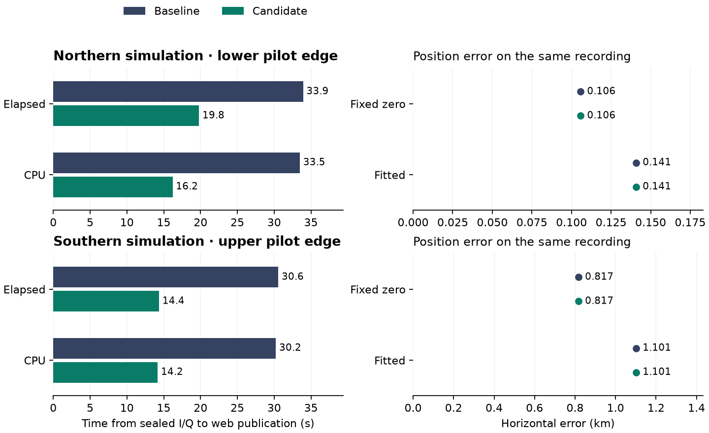

# All-factor exact acquisition on two public simulated sites

The same frozen candidate reproduced both positions, all 912 selected observations and all 16 web figures from deployed ALGO08v2. Total CPU speedup was **2.10×** and total elapsed speedup **1.89×**. It withheld the two distant omitted regions and issued false fixes for both near omissions. The timing and regional qualification criteria remain open. [Predeclared comparison](all-factor-composition-protocol.md) · [Frozen implementation](exact-curved-lookahead.md)

| Recording and first build | Elapsed s, deployed → candidate | CPU s, deployed → candidate | Fixed-zero / fitted horizontal error, both |
|---|---:|---:|---:|
| [South, candidate first](measurements/exact-curved-lookahead-south-inside.json) | 30.57 → 14.37 | 30.23 → 14.18 | 817 / 1,101 m |
| [North, deployed first](measurements/exact-curved-lookahead-north-inside.json) | 33.94 → 19.80 | 33.49 → 16.21 | 106 / 141 m |

Both raw runs used the full two-scan schedule, direct solver design assembly and the 16 MiB next-member hint inside acquisition. The southern solver used direct matrix assembly 731 times and the northern solver 713 times. Each recording issued 18 hints. All four timed arms reported zero filesystem input blocks. These runs measure warm-input behavior. A separate private full-member test measured the hint's cold performance. [Southern audit](measurements/exact-curved-lookahead-south-audit.json) · [Northern audit](measurements/exact-curved-lookahead-north-audit.json) · [Cold input experiment](full-member-lookahead.md)

Elapsed fell **64.51 → 34.17 s** and CPU **63.73 → 30.38 s**. The median paired candidate/deployed elapsed ratio was **0.52674**, the summed ratio **0.52969**. The candidate's northern wall time exceeded its CPU by 3.59 s versus 0.44 s for deployment. The previous spectral candidate recorded a 3.55 s gap on this same northern signal and run order. The current receipt records 1,396 involuntary context switches for the northern candidate and 967 for deployment. Those counts give no duration or causal attribution for the wait. [Earlier timing](spectral-publication.md)

Each site returned 456 selected signals out of 2,400 detector rows. All row fields, fitted and fixed-zero frequency RMS, satellite owners, optimizer paths, published coordinates and pixels agreed between builds. All 137 diagnostic grid locations, their validity and both minima agreed at each site. The northern grid's nuisance-model label and scores differed, with maximum absolute score difference 3.73 × 10⁻¹¹. The southern grids agreed. [Grid comparison](measurements/exact-curved-lookahead-grids.json)

## Search regions missing the receiver

Both containing offers placed the receiver 100 m inside the supplied square and produced valid fixes. On the same signal, moving the face to 100 m outside produced false fixes with fitted errors of **118 m north and 1,102 m south**. Both 52.5 km omissions were withheld in both arms. The replay reused each candidate's own detector rows and original causal orbit archive, with the relocated search and sky-screening centers. These are decision comparisons on the two existing signals and add no timed raw recordings. [Northern offers](measurements/exact-curved-lookahead-north-offers.json) · [Southern offers](measurements/exact-curved-lookahead-south-offers.json)

The saved-input replay driver initially retained the raw lookahead option while bypassing ingress, and the launcher's integrity check rejected that incompatible configuration. The driver now disables raw-only options when opening already verified detections, retaining the frozen solver and regional settings. Both successful omission replays used that correction. The timed raw runs used the original frozen launcher.

Use the commands in the [public raw procedure](spectral-publication.md#reproduction) with bundle `integration-exact-curved-lookahead`, specification `sha256:6cdbac1e8496bfeaf8f3eefb90c936c65829629cc42d04b4a9bab7c6e97cf50f`, and fresh output paths. Generate the figure with `python -m reports.ALGO08.single-core-2x.plot_shared_publication --trial exact-curved-lookahead`.
