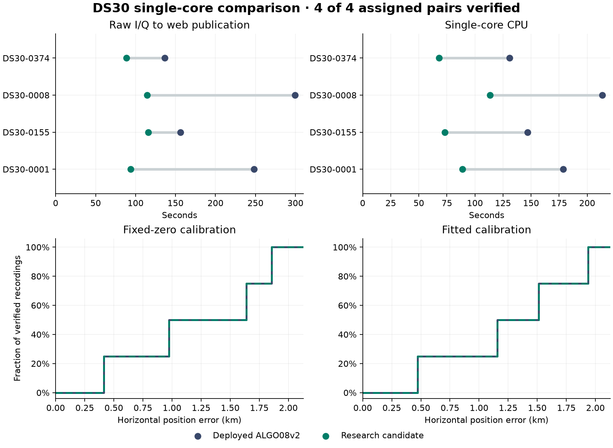

# Exact receiver scores on four physical DS30 recordings

The frozen selected-score receiver and regional solver reproduced **all four deployed fixes, both calibration fits on each recording, and all 32 web figures pixel for pixel**. The pipeline took **412.76 s** against **839.85 s** from sealed I/Q to complete publication on one low-priority Gauss core. The summed candidate/deployed ratio of **0.49146** passed the 0.50 target. The median paired ratio of **0.51663** missed it. This build stops at four physical recordings. [Complete stage score](measurements/fractional-selected-four-stage.json) · [Reopened detector, grid and image comparisons](measurements/fractional-selected-four-audits.json)

| Matched recording | Elapsed s, deployed → candidate | CPU s, deployed → candidate | Input pages cached at launch, deployed → candidate | Fitted horizontal error, both |
|---|---:|---:|---:|---:|
| [DS30-0374](measurements/DS30-0374-fractional-selected.json) | 136.35 → 88.68 | 130.91 → 68.10 | 100.0% → 26.2% | 1.935 km |
| [DS30-0008](measurements/DS30-0008-fractional-selected.json) | 299.44 → 114.65 | 213.46 → 113.51 | 1.4% → 100.0% | 1.512 km |
| [DS30-0155](measurements/DS30-0155-fractional-selected.json) | 155.96 → 115.78 | 147.03 → 73.23 | 100.0% → 0.1% | 1.157 km |
| [DS30-0001](measurements/DS30-0001-fractional-selected.json) | 248.10 → 93.64 | 178.71 → 88.90 | 0.0% → 100.0% | 0.470 km |

The candidate ran first on DS30-0374 and DS30-0155. Each of the four first runs did substantial storage I/O. None of the pairs started both runs with fully cached I/Q. Summed wall speedup was **2.035×**. Process CPU fell **670.12 → 343.75 s**, or **1.949×**, leaving 8.69 CPU seconds across the panel above half of deployed CPU. Median elapsed qualification uses each recording's candidate/deployed ratio before taking the median. Here its middle two ratios came from DS30-0008 and DS30-0374.

| Stage summed over four matched recordings | Deployed elapsed s | Candidate elapsed s |
|---|---:|---:|
| Launch through saved detections, including I/Q reads | 599.86 | 254.09 |
| Detections through position decision | 215.85 | 146.82 |
| Decision through completed web publication | 24.14 | 11.84 |

## Position and publication

Both builds used the same regional offer and capture-era orbit archive per pair. With calibration fixed at zero, position errors had a median of **1.306 km** and P90 of **1.791 km** in both builds. Fitted calibration gave **1.334 km** and **1.808 km** respectively. Actual endpoints and observation owners agreed separately in each arm. DS30-0001 now reproduced the deployed position after an earlier collapsed solver moved the fitted endpoint by 41 m. [Earlier four-case comparison](full-phase-ds30-stage.md)

All **48,674** published detector rows matched, including **21,690** retained observations. The RF RMS and optimizer paths agreed in both arms on every recording. Every pair evaluated the same 179 ordered grid positions with the same validity, failure map and minimizing locations. The diagnostic grid's nuisance-model label differed. Grid scores differed by at most **1.46 × 10⁻¹¹** across recordings. [Field-level audits](measurements/fractional-selected-four-audits.json)

These four recordings share a roof. The existing public simulated near-boundary failures still require a geographic solution. Further roof recordings would add timing and within-site coverage. Fresh-location confirmation remains reserved. [Boundary results](north-south-faces.md) · [Geographic protocol](PROTOCOL.md)

## Next candidate

On saved 128-visit prefixes, computing every factor's exact score in the verifier was at least as fast in the median as selectively repairing scores afterward. The selective policy cost an extra 2.84% of acquisition CPU on dense DS30-0008 and 0.39% on the public southern simulation; individual southern repeats went in both directions. Both reproduced deployed observations. Direct likelihood assembly saved 2.52 CPU seconds in the dense saved solver and 0.05 seconds in the south. On three private DS30-sized compressed members, a bounded hint for the next member saved 222 ms median cold acquisition elapsed across three pairs. These component measurements motivate testing their combination on saved recordings. They do not establish its full publication speed. [Exact receiver comparison](receiver-fractional-score-transfer.md) · [Solver comparison](solver-curved-design.md) · [Cold and warm input comparison](full-member-lookahead.md)

## Reproduction

Follow the [stage runner](ds30-stage.md) with bundle `integration-fractional-absolute-selected-v3`, specification `sha256:e819d432e87d84f9f03e6df8e147fc7d2894e776c1db9e23e9b84113cb1e9e71`, and a fresh workspace. Run one assigned pair at a time in table order, with `--size 4` and `--cache-library`. The `score` action verifies the frozen spec and reopens publications. The figure uses `python -m reports.ALGO08.single-core-2x.plot_ds30_stage SCORE.json OUTPUT.png`. Each detailed comparison uses `python -m reports.ALGO08.single-core-2x.physical_pair_audit SCORE.json WORKSPACE/DS30-NNNN/pair.json`. [Candidate specification](measurements/fractional-absolute-selected-v3-freeze.json)
