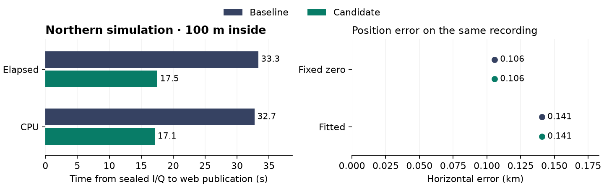

# Frame-plane receiver and sparse satellite ranking

The combined candidate published a valid fix and all eight figures in **17.526 s**, versus **33.323 s** for deployed ALGO08v2, on the public northern recording. This is **1.90× elapsed** and **1.91× single-core CPU**. The positions matched deployment exactly. The elapsed result missed half-time by **0.864 s**. The two earlier roof recordings used a different frozen build. [Matched publication](measurements/frame-plane-north-inside.json) · [Frozen candidate](measurements/frame-plane-freeze.json)



| Matched interval | Deployed | Candidate |
|---|---:|---:|
| Launch to saved detections, elapsed | 19.252 s | 8.696 s |
| Saved detections to position decision, elapsed | 9.712 s | 6.842 s |
| Decision to exit with web figures, elapsed | 4.360 s | 1.988 s |
| Complete process CPU | 32.748 s | 17.135 s |

Both builds selected the same 456 carrier measurements over 2,400 opportunities, with the same epochs, signed frequencies and ranks. Continuous scores differed by at most 1.99 × 10⁻¹⁴. Both owner maps and the optimizer path agreed. All eight decoded PNGs were pixel-identical. Both grids sampled the same 137 positions and selected the same minima. Their likelihood implementation labels differed, and the largest absolute grid score difference was 3.73 × 10⁻¹¹. The candidate ran first. The operating system reported 256 input blocks for the candidate and 440 for deployment. This is one paired observation. [Field and image audit](measurements/frame-plane-north-audit.json) · [Grid comparison](measurements/frame-plane-grid.json)

## Moving the search region on the same detected waveform

| True receiver position relative to offer | Decision | Horizontal error, fixed zero / fitted |
|---|---|---:|
| 100 m inside | Valid fix | 106 / 141 m |
| 100 m outside the same face | False fix | 123 / 118 m |
| 52.5 km outside | Withheld both arms | — |

The two omitted offers used the detector document from the candidate's raw run and the same capture-time orbit archive. Only the offered square and its corresponding screening center changed. The far veto survived integration. The false fix near the face still fails the geographic qualification rule. These replays began from saved detections and do not add two recordings to the timing sample. [Bound inputs and decisions](measurements/frame-plane-offers.json) · [Offer replay](frame_plane_offers.py)

A separately frozen successor stops the region check as soon as the far-exterior veto becomes impossible. On the same inside recording, it needed 25 of 96 probe scores and saved **0.816–0.922 CPU seconds** within the guard across opposite run orders. The complete saved-solver fits, owners, grid and path agreed. On the far omission it evaluated all 96 points and withheld with the same reason. The raw comparison above used the full guard. The 0.864 s observed end-to-end gap and the guard-only saving have different timing boundaries. [Successor, complete saved comparisons and timings](terminal-guard-publication.md)

## Public development comparison

Use the existing northern simulated waveform with its lower pilot edge and the same 25 km search square that contains the receiver by just 100 m. This is one engineering comparison on a previously published recording. The last related deployment-first pair took 33.90 and 18.36 seconds. The new comparison runs the candidate first. Both builds start with empty publication roots and use the original recording, orbit archive and offer. Time sealed I/Q through all eight web figures with a single low-priority Gauss core. Inspect file input blocks, both calibration arms, ranks, measured CFO and timing, every observation owner, numerical grid and path, and decoded figure pixels. Score against the public receiver reference after execution. [Previous pair](packed-graph-publication.md)

The candidate combines the tiled receiver filter, wrapped frequency refinement, frame-plane receiver layout and sparse satellite ranking. Require the exact combined binary to preserve all reviewed factors on the weak-carrier and Austin slices and on the three previously sensitive roof lanes before running the public waveform. The sparse solver has already been checked on complete saved dense-roof and Indian containing solutions. The experiment excludes the wider likelihood, Anderson acceleration, alternative allocator and experimental degree bound. [Regional ranking](sparse-rank-projection.md) · [Plain-control solver comparison](solver-wide-private-blocks.md)

## Reproduction

The receiver comparison matched all 74 tested factors and 52 continuation decisions, including both Austin pilot edges, and reproduced all five factors on the three previously sensitive lanes. The final freeze has specification `6cf354ef58866a795c090d329f0ce87960faaac00e8a146e88c58830aa6f207a`. The receipt lists the changes to the sparse solver bundle. [Combined receiver build and exact comparisons](receiver-frame-planes.md) · [Sparse solver verification](sparse-fir-successor.md)

```sh
bench=/tmp/leo-algo08v2-2x-bench
public=/tmp/leo-regional-qZJKBw4W/public
py=/opt/leo-algo08/bdb869682a2ea63af4b198a920b763a4c6a78c4c/venv/bin/python
frozen="$bench/integration-sparse-frame-plane"
id=0abe7b4514be674d9f5388e3
export PYTHONPATH=.:src OMP_NUM_THREADS=1 OPENBLAS_NUM_THREADS=1 MKL_NUM_THREADS=1
"$py" -BPs -m reports.ALGO08.single-core-2x.freeze_frame_plane_receiver \
  "$bench/integration-ad417-sparse-fir" "$bench/d97b-planes-and-fir/receiver.so" \
  14b52e7e85b6fcf94c956acb3da579d711959c3313d1bc6b9522128c5f161e7c \
  "$frozen" "$bench/frame-plane-freeze.json"
"$py" -BPs -m tools.pipeline_eval.qualification.paired_publication "$public/$id" \
  "$bench/near-edge/$id.json" "$public/tle" "$frozen/reports/ALGO08/single-core-2x/run-candidate" \
  "$bench/frame-plane-north-inside" --candidate-config "$frozen/spec.json" --first candidate \
  --archive-inventory-sha256 sha256:7aa06cab0502bcac70645a41a219bb6d53f1077f329e6f7ed79eb59a8794feec
flock "$bench/gauss.lock" ionice -c2 -n7 nice -n15 taskset -c 2 \
  "$py" -BPs -m reports.ALGO08.single-core-2x.frame_plane_offers \
  "$bench/frame-plane-north-inside/pair.json" "$frozen" reports/ALGO08/regional-release/scoring-key.json \
  "$bench/frame-plane-offers.json"
```

The freezer requires a new bundle directory. The paired runner acquires the Gauss lock itself and requires a new publication directory.
