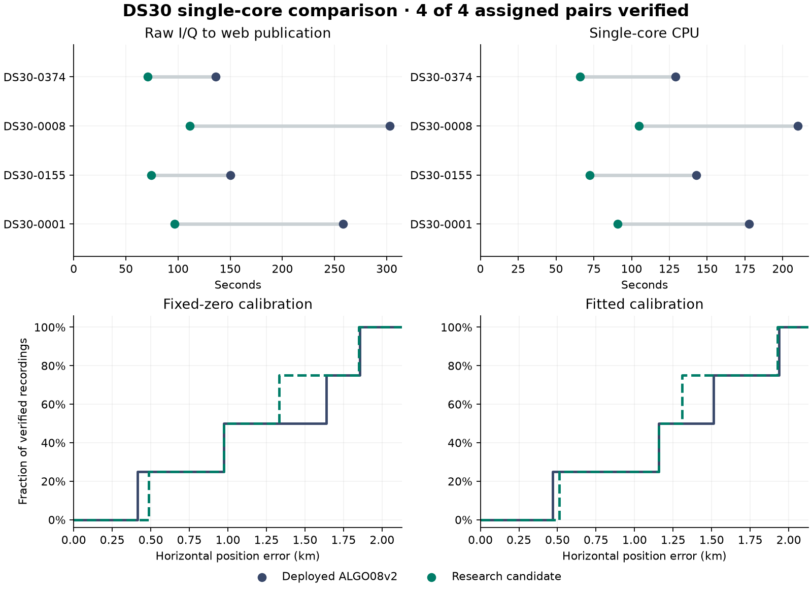

# Full two-scan ALGO08v2 on four matched DS30 recordings

The research build completed the first four assigned recordings in **353.28 seconds** against deployed ALGO08v2's **847.34 seconds**. Both builds used one core, returned four fixes in each calibration arm, and produced all 32 required web figures. Both prespecified elapsed-time gates passed. Two deployed runs incurred substantial disk reads. Across the two pairs where neither build incurred reads, the elapsed speedup was **1.97×**. All four recordings came from the same physical station. [Verified stage score](measurements/full-phase-ds30-stage.json) · [Qualification protocol](PROTOCOL.md)



## Timing on the same raw recordings

Each row includes reading sealed I/Q, both receiver scans, track preparation, satellite association, both position fits, diagnostics and publication. The candidate uses the floating-point receiver, compiler training on generated signals, packed phase verification and the collapsed search with signed orbital corrections. A single frozen build supplied all four rows. The run order alternated in the existing DS30 order. [Candidate and detector pins](measurements/DS30-0374-full-phase.json) · [Benchmark procedure](ds30-stage.md)

| Recording and first build | Elapsed seconds, deployed → candidate | CPU seconds, deployed → candidate | OS input blocks, deployed → candidate |
|---|---:|---:|---:|
| [DS30-0374](measurements/DS30-0374-full-phase.json) · candidate | 136.14 → 70.69 | 129.15 → 65.82 | 0 → 0 |
| [DS30-0008](measurements/DS30-0008-full-phase.json) · deployed | 302.94 → 111.24 | 209.88 → 104.98 | 16,017,368 → 0 |
| [DS30-0155](measurements/DS30-0155-full-phase.json) · candidate | 150.24 → 74.47 | 142.83 → 72.36 | 0 → 0 |
| [DS30-0001](measurements/DS30-0001-full-phase.json) · deployed | 258.02 → 96.87 | 177.60 → 90.79 | 16,120,056 → 2,056 |

The median paired and summed candidate/deployed elapsed ratios were **0.436 and 0.417**, both below 0.500. Summed CPU fell **659.45 → 333.94 seconds**, or **1.975×**. The candidate used 4.21 CPU seconds more than half the baseline total. Cache state favored the candidate on both deployed-first recordings. The two no-read pairs both ran the candidate first. Those measurements limit how precisely this stage can separate algorithmic gains from storage and run-order effects.

## Fixes, position errors and frequency fit

The two arms use identical observations within each build. The fixed-zero arm sets the RF calibration coefficient to zero. The fitted arm estimates it. All four offers contained the station. P90 below is an interpolated percentile of four recordings.

| Recording | Fixed-zero error, km | Fitted error, km | Fixed-zero RF RMS, Hz | Fitted RF RMS, Hz |
|---|---:|---:|---:|---:|
| DS30-0374 | 1.855 → 1.848 | 1.935 → 1.928 | 101.536 → 101.496 | 101.520 → 101.482 |
| DS30-0008 | 1.639 → 1.331 | 1.512 → 1.308 | 129.703 → 125.892 | 129.663 → 125.820 |
| DS30-0155 | 0.972 → 0.972 | 1.157 → 1.157 | 155.420 → 155.420 | 155.382 → 155.382 |
| DS30-0001 | 0.415 → 0.485 | 0.470 → 0.511 | 110.161 → 111.338 | 110.155 → 111.327 |
| Median | 1.306 → 1.152 | 1.334 → 1.233 | | |
| P90 | 1.791 → 1.693 | 1.808 → 1.742 | | |

On DS30-0001 fitted error increased **41 m** and fixed-zero error increased **70 m**. Feeding the deployed receiver measurements to the candidate solver reproduced its satellite assignments in both arms and both complete-candidate positions within **0.031 mm**. The solver change alone reproduced the loss on this case. On DS30-0008, a separate crossed-input experiment found that three tiny carrier-frequency changes altered track assignments at a numerical tie. [DS30-0001 input crossover](measurements/full-phase-0001-solver.json) · [DS30-0008 track membership audit](graph-native-path.md)

All **21,690** selected observations kept their winning scan rank, and both receivers agreed on which opportunities had no detection. Small changes in floating-point scores can change a whole-record digest. The field-by-field check distinguishes those changes from gaining or losing a detection. Seven of 32 paired figures were pixel-identical, all on DS30-0155. Both pipelines published eight decodable figures for every recording. [0374 audit](measurements/full-phase-lead-science.json) · [0008 audit](measurements/full-phase-0008-selections.json) · [0155 audit](measurements/DS30-0155-full-phase-selections.json) · [0001 audit](measurements/DS30-0001-full-phase-selections.json)

## What transfers to other locations

The receiver uses the waveform and capture parameters. The solver takes the operator's search region and the orbit catalogue available at capture. The known station coordinates enter the evaluation when scoring position error. The qualification protocol excludes thresholds, satellite lists, frequency masks and search shortcuts derived from the development roof. [Geographic input audit](geographic-input-audit.md) · [Inputs and held-out scoring rules](PROTOCOL.md)

The public simulated north and south sites expose a remaining failure. Moving a search boundary from 100 m inside to 100 m outside the receiver still yielded a fix on the omitted offer. A separately tested uncertainty rule withheld both false fixes, but also withheld both valid near-edge fixes. The 200 m shift spans only **0.215–0.259** estimated standard deviations perpendicular to the boundary for these observations. Counts for valid boundary fixes and false fixes belong side by side. [Matched offers and uncertainty plot](mirrored-uncertainty.md) · [Independent satellite timing check](mirrored-arrival.md)

The read-only inventory for the nested 16-recording panel verified these four pairs and reported 12 unmeasured. Adding those recordings would expand coverage at the same station. The stronger geographic test reserves entire fresh locations, freezes the candidate before revealing answers, and scores interior, near-inside, near-outside and far-outside offers at each site. Off-site physical position validation still needs a compatible recording with independently known coordinates. [16-recording inventory](measurements/full-phase-16-inventory.json) · [Geographic qualification](PROTOCOL.md#escalation-and-qualification)

## Reproduce the four-pair score

Use the `stage` shell function in the benchmark procedure with the following settings on Gauss. The score reopens existing receipts and artifacts. The build specification is immutable for this panel. [Stage command and run order](ds30-stage.md)

```sh
build=/tmp/leo-algo08v2-2x-bench/integration-full-float-phase-signed
workspace=/tmp/ds30-v2-stage-full-phase-50d300
spec_digest=50d30065095e5a354ec589c31b615a0d1d38194b72335864431e3f63be403879
stage score --size 4
```
