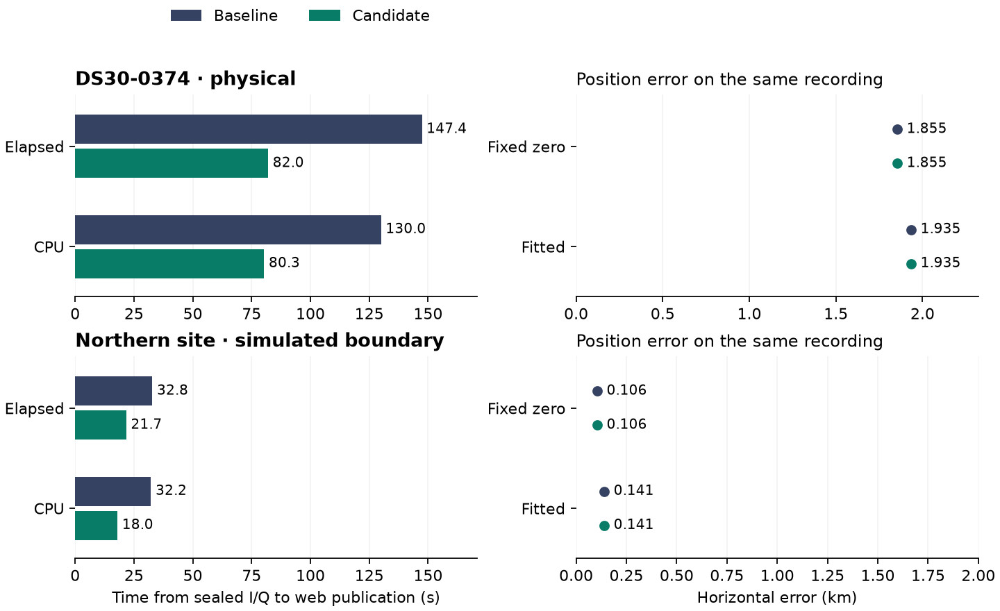

# Full-observation ALGO08v2 on the first DS30 recording and a regional boundary

The same frozen build produced the deployed positions, satellite owners, grids, paths and eight PNG files on both recordings. The longer physical case took **82.01 seconds** from raw I/Q to publication, down from **147.37 seconds**. Its **1.62× CPU speedup** gives a more conservative view of the compute saving because only the baseline incurred filesystem reads. The northern simulation took **21.71 versus 32.81 seconds**. Both remain above the 2× elapsed target.

| Same build, two development recordings | Deployed → candidate elapsed | Deployed → candidate single-core CPU | Position error in both builds, fixed zero / fitted | Published fixes |
|---|---:|---:|---:|---|
| DS30-0374, first in the fixed DS30 order | 147.37 → 82.01 s | 130.00 → 80.31 s | 1.855 / 1.935 km | Both |
| Northern simulation, receiver 100 m inside the square | 32.81 → 21.71 s | 32.23 → 17.97 s | 0.106 / 0.141 km | Both |

The median candidate/deployed elapsed ratio across these two recordings was **0.609**. Summed elapsed time gave a ratio of **0.576**. The predeclared target is at most **0.500** on each statistic. These recordings are public development checks. The physical station reference comes from the eligible recording-specific entry in the DS30 reference audit. The simulated truth is scored separately. [Physical receipt](measurements/DS30-0374-full-search.json) · [Northern receipt](measurements/north-edge-full-search.json) · [Scoring protocol](PROTOCOL.md)

## What still costs time

| Recording and clock boundary | Deployed elapsed | Candidate elapsed |
|---|---:|---:|
| DS30-0374, process launch to sealed detections | 103.14 s | 52.37 s |
| DS30-0374, detections to terminal position decision and grid | 38.50 s | 26.25 s |
| DS30-0374, terminal decision through complete publication and process exit | 5.73 s | 3.39 s |
| Northern simulation, launch to detections | 19.21 s | 12.86 s |
| Northern simulation, detections to terminal decision and grid | 9.40 s | 6.36 s |
| Northern simulation, terminal decision through exit | 4.20 s | 2.48 s |

On DS30-0374, the baseline ran first and reported 16,313,544 filesystem input blocks. The candidate reported zero. An earlier baseline run on this recording measured 130.64 seconds elapsed and 129.42 seconds of CPU. It used a different research comparator and is excluded from the table. The new northern pair ran the candidate first and both arms reported zero input blocks. File timestamps partition the elapsed clock. The operating system records process CPU separately. [Physical file and figure audit](measurements/DS30-0374-full-search-audit.json) · [Northern audit](measurements/north-edge-full-search-audit.json) · [Earlier physical pair](measurements/DS30-0374.json)

Of 6,770 scheduled physical windows, 4,644 passed the existing admission checks. The candidate made 8,933 native lane measurements for 9,288 published lane rows. It skipped 355 measurements that could never affect the released continuation result. Its measurement callbacks consumed **33.86 CPU seconds**. On the simulation the same scheduler skipped 870 of 2,400 calls, and the callbacks consumed **5.20 CPU seconds**. This difference matters when estimating a speedup from a sparse simulated signal. The physical run retained all 4,157 selected measurements and the simulation retained all 456.

On the physical recording the candidate would need to save **another 15.31 CPU seconds** to halve the deployed compute cost. This is 45% of the remaining receiver callback time if all savings came from those callbacks. The corresponding elapsed shortfall was 8.32 seconds in this baseline-first pair. The northern shortfalls were 1.86 CPU seconds and 5.30 elapsed seconds. An optimization to plot rendering alone cannot cover the physical gap.

## Link-time receiver specialization

We also tested whether the compiler could remove enough work across C files to improve the existing receiver without changing its algorithm. GCC 15.2 built the same digest-checked packed source twice, enabling single-threaded link-time optimization and local binding for the experimental binary. The candidate took **1.4–2.0% more native CPU** on 160 saved physical lanes, **0.4–1.9% more** on 36 weak-carrier lanes, and **1.5–2.0% more** on 160 northern and southern simulated lanes. All exported factor bytes matched. These slices had no retained continuation selections in either arm. All nine CPU comparisons favored the existing build, which remains in the integration. [Per-repeat receipts and hashes](measurements/receiver-link-options.json)

To reproduce, use the packed receiver recipe at `1a8cfb54a`. Insert a `cc` executable first on the build PATH whose body is `exec /usr/bin/cc -flto=1 -fno-semantic-interposition -ffp-contract=off "$@"`; this applies to every compile and the shared-library link. Run the existing `receiver_build --pack-stencil` and three `receiver_benchmark` commands with the new binary and `950c2b94` as control. The new binary SHA-256 was `f6b292be990ed70a7a0755c92abbb3e0e88f26598f6ece340cbb930db5d0d977`. [Compiler and sample replay commands](receiver-stencil.md)

## Reproduction and geographic scope

Both pairs used the frozen research commit `4b3520e36`, release `bdb869682`, receiver `950c2b94` and identical source pins. Freeze with `--solver shared-tables --schedule deferred --ingress compressed-buffer --startup lazy-exports --rendering raster-layout`. The search uses every observation for the initial satellite ranking. Timing includes cold process startup, both calibration fits, path and grid, and the required web artifacts in a fresh output root. Each benchmark ran on CPU 2 with one numerical thread and the shared low-priority Gauss lock. Rebuild this figure with `python -m reports.ALGO08.single-core-2x.plot_shared_publication --trial full-search`. [Pair command](shared-publication.md) · [Reasons for retaining the full search](location-triage.md)

Both recordings used containing regional offers. This trial supplies one physical station and one previously published simulated position. The deployed solver's false fixes under omitted offers remain an open qualification failure. A separate all-track diagnostic correctly flagged distant omissions but missed a receiver 100 m outside and would have suppressed a valid fix at another site. The larger DS30 panel and fresh site holdout remain reserved. [Mirrored regional controls](mirrored-regions.md) · [Fixed-assignment comparison](exterior-profile.md)
