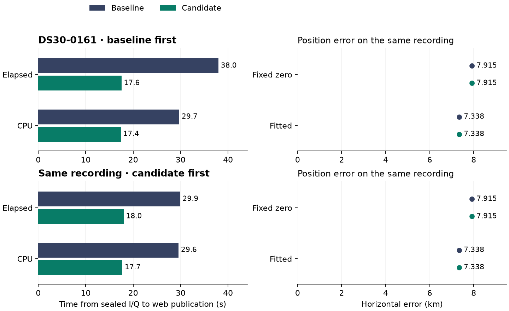

# A faster shortlist changed satellite assignments and worsened position error

The time-polynomial approximation to the initial satellite search fails the position-quality gate on DS30-0008. It reduced the CPU time from saved detections to the final diagnostic grid by 14%, but the fitted position error increased from **1.512 to 2.916 km**. Keep the full-observation search in the qualification candidate. The approximate search remains available to reproduce this experiment. Four earlier saved-input trials had reproduced the final positions. [Earlier measurements](solver-track-moments.md)

## Same observations, different satellite assignments

DS30-0008 is the second recording in the previously fixed DS30 order. Both solvers used the same 7,016 observations, offered square, capture-time orbit archive, search budget and final likelihood. Both used causal parser reuse and the same coarse salvage statistics. A scoring-only join used the eligible operator station reference for this recording. Both runs returned a position. [Full paired evidence, including associations and grids](measurements/DS30-0008-moments-control.json.gz) · [Recording reference authority](../../2026_11_21_ds30_full/reference-audit.json)

| Measurement | Full-observation search | Approximate search |
|---|---:|---:|
| Broad search and initial ranking, CPU s | 8.68 | 3.10 |
| Complete solver and grid, CPU s | 72.42 | 62.12 |
| Complete solver and grid, elapsed s | 75.85 | 62.86 |
| Assigned observations / satellites | 4,472 / 26 | 4,365 / 25 |
| Horizontal error, fixed-zero calibration | 1.639 km | 3.171 km |
| Horizontal error, fitted calibration | 1.512 km | 2.916 km |
| Published residual RMS, fixed-zero / fitted | 155.18 / 148.44 Hz | 155.04 / 147.42 Hz |

Both searches produced seven distinct assignment patterns. No complete pattern was common to the two lists. The later exact fit could only choose from hypotheses proposed by the initial search. In each calibration arm, the final result lost 148 observations, added 41 and reassigned 227 shared observations to different satellites. The slightly lower frequency residuals accompanied worse localization in both arms. The older stock solver agreed with the full-observation control on both final positions and owner hashes. [Stock and combined solver receipts](measurements/solver-costs.json.gz)

## One upper-edge recording from sealed samples to eight PNGs

We chose the first upper-pilot-edge DS30 recording by dataset ID with 500–1,500 scheduled windows. Selection used metadata before viewing the fix or runtime. DS30-0161 has 1,423 windows, of which 811 passed the existing capture checks. This is a different recording at the same physical station. Here the approximate integrated candidate reproduced all 1,622 ordered detector rows, the two owner maps, coordinates, frequency residuals, numerical path and grid, and all eight PNG files. Its errors against the eligible station reference were **7.915 km fixed-zero and 7.338 km fitted**, identical to deployed ALGO08v2. [File and decoded-image audit](measurements/DS30-0161-lean-audit.json)

| Run order | Elapsed s, deployed → candidate | Elapsed speedup | Single-core CPU s, deployed → candidate | Filesystem input blocks, deployed / candidate |
|---|---:|---:|---:|---:|
| Deployed first | 37.99 → 17.55 | 2.16× | 29.73 → 17.41 | 3,616,144 / 0 |
| Candidate first, repeat | 29.91 → 18.00 | 1.66× | 29.59 → 17.75 | 0 / 0 |

Only the first deployed run incurred filesystem input. The reverse-order pair with both inputs cached measured **1.66× elapsed and 1.67× CPU**. These are two orders on one recording. The approximate integrated build includes lighter package startup, deferred receiver work, shared plot pixels and track moments. The integration cannot attribute its overall saving to startup alone. One frozen setting applied to every lane and hypothesis. [First pair](measurements/DS30-0161-lean.json) · [Reverse pair](measurements/DS30-0161-lean-reverse.json) · [Isolated startup experiment](receiver-startup.md)

## What qualifies at a new location

The receiver uses the samples, waveform and capture metadata. The regional solver receives the offered region and capture-time orbit data. Coordinates used to score a trial stay with the evaluator. Satellite candidates, frequency masks, thresholds and stopping rules must work without the roof identity or its observed sky.

DS26, DS29 and DS30 provide one physical station. The northern and southern public simulations are development controls. In earlier tests both returned positions on incorrect offers. In the northern simulation a valid receiver just 100 m inside the square also produced a boundary fix, so rejecting every boundary solution would discard a good position. [Missing-region and valid-boundary evidence](edge-trial.md)

We also held the satellite assignments fixed and refit the nuisance terms at positions outside the square. Both calibration arms preferred an exterior point on the valid northern boundary case. The score advantage outside was greater on this valid fix (0.457 / 0.264 objective units) than on the southern false fix (0.196 / 0.196). A common minimum gain on this diagnostic cannot separate those two cases. The measurements used offsets declared before reading the scores. [Exterior measurements and matched likelihood](exterior-profile.md)

The blind scorer now publishes `passed_geographic_holdout`. It requires the speed and per-site accuracy gates, returned positions for the containing offers and withheld decisions for every omitted offer. It also requires distinct locations and the four-offer protocol on every waveform. Fresh locations are reserved until the candidate and its settings are frozen. Qualifying on simulations still leaves physical transfer unverified until a compatible independent-station recording is available. [Qualification protocol](PROTOCOL.md) · [Independent-station inventory](../regional-release/README.md)

One speedup independent of satellite selection reduced rendering time by 0.44 CPU seconds on DS30-0016 and 0.41 seconds on the northern near-edge simulation. All 16 encoded PNGs matched the originals. The receiver's conditional second scan saved 9–13% in native prefix calls, with one lost physical selection. These stage measurements have different timing boundaries and do not establish an end-to-end gain. [Renderer measurements](raster-layout.md) · [Conditional receiver measurements](receiver-residual-schedule.md)

## Reproduction

The upper-edge pair used research commit `12e756289`, release `bdb869682` and the receiver hash in both receipts. Use the paired publication command with `--solver track-moments --rendering shared-pixels --schedule deferred --ingress compressed-buffer --startup lazy-exports` at freeze time. Rebuild the chart with `python -m reports.ALGO08.single-core-2x.plot_shared_publication --trial upper-edge`. Run the saved-solver comparison with `solver_track_moments_trial.py` in `moments` and `control` modes on native detections with SHA-256 `34d0381ec59c6dc1d264292ee402adbe020ef8c6521d866dde2a83221db395c7`. Use the DS30 regional offer in the receipt and the same causal archive. Both experiments used one pinned core, one numerical thread and the shared low-priority benchmark lock on Gauss. [Pair command](shared-publication.md) · [Saved-solver runner](solver_track_moments_trial.py)
