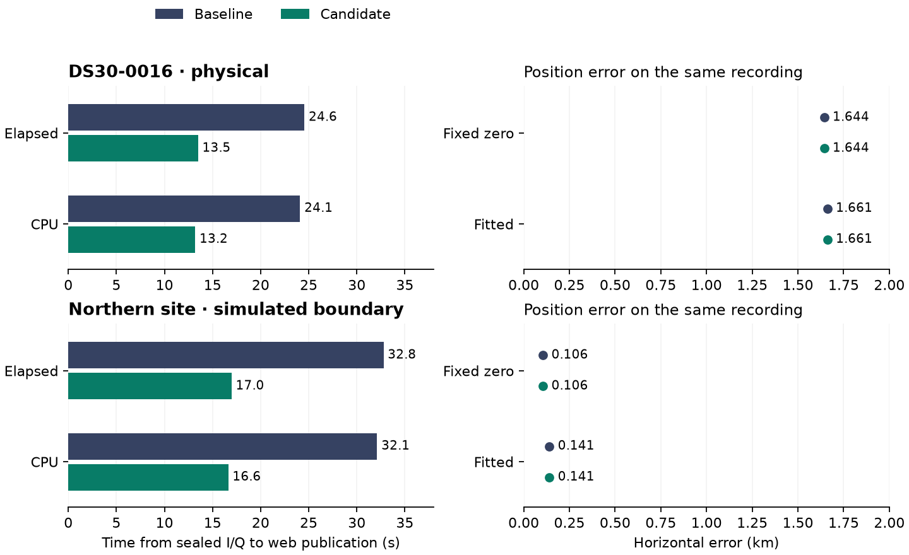

# Single-core ALGO08v2 with packed receiver refinement and lossless PNG encoding

On the short physical recording the candidate took **13.49 seconds** from sealed I/Q to all eight web figures, against **24.56 seconds** for deployed ALGO08v2. On the northern simulated recording the same frozen candidate took **16.98 versus 32.78 seconds**. It reproduced both calibration positions, ownership, RF RMS, optimizer path, numerical grid and rendered pixels on each recording.

| Recording and order | Deployed → candidate elapsed | Deployed → candidate CPU | Speedup, elapsed | Horizontal error, fixed zero / fitted |
|---|---:|---:|---:|---:|
| DS30-0016, physical, baseline first | 24.56 → 13.49 s | 24.11 → 13.20 s | 1.82× | 1.644 / 1.661 km |
| Northern simulation, 100 m inside its square, candidate first | 32.78 → 16.98 s | 32.12 → 16.64 s | 1.93× | 0.106 / 0.141 km |

Both arms ran on the same single core at low priority with zero filesystem input blocks. The median paired elapsed ratio was **0.534**, and dividing summed elapsed times gave **0.531** (1.88×). Both exceed the target of 0.500. The candidate would need another 1.21 seconds on this physical case and 0.59 seconds on the simulation to halve each elapsed time. There was one timed pair per recording. [Physical receipt](measurements/DS30-0016-lossless.json) · [Northern receipt](measurements/north-edge-lossless.json)

| Elapsed stage | Physical, deployed → candidate | Northern simulation, deployed → candidate |
|---|---:|---:|
| Process launch through sealed detections | 12.96 → 7.54 s | 19.06 → 8.79 s |
| Detections through terminal decision and grid | 7.73 → 4.27 s | 9.48 → 6.29 s |
| Terminal decision through complete publication and exit | 3.87 → 1.68 s | 4.24 → 1.90 s |

The candidate packed neighboring hypotheses in the receiver's integer refinement, reused a stable pair of solver fits if track recovery left their inputs unchanged, and used libdeflate for the eight rendered figures. The physical solve reused one pair. The northern solve took its normal path. The physical recording retained all 1,426 ordered detector rows and 440 selected measurements. The northern one retained all 2,400 rows and 456 selected measurements. Both compared exactly against the deployed pipeline on their own inputs. [Receiver](receiver-coarse-bank.md) · [Recovery fit](solver-recovery-reuse.md) · [Image encoder](lossless-png.md)

All 16 new PNGs have different encoded hashes from their corresponding deployed files. Each matched its own manifest and decoded to the same mode, dimensions and every pixel. The complete ordered non-image-data chunks matched, including DPI and text. The strict default audit still requires identical encoded bytes. The two receipts here used its explicit `--lossless-png` option. [Physical file audit](measurements/DS30-0016-lossless-audit.json) · [Northern file audit](measurements/north-edge-lossless-audit.json)

## Geographic evidence

The two-dimensional solver assumes zero height above the WGS84 ellipsoid. On three separate modeled sites, a 1 km height change shifted predicted Doppler by roughly 115–119 Hz. A single linear height term represented that shift to about 0.04 Hz when supplied the true height change. Its ability to recover unknown height or improve horizontal positions has not been established. [Geographic height sensitivity](height-sensitivity.md)

The receiver works from I/Q and the waveform definition. The solver and plots receive the operator's search and screening centers. Both tested offers contained the receiver. The northern recording was an already published simulation. Independent physical off-site performance and the fresh whole-site holdout remain unverified. On the preceding build the same southern waveform produced a fix with its true position both inside and outside the offered region. The separate experimental withholding rule also missed an outside fix in the north and suppressed a valid fix in the south. This candidate includes no new withholding rule. The statistical receiver screen that lost a physical factor in disjoint confirmation was also excluded. [Geographic audit](geographic-input-audit.md) · [Southern wrong-region replay](full-search-publication.md#same-recording-with-the-receiver-outside-the-search-square) · [Mirrored offers](mirrored-regions.md) · [Receiver counterexample](receiver-covariance-confirmation.md)

## Reproduction

Freeze from `90b22f3b5` on top of Gauss release `bdb869682`. Use receiver `474279618`, `--solver shared-tables --schedule deferred --startup lazy-exports --endpoint-reuse --recovery-reuse --ingress paired-sha256 --rendering lossless-raster` and supply the three library paths and SHA-256 values in the matched receipt via `--paired-sha256`, `--png-filter` and `--png-deflate`. Both pairs recorded the same candidate spec digest, `2921760bad42a5d9255c8c9e45bb8152bf3de07374ecfcbb0642b2fb971754bc`. Use the paired runner with an empty output root for each arm. Regenerate the figure with `python -m reports.ALGO08.single-core-2x.plot_shared_publication --trial lossless`. [Freezer](../../../tools/pipeline_eval/qualification/freeze_publication.py) · [Paired runner](../../../tools/pipeline_eval/qualification/paired_publication.py) · [Figure audit](audit_shared_publication.py)
