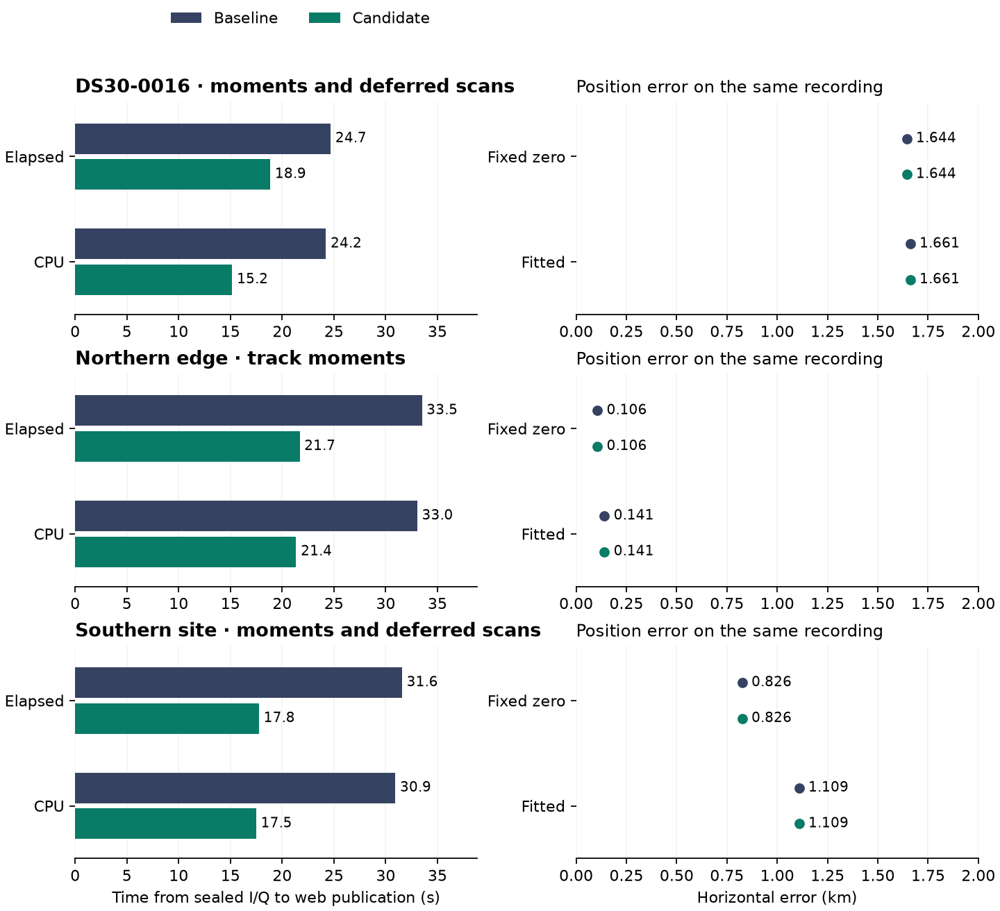

# Full publication with track moments and deferred receiver measurements

The **same frozen candidate** reduced elapsed time **1.31× on DS30-0016** and **1.78× on a southern simulation**. CPU speedups on one core were **1.60× and 1.77×**, respectively. Every ordered detector row, both calibration fixes, the path and grid, and all eight PNGs matched on both recordings. These are development results on one physical site and one simulated site.

| Same candidate | Baseline → candidate elapsed | Baseline → candidate CPU | Native lane calls avoided | Error, fixed zero / fitted |
|---|---:|---:|---:|---:|
| DS30-0016 · candidate first | 24.69 → 18.85 s | 24.23 → 15.18 s | 69 / 1,426 | 1.644 / 1.661 km |
| Southern simulation · baseline first | 31.58 → 17.76 s | 30.93 → 17.49 s | 1,073 / 2,400 | 0.826 / 1.109 km |

Both processes reported zero filesystem input blocks in each of these pairs. The physical candidate spent 3.67 s more in elapsed time than in CPU time; the cause of the gap was not isolated. Across these two pairs the median candidate/baseline elapsed ratio was **0.663** and the ratio of summed elapsed times was **0.651**, against a target of **0.500** for both. The 4- and 16-recording panels and fresh location confirmation remain reserved. [Physical pair](measurements/DS30-0016-deferred.json) · [Southern pair](measurements/south-deferred.json) · [Independent artifact audit and elapsed stages](measurements/deferred-publication-audit.json)

The updated receiver keeps recent measurements pending when the released continuation rule cannot yet use them. If a later carrier needs a pending measurement it runs the original two-scan detector on the retained I/Q. Both recordings used the same 64-lane memory budget. The physical recording contained 255 lanes with two verified carriers, while the southern simulation contained none. The exact scheduler made 1,357 native calls on the physical recording and 1,327 on the simulation. Retention peaked at 22 and 26 stereo windows, equivalent to 35.2 and 41.6 MB of sample payload between calls. These figures exclude other process memory. [Scheduling evidence](deferred-continuation.md) · [64-slot ledger replay](measurements/deferred-64.json)

## Earlier integration and the northern boundary

On the northern simulation the actual receiver was **100 m inside** the offered 25 km square. The updated search kept the valid boundary fix in both calibrations. Sealed-I/Q-to-publication elapsed time fell from **33.50 to 21.69 seconds**, a **1.54×** speedup. The fixed-zero and fitted errors were 106 m and 141 m. The earlier full-pipeline trial with a distant square used this same waveform and published a false fitted fix 52.49 km away. [Earlier missing-region trial](shared-publication.md) · [Construction of the near-edge offer](edge-trial.md)

| Recording and candidate | Baseline → candidate elapsed | Baseline → candidate CPU | Error, fixed zero / fitted, both builds |
|---|---:|---:|---:|
| DS30-0016 physical · shared tables | 24.38 → 15.89 s | 24.18 → 15.56 s | 1.644 / 1.661 km |
| Northern simulation · shared tables and track moments | 33.50 → 21.69 s | 33.04 → 21.35 s | 0.106 / 0.141 km |

The first candidate shares causal orbit records and repeated orbital projection times, postpones a noise calculation when an existing gate already rejects the candidate, and shares static pixels between the paired orbit views. On the short physical recording this build took 3.70 s longer than the 2× elapsed target. Its earlier counterpart took 16.02 s on the same recording. The small difference between single pairs does not resolve the incremental speed benefit. [Physical pair](measurements/DS30-0016-tables.json) · [Audit of rows and figures](measurements/tables-publication-audit.json)

The second candidate also uses time-polynomial summaries for the initial broad search. Every frequency observation contributes to the summary, while three times per local bin suffice for the approximate orbit curve. The shortlisted hypotheses return to the complete observations for exact fitting and selection. On the longer physical DS30-0374 saved input, the broad search and ranking fell from 4.40 to 1.36 CPU seconds. The complete saved-detection-to-grid stage fell from 28.79 to 25.91 s. Two of four tested inputs had different intermediate shortlists. All four returned the same final owners, positions and numerical grids. This approximation can change a winner on another recording. [Moment solver and four saved-data comparisons](solver-track-moments.md)

Each end-to-end pair ran on the same saved recording, one pinned CPU, one numerical thread, low scheduling priority and separate empty output roots. The updated physical and northern candidates both ran first. The physical candidate incurred 133,112 filesystem input blocks, its comparator zero. Both northern runs incurred zero. The physical run matched all 1,426 ordered detector rows, the northern run matched all 2,400, and both pairs matched owners, fitted and fixed-zero coordinates, scientific grid and path digests, and eight decoded PNGs byte for byte. [Northern replay](measurements/north-edge-moments.json) · [Northern audit](measurements/north-edge-moments-audit.json)

The first integrated northern attempt exposed a wrapper incompatibility. The reuse layer added an optional keyword the track-moment association method did not take. The launcher exited before producing a candidate fix. The wrapper now preserves the original call arguments and has a regression test. The table reports the subsequent fresh, successful pair. [Failed attempt](measurements/north-edge-moments-initial-failure.json) · [Association regression test](../../../tests/pipeline_eval/test_algo08_dense_discovery.py)

Two additional experiments used saved inputs. On DS30-0374 an approximate proposal for the optimizer's first move saved just 26 ms inside the fits that it changed. A separate receiver policy that always performed the first scan and conditionally requested the second retained the physical fitted position but lost one selected measurement. Its full-pipeline speed remains unmeasured. Neither result contributes to the elapsed times above. [First-move experiment](solver-temporal-trust.md) · [Conditional residual scan](receiver-residual-schedule.md)

## Reproduction

The two runs with receiver deferral used `f3a6c2dbb` and `--solver track-moments --schedule deferred --ingress compressed-buffer --rendering shared-pixels`. Both pair receipts carry identical pins for the 13 source files and the receiver binary. Run `python -m reports.ALGO08.single-core-2x.plot_shared_publication --trial moments` to rebuild the figure from the receipts and independent scoring references.

Use the receiver binary `950c2b9412020317654fd7c79d30063e9258b70152ed9c91b4129d379ac75a13` and comparator release `bdb869682`. The physical candidate was frozen from `a4c602770` with `--solver shared-tables --ingress compressed-buffer --rendering shared-pixels`. The northern candidate was frozen from `e203fa4f6` with `--solver track-moments --ingress compressed-buffer --rendering shared-pixels`. Use the recording and offered region from each pair receipt, and the matched archive. The northern offer is reproducible from the public development scoring key using the edge experiment. The runner checks the offered region against the actual published frame, verifies all source pins and includes publication in elapsed time. [Freeze and paired-run commands](shared-publication.md) · [Qualification protocol](PROTOCOL.md)
