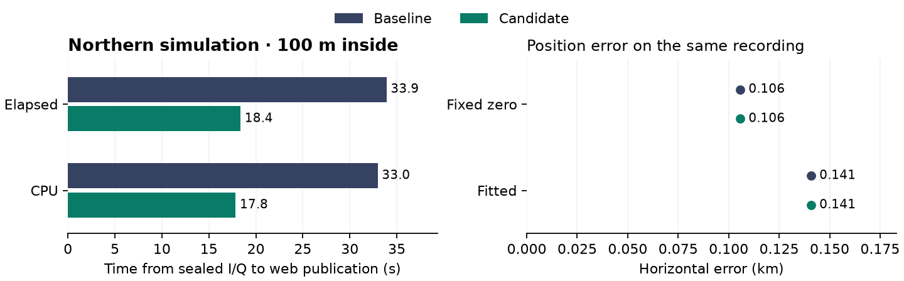

# Packed cancellation and native graph search through web publication

The full candidate took **18.36 s** to publish on the northern simulated recording, compared with **33.90 s** for deployment. Speedup was **1.85×** by both elapsed and CPU time. All eight decoded figures and both positions matched deployment. The valid receiver was 100 m inside the offered square. This one-pair result leaves a **1.41 s elapsed** gap to half-time. [Matched publication](measurements/packed-graph-north-inside.json) · [Independent scoring and decoded images](measurements/packed-graph-north-audit.json)



| Measured interval | Deployed | Packed cancellation and guarded graph |
|---|---:|---:|
| Launch through saved detections, elapsed | 19.27 s | 9.14 s |
| Saved detections through position decision, elapsed | 10.28 s | 7.34 s |
| Position decision through completed publication, elapsed | 4.35 s | 1.88 s |
| Complete process CPU | 32.97 s | 17.84 s |

Each build issued a fix in both arms, with 0.106 km fixed-zero and 0.141 km fitted error. The 456 selected measurements kept their frequencies, timing and ranks, as well as their final satellite assignments. The continuous detector scores differed by at most 1.99 × 10⁻¹⁴. The recorded optimizer path matched. The grid digest differed from deployment and agreed with the prior screened solver. Both arms recorded zero filesystem input blocks. The earlier screened solver without packed cancellation or native graph search measured 17.73 s in a candidate-first pair on this recording. Differences between those single timings do not isolate either optimization's contribution. [Earlier northern run](screened-stock-publication.md)

## Frozen development trial

Combine the exact packed cancellation build tested on the Gauss weak-carrier archive and Austin waveform with the guarded screened solver and native graph search. The solver, orbit preparation, region guard, and web rendering match the frozen graph experiment. The receiver binary is the only replaced component. Its training used generated waveforms. [Frozen combination](measurements/packed-graph-freeze.json) · [Receiver comparison](receiver-packed-cancellation.md) · [Solver comparison](screened-tiled-graph.md)

Measure one short public development waveform, the northern lower-edge recording with the receiver 100 m inside its 25 km offer. Previous screened recovery preserved this valid fix but missed half-time by 1.28 elapsed seconds. Run deployment first, reversing the order of its prior screened-stock comparison. Use the same sealed recording, offer and causal orbital inventory. Measure launch to complete publication on the shared low-priority core. Compare all selected factors field by field, both position errors, owner digests, grids, optimizer path and all eight decoded figures. Record CPU and filesystem input blocks. This probe on 1,200 scheduled visits tests the integrated receiver and solver at a public simulated location. The dense physical receiver discrepancy remains under investigation.

## Reproduction

Use a fresh output directory in each command. The freezer verifies the receiver against the two component trial receipts and checks every nonreceiver pin against the parent. The paired runner acquires the shared benchmark lock and pins the process to one low-priority core.

```sh
export PYTHONPATH=.:src OMP_NUM_THREADS=1 MKL_NUM_THREADS=1 OPENBLAS_NUM_THREADS=1
bench=/tmp/leo-algo08v2-2x-bench
public=/tmp/leo-regional-qZJKBw4W/public
py=/home/mouse9911/gits/leo-tracker-reduxredux/.venv/bin/python
frozen="$bench/integration-packed-graph"
id=0abe7b4514be674d9f5388e3
"$py" -BPs -m reports.ALGO08.single-core-2x.freeze_packed_graph \
  "$bench/integration-screened-tiled-graph" "$bench/c803-packed-cancel-trial-v2/candidate/use.so" \
  "$frozen" "$bench/packed-graph-freeze.json"
"$py" -BPs -m tools.pipeline_eval.qualification.paired_publication \
  "$public/$id" "$bench/near-edge/$id.json" "$public/tle" \
  "$frozen/reports/ALGO08/single-core-2x/run-candidate" "$bench/packed-graph-north-inside" \
  --candidate-config "$frozen/spec.json" --first baseline \
  --archive-inventory-sha256 sha256:7aa06cab0502bcac70645a41a219bb6d53f1077f329e6f7ed79eb59a8794feec
"$py" -BPs -m reports.ALGO08.single-core-2x.compare_publications \
  "$bench/packed-graph-north-inside/pair.json" \
  --public-scoring-key reports/ALGO08/regional-release/scoring-key.json
"$py" -BPs -m reports.ALGO08.single-core-2x.plot_shared_publication --trial packed-graph
```
