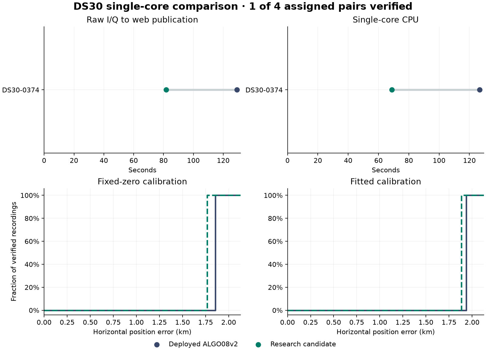

# Combined receiver and solver on one roof and one simulated site

The integer-filter receiver with conditional second scans and the compact solver with one paired repair ran **1.58× faster end to end** on the first recording in the frozen DS30 order. Both calibration arms improved there. On a valid offer at a different simulated position, both arms became less accurate. Moving that square just far enough to exclude the receiver still produced a fix. These results do not qualify this build for promotion. [Matched inventory](measurements/q15-repair-lead/inventory.json) · [Geographic qualification protocol](PROTOCOL.md)

## Physical recording

DS30-0374 uses the same 6,770 recording windows, assigned region and capture-time orbital archive in both arms. The candidate ran first on one low-priority pinned core with one numerical thread. Each invocation started with an empty publication directory and ran through the complete web output.

| Measurement on DS30-0374 | Deployed ALGO08v2 | Combined candidate |
|---|---:|---:|
| Elapsed seconds | 129.24 | 81.69 |
| CPU seconds | 126.70 | 68.87 |
| Horizontal error with `c = 0` | 1.855 km | 1.766 km |
| Horizontal error with fitted `c` | 1.935 km | 1.884 km |
| Frequency RMS with `c = 0` | 101.536 Hz | 101.168 Hz |
| Frequency RMS with fitted `c` | 101.520 Hz | 101.155 Hz |
| Returned positions and decoded web plots | Both arms, 8 PNGs | Both arms, 8 PNGs |

CPU speedup was **1.84×**. The candidate incurred 16,343,392 filesystem input blocks and the subsequent deployed run incurred zero. Their elapsed ratio includes that cache asymmetry. The builds shared 4,128 selected radio measurements. The candidate lost 29 and added six. Satellite ownership changed, and all eight PNGs changed pixels. Only one of the four assigned pairs ran for this build. [Pair and resource counters](measurements/q15-repair-lead/DS30-0374.json)

Halving the deployed time on this recording would require another **17.08 elapsed seconds**. Halving CPU would require another **5.52 CPU seconds**. The candidate spent 29.26 CPU seconds in its 9,288 native radio queries. The remaining 39.60 CPU seconds include ingress, solving and publication. Those figures give a cost budget for further changes that preserve the measurements used by the solver.



## Same waveform across a region boundary

Three previously public offers reuse one northern simulated recording, one causal orbit archive and a 25 km square. The two boundary offers differ by a 200 m translation of the same face. Inference received the offered square. The public scoring key supplies the true position for the distances below. A fix on either omitted offer counts as a false publication, even when its horizontal error is small. [Offer geometry](mirrored-regions.md) · [Development scoring key](../regional-release/scoring-key.json)

| True receiver relative to offered square | Combined decision | Error with `c = 0` | Error with fitted `c` | Published plots |
|---|---|---:|---:|---:|
| 100 m inside the face | Fix | 175 m | 212 m | 8 |
| 100 m outside the same face | False fix | 176 m | 212 m | 8 |
| 64.93 km from the center, outside the square | Withheld | — | — | 0 |

The previous guarded build returned errors of 106 m and 141 m on the valid boundary offer. The combined build preserves its return decision, but adds about 70 m of error in each arm. On the distant omission both builds withheld both arms. Near the face, the combined model made essentially the same position estimate on either side. Its published fix cannot establish region membership at this resolution. These three trials concern one simulated position. [Earlier guarded build](regional-bound-guard.md) · [Inside](measurements/q15-repair-lead/north-inside.json) · [Just outside](measurements/q15-repair-lead/north-edge-omitted.json) · [Far outside](measurements/q15-repair-lead/north-far.json)

Replaying the exact same 456 selected measurements through the previous solver reproduced the 106 m and 141 m errors, the satellite owners, grid and path. Switching only the solver mode produced the regression despite a slightly lower frequency RMS. In the fitted arm the 200 m boundary translation moved the estimated position by just **0.075 m**. The estimate stayed inside the two squares and bypassed the boundary guard in both. The replay isolates the solver mode. Identifying the responsible inner solver step would require a more detailed trace. [Controlled attribution and numerical evidence](north-edge-q15-repair-attribution.md)

## Qualification and reproduction

The frozen research specification digest is `sha256:a32a945a1e6d9e602f02fa636e83761d47e2992d7da4b0c4aa55eba6927cd9ca`. Build it with the `freeze` action in `saved_repair_pair.py` using the [pinned guarded Q15 build](receiver-integer-fir.md) as the input. The DS30 verifier checks both the specification and executable source identities. With `BUILD` pointing to the frozen bundle and `OUT` to a new local workspace, reproduce the first assigned pair with

```bash
python -m reports.ALGO08.single-core-2x.ds30_stage run "$OUT" \
    "$BUILD/reports/ALGO08/single-core-2x/run-candidate" "$BUILD/spec.json" \
    a32a945a1e6d9e602f02fa636e83761d47e2992d7da4b0c4aa55eba6927cd9ca \
    --size 4 --case DS30-0374
```

For the simulated examples use the same frozen launcher, recording, archive and search region recorded in each receipt. The validator checks that the terminal, numerical evidence and web publication use the assigned region. The near-edge coordinates are generated by the published evaluator. The far offer is the original public panel offer. [Near-edge generator](edge_trial.py) · [Publication verifier](compare_publications.py)

The saved-detection solver results and the Austin physical receiver excerpt test different parts of this pipeline. Neither adds a second physical site with a position result. The larger DS30 stage and fresh site-level confirmation remain unopened for this build. [Saved solver comparison](repair-dense-probe.md) · [Austin acquisition](austin-receiver.md) · [Geographic input audit and model limits](geographic-input-audit.md)
