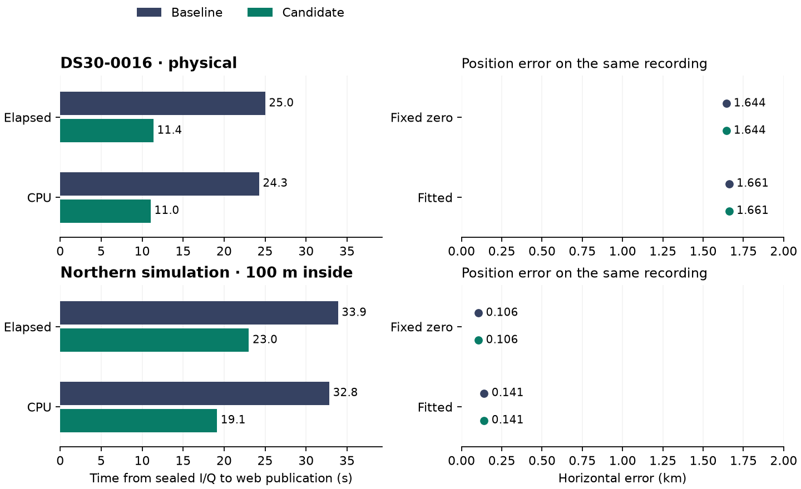

# A faster receiver trained on synthetic pilot signals

Giving GCC branch counts from generated radio samples reduced native receiver CPU by **5.7–7.9%** on the physical archive, weak-carrier examples and public simulation prefixes. The compiler changed the machine code while preserving every exported factor on those inputs. Used with conditional second scans, the original shared-tables solver and the regional guard, the complete research pipeline ran **2.20× faster on short physical DS30-0016** and **1.47× faster on the northern boundary simulation** than deployed ALGO08v2. Both calibration positions matched deployment on both recordings. [Native measurements and independent audits](measurements/receiver-compiler.json)

## Matched end-to-end results

| Development input | Elapsed seconds, deployed → candidate | CPU seconds, deployed → candidate | Horizontal error with `c = 0`, both builds | Horizontal error with fitted `c`, both builds |
|---|---:|---:|---:|---:|
| DS30-0016, Gauss roof, candidate first | 25.01 → 11.37 | 24.27 → 11.03 | 1.644 km | 1.661 km |
| Northern simulation, 100 m inside, deployed first | 33.89 → 23.02 | 32.83 → 19.13 | 0.106 km | 0.141 km |

The timer covers launch on sealed I/Q through web publication in an empty output directory. Both builds produced both fixes and eight valid PNGs on each input. Both reported zero filesystem input blocks. On the northern pair the 456 selected measurements and all eight decoded plots matched. On DS30-0016 the candidate lost one selected observation and added three relative to deployment. Six diagnostic images changed. Compared separately with the previous guarded Q15 research build on that recording, the compiler change preserved the full ordered probe digest, both positions, owners, grid, path and all eight decoded images. Native query CPU went from 3.789 to 3.486 s in those separate Q15 runs. [Physical pair](measurements/DS30-0016-compiler.json) · [Northern pair](measurements/north-edge-compiler.json) · [Earlier Q15 physical run](measurements/guard-q15-ds30-0016.json)



The summed elapsed ratio was **0.584** (1.71× speedup) and the median paired ratio was **0.567**. Both exceed the 0.500 qualification limit. North alone needs another 6.08 wall seconds to halve its deployed time. These are two development recordings. The independent confirmation panel remains sealed.

| Elapsed stage, deployed → candidate | DS30-0016 | Northern boundary |
|---|---:|---:|
| Launch to saved detections | 13.08 → 6.33 s | 19.71 → 12.36 s |
| Detections to terminal decision | 8.17 → 3.36 s | 9.71 → 8.70 s |
| Terminal decision to complete publication | 3.76 → 1.68 s | 4.47 → 1.97 s |

The boundaries use the sealed detection and terminal file timestamps within each timed invocation. The northern decision stage includes the exterior-region check because its valid estimate reached the optimizer bound.

## What the compiler saw

Training generated eight 20 ms dual-antenna windows, equally split between the two pilot edges. Each edge used carriers at ±225 and ±675 kHz, the same signal levels and an alternating weak-pilot or noise lane. This training requires waveform assets and deterministic synthetic I/Q. It receives no recorded data, receiver position, satellite ID or regional offer. GCC 15.2 collected control-flow counts with value profiling disabled. Feedback compilation required matching counter data for all ten translation units and kept the original floating-point contraction policy. Two independent builds in different directories produced identical binaries for both receiver interfaces. [Training and build code](receiver_compiler_trial.py)

| Independent native test | Lanes or edge/window cases | Median paired reduction in total native CPU |
|---|---:|---:|
| Prospective Gauss archive | 160 lanes | 6.54% |
| Weak-carrier archive | 36 lanes | 5.66% |
| Public northern and southern prefixes | 160 lanes | 7.87% |
| DS30-0016 chronological prefix, complete detector | 232 lanes | 6.68% |
| DS30-0016 dual-entry detector, full / primary-only | Same 232 lanes per entry | 6.56% / 7.05% |
| UT Austin physical capture / phase-randomized control | Four cases each | 2.43% / 7.48% |

The four archive and chronological comparisons preserved 388 factors, including 120 residuals, and all 53 chronological continuation selections. The Austin excerpt verified all eight returned factors against the earlier Q15 build and returned zero on the four randomized controls. The Austin windows come from one antenna and provide a receiver-only physical transfer check. Native timings exclude I/Q reading, solving and rendering. These machine-code gains were measured on Gauss. [Austin timing reference](austin-receiver.md)

## Missing-region check

The same frozen solver ran on the completed northern detector file with two omitted offers and the same causal orbital archive. It withheld both arms when the supplied center was 64.93 km away. Shifting the valid boundary offer by 200 m put the receiver 100 m outside. The solver still published positions in both arms, 123 m and 118 m from truth. That is a false publication under the location qualification rule. Neither omission replay is part of the end-to-end timing above.

## Reproduction

Use a new writable directory for each build. The builder first reproduces the corresponding ordinary Q15 binary and verifies its digest. It then collects fresh branch counters and refuses missing or incompatible profiles. The full detector SHA-256 is `64432addf6997f1ebd45daa8e73fd8337d0ab6abbeade254f611055542b71ea3`. The dual-entry digest is `2773de4a4887a82f05361aa059304803fa8781fcf2230375b750542226a28695`.

```bash
python reports/ALGO08/single-core-2x/receiver_compiler_trial.py build "$FULL_BUILD" "$ASSETS"
python reports/ALGO08/single-core-2x/receiver_compiler_trial.py build "$DUAL_BUILD" "$ASSETS" --dual
python -m reports.ALGO08.single-core-2x.plot_shared_publication --trial compiler
```

Use the [archive benchmark](../../../tools/pipeline_eval/variants/experimental/receiver_benchmark.py) for the 80 prospective, 18 weak and 40-per-site simulated visits, with five repetitions. For the chronological comparison use the [dual-entry runner](receiver_integer_fir_benchmark.py) on the first 128 scheduled DS30-0016 visits. Each input, library and schedule is bound in the receipts. The complete research build uses `shared-tables`, `conditional-residual`, the regional veto, and the pinned dual-entry library. Its frozen specification digest is `sha256:a0b4192c7481af69661a6e34492e65271bc5fa2573e469b8a6aae8a42d54276c`. The paired launcher receives the original region and snapshot inventory for each recording. All measurements ran one at a time on one low-priority core.
