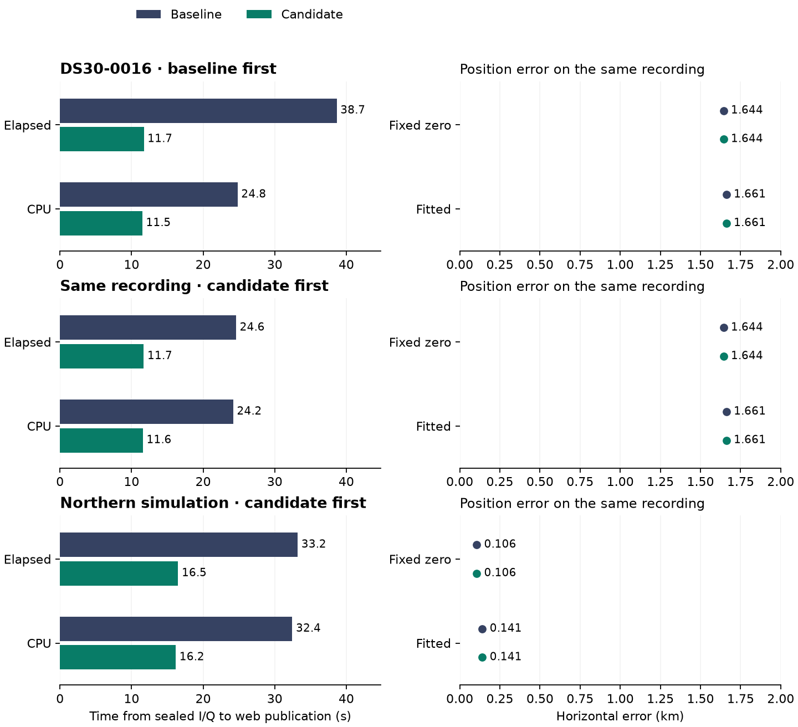

# Conditional residual scans on physical and simulated recordings

The unchanged conditional schedule saved **11.9–14.5%** of native factor-call CPU on the first 192 scheduled DS30-0374 visits and **18.0–20.1%** on the first 192 visits of the public northern simulation. It preserved all **78** and **76** ordered selections, respectively, with empty continuation histories at the start of each arm. The conditional receiver removed three verified residual factors on the physical prefix and eight on the simulated prefix. The measurements cover these prefixes and do not establish final position accuracy. [Receipts](measurements/residual-prefix-192.json)

## Complete physical and simulated publications

The experimental receiver takes a full residual scan every third admitted opportunity on each radio lane. After observing a verified residual, it takes every opportunity on that lane for eight device seconds. It consumes radio measurements and capture counters. The implementation has no search-region input. The publication trial uses the regional solver, endpoint and recovery reuse, scoped preparation collection, fractional-batch receiver, paired hash verification and lossless PNG encoder. The timing measures this combined candidate against deployed ALGO08v2. [Receiver integration](../../../tools/pipeline_eval/variants/experimental/residual_receiver.py) · [Earlier exact build](batch-publication.md)

| Recording and order | Deployed → candidate elapsed | Elapsed speedup | Deployed → candidate CPU | CPU speedup | Filesystem input blocks, deployed / candidate |
|---|---:|---:|---:|---:|---:|
| DS30-0016, baseline first | 38.65 → 11.71 s | 3.30× | 24.80 → 11.50 s | 2.16× | 568,520 / 256 |
| DS30-0016, candidate first | 24.59 → 11.70 s | 2.10× | 24.19 → 11.58 s | 2.09× | 0 / 0 |
| Northern simulation, candidate first | 33.20 → 16.50 s | 2.01× | 32.44 → 16.17 s | 2.01× | 0 / 0 |

The candidate landed within 0.02 seconds of its first elapsed time when the order reversed. The baseline's elapsed time fell by 14.06 seconds. The reverse pair gives the cleaner elapsed comparison on this short recording. Both runs used one low-priority pinned CPU on Gauss and the same frozen capture-time orbit archive. Each timed arm began with its own empty output directory and finished after writing all eight figures. [Baseline-first receipt](measurements/DS30-0016-conditional-residual.json) · [Candidate-first receipt](measurements/DS30-0016-conditional-reverse.json)

Of 1,426 opportunities, the candidate requested 872 full scans and 554 primary-only scans. It retained 439 of 440 selected measurements. The lost measurement at visit 68 on receiver 1 changed the three rendered channel 5–8 diagnostics. The other five figures, including the position map, matched in decoded pixels. Both builds published the same satellite owners, numerical grid, optimizer path, and positions. Horizontal errors were **1.644 km with fixed-zero calibration and 1.661 km fitted**. Frequency RMS was **109.38 and 109.48 Hz**, respectively. Both orders reproduced these results. [Baseline-first science and image comparison](measurements/DS30-0016-conditional-changes.json) · [Reversed comparison](measurements/DS30-0016-conditional-reverse-changes.json)

The complete northern simulated recording put the receiver 100 m inside the offered square. The same frozen build preserved all 456 selected measurements, both owners and grids, and all eight decoded figures. Position errors were **106 m fixed-zero and 141 m fitted** in both builds. The earlier exact receiver already reached 1.99–2.01× at this site. The combined timing here does not isolate an additional gain from the conditional scan rule. [Northern timing](measurements/north-edge-conditional.json) · [Northern scientific comparison](measurements/north-edge-conditional-changes.json)

On the same northern recording we gave the solver a different 25 km square whose center was **64.93 km from truth**, using the newly frozen receiver's saved detections and the same causal archive. The solver returned positions **52.46 km from truth fixed-zero and 52.49 km fitted**, matching both wrong baseline endpoints. This was a solver-only replay. It produced a grid and a path. The complete publication timings above apply only to the containing offers. [Wrong-region solver replay](measurements/north-far-conditional-solver.json.gz) · [Previously published baseline](measurements/north-far-shared.json)

The evidence covers one physical recording and one public simulated location, with the first long DS30 prefix below testing receiver work only. Longer recordings, fresh blind locations and independent physical recordings remain unverified for this build. [Geographic evidence and center-only comparison](geographic-input-audit.md)

To reproduce, freeze research commit `8ce0d287f` using `--schedule conditional-residual` and the options in the saved candidate specification. The canonical specification digest is `sha256:65b664d49a5e91baf1fb593c19808f4cf32921d0c17ffe6145d61189570089c6`. Run the paired publisher in each order with the recorded archive digest. Inspect the changes with `python -m reports.ALGO08.single-core-2x.compare_publications PATH/pair.json` and regenerate the figure with `python -m reports.ALGO08.single-core-2x.plot_shared_publication --trial conditional`. For the northern omitted offer use `solver_gc_trial.py --defer-preparation --composed-tle-parser LIBRARY SHA256 NATIVE ARCHIVE ASSETS REGION NATIVE_SHA256` with the frozen parser, candidate detections, northern archive and public far offer. The replay receipt contains the input digest and complete region.

## Matched receiver calls on the prefixes

Both arms use the exact fractional-batch kernel. The full-search control executes the original two-scan entry. The conditional arm invokes the original entry whenever the frozen per-lane schedule requests a residual. Its primary-only entry skips cancellation and residual detection while keeping the original primary verification. The rule requests residuals at admitted opportunities 1, 4, 7 and so on, and on every opportunity through eight device seconds after an observed verified residual. Each observed lane visit, including empty results, advances that arm's released continuation history independently. [Frozen schedule](receiver-residual-schedule.md) · [Fractional kernel](receiver-fractional-batch.md)

Both readers start at visit zero and stop after exactly 192 scheduled stereo windows. The physical capture rejects 61 windows under the released admission check. The northern simulation admits all 192. Input hashes cover every scheduled visit, including exclusions. The trial checks the conditional build's full and primary-only entries separately on every admitted lane before the timed calls. Full ordered factors and every retained primary field agree byte for byte with the control.

| Prefix | Scheduled / admitted stereo visits | Native factor calls, both arms | Residual requests, control → conditional | Actual residual scout calls, control → conditional | Actual residual scouts avoided |
| --- | ---: | ---: | ---: | ---: | ---: |
| DS30-0374, upper edge | 192 / 131 | 262 | 262 → 134 | 111 → 65 | 46 (41.4%) |
| Northern simulation, lower edge | 192 / 192 | 384 | 384 → 134 | 127 → 41 | 86 (67.7%) |

The physical schedule skips 128 requests (48.9%) and the simulation skips 250 (65.1%). A separate instrumented replay counts the scouts that actually run. The raw scout may reject a lane before it reaches cancellation and residual discovery. The physical conditional arm requests 92 sentinels and 42 activity extensions. The simulated arm requests 128 sentinels and six activity extensions.

| Prefix and first arm | Full-search native CPU (s) | Conditional native CPU (s) | Saved native CPU (s) | Saved native CPU |
| --- | ---: | ---: | ---: | ---: |
| DS30-0374, conditional first | 0.84684 | 0.74600 | 0.10083 | 11.9% |
| DS30-0374, full search first | 0.87095 | 0.74480 | 0.12615 | 14.5% |
| Northern simulation, conditional first | 1.08714 | 0.89093 | 0.19621 | 18.0% |
| Northern simulation, full search first | 1.06691 | 0.85219 | 0.21472 | 20.1% |

Each repeat interleaves the two native calls on the same admitted lane. Reversing arm order gives the second repeat. The CPU clock brackets the noninstrumented native factor call after setup. The archive reader, policy, continuation and downstream stages are outside this clock.

## Factor order and cold continuation

In DS30-0374, three factor lists at receiver 1 changed from `[0,1]` to `[0]` at visits 20, 28 and 178. The returned reference list with a residual ahead of the primary was preserved. Both arms first selected at visit 42 and kept 77 primary selections and one residual selection. In the north, the eight changed factor lists comprised five `[0,1]` and two `[1,0]` becoming `[0]`, and one residual-only list becoming empty at visit 111, receiver 0. Both arms first selected at visit 40 and kept 76 primary selections. Each ordered selected-probe digest is the same across arms and across both timed orders and the count replay.

The earlier DS30-0016 prefix lost one selected primary because its residual donor history changed. The new prefixes preserve selections despite the observed factor losses. A fixed 192-visit prefix exercises only its own cold history. Neither prefix was fitted or published. [Earlier receiver comparison](receiver-residual-schedule.md)

## Reproduce

The frozen `c5fca3e2` control builds with `--pack-stencil --batch-refine --fractional-batch`. The optional residual entry on the same kernel is SHA-256 `1b4c43dc1f2edc64ead9c4b9c0f4d724f79f623e04a13f40812a1d4bb40345a5`. The prior optional 950c build also rebuilt byte for byte. All nine targeted tests passed, including the scheduled prefix boundary, original factor order and residual-only behavior.

~~~bash
algo08_work=/tmp/leo-algo08v2-2x-bench
algo08_python=/home/mouse9911/gits/leo-tracker-reduxredux/.venv/bin/python
algo08_assets=/opt/leo-algo08/current/assets
algo08_native=tools.pipeline_eval.variants.experimental
algo08_trial=reports/ALGO08/single-core-2x/residual_prefix_trial.py
algo08_control="$algo08_work/receiver-fractional-batch.so"
algo08_conditional="$algo08_work/receiver-residual-fractional.so"
algo08_control_profile="$algo08_work/receiver-fractional-batch-profile.so"
algo08_conditional_profile="$algo08_work/receiver-residual-fractional-profile.so"

algo08_lock() {
  flock -x "$algo08_work/gauss.lock" ionice -c2 -n7 nice -n15 taskset -c 2 \
    env OMP_NUM_THREADS=1 OPENBLAS_NUM_THREADS=1 MKL_NUM_THREADS=1 PYTHONPATH=src:. timeout 80s "$@"
}
algo08_lock "$algo08_python" -m "$algo08_native.receiver_build" \
  "$algo08_control" --pack-stencil --batch-refine --fractional-batch
algo08_lock "$algo08_python" -m "$algo08_native.receiver_build" \
  "$algo08_control_profile" --pack-stencil --batch-refine --fractional-batch --profile
algo08_lock "$algo08_python" -m "$algo08_native.receiver_residual_build" \
  "$algo08_conditional" --fractional-batch
algo08_lock "$algo08_python" -m "$algo08_native.receiver_residual_build" \
  "$algo08_conditional_profile" --fractional-batch --profile
algo08_lock sudo -n -u leo -- env \
  OMP_NUM_THREADS=1 OPENBLAS_NUM_THREADS=1 MKL_NUM_THREADS=1 PYTHONPATH=src:. PYTHONDONTWRITEBYTECODE=1 \
  /opt/leo-algo08/current/venv/bin/python "$algo08_trial" \
  "$algo08_control" "$algo08_conditional" "$algo08_control_profile" "$algo08_conditional_profile" \
  "$algo08_assets" --physical-binding /srv/bulk/leo-dev/ds30-full-20261121/bindings/DS30-0374.json
algo08_lock "$algo08_python" "$algo08_trial" \
  "$algo08_control" "$algo08_conditional" "$algo08_control_profile" "$algo08_conditional_profile" \
  "$algo08_assets" --panel /tmp/leo-regional-qZJKBw4W/public/panel.json \
  --public-recording 0abe7b4514be674d9f5388e3
algo08_lock "$algo08_python" -m pytest -q tests/pipeline_eval/test_residual_prefix_trial.py \
  tests/pipeline_eval/test_residual_schedule.py tests/pipeline_eval/test_residual_native_build.py
~~~
