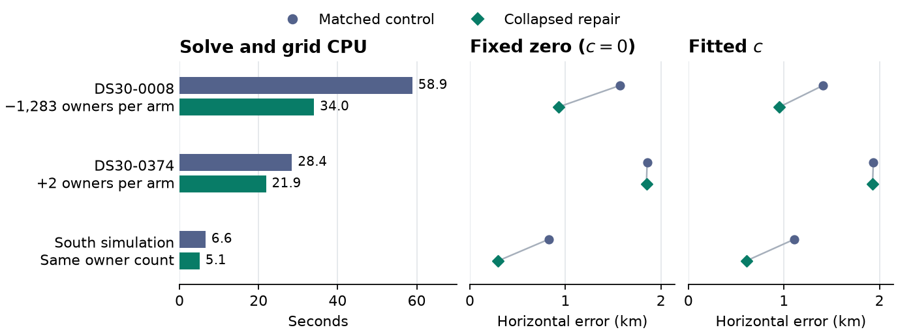

# Collapsed solver on the dense conditional input

On the saved DS30-0008 conditional detections, the collapsed solver with a bounded repair policy cut solve-and-grid CPU from **58.887 to 34.023 seconds**, a **1.73×** speedup. Both calibration arms returned a position and had lower horizontal error. **Each arm assigned 1,283 fewer observations, down 29.3% from the matched control.** The changed owner digests establish a change in the assigned evidence. The receipt records counts and digests, so the count difference is a net loss and the individual ownership changes are unresolved. [Closed dense receipt](measurements/dense-conditional-repair-0008.json)

| Calibration | Horizontal error, control → repair (km) | Solver RF RMS, control → repair (Hz) | Owners per arm, control → repair |
|---|---:|---:|---:|
| Fixed zero | 1.572 → 0.927 | 129.889 → 126.311 | 4,383 → 3,100 |
| Fitted `c` | 1.410 → 0.952 | 129.815 → 126.277 | 4,383 → 3,100 |

Both runs completed the 179-point numerical grid. The control reproduced both published coordinates, both owner digests, and the numerical grid and path of the original shared-tables publication on these detections. Solve-and-grid elapsed time was 63.832 seconds for the control and 35.473 seconds for the repair. Solver RF RMS is conditional on each run's selected curved observations. Position error was scored separately against the locked recording-specific reference. [Probe receipt and reference digest](measurements/dense-conditional-repair-0008.json) · [Reference audit](../../2026_11_21_ds30_full/reference-audit.json)



The plot uses the matched control from each receipt. DS30-0008 uses the frozen shared-tables solver on saved conditional receiver output. DS30-0374 and the southern simulation use the earlier stock solver with causal parser reuse and salvage statistics on their respective saved detections. The earlier comparisons retained every stock owner and the southern simulation took the existing path without a repair. All three comparisons are development results. The two physical recordings were made at the same roof. Confirmation at independent physical locations is still required to establish geographic transfer. The timing excludes acquisition and PNG rendering, so it provides no end-to-end speed measurement. [Earlier paired results](solver-bounded-salvage-repair.md) · [Earlier measurement receipt](measurements/collapsed-repair.json)

## Locked comparison

The post-fit policy was selected at `ba830dcc3` before inspecting DS30-0008. If a proposed pair fails, it removes the union of incompatible tracks across both calibration arms, refreshes their shared support and causal priors, and attempts one more pair with the original gates. The alternative endpoint screen had dropped 25 stock-owned observations on DS30-0374. The supplied search square and causal archive determine geometric support. Measurement evidence and the original track gates determine which assignments to retain. [Implementation and earlier comparison](solver-bounded-salvage-repair.md)

The challenger ran first on the same low-priority core as the control. The saved detections, offered square, capture-time archive, and grid budget matched. The driver verified both frozen source specifications and the causal archive, then locked the two results before scoring. The dense worker receipt contains the published owner counts and digests. The selected internal branch and whether it invoked the optional retry remain unverified. [Saved pair driver](saved_repair_pair.py)

## Reproduce the figure and score

The figure reads the two checked-in measurement JSONs. The score command reopens the predictions from the existing `locked.json` and checks the scoring reference digest. [Plot script](plot_repair_dense_probe.py) · [Prediction and offer pins](measurements/dense-conditional-repair-0008.json)

```sh
release=/opt/leo-algo08/bdb869682a2ea63af4b198a920b763a4c6a78c4c
export PYTHONPATH="$PWD:$release/src:$release"
trial=reports/ALGO08/single-core-2x/saved_repair_pair.py
reference=reports/2026_11_21_ds30_full/reference-audit.json

"$release/venv/bin/python" -B "$trial" score "$closed_result_dir/locked.json" "$reference"
"$release/venv/bin/python" -B reports/ALGO08/single-core-2x/plot_repair_dense_probe.py
```

The saved-detection replay takes the original DS30-0008 conditional pair receipt, the assigned input request, the original shared-tables freeze, and the matched collapsed-repair freeze. The replay verifies that the two configurations select different solvers with matching numerical and publication settings. Use a new result directory. [Freeze and replay interface](saved_repair_pair.py)

```sh
flock /tmp/leo-algo08v2-2x-bench/gauss.lock nice -n 15 ionice -c 2 -n 7 taskset -c 2 \
  env OMP_NUM_THREADS=1 OPENBLAS_NUM_THREADS=1 MKL_NUM_THREADS=1 \
  "$release/venv/bin/python" -B "$trial" run "$saved_pair" "$assigned_request" \
  "$shared_tables_build" "$repair_build" "$new_result_dir"
```
