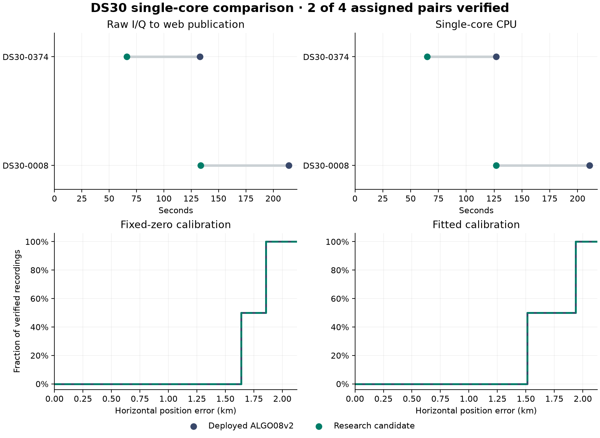

# Packed cancellation with original carrier refinement

**The dense-recording position regression is fixed. Across the first two physical recordings, complete publication is 1.74× faster.** The corrected receiver preserved the measured frequencies, fractional epochs and ranks of all 11,173 selected observations. Both builds returned both calibration fixes on each recording and produced all 16 figures. Fourteen decoded images matched exactly. The position maps differed at 46 and five of 1,612,800 pixels. Both pairs used a single low-priority Gauss core, with all compressed input pages resident before every run and zero filesystem input blocks. [Stage inventory and cache measurements](measurements/restored-scout-ds30-stage.json) · [Position scores and map pixels](measurements/restored-scout-position-audit.json)



| Recording | Elapsed, deployed → corrected | Elapsed speedup | CPU, deployed → corrected | Error with fixed-zero / fitted calibration, both builds |
|---|---:|---:|---:|---:|
| DS30-0374 | 132.90 → 66.00 s | 2.01× | 126.83 → 64.70 s | 1.855 / 1.935 km |
| DS30-0008 | 214.34 → 133.55 s | 1.60× | 210.65 → 126.75 s | 1.639 / 1.512 km |
| **Both** | **347.25 → 199.55 s** | **1.74×** | **337.48 → 191.44 s** | **4/4 calibration fixes per build** |

On these two recordings the median paired elapsed ratio was 0.560 and the summed ratio was 0.575 against a target of 0.500. The sum exceeded half-time by 25.93 s. CPU speedup was 1.76× across the two. The ordered four-recording stage remains incomplete. The current result combines two recordings from one physical roof.

The geographic errors above are rounded to metres. At full precision the fitted errors increased by 0.044 mm on DS30-0374 and 0.0075 mm on DS30-0008. The protocol compares per-site median and P90 errors without rounding. Both fitted statistics are therefore numerically higher on this partial sample. The final quality and timing verdicts are unscored until a complete stage is available.

| DS30-0008 elapsed stage | Deployed | Corrected | Corrected minus half deployed |
|---|---:|---:|---:|
| Launch through saved detections | 127.41 s | 62.33 s | −1.37 s |
| Saved detections through position decision | 80.57 s | 67.79 s | **+27.51 s** |
| Position decision through completed publication | 6.37 s | 3.42 s | +0.24 s |

The dense receiver kept the original measurements in the three windows that previously shifted the final fix by about 19 m. The full pipeline recovered both owner maps and agreed with the deployed coordinates within 0.032 mm. Its continuous receiver scores still had differences up to 2.34 × 10⁻¹³. Numerical grid and optimizer path digests differed. The stage clocks favor returning to dense saved-solver profiling before another physical recording. [Dense factor and artifact audit](measurements/restored-scout-0008-audit.json) · [Earlier saved crossover](screened-graph-transfer.md)

One instrumented replay on the corrected dense detections reproduced both published positions, owner maps, grid and path. Initial ranking and fitting took 17.40 profiled CPU seconds, conservative recovery 14.71 s, and family history 8.96 s. Preparation, signed fitting, reassignment and final evidence used the balance. The native likelihood took 14.10 s across these stages on DS30-0008 versus 3.90 s on DS30-0374, despite only about 11% more wrapper calls. The workload per fit matters. Speeding one small receiver operation cannot close the observed 27.51 s dense solver gap. [Dense saved profile and matched publication bindings](restored-scout-0008-solver-profile.md)

A separate build restored the original arithmetic only for refinement windows that wrap around the waveform period. It matched the full-object restoration on the three diagnostic visits and recovered 2.45% receiver CPU on the weak-carrier slice. The physical clocks above use the full-object restoration. The wrapped-only variant has no measured raw-to-publication time. [Wrapped refinement trial](receiver-cfo-wrap.md)

The first matched pair reached **2.014× elapsed** on DS30-0374, from 132.90 to 66.00 s. CPU fell from 126.83 to 64.70 s, **1.960×**. All 4,157 selected carrier frequencies, epochs and ranks matched. Both positions agreed within 0.052 mm and both arms retained every deployed observation owner. Both publications contained the eight required PNGs. Seven decoded images matched. The position plot, grid digest and path digest differed. Both arms began with all 106 compressed files cached and registered zero filesystem input blocks. [First-pair artifact audit](measurements/restored-scout-0374-audit.json)

## Second physical assignment

The first recording crossed the 2× elapsed target and recovered all measured frequencies. DS30-0008 is next in the original order and is the one recording where the earlier receiver degraded both position estimates by about 19 m. Its corrected scout was verified on the three affected visits. A metadata-only check found all 1,997,612 pages of its 106 compressed input files resident. Run this one full matched comparison, deployment first. Check whether all 7,016 frequencies and epochs and the two complete position fits survive the real receiver path. Record elapsed and CPU speed separately, all PNGs, owner maps and cache status. Review the first two assignments together before opening another recording.

## First physical assignment

The three changed fractional carrier measurements on DS30-0008 appeared when the compiler used profile feedback on the delay-product kernel. Rebuilding that single object without feedback restored the three original epoch and frequency measurements. The change applies to every scan. It has no location input, threshold or satellite selection. The rest of the receiver retains packed cancellation and its existing compiler settings. Replacing the three measurements in a saved solver replay restored all deployed assignments and both coordinates within 0.027 mm. [Dense crossover](screened-graph-transfer.md) · [Frozen integration](measurements/restored-scout-graph-freeze.json)

Run one raw pair on DS30-0374, the first recording in the original four-case order, after checking the corrected receiver on the previously archived weak-carrier and Austin controls. A new lost or gained factor on those controls sends the change back to saved-sample triage. Use the ordinary one-core benchmark with the candidate first, fresh output roots, the exact capture-time orbit archive and cache snapshots before both arms. The scientific check compares all selected measurements, both positions and owner maps, grids, paths and decoded PNGs. Record wall time, CPU time, filesystem input blocks and the three publication stages. A metadata-only preflight observed all 2,054,132 compressed pages already resident across 106 physical input files.

The previous guarded receiver and solver needed 3.80 elapsed seconds and 2.11 CPU seconds beyond half-time on this recording. The separate graph and cancellation trials made that gap small enough to measure end to end. They do not establish an additive improvement. Review this single pair before scheduling any further roof recording. The known Indian omission and northern near-face uncertainty remain open.

The restored receiver passed the two saved-sample checks. Returned ranks, timing and frequencies matched deployment on all 74 factors from the DS26 weak-carrier and Austin controls. All 52 continuation results matched. On 36 weak-carrier lanes the restored receiver used 2.49% more CPU than the packed version and ran 2.70× faster than deployment. Austin's two measured windows came from the same antenna and assess receiver transfer. They do not supply a physical position accuracy result. [Wrapped-refinement attribution](receiver-cfo-lineage.md) · [Receiver cost and Austin controls](receiver-cfo-native.md)

## Reproduction

The following commands use the reviewed Gauss bundle paths, service account and release. The specification includes absolute library paths. Recreating it byte for byte requires the listed destination. The freezer requires an empty destination and an unused receipt filename. The one-case runner can use a fresh workspace with the existing verified bundle.

```sh
bench=/tmp/leo-algo08v2-2x-bench
build="$bench/integration-restored-scout-graph"
work=/tmp/ds30-v2-stage-restored-scout-ad417a
release=/opt/leo-algo08/bdb869682a2ea63af4b198a920b763a4c6a78c4c
export OPENBLAS_NUM_THREADS=1 MKL_NUM_THREADS=1 OMP_NUM_THREADS=1
PYTHONPATH=.:src "$release/venv/bin/python" -BPs -m reports.ALGO08.single-core-2x.freeze_packed_graph \
  "$bench/integration-packed-graph" "$bench/receiver-cfo-lineage-fix/restored.so" "$build" \
  "$bench/restored-scout-freeze.json" --restored-scout-build "$bench/receiver-cfo-lineage-fix/build.json"
stage() {
  action=$1
  shift
  sudo -n -u leo -- env PYTHONPATH="$PWD:$PWD/src:$release" OMP_NUM_THREADS=1 \
    OPENBLAS_NUM_THREADS=1 MKL_NUM_THREADS=1 "$release/venv/bin/python" -BPs \
    -m reports.ALGO08.single-core-2x.ds30_stage "$action" "$work" \
    "$build/reports/ALGO08/single-core-2x/run-candidate" "$build/spec.json" \
    ad417aaa51a49edf1a36aca571683bbc0479317c06b821030373656461a28acd "$@"
}
stage run --case DS30-0374 --cache-library "$bench/ds30-cache-residency.so"
stage run --case DS30-0008 --cache-library "$bench/ds30-cache-residency.so"
stage score
```
