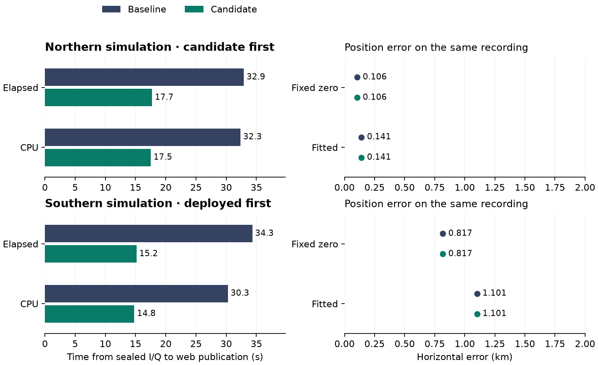

# Complete publication with the screened initial search and deployed recovery

The frozen candidate took **32.885 versus 67.229 seconds elapsed (2.04×)** across the two public simulated waveforms. It returned both positions with the same satellite assignments and RF residuals as deployment, and all **16 decoded PNGs matched**. Summed single-core CPU fell from **62.612 to 32.300 seconds (1.94×)**. Two small development recordings support a matched timing comparison. They leave independent-site and physical-stage qualification open. [Northern publication audit](measurements/screened-stock-north-inside-audit.json) · [Southern publication audit](measurements/screened-stock-south-inside-audit.json)



| Raw waveform | Elapsed seconds, deployed → candidate | CPU seconds, deployed → candidate | Horizontal error for both builds, fixed-zero / fitted |
|---|---:|---:|---:|
| North, lower pilot edge | 32.912 → 17.733 | 32.346 → 17.512 | 0.106 / 0.141 km |
| South, upper pilot edge | 34.317 → 15.152 | 30.266 → 14.788 | 0.817 / 1.101 km |

The paired median and summed elapsed ratios were **0.4902 and 0.4891**. The combined margin below half deployed elapsed was **0.730 s**. The northern run missed half-time by **1.277 s**. The southern deployment used **4.051 s** more wall time than CPU, and the candidate used **0.364 s** more. All four runs recorded zero filesystem input blocks. Each of the 912 winning measurements kept its time, carrier offset and rank. On the northern waveform the numerical grid differed by up to 3.73 × 10⁻¹¹, with an identical optimizer path. The southern grid and path matched exactly. [Northern raw pair](measurements/screened-stock-north-inside.json) · [Southern raw pair](measurements/screened-stock-south-inside.json)

The two additional saved-input sites exercise a different boundary. The same solver policy recovered deployment's valid position at the southern African portable site, where the previous fast candidate regressed. It matched the Indian valid fix and withheld the distant southern African omission. It still falsely published at the Indian offer with truth 1.5 km outside. The wider-search diagnostic correctly withheld that case but lost a valid northern near-edge fix. Neither result warrants geographic qualification. [Matched solver comparisons](screened-stock-recovery.md) · [Widened offers](widened-offer-membership.md)

## Physical CPU budget from saved detections

On the first assigned roof recording, DS30-0374, this solver took **24.860 CPU seconds** on the already generated candidate detections. It returned both fixes with the same 2,905 observation assignments per arm as deployment. The fixed-zero and fitted coordinates differed from deployment by **0.071 and 0.124 millimetres** respectively. Against the surveyed point, fitted error increased by 0.115 mm. This is one saved solve. The four-pair position gate remains unscored.

The parent build used 63.008 CPU seconds for complete publication, and its earlier saved solve with the same detections, search square and orbit archive used 18.799 s. Holding the remaining 44.209 s constant leaves **19.568 s** for this solver to halve the deployed 127.555 s CPU. The new solve gives an estimated **69.069 s**, **5.292 s above half**. This estimate assumes unchanged acquisition and publication costs. The difference between two independent process timings also carries run-to-run variability. We kept the physical raw benchmark closed. [Measured solve and budget calculation](measurements/screened-stock-0374-cpu-budget.json.gz) · [Verified input bindings and estimator](saved_solver_budget.py)

## Frozen test and order

Use the fixed covariance receiver and all of its publication options with the following solver schedule. Run two phase updates on every ranked branch, continue the selected branch through five, then use the deployed conservative trim, signed fit and complete-family reassignment. This schedule can still choose a different branch from deployment if the ranking changes after the second update. The full solver and the public waveform receipt record the early ranking. [Candidate specification](measurements/screened-stock-freeze.json) · [Initial screening code](../../../tools/pipeline_eval/variants/v5_screen_winner.py)

The next raw trial is one matched, single-core comparison on the already public northern near-inside waveform, with both builds starting in empty output directories. Use its original centered search and screening offer, sealed waveform and causal catalogue. Run the candidate first to complement the earlier covariance pair on that recording. Score elapsed time from process launch through full publication, CPU, disk input, both calibration arms and every decoded figure. Report the difference from half the paired release time. Stop roof escalation for this build if the public test or the saved off-site comparisons show an unresolved cost or accuracy regression. [Earlier raw comparison](covariance-publication.md) · [Qualification rules](PROTOCOL.md)

The northern pair took 32.912 s for deployment and 17.733 s for the candidate, 1.277 s over half-time. The positions, ownership and eight decoded figures agreed. Complete the same public comparison on the distinct southern upper-edge waveform, deployment first. Both recordings have earlier full-pipeline receipts, so this adds one matched pair and reverses build order across sites. Use the unchanged freeze and original near-inside offer. Report the result per location before combining clocks. The two simulations can resolve whether the timing shortfall carries across the two pilot edges. Further Gauss roof recordings remain deferred. [Northern pair](measurements/screened-stock-north-inside.json) · [Bound artifact audit](measurements/screened-stock-north-inside-audit.json)

## Reproduce the analysis

Run from the repository root in the project Python environment. The audit reopens the measured native detections, terminal and published evidence before scoring against the public reference. The plot reads the checked-in pair receipts.

```sh
export PYTHONPATH=.:src
python -m reports.ALGO08.single-core-2x.compare_publications \
  /tmp/leo-algo08v2-2x-bench/screened-stock-north-inside/pair.json \
  --public-scoring-key reports/ALGO08/regional-release/scoring-key.json
python -m reports.ALGO08.single-core-2x.plot_shared_publication --trial screened-stock
```
