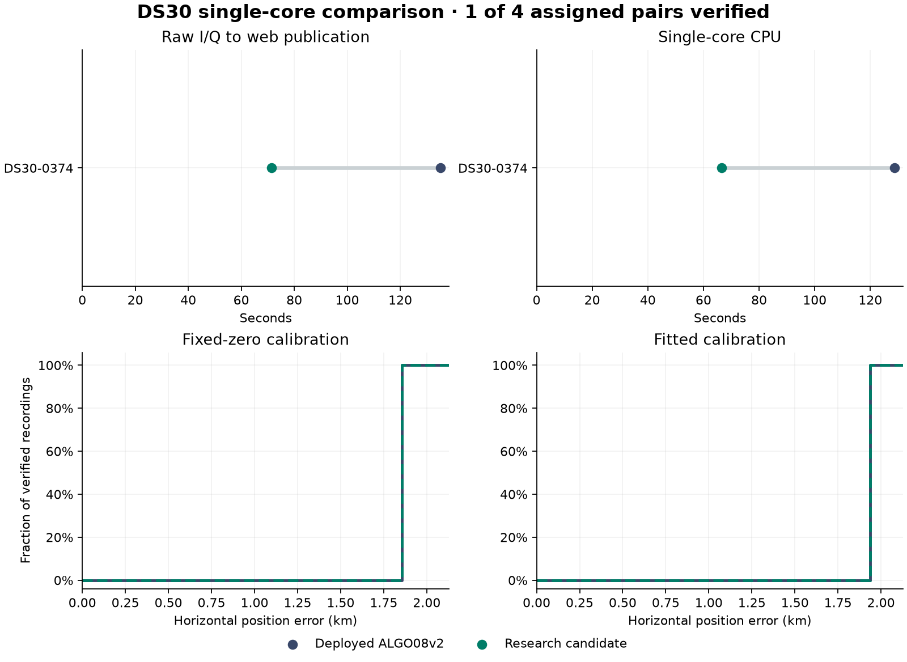

# Guarded trim search with the screened solver

On DS30-0374 the integrated candidate took **71.40 versus 135.20 seconds elapsed (1.89×)** and **66.46 versus 128.71 seconds of CPU (1.94×)**. The elapsed shortfall to half-time was **3.80 s**, and the CPU shortfall was **2.11 s**. Both runs had all 2,054,132 compressed-file pages resident across all 106 input files immediately before launch. Each recorded zero filesystem input blocks. This is one paired timing from one physical roof. [Verified inventory and cache measurements](measurements/screened-tiled-ds30-stage.json)

| Measured wall interval | Deployed | Guarded solver and covariance receiver | Candidate minus half deployed |
|---|---:|---:|---:|
| Process launch through saved detections | 90.74 s | 46.13 s | +0.76 s |
| Saved detections through terminal position | 38.75 s | 22.68 s | +3.30 s |
| Terminal position through completed publication | 5.70 s | 2.59 s | −0.26 s |

Both arms returned fixes with 2,905 identical observation owners per arm. Fixed-zero and fitted position error were 1.855 and 1.935 km for each build to three decimals. Their coordinate displacements relative to deployment were **0.071 and 0.124 mm**. All 4,157 selected factors kept their winning rank. One fractional frequency changed by 0.000037 Hz. Both published all eight standard figures. Seven figures matched after decoding. The position plot differed at 96 of 1,612,800 pixels. The numerical path and grid digests also differed from deployment. The first pair misses half-time. The other three physical assignments and the sixteen-recording stage remain unopened for this build. [Selections, image difference and stage clocks](measurements/screened-tiled-0374-details.json)

## Candidate and physical triage

Keep the screened-stock receiver, five-update winning branch, paired fitting, signed policy, final reassignment and image settings. Change only how conservative recovery computes the coarse candidate list and rejects fine alternatives that cannot pass the existing gates. The saved southern African and Indian containing comparisons preserved the proposed trims, observation assignments, residuals and both positions. The southern African solve took 35.13 CPU seconds with these changes, versus 50.89 s in the earlier screened-stock solve. The incoming fit and archive were matched. The two clocks included different diagnostic instrumentation. [Screened-stock build](screened-stock-publication.md) · [Frozen integrated candidate](measurements/screened-tiled-freeze.json)

Before spending a complete raw pass, replay the frozen integration once on the saved DS30-0374 detections. Keep the same parent CPU budget estimate as the screened-stock experiment. Compare returned coordinates and frequencies to the screened-stock solve on these identical detections, as well as the observation owners, numerical evidence, and distance to the 19.568 s solver budget. This estimate determines whether a physical timing trial is informative. The roof replay supplies no additional geographic site.

The integrated solve preserved both screened-stock positions, frequency residuals and owner maps, and reduced saved solver CPU from 24.860 to 23.150 s. Substituting the latter clock gives an estimated 67.359 s overall, 3.582 s above half the earlier deployed CPU. This small gap and the larger saving at the southern African site justify measuring actual publication overhead once. Run only DS30-0374, the first recording in the frozen physical order, with the candidate first. Take the optional cache snapshot for each arm and record OS input blocks. Review the full elapsed, CPU, positions and figures before considering another recording. [Saved integrated result](measurements/screened-tiled-0374-cpu-budget.json.gz)

## Evidence by solver version

| Input and boundary | Screened search with deployed trim | Same search with guarded trim |
|---|---|---|
| Two public near-inside waveforms, raw I/Q through web | 67.23 → 32.89 s elapsed across both, with matching coordinates and figures | No raw comparison on these waveforms |
| Southern African portable simulation, saved detections, containing | 50.89 s CPU, 0.351 / 0.583 km error | 35.13 s CPU, same fixed-zero / fitted errors and all 4,149 observation owners |
| Same portable simulation, distant omission | Withheld both arms | No solve on this offer |
| Indian simulation, saved detections, containing | 5.75 s CPU, 1.017 / 0.751 km | 5.65 s CPU, same fixed-zero / fitted errors and all 517 owners |
| Same Indian simulation, receiver 1.5 km outside | False fix in both arms | False fix in both arms, 1.580 / 1.534 km from truth |

On the southern portable input, the guarded version checked the same hypotheses and returned the same five selected trims. It avoided 64,200 of 65,375 expensive noise checks using existing rejection criteria. The Indian containing case had no rejected fragments to recover. [Matched measurements, trim identity and solver diagnostics](screened-stock-salvage.md) · [Deployed trim and missing-region controls](screened-stock-recovery.md)

The integrated Indian omission used the original 25 km search square. Both receivers favored the same point 3.125 km beyond the face, which left the deployed-width exterior rule inactive. The frozen guarded result matched the screened-stock false fix, both RF residuals and the owner maps. This remains a geographic failure even though the two solvers agree. [Integrated omission receipt](measurements/screened-tiled-india-omitted.json.gz)

A follow-up native graph search on saved detections reduced solver CPU by 1.195 s on DS30-0374 and 0.087 s on the Indian containing case. Both returned the same coordinates, assignments and numerical grid and path as the guarded solver. Even if the entire observed DS30 solver saving carried over to full publication, the physical pair would still miss half-time by about 0.91 CPU seconds and 2.52 elapsed seconds. Each saving comes from a single replay against its archived comparator. [Native graph trial and receipts](screened-tiled-graph.md)
