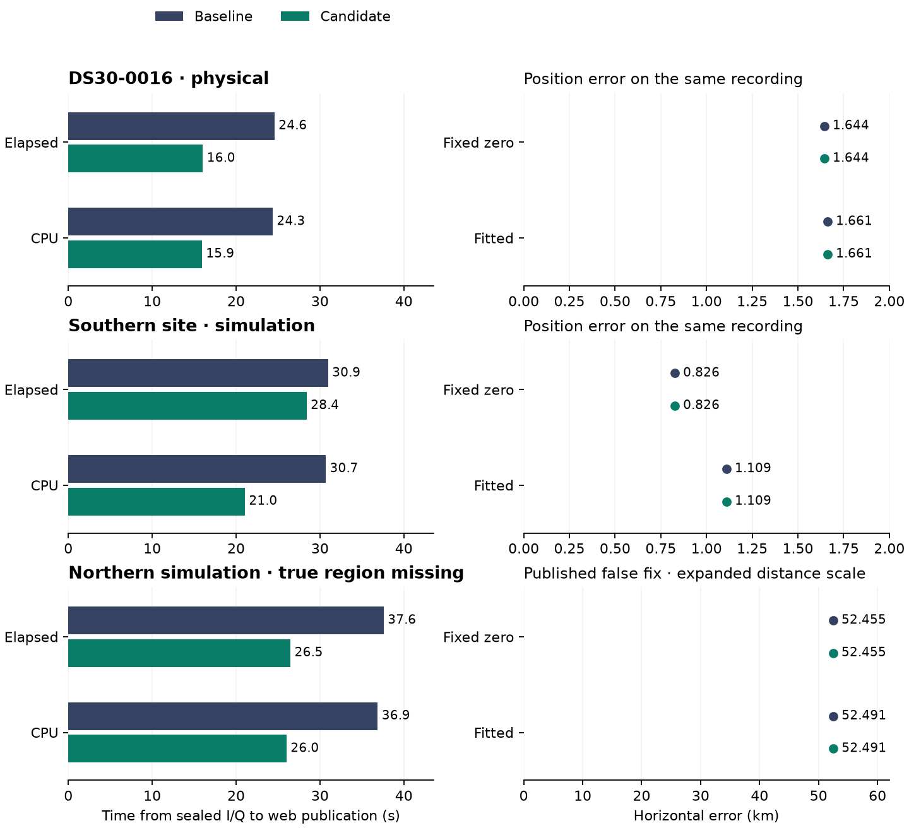

# Single-core publication on three matched recordings

On the short physical recording, the new build saved **8.54 s** from sealed I/Q to a completed web publication. It would need to save a further **3.74 s** on that recording to reach 2×. The same build saved **9.64 CPU seconds** on the southern simulated recording. On the northern simulation, the supplied region excluded the receiver. Both builds published the same false fix **52.49 km** from truth under fitted calibration. All three recordings were known development cases.

| Recording | Baseline → candidate, elapsed | Elapsed speedup | Baseline → candidate, CPU | CPU speedup | Fixed-zero / fitted error, either build |
|---|---:|---:|---:|---:|---:|
| DS30-0016, physical | 24.56 → 16.02 s | 1.53× | 24.34 → 15.91 s | 1.53× | 1.644 / 1.661 km |
| Southern site, simulated | 30.95 → 28.40 s | 1.09× | 30.67 → 21.03 s | 1.46× | 0.826 / 1.109 km |
| Northern site, simulated, receiver outside offer | 37.57 → 26.47 s | 1.42× | 36.86 → 26.00 s | 1.42× | 52.455 / 52.491 km · false fix |

The physical and northern baseline ran first. Both processes reported zero filesystem input blocks in each pair. On the southern run the candidate ran first and incurred 462,632 input blocks, then the baseline incurred zero. Elapsed time includes those reads. Both builds ran on one pinned core, with one numerical thread, at low CPU and I/O priority. Both published a fix on each recording. Each row has one timed pair. [Physical receipt](measurements/DS30-0016-shared.json) · [Southern receipt](measurements/south-shared.json) · [Northern wrong-region receipt](measurements/north-far-shared.json)



The file timestamps give three elapsed intervals. Launch through detections includes input reads and process startup. Detections through the terminal decision includes regional inference and its diagnostics. The last interval includes rendering, publication and process exit. Each cell shows baseline → candidate seconds.

| Recording | Launch through detections | Detections through terminal decision | Terminal decision through exit |
|---|---:|---:|---:|
| DS30-0016 | 12.99 → 8.38 | 7.73 → 4.48 | 3.84 → 3.16 |
| Southern simulation | 17.55 → 18.41 | 9.11 → 6.57 | 4.30 → 3.42 |
| Northern simulation, receiver outside offer | 19.08 → 11.51 | 14.33 → 11.55 | 4.17 → 3.42 |

On the northern case, inference alone took about as long as acquisition in the new build. The southern candidate's additional input reads fall in the first interval. Independent trials of direct decompression and reusable decoded-window buffers preserved the receiver evidence but added CPU on both physical prefixes. Sharing orbital projections across satellite families reduced complete saved-detection-to-grid CPU by 0.46 s on DS30-0374 and 0.09 s on the northern wrong-region case. Those changes were tested separately. [Stage measurements](measurements/shared-publication-audit.json) · [Decoded input trials](receiver-decoded-ingress.md) · [Shared orbital projections](solver-cavity-projection.md)

## What the prototype shares

The receiver computes four adjacent timing correlations together and examines every valid visit. A bounded compressed-input buffer reduces copies. The position solver shares causal parsing, coarse salvage calculations and repeated full-catalogue discovery calls with identical inputs. The renderer builds one figure per channel group and derives its unassociated view by hiding the assigned observations. Each group still has both published views. The timing includes detection, fitting, diagnostics, rendering and storage. [Receiver](receiver-stencil.md) · [Catalogue discovery](solver-discovery.md) · [Figure implementation](../../../tools/pipeline_eval/variants/experimental/shared_orbit_figures.py)

An independent read of each pair's publication roots matched **1,426 ordered probe rows and 440 selected candidates** on DS30-0016, and **2,400 rows and 456 selected candidates** on each simulation. It compared owners, both coordinate and frequency fits, grid and path digests, and the eight published image digests. It opened and decoded each PNG from both stores. Isolated figure timings on the **longer DS30-0374** saved about 1.1 CPU seconds from rendering eight plots. A later experiment on DS30-0016 saved another 0.35 render CPU seconds by reusing static pixels. Only figure construction was shared in the end-to-end measurements above. [Publication audit](measurements/shared-publication-audit.json) · [Long recording render timings](measurements/shared-figures-DS30-0374.json) · [Southern render timings](measurements/shared-figures-south.json) · [Pixel reuse](measurements/shared-pixels-DS30-0016.json)

## Geographic evidence

The supplied square and orbital screening center follow each recording through inference and publication. The paired runner checks the centers and width against the assigned offer. The receiver takes waveform and radio settings. The duplicate-search optimization reuses a result within the same solve and discovery point. Neither improvement needs a station-specific satellite list, surveyed position or roof-derived frequency threshold. [Paired runner](../../../tools/pipeline_eval/qualification/paired_publication.py) · [Receiver tests](../../../tests/pipeline_eval/test_experimental_receiver_stencil.py)

DS26, DS29 and DS30 represent one physical station. The southern simulation gives a second sky geometry, and its scoring key was already public before this comparison. Earlier regional tests on two simulated sites returned **four false fixes on four offers that omitted the receiver**. In a separate test a valid northern fix just inside the search square landed on the boundary, 106 m from truth with fixed-zero calibration. A blanket boundary rejection would lose that fix. A blind confirmation holds out whole locations, covers both sides of each boundary and scores each site's errors, fixes and wrong-region decisions separately. The independent physical field check remains open. [Regional results](../regional-release/README.md) · [Boundary experiment](edge-trial.md) · [Qualification protocol](PROTOCOL.md)

The static audit found two geographic limits inherited from ALGO08v2. The local-square contract rejects offers crossing the antimeridian or a pole. Both the sky screen and native Doppler projector assume zero receiver altitude. Satellite screening evaluates the supplied screening center, so the tests on these small regions do not establish visibility coverage for an arbitrarily wide region or a distant screening center. A regression test moves the discovery point and then switches hemispheres within the same wrapper to check that each region gets its own catalogue search. [Region contract](../../../src/leo/contracts/algo08_region.py) · [Sky screening](../../../src/leo/analysis/localization_v3/orbits.py) · [Position projector](../../../tools/pipeline_eval/variants/orbit_projector.py) · [Moved-region test](../../../tests/pipeline_eval/test_algo08_dense_discovery.py)

The deployed publication cache binds the recording and region, including the screening center. Its identity omits the orbit archive. Replacing a historical archive while reusing an existing publication root can return an earlier result. Every arm here started with an empty publication root and used the same archive as its comparator. [Cache identity](../../../tools/algo08_scan.py) · [Paired runner](../../../tools/pipeline_eval/qualification/paired_publication.py)

An alternative that interpolated measurements between two surrounding visits also stopped at triage. The bracketed forecasts covered both scan factors on too few lanes to justify replacing the full detector. At the physical station they covered only two of 22 bracketed second-scan factors. The two simulation prefixes also offered little removable CPU. [Receiver forecast audit](receiver-brackets.md)

## Reproduction

Use the frozen source tree at `5166e1c83`, the deployed comparator at `bdb869682`, and the packed receiver with SHA-256 `950c2b9412020317654fd7c79d30063e9258b70152ed9c91b4129d379ac75a13`. The receipts include the exact seven launcher source hashes, binary hash, offered region, input location and order. Build the binary using the receiver recipe, freeze the run with the options below, and supply a fresh output directory for each pair. The paired runner acquires the shared benchmark lock. [Build recipe](receiver-stencil.md) · [Benchmark setup](README.md)

```sh
python -m tools.pipeline_eval.qualification.freeze_publication "$bundle" "$detector" "$detector_sha256" \
  --solver combined-shared-discovery --ingress compressed-buffer --schedule all --rendering shared-orbits
python -m tools.pipeline_eval.qualification.paired_publication "$recording" "$offer" "$archive" \
  "$bundle/reports/ALGO08/single-core-2x/run-candidate" "$pair_dir" --candidate-config "$bundle/spec.json" --first "$first"
python reports/ALGO08/single-core-2x/audit_shared_publication.py "$physical_pair/pair.json" "$southern_pair/pair.json" "$northern_pair/pair.json"
python -m reports.ALGO08.single-core-2x.plot_shared_publication
```
