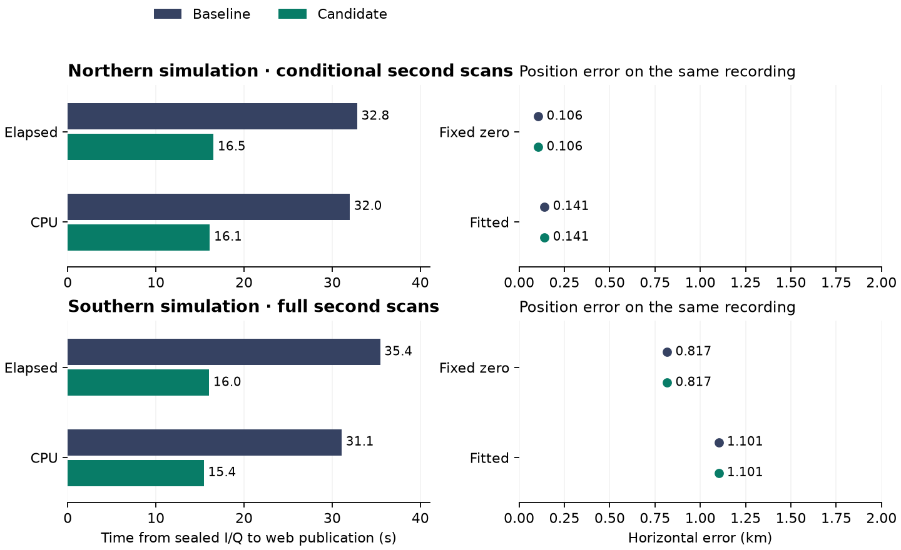
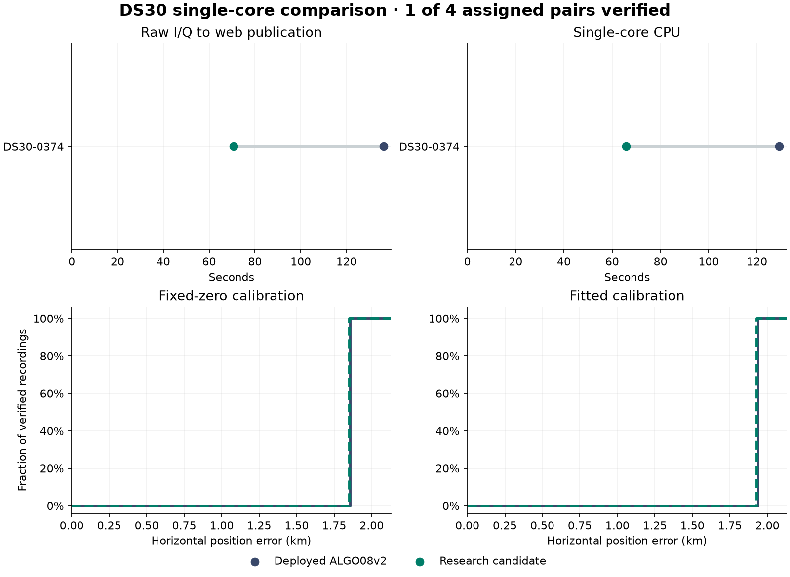
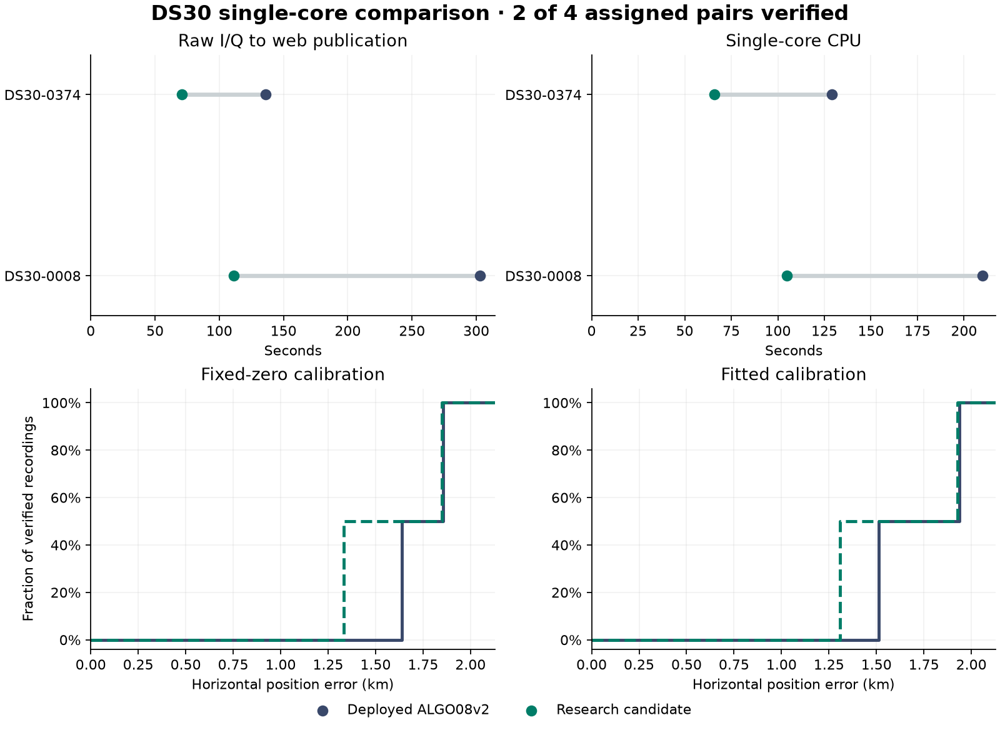
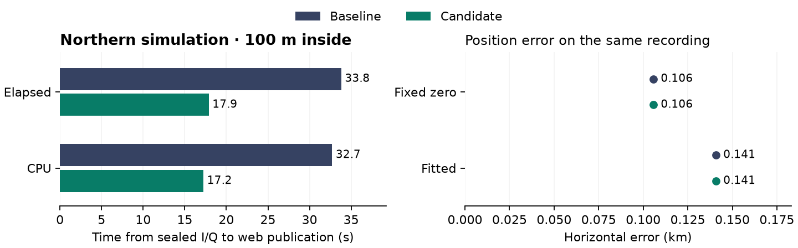

# Signed orbital prior with the fast receiver and the regional guard

Freeze the combined candidate before evaluating another roof recording. Use the compiler-trained Q15 dual-entry receiver, the conditional residual schedule, collapsed discovery with paired repair, the released signed orbital prior, and the boundary guard with same-solve catalogue reuse. The solver applies the signed update under the original causal qualification and paired acceptance rules at every location. The build specification digest is `sha256:f7dcc16dc41d5d923a9d7e75ec094ca9a2cb42c8aba9ce1316d6c2af50b971e4`.

First check the complete pipeline on the public northern 100 m inside offer against deployed ALGO08v2, with the candidate first. Then try the solver alone on the archived DS30-0155 conditional detections. DS30-0155 had the largest loss in position accuracy in the earlier four-recording development stage. Both solvers receive that entire same ordered measurement file, assigned region and capture-time archive. Compare the two horizontal errors against both the matched conditional control and deployment; report frequency-fit changes separately. This check uses an earlier detector file and does not measure the combined receiver's output or end-to-end time on DS30-0155. Keep the complete 16-recording stage and fresh geographic confirmation sealed.

## Complete northern boundary result

Elapsed time fell **32.84 → 16.54 seconds (1.986×)** and CPU time fell **31.99 → 16.12 seconds (1.984×)**. Both runs incurred zero filesystem input blocks. The candidate missed the 0.500 elapsed ratio by 0.118 seconds on this pair. Its fixed-zero error was 106 m and its fitted error was 141 m, exactly matching deployment. All 456 selected radio observations, both owner maps, the numerical grid and path, and all eight decoded web figures matched. A single simulated recording cannot establish the benchmark distribution. [Pair](measurements/north-edge-signed.json) · [Scientific audit](measurements/signed-repair-triage.json)

The previous collapsed solver stopped after fitting the unsigned orbital phase prior. On identical observations its fitted position was 212 m from truth. The restored correction uses differences between satellite orbital elements observed before capture. It reproduced deployment's 141 m error. The guard also reused the full causal satellite catalogue already prepared during this solve. Each offer still evaluates all 96 regional probes when the optimizer reaches a bound. [Signed update and causal provenance](solver-stock-finish.md) · [Matched guard scores and cost](regional-bound-guard.md)

On the same detector file the signed solver withheld the distant omitted region. Moving the valid boundary square 200 m to put the receiver 100 m outside still yielded a false fix, 123 m and 118 m from truth in the two arms. These are saved-detection decision checks. They do not contribute to the raw-to-web timing.

## Crossing detector inputs and solvers on DS30-0155

| Saved measurements | Position solver | Error with `c = 0` | Error with fitted `c` | Frequency RMS with `c = 0` / fitted |
|---|---|---:|---:|---:|
| Deployed, full second scans | Deployed | 0.972 km | 1.157 km | 155.42 / 155.38 Hz |
| Same full measurements | Collapsed with signed update | 0.972 km | 1.157 km | 155.42 / 155.38 Hz |
| Earlier conditional second scans | Shared-tables control | 1.291 km | 1.426 km | 156.08 / 156.06 Hz |
| Same conditional measurements | Collapsed with signed update | 1.323 km | 1.464 km | 156.37 / 156.32 Hz |

On the full measurements the signed solver reproduced both deployed endpoints, both 3,498-observation owner maps, the path and the 179-point grid. On conditional measurements, changing the solver added another 0.037 km of fitted error. Switching the input of the signed solver from conditional to full recovered 0.307 km. The combination of input and solver matters. This recording had already been used to investigate conditional scans and cannot serve as blind confirmation. [Ordered input digests, scored runs and numerical evidence](measurements/signed-repair-triage.json)

## Full two-scan receiver on the original DS30-0155 I/Q

Run both scans on every admitted lane, retain the floating-point FIR, and compile the full receiver using the same site-free training signals. This removes the conditional second-scan schedule. Freeze that receiver with the signed solver and same-solve catalogue reuse. A single raw-to-web run took **75.08 CPU seconds and 118.23 elapsed seconds**. It returned both fixes and all eight PNGs. The fitted position error was **1.157 km** and fixed-zero error was **0.972 km**. These match deployment to the precision shown. [Raw run and comparison](measurements/full-float-signed-0155.json)

All 4,627 returned observations retained their winning rank. Two had small numerical changes; the larger CFO difference was 0.000096 Hz. Both satellite owner maps matched. The positions moved by less than 0.00002 m. Seven decoded PNGs matched exactly. The position image, grid and path differed. [Per-observation differences and image checks](measurements/full-float-signed-0155.json)

The previously archived deployed run on the same raw input took **144.70 CPU seconds and 148.20 elapsed seconds**. It reported 40 filesystem input blocks, versus 16,249,328 in the new run. The historical CPU ratio is 1.93×. The gap to half the archived CPU is 2.73 s. This was a candidate-only timing and cannot establish paired elapsed speedup. The frozen full-scan specification is `sha256:99b46f7ffe4d9e2acb173364d54240c6cf8ca2deceb1d7715d389c03066659cf`. Build its detector with `receiver_compiler_trial.py build "$FULL_BUILD" "$ASSETS" --floating`, then freeze the same signed solver with `--schedule all`. [Compiler and build procedure](receiver-compiler.md)

## The same full-scan build on the southern simulation

With the receiver 100 m inside its supplied square, deployed ALGO08v2 took **35.44 s** and the full-scan signed candidate took **16.04 s** from raw I/Q through all eight PNGs, a **2.21× paired elapsed speedup**. Single-core CPU fell from 31.08 to 15.44 s (2.01×). Both runs reported zero filesystem input blocks and returned 0.817 km fixed-zero error and 1.101 km fitted error. All selected observations, owner maps, grid, path and eight decoded images matched. The northern row in the figure used conditional second scans. Pooling those two rows would mix candidate builds. [Southern matched pair](measurements/south-edge-full-signed.json)

Reusing the southern full-scan detections, the candidate withheld both arms on the distant omission but returned a false fix when the receiver was 100 m outside. That fitted error was 1.102 km. The two hemispheres expose the same remaining decision failure. This is a public development simulation, and physical position accuracy away from the Gauss site remains unmeasured. [Saved wrong-region receipts](measurements/signed-repair-triage.json) · [Across-face bias at both sites](mirrored-regions.md)

## First formal pair for the packed verifier

Freeze the floating-FIR version with the guarded, frame-relative phase calculation in the verifier. The floating path retains the scout used in the successful DS30-0155 accuracy check. The new library is `dd2d83a8cc865b156115922e057823300e269c2fcb65f525f81e6fa620ed1a20`. All captured scientific Python modules match the previous full-scan build. The candidate specification is `sha256:50d30065095e5a354ec589c31b615a0d1d38194b72335864431e3f63be403879`. Use the first assignment in the existing DS30 order, DS30-0374, candidate first. Open just this one complete pair. Require both calibration solutions, report all returned measurements and image changes, and compare both errors, elapsed and CPU seconds to deployed ALGO08v2 on the same raw I/Q and archive.

| DS30-0374, one pinned core | Deployed ALGO08v2 | Full two-scan candidate |
|---|---:|---:|
| Raw I/Q through published web artifacts | 136.14 s | 70.69 s |
| CPU | 129.15 s | 65.82 s |
| Launch through saved detections, elapsed | 91.79 s | 47.95 s |
| Detections through position terminal, elapsed | 36.71 s | 20.10 s |
| Terminal through process exit, elapsed | 7.63 s | 2.65 s |
| Fixed-zero / fitted horizontal error | 1.855 / 1.935 km | 1.848 / 1.928 km |
| Fixed-zero / fitted frequency RMS | 101.536 / 101.520 Hz | 101.496 / 101.482 Hz |

The matched elapsed speedup was **1.926×**, 2.63 s short of halving runtime. Single-core CPU speedup was **1.962×**. Both runs had zero filesystem input blocks. Both produced a fix in each calibration arm and all eight required PNGs. The owner digests, grid, path and pixels differed. The fitted position moved 8.9 m and its error decreased 7.6 m. This small movement on one known physical roof supplies no evidence of better accuracy elsewhere. [Matched run](measurements/DS30-0374-full-phase.json) · [Position and timing audit](measurements/full-phase-lead-science.json)

The two receivers agreed on all 9,288 opportunities about whether to return a measurement. All 4,157 selections retained the same winning rank and integer epoch. Only one differed in fractional timing or frequency, by less than 0.000000002 samples and 0.000037 Hz. Numerical scores changed on 3,990 selections, the largest absolute score change being 0.000000000241. The inventory counts whole observation records by digest, so it records 3,990 replacements. The per-field audit establishes that both receivers returned every one of the same selections. The paired build also changes the solver, so this comparison alone cannot attribute the owner changes to the receiver. [Field-level differences](measurements/full-phase-lead-science.json) · [Stage inventory](measurements/full-phase-lead-inventory.json)

DS30-0374 belongs to the Gauss development site. Qualification requires the same frozen algorithm at geographically withheld sites, including containing and omitted offers. The existing Austin waveform exercises the receiver only. Independent physical positioning still requires an off-site capture with a survey, time and orbital archive. [Geographic protocol and physical data inventory](geographic-input-audit.md)

## Holding the receiver fixed on two physical recordings

The frozen candidate solver was run on the **deployed receiver's saved detections** and the same regional offer and capture-era orbital snapshots. Only the solver changed relative to the deployed position. The CPU clock below begins at the solver call and includes the numerical position evidence. It excludes acquisition and PNG rendering. [Input digests, archive pins, owner maps and outputs](measurements/crossed-signed-fixed-inputs.json)

| Recording | Saved observations | Deployed error, fixed-zero / fitted | Candidate solver error, fixed-zero / fitted | Deployed → candidate solver fitted frequency RMS | Candidate solver CPU |
|---|---:|---:|---:|---:|---:|
| DS30-0374 | 4,157 | 1.855 / 1.935 km | 1.848 / 1.928 km | 101.520 → 101.482 Hz | 19.47 s |
| DS30-0008 | 7,016 | 1.639 / 1.512 km | 1.306 / 1.284 km | 129.663 → 125.770 Hz | 39.62 s |

On DS30-0374 the candidate solver assigned the same observations to the same satellites with either receiver input. Its fitted endpoints were **0.24 mm** apart. The 8.9 m difference from deployment and the changed assignment therefore persisted when the receiver was held fixed. On DS30-0008 the candidate solver selected a different owner map from deployment and reduced fitted error by 228 m on the deployed factors. Both recordings come from one physical roof.

Use `residual_attribution_trial.py worker NATIVE SPEC ARCHIVE REGION OUTPUT --evidence` with the frozen candidate first on the release Python path to reproduce a saved solve. To distinguish substitutions of a winning rank from numerical changes within the same rank in a complete paired run, use `python -m reports.ALGO08.single-core-2x.selected_changes PAIR_JSON --summary`. It checks both saved native digests against their terminals before matching the ordered opportunities.

## Second matched recording with the frozen full-scan build

On DS30-0008 both runs completed both calibrations and rendered all eight figures. Fitted horizontal error fell **1.512 → 1.308 km**, and fixed-zero error fell **1.639 → 1.331 km**. Frequency RMS fell **129.663 → 125.820 Hz** (fitted) and **129.703 → 125.892 Hz** (fixed zero). Both runs selected the same 7,016 opportunities at the same ranks and integer epochs. Scores differed on 6,692 complete factor records. Only three winning fractional times or CFOs changed, by at most 0.0000000021 samples or 0.000018 Hz. The end-to-end build selected different owner maps from deployment and from the candidate solver running on deployed factors. All eight figures changed pixels, and the numerical grid and path also changed. [Matched execution](measurements/DS30-0008-full-phase.json) · [Sealed factor comparison](measurements/full-phase-0008-selections.json)

| Raw I/Q through all web artifacts | Deployed elapsed | Candidate elapsed | Deployed CPU | Candidate CPU | Deployed / candidate filesystem input blocks |
|---|---:|---:|---:|---:|---:|
| DS30-0374, candidate first | 136.14 s | 70.69 s | 129.15 s | 65.82 s | 0 / 0 |
| DS30-0008, deployed first | 302.94 s | 111.24 s | 209.88 s | 104.98 s | 16,017,368 / 0 |

The second recording ran **2.72× faster by elapsed time** and **1.9992× by CPU**. The disk-read imbalance favors the second recording's candidate elapsed time. Across the first two verified pairs the median paired elapsed ratio was **0.443** and the summed elapsed ratio was **0.414**. The corresponding CPU ratios were **0.505** and **0.504**. The four-recording stage subsequently completed at the same station. [Two-pair snapshot](measurements/full-phase-two-inventory.json) · [Completed stage](full-phase-ds30-stage.md)

### Which receiver fields changed the DS30-0008 fix?

On DS30-0008 the candidate solver using deployed detector output had a fitted error of 1.284 km. With the candidate detector that error was 1.308 km. Two crossed replays isolate the cause. Each uses the same frozen solver, region, capture-era orbital archive, winning ranks and fixed set of 7,016 observations. [Crossed inputs and output digests](measurements/full-phase-0008-crossed-fields.json)

| Score fields | Measured CFO and fractional timing | Associated points per arm | Fixed-zero / fitted error | Fitted frequency RMS |
|---|---|---:|---:|---:|
| Deployed | Deployed | 3,094 | 1.306 / 1.284 km | 125.770 Hz |
| Candidate | Deployed | 3,094 | 1.306 / 1.284 km | 125.770 Hz |
| Deployed | Candidate | 3,092 | 1.331 / 1.308 km | 125.820 Hz |
| Candidate | Candidate | 3,092 | 1.331 / 1.308 km | 125.820 Hz |

Changing scores alone kept the owner maps. Changing the three measured CFO/timing pairs reproduced the full candidate's owner maps, and each endpoint was within 0.03 mm of its matching control. The position solver's track adapter uses the winning CFO. Its time coordinate comes from the sample counter, independently of the fractional pilot epoch. The small input differences amplified during inference. The two-by-two result identifies their effect on this recording and gives no basis for rounding frequencies or adjusting a global threshold. [Input constructor](cross_factor_fields.py) · [Track preparation](../../../src/leo/analysis/localization_v3/tracks.py)

The difference was already visible in Graph track construction. Both inputs yielded 236 tracks with the same curved track keys. The deployed input assigned 6,456 points and the candidate input assigned 6,454. Both noise fits selected the model with variance dependent on signal strength. The constant-model comparison gave 124.784 and 124.807 Hz respectively. [Track membership and noise fit](measurements/full-phase-0008-graph.json)

## Full two-scan receiver with balanced synthetic training at the northern site

The successor keeps the first scan's deinterleaved lane samples for cancellation and caches the eligible Fourier bins for the actual frequency bounds. Training included symmetric and shifted mixer settings. On short saved samples this avoided the nonzero-center slowdown of developing exclusively on symmetric bands. Freeze the balanced build with the same scientific solver and all other source and library pins as the two-case DS30 candidate. Its specification is `sha256:ed2a4e285c0f94b44e052a8bbbc1e7db1a163200a129635b41c1af86874e95e9`. [Receiver comparisons including shifted bands](receiver-resident-cancel.md)

On the public northern 100 m inside recording, full raw-to-web elapsed time fell **33.80 → 17.88 s (1.89×)** and CPU fell **32.70 → 17.24 s (1.90×)**. Both runs had zero filesystem input blocks. All 456 selections matched by opportunity, rank, integer/fractional time and CFO. Some score fields changed by at most 2 × 10⁻¹⁴. Both fixes, both satellite owner maps, frequency RMS, scientific grid, path and all eight decoded web images were identical. Fixed-zero error was **106 m** and fitted error **141 m**. This comparison fell 0.97 s short of half the deployed elapsed time. [Paired run](measurements/north-balanced-full-pair.json) · [Detailed audit](measurements/north-balanced-full-audit.json)

On the same saved detections and causal archive the successor withheld the distant omitted square. It still published the square with the receiver 100 m outside, with fitted error 118 m. An independent held pilot-arrival test on the northern and southern recordings slightly favored the wrong face at both sites. Leaving out one satellite reversed either preference. These development results keep geographic qualification open. [Matched offers and verdicts](measurements/north-balanced-full-audit.json) · [Held arrival test and control models](mirrored-arrival.md)

## Integrated predictive-grid change on the northern recording

A further research build lets the predictive grid reuse a checked matrix factor from the curved fit at the same position. On a saved DS30-0155 solve it reduced grid CPU **5.18 → 3.60 s**. The original position fit, optimizer and endpoint scoring still use the release calculation. The eligible grid changes its arithmetic label so readers can distinguish its numerical scores. [Qualification and complete grids](solver-posterior-handoff.md)

The balanced full receiver and this grid change ran together from raw northern I/Q through all eight PNGs. The native factor was used on **272** grid calls. Against the immediate balanced-receiver control the endpoints, owners, frequency RMS, optimizer path and all eight PNG **files** matched exactly. The two 137-point grids kept the same minimizing points and endpoint scores. Numerical scores differed at 124 fixed-zero and 130 fitted points, by at most **3.73 × 10⁻¹¹**. This was a candidate-only run of **17.28 CPU s and 21.30 elapsed s**. The prior control used 17.24 CPU s, so this example provides no measured compute benefit on the northern recording.

The frozen specification is `sha256:fd5e122c8418fce7f58be2c387faca4ebf4230e8b4e659f1df95b3ec359982cc`. Every tracked overlay file matches commit `d6166f669`. The receiver matches the previous balanced build, and the scorer observed the same raw authority, offer and causal snapshot inventory. [Integration receipt and pointwise comparison summary](measurements/north-balanced-posterior-integration.json)

On identical saved DS30-0374 candidate measurements, the newer solver used 356 checked factors. Solver CPU was 19.31 s for the four-pair frozen build and 17.87 s for the successor. Both calibration endpoints, frequency residuals, satellite assignments, full paths and endpoint objective replays matched exactly. Fourteen fixed-zero and 23 fitted grid scores changed by at most 7.28 × 10⁻¹². Both minimizing grid points matched. This single solver timing excludes raw reception and image generation. [Bound inputs and pointwise checks](measurements/lead-posterior-grid.json)
