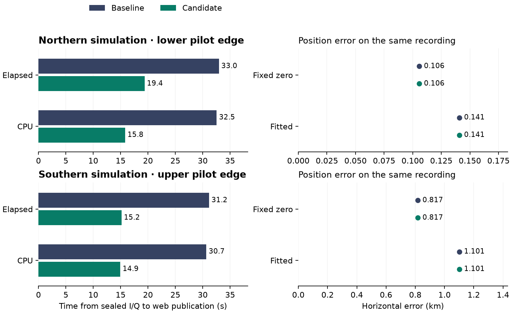

# Frozen receiver and regional solver on two public sites

**The same frozen build cut single-core CPU time by about 51% at each simulated site.** Total elapsed speedup was **1.86×** across the two recordings. Both builds returned identical positions and rendered identical web figures on the containing offers. The candidate withheld both distant omissions and returned false fixes on both near omissions. The elapsed-time and regional decision criteria remain unmet.

| Public recording | Elapsed s, deployed → candidate | Elapsed speedup | CPU s, deployed → candidate | CPU speedup | Fixed-zero error, both | Fitted error, both |
|---|---:|---:|---:|---:|---:|---:|
| Northern, lower pilot edge | 32.95 → 19.38 | 1.70× | 32.54 → 15.83 | 2.06× | 106 m | 141 m |
| Southern, upper pilot edge | 31.16 → 15.17 | 2.05× | 30.66 → 14.94 | 2.05× | 817 m | 1,101 m |

The elapsed ratios were **0.538 median paired** and **0.539 summed**, compared with the target of ≤0.500 for both. Single-core CPU fell from 63.20 to 30.76 s. On the northern pair, elapsed exceeded charged CPU by 3.55 s for the candidate and 0.41 s for deployment. Both registered zero filesystem input blocks. On the southern pair deployment registered zero and the candidate registered 24. These are single low-priority timings per build and site. [Northern pair](measurements/spectral-terminal-north-inside.json) · [Southern pair](measurements/spectral-terminal-south-inside.json)

Each site retained all 456 selected frequencies, epochs and ranks. Three detector score fields differed by at most 2.46e−14. Both calibration arms retained all owners and endpoints. All 16 decoded PNGs matched. In the south the path and grid digests also matched. In the north the grid matched the candidate parent's grid, with the same sampled minimum as deployment. Fitted calibration lowered the frequency RMS from 5.41 to 5.17 Hz in the north and 6.50 to 6.39 Hz in the south, while increasing position error at each site. [Northern science and figure audit](measurements/spectral-terminal-north-audit.json) · [Southern science and figure audit](measurements/spectral-terminal-south-audit.json) · [Northern grid comparison](measurements/frame-plane-grid.json)



| Region offered on the same detected signal | Northern decision, fixed-zero / fitted error | Southern decision, fixed-zero / fitted error |
|---|---|---|
| True receiver 100 m inside | Fix, 106 / 141 m | Fix, 817 / 1,101 m |
| True receiver 100 m outside | False fix, 123 / 118 m | False fix, 817 / 1,102 m |
| True receiver 52.5 km outside | Withheld both | Withheld both |

Each omitted offer is a solver replay of the corresponding candidate's raw receiver output. It does not add a recording to the runtime or position sample. Both near failures count against geographic qualification. The shared screening-center regression also rejects a hypothetical panel that supplies the true receiver coordinate to the satellite visibility filter. The two-site radio experiment helps explain why choosing a cutoff at one known boundary can fail elsewhere. [Northern offers](measurements/spectral-terminal-north-offers.json) · [Southern offers](measurements/spectral-terminal-south-offers.json) · [Geographic input audit](geographic-input-audit.md) · [Conditional boundary experiment](mirrored-noise.md)

## Builds and comparison design

The experimental receiver batches arithmetic around the scout FFTs. It retains the same frequency bins, timing search, cancellation and thresholds. The solver, region checks and web renderer are identical to the frozen terminal-guard parent. The specification is `23fadeb79c76c343760dc3fb107f7dfb170b0ba4eec22a4dc3df244c2187cf24`. Training used generated RF signals. In a receiver-only comparison against its immediate parent the new arithmetic reduced single-core CPU by 5.81% on weak DS26 signals and 4.05–5.74% on measured Austin signals. Austin contributes an independent receiver test. Its excerpt has no surveyed position result. [Receiver measurements](receiver-spectral-vectors.md) · [Freeze receipt](measurements/spectral-vectors-terminal-veto-freeze.json)

The two public recordings use different simulated locations and pilot edges. Both receivers are 100 m inside their assigned square for timing. The reference for speed is deployed ALGO08v2. Timed runs read saved I/Q on one low-priority Gauss core and end after the web publication. The southern run used the candidate first. The northern run used deployment first. All location scoring follows inference. The two sites and their answers were previously used in development. They supply a transfer check before blind qualification.

## Reproduction

Use the original public I/Q and frozen bundle from the Gauss experiments. Each pair needs a new output root. The paired launcher manages the common benchmark lock for both timed arms. The subsequent replays reuse the candidate's native detections and causal orbit archive. The shifted-offer driver checks the original search and screening centers against the designated site's published offer.

```sh
bench=/tmp/leo-algo08v2-2x-bench
release=/opt/leo-algo08/bdb869682a2ea63af4b198a920b763a4c6a78c4c
public=/tmp/leo-regional-qZJKBw4W/public
build="$bench/integration-spectral-vectors-terminal-veto"
py="$release/venv/bin/python"
export PYTHONPATH="$PWD:$PWD/src:$release:$release/src"
export OPENBLAS_NUM_THREADS=1 OMP_NUM_THREADS=1 MKL_NUM_THREADS=1
key=reports/ALGO08/regional-release/scoring-key.json
locked() { flock "$bench/gauss.lock" nice -n15 ionice -c2 -n7 taskset -c 2 "$py" -BPs "$@"; }
site_pair() {
  site=$1
  id=$2
  first=$3
  out="$bench/spectral-terminal-$site-inside"
  "$py" -BPs -m tools.pipeline_eval.qualification.paired_publication "$public/$id" \
    "$bench/near-edge/$id.json" "$public/tle" "$build/reports/ALGO08/single-core-2x/run-candidate" \
    "$out" --candidate-config "$build/spec.json" --first "$first" \
    --archive-inventory-sha256 sha256:7aa06cab0502bcac70645a41a219bb6d53f1077f329e6f7ed79eb59a8794feec || return
  locked -m reports.ALGO08.single-core-2x.compare_publications "$out/pair.json" \
    --stage-clocks --public-scoring-key "$key" > "$bench/spectral-terminal-$site-audit.json" || return
  locked -m reports.ALGO08.single-core-2x.frame_plane_offers "$out/pair.json" \
    "$build" "$key" "$bench/spectral-terminal-$site-offers.json" --site "$site"
}
site_pair south 6bd1f26bfa0bedfcf3f100f8 candidate
site_pair north 0abe7b4514be674d9f5388e3 baseline
```
