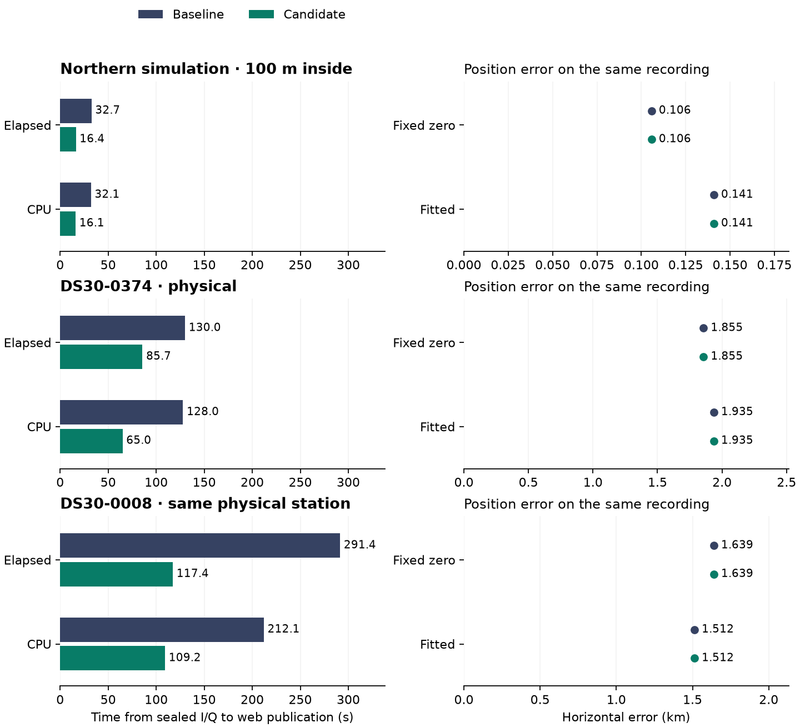

# Terminal-only regional guard in the frame-plane build

The research-only freeze at `/tmp/leo-algo08v2-2x-bench/integration-frame-plane-terminal-veto` has specification `sha256:977e7dd61c23622cc05365f0a7743a0042a7edd590d88173faeace8590ca8fe3`. It copies the frame-plane parent `6cf354ef` and preserves its receiver `14b52e7e`, sparse ranking, screened tiled finish, causal catalogue handoff, Graph, position grid and remaining settings. The freeze checks the reviewed short-circuit source from `0b70f59cc` and verifies the full source manifest. At runtime the opt-in flag also checks the actual imported guard, geometry scorer and reducer sources. [Freeze receipt](measurements/frame-plane-terminal-veto-freeze.json) · [Frame-plane parent](frame-plane-publication.md)

The ordinary scorer still returns full pointwise results. The opt-in scorer uses the same boundary gate and all-location geometry, then stops as soon as the joint veto condition becomes impossible. If the veto remains possible, it evaluates all 96 scores and applies the original reducer. The short path records its stop reason and incomplete diagnostic state. The published terminal fields are the decision, reason, calibration arms, region and data binding. Their schema and semantics are unchanged. [Prior decision proof and scorer checks](regional-veto-short-circuit.md)

## Northern end-to-end comparison

The subsequent matched run on the same public northern waveform took **32.650 s deployed and 16.410 s candidate** from recorded I/Q to complete web publication, a **1.990×** speedup. It missed half the deployed elapsed time by 0.085 s. Single-core CPU time was 32.092 and 16.109 s. Deployment ran first, both arms registered zero filesystem input blocks, and both wrote all eight required web figures. The paired outputs agree on every decoded pixel, observation owner and position estimate. Error was 105.69 m with fixed-zero calibration and 140.78 m with fitted calibration. All 456 selected frequencies, times and ranks matched. Three score fields varied by at most 1.99e−14. The two grid hashes reproduce their respective parent grids, which differed by at most 3.73e−11 in objective. [Run receipt](measurements/terminal-veto-north-inside.json) · [Science and image audit](measurements/terminal-veto-north-audit.json) · [Parent grid comparison](measurements/frame-plane-grid.json)

| Northern simulation, seconds elapsed | Deployed ALGO08v2 | Frozen candidate |
|---|---:|---:|
| Launch to detections | 19.122 | 8.577 |
| Detections to position decision | 9.195 | 5.790 |
| Decision through web publication and exit | 4.334 | 2.043 |

Two saved-detection replays held the northern waveform and orbit archive fixed and changed the offered square. At **52.5 km outside** the square, the frozen candidate withheld both positions. At **100 m outside** the same face used for the inside comparison, it published a false fix with errors of 122.90 m and 118.20 m. The inside and omitted comparisons use one simulated receiver. Independent geographic confirmation remains outstanding. [Shifted-offer measurements](measurements/terminal-veto-offers.json)

On a separate two-location counterfactual, the Doppler predictor using the orbits available at capture time preferred the same side of a 200 m boundary challenge at both simulated endpoints. That preference produces opposite operational errors at the two sites. It would reject a valid northern fix and accept an invalid southern fix. Replacing the causal orbits with the simulator's exact later trajectories largely removed the error in a receiver-noise experiment. Those trajectories are available only to the evaluator. [Experiment, assumptions and per-site results](mirrored-noise.md)

## Physical recordings from one roof

We ran the first two assignments of the fixed four-recording panel. Each row compares deployment and the same frozen candidate from raw I/Q to published web figures. The timer includes input reads. CPU time measures the work charged to each single-core process. Error uses the eligible recording reference after both builds finish.

| Recording and first build | Elapsed s, deployed → candidate | CPU s, deployed → candidate | Elapsed speedup | CPU speedup | Fixed-zero error, both | Fitted error, both |
|---|---:|---:|---:|---:|---:|---:|
| DS30-0374, candidate first | 130.02 → 85.70 | 127.96 → 64.98 | 1.52× | 1.97× | 1.855 km | 1.935 km |
| DS30-0008, deployment first | 291.44 → 117.38 | 212.05 → 109.21 | 2.48× | 1.94× | 1.639 km | 1.512 km |

Total elapsed was **421.46 → 203.07 s (2.08×)**. The median paired candidate/deployed elapsed ratio was **0.531**, above the **0.500** target, while the summed ratio was **0.482**. Total single-core CPU was **340.01 → 174.20 s (1.95×)**. The two recordings share a surveyed reference and count as one physical site. The four-recording stage is incomplete. [Assigned cases and verification](measurements/terminal-veto-physical-stage.json) · [DS30-0374 raw receipt](measurements/DS30-0374-terminal-veto.json) · [DS30-0008 raw receipt](measurements/DS30-0008-terminal-veto.json)

The first build in each pair started with less of the input already cached. On DS30-0374 the candidate began with 25.6% of pages resident and deployment began with 100%. On DS30-0008 deployment began with 2.2% and the candidate with 98.4%. This favors opposite builds on the two wall clocks. It explains why 2.48× on the dense recording is weak evidence of a 2.48× computational speedup. The CPU results agree much more closely.

Both builds published two fixes per calibration arm and all 16 required figures. They retained the same observation owners in both arms. Seven of eight decoded images matched on each recording. The position image, objective grid digest and path digest differed on both. Corresponding positions differed by at most 0.052 mm. Unrounded fitted error increased on both recordings, by less than 0.044 mm each. A strict zero-regression test can distinguish those values even though they coincide at the displayed precision.

All 4,157 and 7,016 selected frequencies, epochs and ranks agreed on DS30-0374 and DS30-0008, respectively. Three floating-point score fields differed by up to 2.34e−13. The fixed-zero median and P90 errors passed the strict no-increase check on this subset. Both fitted statistics failed that check. The dense recording spent 81.04 → 56.16 s between detection and the position decision, compared with 34.20 → 26.60 s on DS30-0374. [Complete stage clocks, selections, decoded-image audit and unrounded errors](measurements/terminal-veto-physical-audit.json)



## Saved northern solves

Both offers used the same frame-plane candidate detections and capture-time archive from the released northern pair. The 100 m inside offer matched the original published fix in both calibration arms and used the same 302 associated points per arm and owner hashes. The full position path, grid and objective replay matched by canonical digest. The far omission, 52.5 km outside, withheld with `both_receivers_support_far_exterior`, null positions in both arms and no selected evidence packet. Both guard modes agreed exactly on the far-case receiver maxima, gains and separation. [First comparison and far replay](measurements/frame-plane-terminal-veto-saved.json) · [Reverse inside comparison](measurements/frame-plane-terminal-veto-reverse.json)

| Inside calibration | Estimated latitude | Estimated longitude | RF RMS (Hz) |
|---|---:|---:|---:|
| Fixed zero | 47.772561156 | 16.095478545 | 5.406434006 |
| Fitted | 47.771358408 | 16.095478545 | 5.166631395 |

All runs were unprofiled, used one thread and ran under the Gauss lock on CPU 2. The full solve timings start at the saved native input and include packet generation for a fix. The guard timings cover the triggered boundary readout, including the geometry setup.

| Offer and run order | Guard probes full → terminal | Guard CPU s full → terminal | Guard wall s full → terminal | Solver CPU s full → terminal | Solver wall s full → terminal |
|---|---:|---:|---:|---:|---:|
| Inside, full first | 96 → 25 | 1.307 → 0.492 | 1.319 → 0.492 | 7.843 → 5.904 | 7.926 → 5.932 |
| Inside, terminal first | 96 → 25 | 1.396 → 0.474 | 1.429 → 0.474 | 6.797 → 5.855 | 6.925 → 5.974 |
| Far omitted, terminal first | 96 → 96 | 1.301 → 1.314 | 1.312 → 1.323 | 9.420 → 9.559 | 9.532 → 9.600 |

The inside guard saved 0.816 and 0.922 CPU seconds in the two run orders. The first inside pair also differed by 1.123 CPU seconds outside the guard. That difference fell to 0.020 seconds with the order reversed. The parent raw run was 0.864 wall seconds beyond the 2× mark. The subsequent trial above measures the complete pipeline independently. [Frame-plane raw and shifted-offer results](frame-plane-publication.md)

## Reproduce

From the research worktree on Gauss, use the archived frame-plane freeze, northern pair and previous far-offer receipt. The driver checks their hashes, verifies the saved native detection and terminal binding, and confirms the causal archive before and after the runs. The specification includes absolute library paths, so reproducing the exact bundle digest requires the original path and a fresh destination.

```bash
release=/opt/leo-algo08/bdb869682a2ea63af4b198a920b763a4c6a78c4c
bench=/tmp/leo-algo08v2-2x-bench
bundle="$bench/integration-frame-plane-terminal-veto"
module=reports.ALGO08.single-core-2x.terminal_guard_publication_trial
freeze="$bench/frame-plane-terminal-veto-freeze.json"
python="$release/venv/bin/python"
export PYTHONPATH="$PWD/src:$PWD:$release/src:$release"
export OPENBLAS_NUM_THREADS=1 OMP_NUM_THREADS=1 MKL_NUM_THREADS=1
"$python" -BPs -m "$module" freeze "$bench" "$bundle" "$freeze"
flock -w 360 "$bench/gauss.lock" nice -n 15 ionice -c2 -n7 taskset -c 2 \
  "$python" -BPs -m "$module" solve "$bench" "$bundle" "$freeze" \
  "$bench/frame-plane-terminal-veto-saved.json"
flock -w 360 "$bench/gauss.lock" nice -n 15 ionice -c2 -n7 taskset -c 2 \
  "$python" -BPs -m "$module" solve "$bench" "$bundle" "$freeze" \
  "$bench/frame-plane-terminal-veto-reverse.json" --reverse-inside
```

The qualification ran 75 passing component tests covering both guard modes, source and cutoff binding, exact veto parity, saved-input replay and the research launcher. [Driver](terminal_guard_publication_trial.py) · [Guard tests](../../../tests/pipeline_eval/test_regional_bound_guard.py)

For the raw public comparison, use the verified bundle and a fresh output directory. The paired runner holds the Gauss benchmark lock during both timed arms. The offer replays take the detector output of this exact run. For the physical pairs, the DS30 runner binds both builds to each recording's archive at capture time, alternates run order by assignment, and records cache residency before either build starts. The two run commands below execute one at a time.

```sh
public=/tmp/leo-regional-qZJKBw4W/public
id=0abe7b4514be674d9f5388e3
raw="$bench/terminal-veto-north-inside"
runner="$bundle/reports/ALGO08/single-core-2x/run-candidate"
"$python" -BPs -m tools.pipeline_eval.qualification.paired_publication "$public/$id" \
  "$bench/near-edge/$id.json" "$public/tle" "$runner" "$raw" --first baseline \
  --candidate-config "$bundle/spec.json" \
  --archive-inventory-sha256 sha256:7aa06cab0502bcac70645a41a219bb6d53f1077f329e6f7ed79eb59a8794feec
flock "$bench/gauss.lock" nice -n 15 ionice -c2 -n7 taskset -c 2 "$python" -BPs \
  -m reports.ALGO08.single-core-2x.frame_plane_offers "$raw/pair.json" "$bundle" \
  reports/ALGO08/regional-release/scoring-key.json "$bench/terminal-veto-offers.json"
work=/tmp/ds30-v2-stage-terminal-977e7d
spec=977e7dd61c23622cc05365f0a7743a0042a7edd590d88173faeace8590ca8fe3
for case in DS30-0374 DS30-0008; do
  sudo -n -u leo -- env PYTHONPATH="$PWD:$PWD/src:$release" OPENBLAS_NUM_THREADS=1 \
    MKL_NUM_THREADS=1 OMP_NUM_THREADS=1 "$python" -BPs -m reports.ALGO08.single-core-2x.ds30_stage \
    run "$work" "$runner" "$bundle/spec.json" "$spec" --case "$case" \
    --cache-library "$bench/ds30-cache-residency.so" || break
done
```
