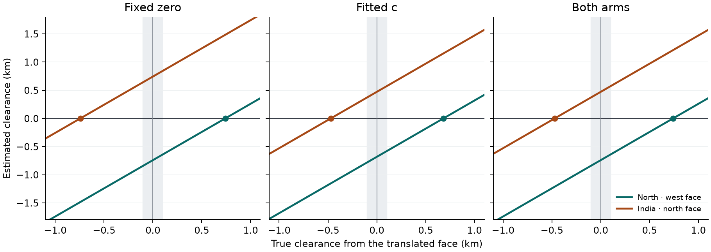

# Separation across translated faces with fixed widened estimates

Across the four saved India and north fits, the original **both-arm membership rule** kept every fixed estimate from **741.4 m inside** and withheld every fixed estimate at more than **470.7 m outside** the tested face. Any shared monotone threshold on the paired clearance would require symmetric inside and outside depths greater than about **606.1 m** on this observed error envelope, about 1.212 km between cases. The earlier 100 m mirror leaves too little separation. These bounds condition on the saved fits and the tested directions. [Machine-readable intervals and error bands](measurements/widened-face-sweep.json)

## Continuous translation

The input is the four independently returned 50 km fits from the wider-offer study. Each endpoint stays fixed while the original 25 km square translates along its challenged face normal in the original local frame. The challenged face is north for India and west for the northern waveform. The tangential coordinate stays fixed and has at least 11.80 km of slack for each reference and estimate. The analytic intervals reproduce all four original paired decisions. The earlier mirrored-position study held a single containing-offer estimate fixed and tested two discrete shifts. This sweep uses both actual widened estimates per waveform and computes the acceptance interval for every translation. [Widened endpoints and inputs](widened-offer-membership.md) · [Earlier point membership](mirrored-regions.md)

Let `d` be true clearance from the tested face in km, positive inside, and `b` be the endpoint error projected onto the inward normal. The estimated clearance from that face is `d + b`. A single arm is inside the translated square exactly when `−b ≤ d ≤ W − b`, where `W` is the original width. Both arms are inside when `−min(b₀, b꜀) ≤ d ≤ W − max(b₀, b꜀)`. The near-face paired score therefore uses the smaller of the two arm clearances. The upper endpoints keep the opposite face in the calculation.



The gray strip marks ±100 m of true clearance. The markers show where the unchanged zero gate begins to keep a fit. Lines use each waveform's mean inward bias for display. For each rule, the two offer-specific fits differ by at most 0.12 m in this projection within either waveform. The bounds use all four biases individually.

| Waveform and tested face | Geographical east error, c = 0 / fitted | Geographical north error, c = 0 / fitted | Inward error through that face, c = 0 / fitted |
|---|---:|---:|---:|
| India, north face | +695 / +585 m | −742 / −471 m | +742 / +471 m |
| North, west face | −741 / −683 m | −81 / −202 m | −741 / −683 m |

India's southward error points into its original offer. Translating the north face to a 100 m omission would place both fixed estimates inside. North's westward error points out of its offer. That fit needs about 741 m of true clearance before the paired gate keeps it. A face with the reversed normal reverses the sign of the same projected error. [Per-fit error vectors](measurements/widened-face-sweep.json)

## Where the fixed rule can separate

| Rule | Observed inward error | All withhold if omission depth exceeds | All keep from this inside depth near the face | Symmetric depth needed for any shared clearance threshold |
|---|---:|---:|---:|---:|
| Fixed zero | −741.4 to +742.4 m | 742.4 m | 741.4 m | >741.9 m |
| Fitted `c` | −682.6 to +470.7 m | 470.7 m | 682.6 m | >576.7 m |
| Both arms | −741.4 to +470.7 m | 470.7 m | 741.4 m | >606.1 m |

If the observed inward errors range from `b_min` to `b_max`, a shared gate that keeps clearance at least `T` must satisfy `b_max − m < T ≤ b_min + m` to separate omissions at `−m` from valid offers at `+m`. The strict bound comes from closed-face membership. At ±100 m, the paired rule would require `T > +370.7 m` for the India omission and `T ≤ −641.4 m` for the north containing offer. The interval is empty. The analysis reports this feasibility limit while evaluating the existing zero gate. The exact common keep intervals in the receipt also account for the opposite face.

The observed envelope measures signed errors from two public waveforms. The prior conditional-curvature audit on the earlier northern anchor measured face-normal scales of 0.929 km at fixed zero and 0.922 km with fitted `c`, and projected half-widths of 2.274 and 2.256 km for its nominal joint ellipse. The 200 m separation in that audit was about 0.22 of either scale. Those numbers describe the earlier fit's local likelihood and supply context for the geometric limits here. Coverage and new-site performance remain unmeasured. [Earlier uncertainty experiment](mirrored-uncertainty.md)

## Reproduction

Eleven component tests passed, covering the full translated interval, the strict threshold gap and the archived membership decisions. Generate the receipt and figure directly from the existing scored document. [Sweep code](widened_face_sweep.py) · [Tests](../../../tests/pipeline_eval/test_widened_face_sweep.py)

```sh
d=reports/ALGO08/single-core-2x
python -m reports.ALGO08.single-core-2x.widened_face_sweep \
  "$d/measurements/widened-offer-membership.json" "$d/measurements/widened-face-sweep.json" \
  --figure "$d/widened-face-sweep.png"
```
