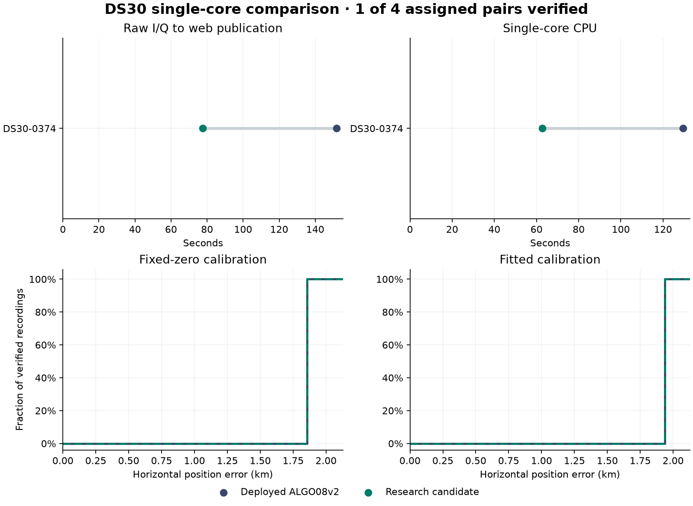

# First physical publication with the wrapped-longitude solver

The frozen research build `445744b4` took **77.48 s** on DS30-0374 versus **151.70 s** for deployed ALGO08v2, **1.96× elapsed**. It missed half-time by 1.62 s. Single-core CPU fell **129.50 → 62.77 s**, or **2.06×**. This is the first assignment of the existing four-recording panel. The receiver used the full two-scan schedule. All eight required web figures were published by both builds. [Frozen source and detector](measurements/spectral-wrapped-longitude-freeze.json) · [Matched raw receipt](measurements/DS30-0374-wrapped-spectral.json)

| Stage on DS30-0374 | Deployed elapsed s | Candidate elapsed s |
|---|---:|---:|
| Start through saved detections | 109.46 | 51.70 |
| Detections through position decision | 36.55 | 23.07 |
| Decision through completed web publication | 5.69 | 2.70 |

The candidate ran first with 15.3% of the 106 input files' pages resident. At the start of deployment 88.7% were resident. Each arm registered filesystem reads. The timings include that storage activity and the single CPU was scheduled at low priority. [Assigned order, cache snapshots and verification](measurements/wrapped-spectral-0374-stage.json)

Both builds found **4,157** selected factors in the same order with identical carrier frequencies, epochs and ranks. Fixed-zero position error rounded to 1.855 km and fitted error to 1.935 km in both builds. The physical fitted error increased by 0.0435 mm under the unrounded comparison. The owner maps in both calibration arms and seven decoded plots matched. The position image and path/grid digests differed. These observations reproduce the preceding build's physical discrepancy. Restoring the deployed detector margins before noise estimation recovered both deployed endpoints and paths in saved sparse and dense solves. This separate replay used archived margins. [Raw artifact and error audit](measurements/wrapped-spectral-0374-audit.json) · [Noise-model attribution](solver-deployed-margin-recovery.md)

To reproduce this pair, follow the [physical runner commands](terminal-guard-publication.md#reproduce) with the candidate bundle `integration-spectral-vectors-wrapped-longitude`, specification `445744b4401d14d42a62130dca85882fd9062eb32627a9046e62205650dddb28`, a fresh output root, and the single assignment `DS30-0374`. Plot the resulting inventory with `python -m reports.ALGO08.single-core-2x.plot_ds30_stage INVENTORY OUTPUT.png`. This recording provides one physical location and one timing pair.
