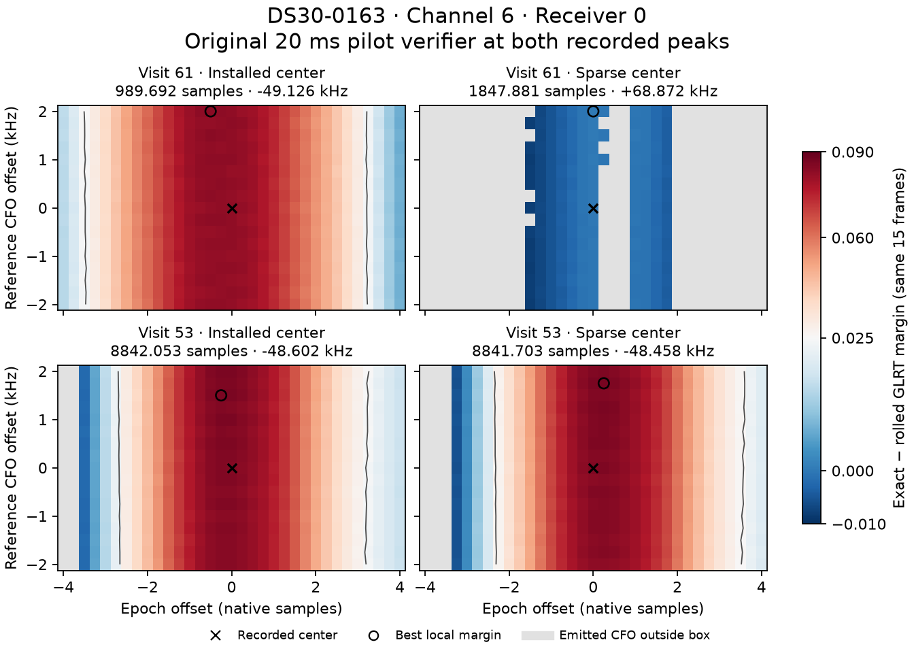

# DS30-0163 visit 61 has stronger full-window support near the installed estimate

At visit 61, receiver 0, channel 6, the original 20 ms pilot verifier favors the recorded **−49.126 kHz / 989.692-sample** neighborhood. Its best local exact-minus-rolled margin was **0.083589**. The sparse **+68.872 kHz / 1847.881-sample** neighborhood peaked at **0.000278**, below the original **0.025** gate. The sparse factor had passed on five frames with a margin of **0.025705**. Both 20 ms neighborhoods used the same 15 frames, raw CI16 and scoring rule. This bears on waveform support for two competing interpretations of one opportunity. Satellite identity, causal tracking choice and position accuracy are separate questions.

## Native factors and their separate selection

The unmodified installed two-scan and sparse 8 ms libraries reproduced the archived selected rows, including every float field. For installed v3 the sealed ranked row occurs among the returned alternatives. The old source-pinned diagnostic relink reproduced both raw full factors exactly, and its fixed exact verifier reproduced their scores and final CFOs at the traced scout seeds and timing offsets. The sparse scout independently returned its archived integer phase region and a signed carrier of **+68.428 kHz**, then added one positive residual bin. Its scout passed the early pilot check. Full rank 1 came from a signed cancellation scout near **−48.682 kHz**, then moved one negative residual bin. Both final verifications read the original I/Q.

| Available native factor, visit 61 | Rank | Phase, samples | Emitted CFO, Hz | Exact | Rolled | Margin |
| --- | ---: | ---: | ---: | ---: | ---: | ---: |
| Installed primary alternative | 0 | 4937.628 | −112,782.582 | 0.143447 | 0.032503 | 0.110943 |
| Installed selected row | 1 | 989.692 | −49,126.353 | 0.119961 | 0.037163 | 0.082798 |
| Sparse selected row | 0 | 1847.881 | +68,872.210 | 0.073723 | 0.048018 | 0.025705 |

The raw primary has the largest installed margin. The chronological installed receiver chose rank 1. The grid was frozen around the two published estimates, so it contains no search around the extra full primary.

## Same-budget local comparisons

Each box has 561 metric evaluations at phase offsets of ±4 samples in 0.25-sample steps, about 25 ns, and signed reference CFO offsets of ±2,000 Hz in 250 Hz steps. The original receiver's fractional phase calculation uses the same 16-tap Lanczos weights and 64 symbols × 44 samples per frame in all views. Each exact or rolled score is normalized by summing over frames the squared sum of the magnitudes of its despread symbols. The native verifier searches its 512 residual bins for each reference evaluation. Those bins cover a signed cyclic **227,272.727 Hz** period, with nominal **443.892 Hz** spacing. The plotted vertical coordinate is the reference oscillator. The reported peak also requires its reconstructed `reference + residual` CFO in the same signed local box. All 2,244 score cells, including those outside that output-CFO condition, are in the receipt.

| Visit and grid center | Valid emitted CFO cells | Cells passing 0.025 | Best margin | Phase, samples | Emitted CFO, Hz |
| --- | ---: | ---: | ---: | ---: | ---: |
| 61 · installed | 561 | 444 | 0.083589 | 989.192 | −48,901.921 |
| 61 · sparse | 186 | 0 | 0.000278 | 1847.881 | +68,652.750 |
| 53 · installed | 527 | 392 | 0.086310 | 8841.803 | −48,433.809 |
| 53 · sparse | 510 | 408 | 0.086606 | 8841.953 | −48,483.435 |

The visit 61 centers are **858.189 samples** and **117,998.563 Hz** apart. Their minimum separation under the residual alias period is **109,274.164 Hz**, well beyond the combined 4 kHz search width, and their phase intervals are disjoint. Even allowing every residual branch in the sparse box gives zero gate-passing cells. Its highest exact-score cell has margin 0.002678 and reconstructs **+176.182 kHz**, beyond that box. The paired control at visit 53 is the previous positive on the same RX0/CH6/RF stream. Its two centers differ by **0.350 samples and 144.265 Hz**, so their neighborhoods overlap and their similar peaks are correlated. The native ranks differ there too, even though the measured waveforms support the same local peak.

## Custody and reproduction

The installed reader checked the complete original 78,720,466-byte compressed member, index, frame checksum, 102,400,000 decoded bytes, all 64 window hashes and chronological extent before either native diagnostic. The two measured windows were immutable. Only the one already recovered first member was read. The native worker's internal clock, through input verification and all four local grids, was **2.290 s elapsed / 2.274 CPU s** on CPU2 at nice 15, best-effort priority 7 and one numerical thread. The lock was released before offline rendering and reporting.

The protocol and native diagnostic were frozen at `438e8c30a`. Run `python -BPs -m reports.ALGO08.v3.signed_peak_0163 NEW_RESULT.json.gz` with the pinned installed release interpreter, installed payload and release `src` on `PYTHONPATH`, and the shared Gauss lock. Run `python -Bm reports.ALGO08.v3.plot_signed_peak_0163 RECEIPT.json.gz OUTPUT.png` for the figure. The [frozen protocol](0163-signed-peak-neighbourhood-protocol.md) records the exact predeclared scope. The [sealed receipt](measurements/0163-signed-peak-neighbourhood.json.gz) SHA-256 is `77dabc6821d2cd2134187e320478ddd43b30f9dd6ca38478ec0ca045e4a2ceeb`. The [previous native-method qualification](directed-verifier.md) covers the archived fixed verifier and full-factor parity.
