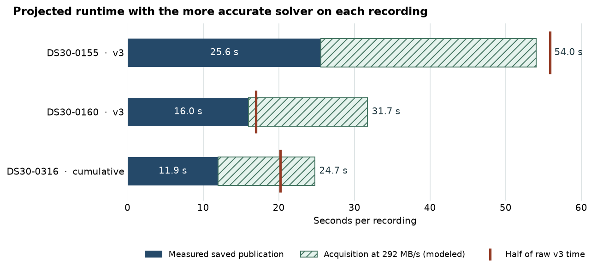

# What preserving both position estimates costs on three named DS30 packets

Choosing the faster cumulative solver only when both of its position errors are at least as good as v3's selects **v3 on DS30-0155 and 0160, and cumulative on 0316**. This choice uses the surveyed answers. It gives the two existing solvers an optimistic routing test with no cost for deciding and no extra solve for a retry. Each saved solver ran on identical named v3 detector output for its recording. All three physical recordings come from one site. [0155](prospective-0155-solver.md) · [0160](prospective-0160-solver.md) · [0316](prospective-0316-solver.md)

| Recording | Historical raw v3 elapsed | Fresh saved publication, v3 / cumulative | Route selected in hindsight | Seconds left for acquisition at half historical elapsed |
|---|---:|---:|---|---:|
| DS30-0155 | 111.682 s | 25.571 / 18.271 s | v3 | 30.270 |
| DS30-0160 | 33.933 s | 15.999 / 14.612 s | v3 | 0.968 |
| DS30-0316 | 40.371 s | 18.358 / 11.946 s | cumulative | 8.240 |

On 0160 the candidate time is from the successful confirmation of the original candidate output. The first run exited with an audit error. The original raw baselines for 0160 and 0316 had fully resident compressed inputs. On 0155 the initial resident fraction was below 0.01%. The table compares each candidate projection against its own recording and cannot predict a differently cached physical panel. All inputs link back to the same inventory for that recording. [Sources, hashes and per-case calculation](measurements/accuracy-route-budget.json)

## Joint acquisition and solver requirement

Assume a single effective acquisition rate across all three recordings. Divide each original compressed byte count by that rate, then add a saved elapsed charge from the chosen solver. The two requirements are the median candidate/v3 time ratio and ratio of total times, each at most 0.500. The table gives the minimum rate each gate needs, in decimal MB/s.

| Solver charged | Saved publication through exit, median / summed | Numerical solve alone, median / summed |
|---|---:|---:|
| Named v3 on all three | 2,049 / 504 | 675 / 377 |
| Cumulative on all three, including its two regressions | 454 / 346 | 325 / 290 |
| Choose the faster accuracy-preserving route with hindsight | **454 / 422** | **325 / 332** |

The complete saved clock includes fresh startup, packet loading and verification, the numerical solve, rendering and publication. A combined raw launcher could share some of these costs. The solve-only column grants all those other operations free, while still charging acquisition. The measured numerical clocks use different cumulative revisions on the three recordings. These are sensitivity calculations for the documented implementations. The raw benchmark requires one frozen candidate through publication and process exit. [Budget implementation](accuracy_route_budget.py)

At the **292.39 MB/s** observed on a different warm physical recording, the hindsight route gives projected median/summed ratios **0.613/0.594**, leaving **17.488 s** to remove across the three before reaching the summed gate. Even charging only the measured numerical solve gives **0.532/0.536**, or **6.756 s** over the summed budget. The reference rate was measured with a mixed 20/12 ms receiver; obtaining the original full-20 ms measurements at this rate is an additional unverified assumption. The two timing gates apply to the panel. They can both pass while an individual recording misses its half-time. [Measured weak rate](warm-recording-budget.md)

A fast fallback to original v3 can protect an occasional difficult fix. On this trio, improving the exact solve and reducing receiver work are both valuable even if we can identify the cases that need fallback in advance. The immediate tests use the 0155 and 0160 changes in satellite support to isolate the accuracy loss and price alternatives on unchanged inputs. This audit performed no waveform or numerical replay.
