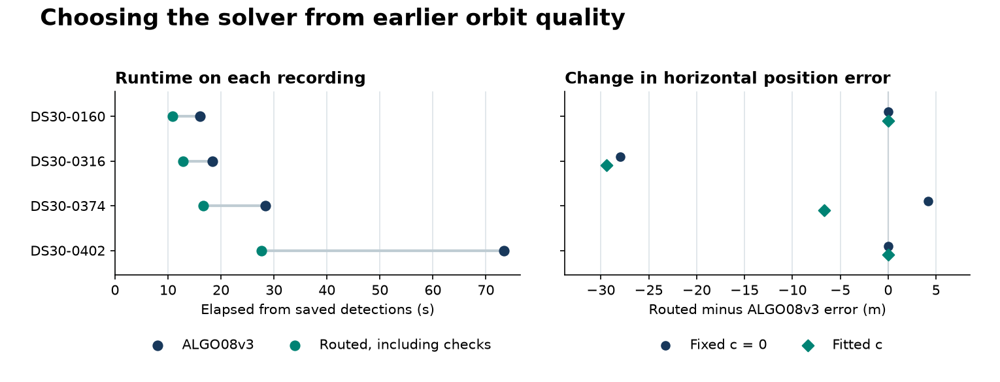
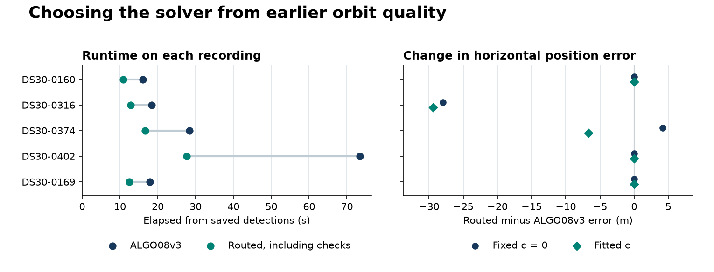
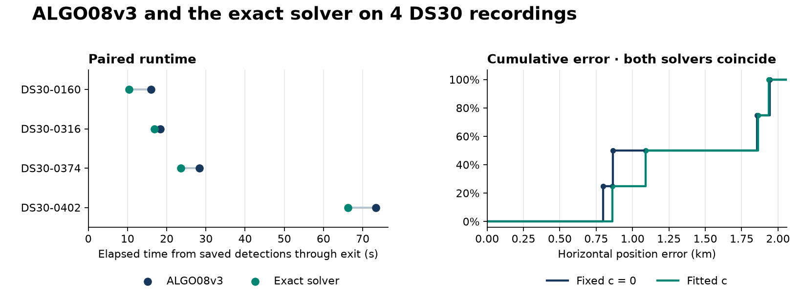

# ALGO08v3 successor validation on saved DS30 recordings

**The current solver cut total time from 153.93 to 80.50 s on five physical DS30 fixes starting from saved detections.** Including candidate launcher checks, the speedups were **1.47× on the median pair and 1.91× by total time**. All five known positives returned fixes. The largest increase in horizontal error was **4.2 m** across both calibration arms. DS30-0107's archived withholding precedes the solver and is outside these five timings. [Five-recording comparison](history-risk-held-0169.md)

The following earlier experiments explain why the candidate checks orbit quality before choosing a solver. On DS30-0160, the original lean approach increased fitted-calibration error by 236 m. The new routing rule recovered the installed answer.

| Recording | Timing boundary | ALGO08v3 → candidate, elapsed | Position result |
|---|---|---:|---|
| DS30-0107 | Complete original recording through process exit, one fresh run per arm | 1.417 → 0.508 s (2.79×) | Both withheld for insufficient curvature. Both calibration arms returned no position. [Paired result](adaptive-withhold-0107.md) |
| DS30-0160 | Same original 20 ms detection packet through exit | 15.999 → 14.353 s (1.115×) | Both fixed. Horizontal error increased from 798 to 822 m at fixed zero calibration and from 1,089 to 1,325 m with fitted calibration. [Held transfer](held-adaptive-0160.md) |
| DS30-0008 | Same hybrid detection packet through exit | 62.393 → 26.769 s (2.33×), or 31.090 s (2.01×) charging index construction | Both fixed. Horizontal error fell from 959 to 573 m and from 894 to 516 m. Only the first 192 of 6,772 visits used actual 8 ms substitutions. [Dense comparison](named-hybrid-baseline.md) |
| DS30-0016 | Complete historical v3 run compared with separately timed candidate acquisition and publication | 10.824 s measured → 7.511 s estimated (1.44×) | Historical v3 and current saved candidate both fixed. Horizontal error fell from 1,644 to 490 m and from 1,661 to 980 m. Candidate RF RMS rose in both arms. [Weak comparison](weak-all8-adaptive.md) |

The last three rows cannot supply a cohort runtime or fix-rate estimate for a new end-to-end release. In particular, charging the index construction to the dense case addresses one cost. It still leaves original waveform processing outside both saved clocks. The candidate used an adaptive grid and all eight figures were verified on each saved positive. On DS30-0160 the omitted grid locations have no same-fit full-grid reference. The physical DS30 cases also share a site.

## Complete North simulation with the split archive

Both single-core processes started from stored waveforms, used the same 1,200 scheduled visits and supplied region, and finished their position publication with eight verified figures. The candidate took **9.811 s**, versus **17.255 s** for a fresh installed ALGO08v3 control. It used **9.801 CPU s** versus **17.248 CPU s**. The candidate ran first. These are individual measurements on a previously evaluated simulation. [Paired experiment, clocks and figure checks](north-strict-read.md)

| What the user starts with | ALGO08v3 | Candidate | Speedup |
|---|---:|---:|---:|
| Each reader's verified archive ready | 17.255 s | 9.811 s | 1.759× |
| Existing v3 archive, one analysis including conversion and independent readback | 17.255 s | 18.069 s | 0.955× |

The earlier installed control on these waveforms took 16.133 s, giving 1.644× for the ready archive. Against the fresh control the candidate still needs to save **1.183 s** to reach 2×. The packed payload occupied 1.586 GB versus 1.579 GB for the original. The reader saved decoding work by accessing short observation windows separately. The total speedup also includes changing the detector, solver and renderer. [Reader and solver clocks](north-strict-read.md)

Running ALGO08v3 first on the same simulation gave **18.757 → 10.544 s (1.779×)**. Adding the one-time 8.258 s conversion to this repeat gives 18.802 s, or 0.998× the fresh control. The two candidate clocks give **1.530–1.644×** against the earlier 16.133 s baseline. Both fresh pairs cleared 1.6× with prebuilt input. Neither reached 2×. These repetitions cover one location and one recording. [Reversed order and independent verification](north-strict-reverse.md)

On 64 visits from the same simulation, a prototype wrote a split archive directly from the original sample words, then verified the complete payload in **365 ms**, versus **436 ms** for the ordinary writer and full readback. The full-recording experiment then started both writers with the same 1,200 in-memory windows and timed durable capture through first verified position and process exit. The ordinary writer plus installed ALGO08v3 took **19.529 s** and the direct split writer plus candidate took **13.580 s (1.438×)**. The respective writing stages took **2.825 and 2.543 s**. The packed reader authenticated all 2,400 encoded parts and independently verified all 1.92 GB of decoded samples. This captures the cost of first analysis with a new recording in each format. [Member experiment](north-owned-capture.md) · [Complete first publication](north-direct-multichunk.md)

The direct writer used its own signed capture identity. Both routes reproduced their earlier detector and calibration results after accounting for that identity. All eight images per route matched prior pixels outside the recording title. The candidate preserved all 342 ordered assignments per arm. The installed route exposed counts and digests without an independently retrievable ordered list in this run. One simulated recording was tested in this experiment. [Published outputs and readback evidence](north-direct-multichunk.md)

| Horizontal error and frequency residuals | ALGO08v3, zero / fitted calibration | Candidate, zero / fitted calibration |
|---|---:|---:|
| Horizontal error | 105.7 / 140.8 m | 112.0 / 128.1 m |
| Conditional RMS | 5.41 / 5.17 Hz | 9.13 / 8.92 Hz |
| RMS across all assigned observations | 9.70 / 18.57 Hz | 44.98 / 50.42 Hz |

The lean and exact solvers produced the same positions and ordered assignments on the same 20/8 ms detector packet for North and physical DS30-0016. On identical full-20 ms packets the lean solver lost 49 assignments per arm on DS30-0160, added 26 on DS30-0316 and lost 83 on DS30-0374. Both final fits on DS30-0316 passed the original signed check. That check alone cannot certify equivalent satellite assignments. [Five-packet solver audit](lean-named-parity.md)

## Transfer to the South simulation

The same single-core reader, detector and solver completed South in **9.507 s** with the split archive available, versus **15.699 s** for a fresh installed ALGO08v3 control (**1.651×**). Charging **9.444 s** to convert and verify the original archive made first use **18.952 s**. The earlier v3 control took 14.370 s, giving **1.511×** for the prebuilt input. The candidate ran first. [South transfer and clocks](south-strict-transfer.md)

For fixed-zero and fitted calibration, horizontal errors fell from **817 / 1,101 m** to **325 / 363 m**, while conditional RF residual RMS rose from **6.502 / 6.392 Hz** to **10.213 / 10.108 Hz**. The two builds both returned a containing fix. The strict route reproduced its earlier lean result, all 304 ordered assignments per arm and all eight PNGs. The 100 m omitted-region result comes from matching the signed detector packet and inference configuration to the earlier saved solve, which returned a false fix in both arms. [South scientific outputs and omission evidence](south-strict-transfer.md)

## Partial and empty physical captures

The first physical trial exposed an assumption in the split format. The ordinary reader treats a cancelled or skipped visit as a recorded opportunity with its actual sample extent. DS30-0107 includes a cancelled visit with 136,857 samples and an empty visit. The initial packed format expected exactly 200,000 samples per visit and rejected this recording at the metadata check before reading its waveform.

The sealed DS30 inventory contains **45,080 compressed members across 455 recordings**. In **43 recordings**, one member's declared decoded length is shorter than `1,600,000 bytes × issued visits`. The difference totals 83,960,496 bytes across the 43 members. All 43 recordings were marked incomplete. DS30-0016 was the one additional incomplete recording with nominal totals in every member. Matching the cohort by original content identity shows that **28 of the 43 affected recordings produced fixes in both calibration arms** in the historical compact two-scan evaluation. DS30-0316 also exhibits the length discrepancy and subsequently fixed with named v3. Checking member lengths establishes a lower bound on variable extents. The census used only the committed inventory and outcome tables. [Reproduce the census](strict_extent_census.py) · [DS30 source and historical fixes](../../2026_11_21_ds30_full/README.md)

A new private format revision preserves every original byte and visit, including partial and empty captures. On the complete original DS30-0107 input both pipelines withheld for insufficient curvature. With a packed archive available the candidate took **0.486 s** versus **1.388 s** for installed v3 (**2.859×**). Including **0.319 s** for one-time conversion and complete readback gives **0.805 s (1.725×)**. The candidate authenticated 58 encoded parts, retained both exclusions and processed all 54 admitted radio opportunities. Both calibration arms returned null positions, and the web product checks confirmed the expected absence of figures. This measures one physical withholding decision. Position accuracy requires a physical recording that returns a fix. [Physical pair, format revision and integrity checks](strict-packed-0107.md)

## Choosing the solver from earlier orbit quality

A location-independent check propagated the available earlier orbital elements at three times before fitting. If any element failed that check, the candidate used the full exact solver. Otherwise it used the faster discovery procedure and the original final fit. Both branches reused one preparation. These two development recordings were already known to exercise different branches. [Selection rule and paired publications](history-risk-route.md)

| Same saved physical detections | Installed v3 | Routed worker | Horizontal error, fixed / fitted |
|---|---:|---:|---|
| DS30-0160, earlier orbit failed | 15.999 s | 10.471 s | Reproduced **798 / 1,089 m** and all 1,037 assignments per arm. The earlier lean run gave 822 / 1,325 m. |
| DS30-0316, earlier orbits passed | 18.358 s | 12.371 s | **1,917 / 1,834 m**, versus 1,945 / 1,863 m for v3. The lean branch added 26 assignments per arm and increased conditional RF RMS by 0.36 / 0.38 Hz. |
| DS30-0374, earlier orbits passed | 28.324 s | 16.228 s | **1,860 / 1,929 m**, versus 1,855 / 1,935 m for v3. The lean branch retained all 411 predictive assignments and dropped 83 conditional assignments per arm. Conditional RF RMS increased by 0.041 / 0.074 Hz. |

DS30-0374 was held out when designing the routing rule and had previously been used for localization. On these three known positives from the same roof, both pipelines returned three fixes and eight verified figures per fix. From saved detections through process exit, elapsed fell from **62.681 to 39.070 s**. That gives **1.604× summed and 1.528× median paired speedup**. Including the routed launcher's input checks gives **40.360 s**, or **1.553× summed and 1.470× median**. The historical installed worker clocks exclude launcher checks. [Timing boundaries, errors and product verification](history-risk-0374.md)

On the fourth recording, DS30-0402, the lean branch took **27.655 s** with entry checks, versus **73.351 s** for installed v3. All 4,821 satellite assignments in each arm matched. The error changes were under 0.05 mm. The grid and path changed, and seven of eight images matched pixel for pixel. All eight verified. Across four cases, charging candidate entry checks gives **1.585× median paired speedup and 2.000025× by total elapsed**. In the benchmark's candidate/v3 units, the median is **0.6344** and the ratio of totals is **0.499994**. Both must be at most 0.5. The summed margin is less than a millisecond against archived controls. The panel contains known positives at one site. [Per-recording errors, assignments and figures](history-risk-0402.md)

The largest saving also held in a fresh, single-core pair on DS30-0402. With input admission charged to each method, installed v3 took **76.904 s**, followed by **27.247 s** for the candidate (**2.82×**). Shared controller startup was outside both clocks. The fresh installed run reproduced its archived scientific outputs and all eight PNGs. The panel above retains its original enrolled runs. [Fresh paired controls and scientific comparison](history-risk-0402-pair.md)

The next enrolled physical recording, DS30-0169, took **12.485 s** with input checks versus **17.893 s** for archived installed v3. Both calibration arms reproduced all 2,236 ordered satellite assignments, the full grid and all eight PNGs. The horizontal errors were **506 m fixed and 348 m fitted** for both methods. Across the expanded panel, the candidate divided by installed elapsed was **0.6804 at the median and 0.5230 by totals**. Both exceed the 0.5000 target. This recording was previously studied for other localization methods and held out for routing. [Enrollment, outcomes and timings](history-risk-held-0169.md)

Transferring each measured downstream saving, including launcher checks, to that recording's historical raw clock gives acquisition budgets of **7.43, 8.47 and 25.40 s** respectively for a per-recording 2× improvement. A receiver sustaining one rate across the three would need **442 MB/s** for the median gate and **406 MB/s** for the summed gate, measured from launch through sealed detections in original compressed MB. These are targets derived from separate launches. Reproduce them with `PYTHONPATH=.:src python reports/ALGO08/v3/adaptive_receiver_budget.py --routed-cases` in the project environment. [Calculation](adaptive_receiver_budget.py) · [Measured physical receiver prefixes](seekable-eight-raw.md)

Adding DS30-0402 gives it a **35.72 s** acquisition budget. The four-recording thresholds become **377 MB/s** for the median gate and **324 MB/s** for the summed gate. The difference from the three-case thresholds illustrates how much the target depends on including one expensive solve. Use `--routed-cases 4` to reproduce the four-case estimate. The raw 20/8 ms receiver can produce different detections from the original packet used to measure these saved-solver improvements.

### How representative are the saved recordings?

The first four accounted for **4.98%** of installed v3 elapsed on the historical 55 recordings and **7.31%** of post-detection time among the 52 with stage clocks. The fifth brings those shares to **6.28% and 8.26%**. Ordered by increasing post-detection time, DS30-0160 ranks 2nd, DS30-0169 5th, DS30-0316 6th, DS30-0374 19th and DS30-0402 52nd of 52. The largest measured saving came from the single most expensive post-detection case. Four of the five were among the eight shortest complete raw runs.

The table prices the remaining work across the original 55. It transfers the five matched solver time differences, charges the three unsplit recordings their entire installed clocks, and asks how much faster the other **47** post-detection stages would have to run. Each column gives the minimum common reduction across those 47 that would satisfy **both** the median and summed elapsed gates at the stated acquisition rate.

| Assumed effective acquisition on all 52 split cases, original compressed MB/s | Remaining downstream reduction for 1.6× | Remaining downstream reduction for 2× |
|---:|---:|---:|
| 225 | 12.2% | 55.0% |
| 250 | 1.1% | 43.9% |
| 325 | 0% | 20.9% |
| 375 | 0% | 10.7% |
| 400 | 0% | 6.5% |

The acquisition rate includes startup, storage waits, verification, DSP and sealing detections. Uniform rates and uniform downstream savings are assumptions. The remaining 47 recordings still need observed candidate timings and accuracy measurements. Run `PYTHONPATH=.:src python reports/ALGO08/v3/adaptive_receiver_budget.py --historical-transfer 5` in the project environment for the two gates separately. [Historical stage and input-size ledger](measurements/acquisition-throughput.json) · [Paired calculation](adaptive_receiver_budget.py)

## Keeping ALGO08v3's original position solution

The next solver experiment kept the original satellite selection, repairs, fits, and standard figures and reused repeated computations. All four physical recordings returned exactly the original ordered satellite assignments, both calibration endpoints and RF residuals, the 179-location grid, the path and all eight PNGs. Each comparison starts with the same original signed 20 ms detections. The named comparison clocks are historical. [First two recordings](exact-named-route.md) · [Third recording](exact-named-dense.md) · [Fourth recording and cohort](exact-named-0402.md)

| Recording | Named v3 elapsed | Exact solver elapsed | Speedup | Horizontal error for both methods, fixed / fitted |
|---|---:|---:|---:|---:|
| DS30-0160 | 15.999 s | 10.330 s | 1.55× | 798 / 1,089 m |
| DS30-0316 | 18.358 s | 16.887 s | 1.09× | 1,945 / 1,863 m |
| DS30-0374 | 28.324 s | 23.630 s | 1.20× | 1,855 / 1,935 m |
| DS30-0402 | 73.351 s | 66.203 s | 1.11× | 864 / 860 m |

On the first recording the saved speedup was **1.55×**. Across the first two, total time fell **34.357 → 27.217 s** (**1.26×**), with **1.28×** by the median paired ratio. Adding the prospectively selected 6,770-visit DS30-0374 brought the totals to **62.681 → 50.847 s** (**1.23×**), with **1.20×** by the median paired ratio. Both solvers fixed 3/3. DS30-0160 avoided repeating a fit after recovering a missing prior orbit. DS30-0316 took the ordinary inference path and had no such retry. These cases differ in how much work the solver can reuse.

With DS30-0402 included, both solvers fixed **4/4**. Total elapsed fell from **136.033 to 117.050 s**, a **1.162×** speedup. The median within-recording candidate/v3 time ratio was **0.868** and the summed ratio was **0.860**, against a target of 0.500. DS30-0402 was already a development case. Its constrained optimization ran 393 visits across ten fits. An earlier configuration checked the fitted arm first and used a wider compiled likelihood, preserving the same science in **49.712 s** on this recording. The four-case comparison uses the same frozen solver on every recording. [Four-case results](exact-named-0402.md) · [Earlier DS30-0402 configuration](wide-private-0402.md)

The candidate launches could use the same prebuilt orbit index. Its signed digest and producer match the independently timed **4.320 s** build. Charging that build once across the three completed runs gives **55.168 s**, or **1.14×** versus named v3. DS30-0316 also incurred a 1.127 s rejected startup before its legacy manifest path convention was corrected. Including both that startup and the index gives **56.295 s**, or **1.11×**. The candidate reused four indexed catalogue bodies on DS30-0160 and zero on DS30-0316. [Index build clock](weak-all8-adaptive.md) · [Per-case activation](exact-named-route.md)

On **DS30-0016**, both solvers consumed the complete signed detections from the candidate's 20/8 ms receiver. The exact solver took **6.453 s** against **6.918 s** for the named solver on that same packet, a **1.07×** saved speedup. Both produced identical 490 m and 980 m errors, retained all 115 assigned observations per arm, and reproduced the full grid, path and eight PNGs. The original v3 receiver on the same recording had produced 1,644 m and 1,661 m errors. This comparison tests the handoff from the shorter receiver to the exact solver. Its 6.453 s clock starts after the detections already exist. [Weak receiver-to-solver comparison](named-weak-all8.md)

The first 1,024 visits of DS30-0008 supplied a separate shorter-duration test for the earlier combined solver. Both workers used the same 45.379 s physical observation span. Saved publication took 11.513 versus 9.316 s (1.24×). Both produced eight PNGs, but both position errors were about 7.7 km and the candidate increased error by about 8 m. An earlier candidate attempt failed to complete its final source receipt. These successful-run times illustrate the cost of publishing a fix from that short span. [Prefix result and both attempts](resident-positive-pair.md)

## How much faster must acquisition become?

The table gives the **minimum uniform effective compressed MB/s** from launch until sealed detections that would satisfy both existing time gates. A run passes those gates when both the median paired candidate/v3 elapsed ratio and the ratio of summed elapsed times are at most 0.5. Higher required rates leave less time to read, authenticate, decode and detect the same recordings.

| Assumed speedup from detections through exit | First 4 DS30 | First 16 DS30 | Historical 55 DS30 |
|---|---:|---:|---:|
| Unchanged downstream time | 752 | 651 | 486 |
| 1.115× on every fix, as in the held medium saved comparison | 574 | 501 | 399 |
| 2.007× on every fix, as in the dense saved comparison charging the index build | 299 | 264 | 235 |
| 2.331× on every fix, as in the dense saved comparison with an index available | 270 | 244 | 219 |

These are sensitivity calculations using the enrolled v3 recordings and elapsed stage clocks. Each row applies one assumed speedup uniformly to all measured post-detection time, including publication and exit. A saved-process clock contains its own startup work, so its ratio is only an assumption about how the corresponding raw stage might scale. Recordings without stage splits retain their original total elapsed. Each panel uses its original membership, including failures. No receiver was benchmarked at the rates in the table. Earlier cold two-member acquisitions reached 225 and 248 MB/s on short prefixes. Sustained throughput over complete fixes remains an open measurement. [Original rosters and acquisition measurements](panel-tail-ceiling.md)

Run `PYTHONPATH=.:src python reports/ALGO08/v3/adaptive_receiver_budget.py` from the repository root. The output gives each timing gate separately. The calculation verifies the hashes of both saved comparisons, the enrolled subsets and the historical stage data. [Calculation](adaptive_receiver_budget.py)

The receiver experiment reduced the number of pilot samples converted and preserved every ordered detection on two physical members. Complete acquisition CPU showed mixed results across repeated runs, so this change does not advance. A paired launch from identical original samples through verified publication and exit is still needed for a physical fix. The latest opportunity to copy the rest of DS30-0016 expired under storage load after zero new archive reads. [Receiver measurements](verifier-pilot-support.md) · [Staging receipt](guarded-cfo-0016-idle-a16.md)

## The receiver budget on the three matched exact fixes

These recordings also have independent v3 clocks from original waveforms. For each row, subtract that recording's observed saved-solver improvement from its historical time between sealed detections and exit. The difference between half its original end-to-end clock and this estimated downstream time is the receiver's budget. This calculation transfers the time saved on the same input. It avoids charging the saved worker's separate launch twice. Raw and saved launches took place at different times, so the result is an experiment target.

| Recording | Original raw v3 time | Original acquisition | Saved solver improvement | Acquisition budget for 2× | Required compressed MB/s |
|---|---:|---:|---:|---:|---:|
| DS30-0160 | 33.93 s | 19.28 s | 5.67 s | 7.99 s | 575 |
| DS30-0316 | 40.37 s | 23.10 s | 1.47 s | 4.39 s | 853 |
| DS30-0374 | 84.85 s | 56.16 s | 4.69 s | 18.43 s | 456 |

The original stage-clock cohort supplies all three denominators. DS30-0160 and DS30-0316 were fully resident at launch. DS30-0374 was 10.6% resident. A separate 164.40 s historical v3 run also exists for DS30-0374. Using that slower wall clock as the denominator would make the acquisition budget look much larger. [Stage-clock inventory](measurements/acquisition-throughput.json) · [Separate dense run](exact-named-dense.md)

On two original DS30-0008 members, the faster of two acquisition passes that **only decoded and verified** bytes processed 567 MB per CPU-second. As a sensitivity calculation, give all three recordings that rate, zero I/O waits and zero time for signal detection. The resulting candidate/v3 elapsed ratios are **0.503 median and 0.492 summed** against a 0.500 target on both gates. Throughput can vary by recording and implementation. The measured cost makes a change to how data are read and verified worth testing alongside faster signal processing. Run `PYTHONPATH=.:src python reports/ALGO08/v3/adaptive_receiver_budget.py --exact-cases` to reproduce the table and both ratios. [Original two-member measurements](physical-stage-envelope.md)

The fourth physical timing pair changes the receiver target. DS30-0402's original raw clock was **121.438 s**, including **50.741 s** before sealed detections. Transferring the frozen exact solver's measured **7.149 s** saving on the same signed packet gives **63.548 s** after detection alone, already **2.829 s** over half the original clock. In this model even instantaneous reading and detection would miss the per-recording target. Across all four physical cases, crediting the same 567 MB/s verification-only rate with zero detector time and zero storage wait gives **0.529 median and 0.557 summed** for candidate/v3 elapsed. The program verifies the raw recording identity and window count against the saved publication for each case. Run `adaptive_receiver_budget.py --exact-cases 4` with the same Python environment as above. These are conditional estimates across separate runs. [Four measured solver pairs](exact-named-0402.md) · [Clock and identity calculation](adaptive_receiver_budget.py)

## Reading the same original signal with less decoding

Two saved DS30 members now have an independently verified experimental representation that separates each 20 ms capture into an 8 ms prefix and a 12 ms tail. The receiver authenticates every encoded block and decodes the samples its 20/8 ms detector uses. Corrupting an unused tail caused verification to fail on both recordings. The resulting detection packets matched the ordinary 20/8 ms receiver byte for byte. The installed 20 ms receiver reads the same physical opportunities but can select different factors. [Protocol, fault injection and timings](seekable-eight-raw.md)

| Acquisition elapsed for one 64-visit physical member | DS30-0008 | DS30-0169 |
|---|---:|---:|
| Original v3, 20 ms | 488 ms | 435–448 ms |
| Ordinary archive, 20/8 ms | 349 ms | 338–362 ms |
| Verified split archive, 20/8 ms | 207 ms | 193–204 ms |
| Building and independently verifying the split archive from the original | 492 ms | 432 ms |

With the split archive already built, acquisition was **2.36×** faster on DS30-0008 and roughly **2.1–2.3×** on DS30-0169 against the original 20 ms receiver. These clocks end at acquisition, before final detection selection and position solving. For the first analysis of each existing recording, adding conversion and readback gives about **699 ms** and **625–635 ms**. Both exceed the ordinary v3 acquisition cost. The full-file reader experiment on the existing format saved up to 19.5% CPU on DS30-0169 but failed to give a repeatable improvement on DS30-0008. [Original-format receiver](sealed-stream.md)

An offline rehearsal on DS30-0008 started each writer with the same 64 physical sample windows and timed durable write through the first signed detection output. Both produced the same 70 factors with the 20/8 ms receiver and verified all 64 original window hashes and the complete 102.4 MB decoded member. In opposite orders, the ordinary writer and 20/8 ms receiver took **595 and 536 ms**. The split writer and 20/8 ms receiver took **413 and 407 ms**, a **1.32–1.44×** improvement at the same receiver settings. Ordinary writing followed by v3's 20 ms receiver took **765 ms** in its one run and returned 19 factors. It also incurred a major page fault. These measurements include the first analysis of newly written files. No new radio capture or position solve ran. [First-use timings and verification](eight-first-use.md)

The same first-use test transferred to DS30-0169 with its original 13 excluded visits. Across the two physical members, the ordinary writer and 20/8 ms receiver took **1.077 and 1.122 s** in the two orders. The split writer and the same receiver took **0.810 and 0.778 s**. The summed speedups were **1.33× and 1.44×**. The original writer and named 20 ms detector took **1.496 s** in total, giving **1.85–1.92×** when both the format and receiver changed. Both versions of the 20/8 ms path produced identical factors and end-of-recording selections. [Held transfer, aggregate and first-use costs](eight-first-use-held.md)

Reusing the exact numerical solver with the Cairo renderer also retained both DS30-0160 positions and the full grid and path. In a fresh matched pair, changing six of the figures reduced saved-publication elapsed from **10.338 to 9.825 s**, or **1.63×** against the earlier 15.999 s original v3 saved run. On DS30-0316, rendering alone saved 0.486 CPU s. Its instrumented publication took 17.095 s, including a 0.400 s diagnostic export, versus 18.358 s for the earlier v3 control. [Matched timings, figure content and instrumentation](exact-named-cairo.md)

## One process from original I/Q through the position and figures

The common research entry point now runs the 20/8 ms receiver and the exact named solver in one process using the supplied search region. On the 1,200-visit North geographic simulation, v3 and the candidate processed all 2,400 opportunities, published both calibration arms and verified all eight PNGs. The new candidate took **15.561 s**, compared with **19.967 s** for the fresh instrumented v3 baseline (**1.28×**). Acquisition fell from 9.507 to 6.144 s, with another 0.071 s for the candidate's end-of-recording detector selection. Solving fell from 7.172 to 6.082 s. Rendering took 1.698 and 1.649 s respectively. [Raw launch, timing boundaries and receipts](exact-named-raw.md)

Horizontal error changed from **106 to 112 m** at fixed zero calibration and **141 to 128 m** with fitted calibration. In the signed scientific terminal, RF RMS increased from **5.406 to 9.133 Hz** and **5.167 to 8.921 Hz** respectively. The separate plot residual summaries were 9.7 to 45.0 Hz and 18.6 to 50.4 Hz. The two receivers selected different observations. An exact solver on identical input can therefore preserve the solver result while the complete pipelines produce different positions. Reusing the candidate's detections with the published far-outside offer produced a withhold with no PNGs. North is a previously evaluated simulation and the omission was a saved-detector check.

On the complete physical DS30-0107 original input, the same entry point withheld for insufficient curvature in **0.577 s**. Its position and RF fields were null in both arms. This verifies the physical withholding path. The physical DS30 positive-fix gate remains open.

The opt-in orbit-quality rule now runs through the same raw entry point. On the North simulation it took **11.992 s** through verified publication of both positions, the 137-point grid and eight figures, or **12.256 s** including launcher checks. That is **1.629×** against the instrumented 19.967 s installed control and **1.316×** against a separate 16.133 s installed control. The fixed and fitted errors were **112 / 128 m**, versus **106 / 141 m** for installed v3. The first attempt exited with an audit serialization error after publishing and took 15.103 s. The successful clock follows the fix. Replaying its detections with the true location 52.5 km outside the region withheld both positions after 96 probes. [Raw timing, failure, omission and output checks](history-risk-raw.md)

With the verified split archive already built, the same routed raw worker took **11.647 s** on North versus **18.201 s** for fresh installed v3. Charging the candidate's specific setup gives **11.698 s (1.556×)**. Acquisition saved **0.879 s** against the earlier original-format run with the same receiver and solver. The gain through process exit was **0.345 s**. All 342 assignments per arm, the scientific grid, path and eight PNGs matched that earlier routed run. Including the independently measured **8.258 s** conversion and readback for first use of an existing archive gives **19.956 s (0.912×)**. [Fresh paired run and accounting](strict-history-raw.md)

Two narrower writer experiments timed one physical member and one simulated member. Grouping fixed-width samples cost 2.6 ms extra on DS30-0008 and saved 4.0 ms on North. Reusing the SHA-256 prefix state preserved every original digest and saved 15.3 ms and 30.2 ms respectively. Isolated hash timings support about 16–18 ms of savings per 64-window member. [Packing experiment](ci16-grouped.md) · [Digest reuse](ci16-sha-reuse.md)

The harder South omission exposed a shared failure. With the true simulated position **100 m outside** the search region, both v3 and the candidate published a false fix in both calibration arms. The candidate's fitted points were inside its search boundary, so the exterior check made zero probes. The timed candidate exited with an error while writing an additional audit record after publishing its terminal, path and eight figures. The recovered published evidence establishes the false fix. [South near-boundary test](exact-named-south-omitted.md)

A proposed withholding rule checked whether competitive points on each saved position grid reached a face of the search box. On eight matched offers it flagged all four omissions, including South's 100 m miss. It also rejected **both valid 100 m boundary fixes**, retaining only the two wider valid controls. No common threshold on this score separated the tested omissions from the valid fixes. The rule stays outside the candidate. [Frozen decision and per-offer evidence](grid-face-abstention.md)

The cheaper physical-fixture check used saved detections before transferring any waveform bytes. The two-member and three-member crops of DS30-0008 both failed the original curvature gate. The first eight contiguous members contained two eligible curved tracks, but would require another 543 MB from the archive. Passing that track gate alone would not guarantee a fix. The complete DS30-0016 input, which has an established v3 fix and a matched 20/8 ms saved fix, still requires 891 MB of staging. [Crop definitions, custody and tested track counts](cropped-physical-iq-census.md)

The raw entry point's solver handoff now has a physical accuracy check on DS30-0016. Reconstructing the selected 20/8 ms detections from the authenticated full detector output reproduced all 506 factors. The routed worker took **5.690 s**, plus **0.306 s** for admission and packet regeneration. All 115 assignments per arm, the scientific grid scores and all eight PNGs matched the exact solver on those detections. Against installed v3's full-20 ms receiver, horizontal error fell from **1,644 to 490 m** at fixed calibration and from **1,661 to 980 m** at fitted calibration. Conditional RF RMS rose from **109.4 to 134.0 Hz** and **109.5 to 133.7 Hz**, respectively. This comparison ran from saved detections. Waveform-to-position time for the combined candidate on this recording remains unmeasured. [Physical accuracy, timings and verification](history-risk-weak-physical.md)
