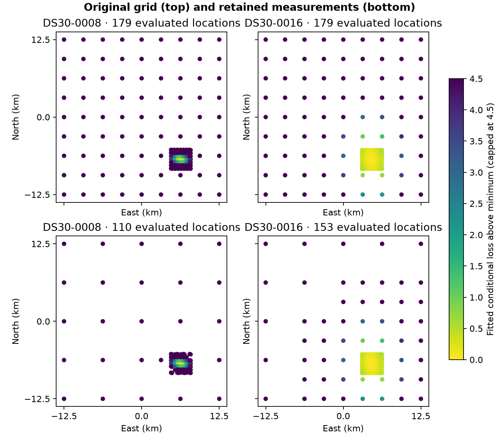

# Can the position map keep its low-loss region with fewer evaluations?

On four archived offers, an adaptive layout retained the original sampled minima, all tested locations within 4.5 objective units of the minimum, and all failed locations for both calibration arms. The weak DS30-0016 layout still needed **153 of 179** locations, a **14.5%** reduction. It missed the study's prespecified 25% minimum reduction per offer. The screen ended before a timed fit or new web publication. [Frozen criteria](adaptive-grid-protocol.md) · [All retained coordinates and scores of the audit](measurements/adaptive-grid.json)

| Completed short-receiver publication | Starting locations | Retained / original | Calls avoided | Largest fitted-arm loss interpolation error on omitted nodes |
|---|---:|---:|---:|---:|
| Dense DS30-0008 | 59 | 110 / 179 | 38.5% | 54.29 |
| Weak DS30-0016 | 59 | 153 / 179 | 14.5% | 2.96 |
| Southern simulation, containing | 43 | 75 / 137 | 45.3% | 99.29 |
| Same southern simulation, near omission | 43 | 75 / 137 | 45.3% | 99.43 |



The sampler first covers the offered square on a five-by-five grid and samples a four-by-four neighborhood around each fitted endpoint. It keeps both endpoints. It then adds original grid nodes from triangles with a low-loss vertex in either calibration arm, or with an invalid score. Coordinates clipped by the offer account for the smaller southern grids. Only retained, directly evaluated scores would appear in a position product. The large interpolation differences on some omitted nodes show why those interpolations could not stand in for the actual scores. A test with an unsampled secondary minimum also demonstrates that local refinement alone can miss a mode. The four public development maps establish empirical coverage on these inputs.

The endpoints and region decision were fixed before grid construction. In particular the known false near-omission fix stays a false fix. All four source paths, grids and terminal digests were cross-checked against their original sealed publications. The plotted scores use the fitted calibration arm and a common clipped color scale. The comparisons used archived scores without reading recorded I/Q. [Sampler and scorer](adaptive_grid_screen.py) · [Component tests](../../../tests/pipeline_eval/test_adaptive_grid_screen.py)

## Cost overlap on the installed track graph

Applying the same frozen selection to the genuine dense 12 ms packet with the original v3 graph retained **104 of 179 locations** and all tested low-loss points. This offer also has paired clocks for predictive geometry on every original objective call. The 75 omitted nodes accounted for **0.184 CPU s** of original predictive geometry. Caching orbit states saved **0.213 CPU s** at full resolution, but only **0.123 CPU s** of that saving belongs to the 104 retained nodes. These components overlap. The other per-node work was not independently timed on those coordinates, so the archived clocks do not establish an adaptive solve runtime. For scale, the dense solve would still need to fall by **2.959 CPU s** in the earlier favorable 55-recording timing model. [Matched per-node prices](measurements/adaptive-grid-cost.json) · [Exact full-grid state reuse](grid-phase-state-reuse.md)

To regenerate the numeric receipt on Gauss, run the following from the research checkout with a fresh destination. The figure driver reads the archived receipt in the checkout.

```sh
flock -x /tmp/leo-algo08v2-2x-bench/gauss.lock ionice -c2 -n7 nice -n15 taskset -c 2 \
  env PYTHONPATH="$PWD:$PWD/src" OPENBLAS_NUM_THREADS=1 OMP_NUM_THREADS=1 \
  /home/mouse9911/gits/leo-tracker-reduxredux/.venv/bin/python \
  -m reports.ALGO08.v3.adaptive_grid_screen "$new_receipt"
```
