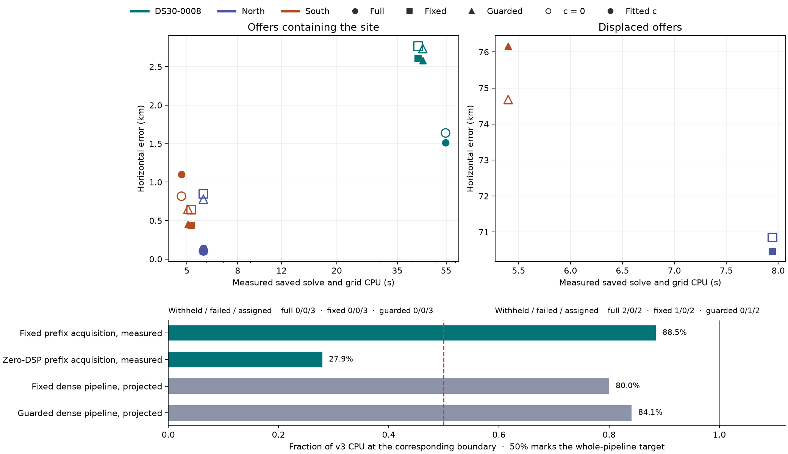

# Interleaving stereo visits across the ALGO08v3 capture

Both interleaves failed the position and runtime screens. On dense DS30-0008, both raised horizontal error by at least **1.07 km** while reducing RF RMS. The fixed mask returned a false position on the northern displaced offer. The guard failed that solve numerically and returned a false position on the southern displaced offer. The fixed and guarded masks leave **80.0% and 84.1%** of v3 dense CPU under favorable assumptions. The signed prefix lost eight carrier selections on visits the fixed schedule still measured. [Prespecified scope](aperture-protocol.md) · [Numeric summary](measurements/aperture-summary.json) · [Full receipts](measurements/aperture.json.gz)

## Changes to the evidence

The mask removes one in four interior stereo opportunities independently within each recorded edge, channel and actual RF. It retains the first four and last opportunity of every RF group. The opportunity counters stay in their original places. In the fixed schedule, measured gaps can span two original gaps. The guarded version restores a proposed omission when either receiver has fewer than three recent measured factors at the required age or its most recent measured factor is weak. It uses the original opportunity timestamps and no reference location. Reserving the last opportunity requires authenticating metadata ahead of acquisition.

Earlier quarter-arc and single-antenna/channel schedules lost entire temporal or RF coverage. An exact alternate-visit replay on DS30-0016 reduced measured CPU and changed continuation at retained visits. The earlier conditional residual trial still searched every raw-primary visit. The solver-prefix audit kept every distinct initial refresh, and the sampled-initial solver reduced only early proposal observations. This trial feeds a distinct full-aperture mask through the graph, recovery and both final fits. The earlier scheduler audit found order-dependent wall differences and recorded runnable wait separately. The prefix here rotates order and reports CPU and its charged input blocks. [Channel schedules](../single-core-2x/channel-schedules.md) · [Alternate visits](../single-core-2x/alternate-visits.md) · [Conditional residuals](../single-core-2x/conditional-ds30-stage.md) · [Solver prefix](../single-core-2x/solver-initial-prefix.md) · [Sampled initial solver](../single-core-2x/solver-sampled-initial.md) · [Scheduler observation](../single-core-2x/north-scheduler-observation.md)

The saved-input solver tests erase the candidate lists at omitted visits before recomputing track extraction, association, both fits and objective grids. Their kept selections still benefited from full v3 continuation. Dense DS30-0008 had 7,016 continued measurements originally and 5,254 after the fixed saved mask. Replaying continuation with the originally published factors alone gave 5,999 in the unmasked control and 4,135 under the fixed mask. The archive lacks the original unselected raw factors and competing carriers, so that restricted replay measures sensitivity to missing donor evidence. The existing full pre-continuation ledgers used an earlier receiver binary.

On the 128-visit signed DS30 prefix, the actual fixed receiver maintained empty causal slots at omissions. It reproduced the metadata for all 256 antenna rows. Saved full measurements predicted 64 survivors on the kept visits, while the measured chronological run returned 56. All eight indirect changes were lost continued factors. The full v3 prefix reproduced all 84 archived selections exactly. The bounded raw experiment supplies direct evidence of causal selection changes for one dense prefix.

## Position and ownership

Both masks returned fixes for all three containing offers. The guarded schedule restored 439 of 1,685 planned skips on dense DS30-0008 and 244 of 296 on each simulation. The north containing estimate with fixed-zero calibration worsened under both masks. The south containing errors improved while the saved solves used more CPU. Each mode and offer used the same v3 search policy and causal archive. The original and masked inputs used the same region, other priors and budgets for the two calibration arms.

| Containing offer | Mask | CPU s | Owners per arm | Error km `c = 0` / fitted | Change vs full km | RF RMS Hz `c = 0` / fitted | Change vs full Hz |
| --- | --- | ---: | ---: | ---: | ---: | ---: | ---: |
| DS30-0008 | Full v3 | 54.72 | 4,472 | 1.639 / 1.512 | — | 129.703 / 129.663 | — |
| | Fixed | 42.32 | 3,174 | 2.769 / 2.612 | +1.130 / +1.100 | 126.304 / 126.197 | −3.399 / −3.466 |
| | Guarded | 44.31 | 3,271 | 2.735 / 2.579 | +1.096 / +1.067 | 125.402 / 125.338 | −4.301 / −4.325 |
| North | Full v3 | 5.83 | 302 | 0.106 / 0.141 | — | 5.406 / 5.167 | — |
| | Fixed | 5.81 | 314 | 0.848 / 0.104 | +0.742 / −0.037 | 6.500 / 5.297 | +1.094 / +0.131 |
| | Guarded | 5.83 | 330 | 0.778 / 0.118 | +0.672 / −0.023 | 8.743 / 5.626 | +3.337 / +0.459 |
| South | Full v3 | 4.76 | 266 | 0.817 / 1.101 | — | 6.502 / 6.392 | — |
| | Fixed | 5.19 | 314 | 0.642 / 0.442 | −0.175 / −0.659 | 6.704 / 6.386 | +0.201 / −0.006 |
| | Guarded | 5.05 | 330 | 0.648 / 0.452 | −0.168 / −0.650 | 6.802 / 6.475 | +0.299 / +0.083 |

Dense fixed kept 3,050 jointly owned observations, of which 384 changed owners in each calibration arm. Another 1,422 lost ownership and 124 gained it. Guarded kept 3,040 jointly owned observations with 222 changed owners. Another 1,432 lost ownership and 231 gained it. On the containing simulations every jointly owned observation kept its satellite, though each arm lost and gained more than 55 owners. Owner identities join on receiver, channel, time and measured CFO. The aggregate counts alone conceal changes to the track graph. [Ownership and saved graph receipts](measurements/aperture.json.gz)

The dense calibration ablation measured fitted-minus-zero horizontal errors of −0.127, −0.158 and −0.156 km for full, fixed and guarded, respectively. Fitted-minus-zero RF RMS was −0.040, −0.108 and −0.064 Hz. Within a schedule, fitting `c` improved both metrics on this physical case. Across schedules, the changes that lowered both RF residuals increased both position errors. The 0.25 km per-arm development screen is distinct from the final gate of no worse site median or P90 in either calibration arm. These three development waveforms cannot establish that population gate.

| Displaced offer | Full v3 | Fixed | Guarded |
| --- | --- | --- | --- |
| North | Withheld, 9.33 CPU s | False return, 7.94 CPU s, 70.86 / 70.47 km, 54.15 / 56.27 Hz, 194 owners per arm | Cavity fit assertion, 8.17 CPU s |
| South | Withheld, 6.27 CPU s | Withheld, 7.24 CPU s | False return, 5.40 CPU s, 74.68 / 76.17 km, 39.00 / 38.01 Hz, 180 owners per arm |

The full north and south controls both returned `both_receivers_support_far_exterior`. The guarded north failure was a phase assertion on a coordinate clipped to 15.0. Its short run contributes as a failure. The north and south truth locations were independent simulation sites. The dense physical reference is the archived radio/time-eligible operator site. [Simulation scoring key](../regional-release/scoring-key.json) · [Physical reference](../../2026_11_21_ds30_full/reference-audit.json)



## Acquisition ceiling and retry

Each prefix arm traversed the same two sealed members totaling **154,722,097 compressed bytes**. Every arm checked the manifest, index, compressed member, decoded member and each recorded window through the installed paired-hash reader. Each arm wrote and revalidated a derived prefix detection document. The full-recording authority, ordered window receipts and derived prefix raw digest agreed across arms. The optimized empty-DSP branch still writes all quality-admitted opportunity rows. It supplies a component floor with zero scientific returns.

| Prefix arm | Detector stereo visits / admitted | Selected factors | Median CPU s | Median elapsed s |
| --- | ---: | ---: | ---: | ---: |
| Installed v3 | 128/128 | 84 | 0.988 | 0.988 |
| Fixed interleave | 104/128 | 56 | 0.874 | 0.874 |
| Zero DSP | 0/128 | 0 | 0.276 | 0.276 |

All three rotations ran under the shared Gauss lock on CPU 2, nice 15, best-effort I/O priority 7 and one numerical thread. The first full arm read 151,384 blocks and its elapsed time was 1.358 s. All eight subsequent arms charged zero input blocks. These clocks cover the scoped acquisition through detection sealing and validation, excluding startup and publication. The median 0.1401 CPU seconds of work attributable to the 24 omitted prefix detector requests projects to 9.84 seconds across the 1,685 planned dense omissions. Applying the same per-visit rate from the prefix to the entire recording is favorable to the candidate. It excludes planning overhead and keeps all required read, decode, verification and publication charges.

The warm archived dense case spent 52.70 s acquisition, 56.98 s solving and 3.34 s publishing. Crediting the projected DSP saving alone leaves approximately **42.86 s acquisition**, or **81.3%** of that clock. The equivalent prefix measured CPU ratio is **88.5%**. The project's matched first-16 budget calls for acquisition at most 42.47% of full elapsed even with a twofold solver improvement. The measured dense solver CPU remained 42.32 s under the fixed mask. [Warm stage clocks](first-55/stage-clocks.csv)

A retry after the dense fixed solve would need both the skipped DSP and another full solve. Even with the omitted I/Q and original pre-continuation factors for every measured lane available in memory, that adds at least 64.56 CPU seconds under the projection. It would require retaining about 2.70 GB of omitted stereo samples along with the verified factors that supply continuation history. The optimistic retry path costs **153.41 CPU seconds**, or **1.38×** archived v3. At most 34.4% of attempted cases could retry before consuming the projected average saving, ignoring the cost of retention and rerunning continuation. A fresh signed traversal adds ingestion and previously measured DSP again. No fallback path was promoted into the installed receiver.

The guarded plan credits 7.27 CPU seconds of dense detector saving, leaving 93.40 s combined. Its most favorable retry costs 155.39 s, and its corresponding break-even retry rate is 28.5%. Withholding alone would miss the noisy but complete dense fixes and the false displaced returns. The existing support guard also missed them. Until a location-independent trigger identifies those cases, the evidence supports starting with the full v3 receiver and solver. No full physical raw rerun was performed.

## Reproduction

Use the saved detector packets and their archived region, pin and causal-archive receipts. Run each case and mode in a fresh installed-v3 process under the shared lock. `aperture_trial.py` verifies the source terminal and the saved raw authority before constructing a mask. The full results match the archived arms, owner digests, path and grid or reproduce the archived withholding. `aperture_ingress.py` uses the `leo` account for the bounded signed I/Q read. `aperture_score.py` and `aperture_figure.py` read only completed local receipts and archived evaluation references. The mask and adjacent continuation, reader and lookahead tests passed all 33 checks. [Solver runner](aperture_trial.py) · [Prefix runner](aperture_ingress.py) · [Scorer](aperture_score.py) · [Figure code](aperture_figure.py) · [Component tests](../../../tests/pipeline_eval/test_algo08v3_aperture_mask.py)

```sh
aperture_release=/opt/leo-algo08/bdb869682a2ea63af4b198a920b763a4c6a78c4c
aperture_payload=/opt/leo-algo08/algo08v3/payload
aperture_output=$(mktemp -d /var/tmp/leo-aperture-replay.XXXXXXXX)
aperture_code="$PWD/reports/ALGO08/v3"

aperture_lock() {
  flock -x /tmp/leo-algo08v2-2x-bench/gauss.lock ionice -c2 -n7 nice -n15 taskset -c 2 \
    timeout 82s env OMP_NUM_THREADS=1 OPENBLAS_NUM_THREADS=1 MKL_NUM_THREADS=1 \
    BLIS_NUM_THREADS=1 NUMEXPR_NUM_THREADS=1 "$@"
}

for aperture_case in DS30-0008 north-containing north-far south-containing south-far; do
  for aperture_mode in full fixed guarded; do
    aperture_lock env PYTHONPATH="$aperture_code:$aperture_payload:$aperture_release/src:$aperture_release" \
      "$aperture_release/venv/bin/python" -BPs "$aperture_code/aperture_trial.py" \
      "$aperture_case" "$aperture_mode" "$aperture_output/$aperture_case-$aperture_mode.json"
  done
done

aperture_private=$(sudo -n -u leo mktemp -d /var/tmp/leo-aperture-signed.XXXXXXXX)
flock -x /tmp/leo-algo08v2-2x-bench/gauss.lock timeout 40s \
  sudo -n -u leo ionice -c2 -n7 nice -n15 taskset -c 2 \
  env PYTHONPATH="$aperture_code:$aperture_payload:$aperture_release/src:$aperture_release" \
  OMP_NUM_THREADS=1 OPENBLAS_NUM_THREADS=1 MKL_NUM_THREADS=1 BLIS_NUM_THREADS=1 NUMEXPR_NUM_THREADS=1 \
  "$aperture_release/venv/bin/python" -BPs "$aperture_code/aperture_ingress.py" "$aperture_private/ingress.json"
sudo -n -u leo cat "$aperture_private/ingress.json" > "$aperture_output/ingress.json"

aperture_lock env PYTHONPATH="$aperture_code:$PWD:$PWD/src" python "$aperture_code/aperture_score.py" \
  "$aperture_output" "$aperture_output/aperture.json.gz" "$aperture_output/aperture-summary.json"
aperture_lock python "$aperture_code/aperture_figure.py" \
  "$aperture_output/aperture-summary.json" "$aperture_output/aperture.png"
```
