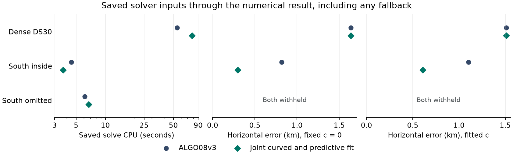

# Cold RF discovery with one joint curved and predictive finish

The blind route found **3,643 curved and 949 predictive points** on DS30-0008. Its joint fit provisionally reached **0.634 / 0.614 km** error with **129.001 / 128.965 Hz** curved RF RMS, but the original paired gates rejected three distinct curved tracks and one predictive track. The route spent **27.835 CPU seconds before candidate evidence** and **77.971 seconds** after its checked v3 fallback. On the southern simulation the candidate returned the containing fix with all original owners and independently withheld on the omitted offer. [Prespecified protocol](blind-joint-protocol.md) · [Numeric summary](measurements/blind-joint-summary.json) · [Full receipts](measurements/blind-joint.json.gz)

## Blind route

The installed discovery ranks complete all-catalogue assignments across the supplied region. The candidate performs two fixed-zero phase refreshes on each of up to three branches. The lowest exact score supplies the cold position, curves and signed aliases. At that position one genuine-previous conditional check masks incompatible curves. One original coarse/fine salvage pass can change a rejected curve's satellite and alias on an eligible segment. Another fixed-site check screens the restored curves. The original causal predictive selector then attaches eligible noncurved tracks to confirmed families. Both RF classes contribute to the geographic objective during the first paired fit. The receiver calibration normal equations use the curved evidence and the predictive term uses its conditional covariance. The paired finish uses identical membership and priors in both arms. [Proposal and finish](blind_joint_finish.py)

The earlier cold mixture fixed candidates from a sampled trajectory score, and the conditional oracle showed that exact curved-only identities left predictive evidence unavailable. The earlier collapsed salvage add-back started after a full paired curved fit. This trial selects and screens both RF classes before that paired finish. It uses the installed bound-endpoint exterior check as prespecified. The earlier mixture's separate 1 km face screen belongs to that experiment. [Mixture comparison](mixture-position.md) · [Curved oracle](mixture-oracle.md) · [Earlier postfit salvage](../single-core-2x/solver-salvage-addback.md)

## Position, RF fit and decisions

| Saved offer and outcome | Horizontal error km, `c = 0` / fitted | Curved RF RMS Hz, `c = 0` / fitted | Decision |
| --- | ---: | ---: | --- |
| DS30-0008 joint diagnostic | 0.634 / 0.614 | 129.001 / 128.965 | Both RF arms rejected |
| DS30-0008 checked v3 terminal | 1.639 / 1.512 | 129.703 / 129.663 | Both returned via fallback |
| South containing candidate | 0.296 / 0.607 | 6.470 / 6.373 | Both returned |
| South containing matched v3 | 0.817 / 1.101 | 6.502 / 6.392 | Both returned |
| South omitted joint diagnostic | 53.948 / 53.948 | 6.598 / 6.620 | Both RF arms compatible, both endpoints bounded |
| South omitted candidate and matched v3 | — | — | Both withheld on the exterior check |

The dense fixed-site gate kept 3,235 of 4,522 curved points. Salvage offered 869 additional curved points. The second fixed-site screen removed 461 from that union. The paired finish consumed the resulting 3,643 curved points plus 949 observations on 61 predictive tracks. Fixed-zero rejected two curved tracks covering 71 points, and fitted `c` also rejected a third with 40 points. The same predictive track with 21 observations failed in both arms. The common compatible support therefore covered 3,532 curved and 928 predictive points before any repair. Both phases settled within 0.003 s after two refreshes and site movement was zero on the last refresh. RF compatibility, rather than numerical convergence or exterior position, triggered fallback. The rejected diagnostic improved geographic error by 1.005 and 0.898 km compared with the accepted v3 arms. Both published fallback arms reproduced all 4,472 v3 owners and the 179-point grid. The archived terminal used 3,574 curved and 898 predictive points. [Dense gate and ownership receipts](measurements/blind-joint.json.gz)

The southern containing candidate returned the original 266 owners and a 137-point grid with zero objective replay error. The RMS improvement of 0.033 / 0.019 Hz accompanied horizontal improvement of 0.520 / 0.494 km. Inside the candidate, learning `c` reduced RMS by 0.096 Hz and increased error by 0.311 km. The omitted offer had two RF-compatible solutions at a bound. The unchanged all-track geographic check found independent exterior support from both receivers and withheld both fits. The omitted diagnostic illustrates why low RF residuals can coexist with a false candidate position. Truth entered only in the scorer. [Signed model and references](blind_joint_score.py) · [Physical reference](../../2026_11_21_ds30_full/reference-audit.json) · [Southern reference](../regional-release/scoring-key.json)

## Cost through the terminal



| Saved offer | Preparation and other CPU s | Cold discovery | Fixed-site gates and predictive | Curved salvage | Joint fit | Candidate exterior / evidence | v3 fallback | Charged CPU / elapsed s | Matched v3 CPU s |
| --- | ---: | ---: | ---: | ---: | ---: | ---: | ---: | ---: | ---: |
| DS30-0008 | 3.707 | 13.763 | 4.663 | 5.020 | 0.682 | — / — | 50.136 | 77.971 / 78.012 | 54.720 archived |
| South containing | 2.003 | 0.508 | 0.697 | — | 0.037 | 0.000 / 0.437 | — | 3.682 / 3.682 | 4.481 fresh |
| South omitted | 2.121 | 0.630 | 0.680 | 0.341 | 0.018 | 2.953 / — | — | 6.742 / 6.756 | 6.133 fresh |

The dense same-process v3 fallback and shared preparation account for 53.843 CPU seconds. The independent saved control consumed 54.720 CPU seconds. Even granting a valid finish and free candidate evidence would leave the measured experiment 3.835 CPU seconds above the 24-second dense budget. Removing every second of exact joint fitting still leaves 27.153 seconds before evidence. The largest measured components were cold discovery and the single salvage pass. The containing southern result used 82.2% of its fresh matched control CPU and omitted withholding cost 109.9%. Each archived and current timing represents one bounded saved run. Neither the release's multi-site accuracy gate nor full raw timing was tested. [Saved v3 control](measurements/aperture-summary.json)

## Reproduction

Instantiate the installed v3 numerical assets with the saved packet, compared terminal and causal archive. Run cases in fresh processes. `blind_joint_trial.py` verifies the archived v3 result and the postfit scorer independently tallies both arms. Ten targeted tests passed. [Runner](blind_joint_trial.py) · [Owned tests](../../../tests/pipeline_eval/test_algo08v3_blind_joint.py)

```sh
joint_release=/opt/leo-algo08/bdb869682a2ea63af4b198a920b763a4c6a78c4c
joint_payload=/opt/leo-algo08/algo08v3/payload
joint_code="$PWD/reports/ALGO08/v3"
joint_results=$(mktemp -d /var/tmp/leo-joint-new.XXXXXXXX)

joint_lock() {
  flock -x /tmp/leo-algo08v2-2x-bench/gauss.lock ionice -c2 -n7 nice -n15 taskset -c 2 \
    timeout 120s env OMP_NUM_THREADS=1 OPENBLAS_NUM_THREADS=1 MKL_NUM_THREADS=1 \
    BLIS_NUM_THREADS=1 NUMEXPR_NUM_THREADS=1 "$@"
}

for joint_case in south-containing south-far DS30-0008; do
  joint_lock env PYTHONPATH="$joint_code:$joint_payload:$joint_release/src:$joint_release" \
    "$joint_release/venv/bin/python" -BPs "$joint_code/blind_joint_trial.py" "$joint_case" "$joint_results/$joint_case.json"
done
joint_lock env PYTHONPATH="$joint_code:$PWD:$PWD/src" python "$joint_code/blind_joint_score.py" \
  "$joint_results" "$joint_results/summary.json" "$joint_results/complete.json.gz"
```
