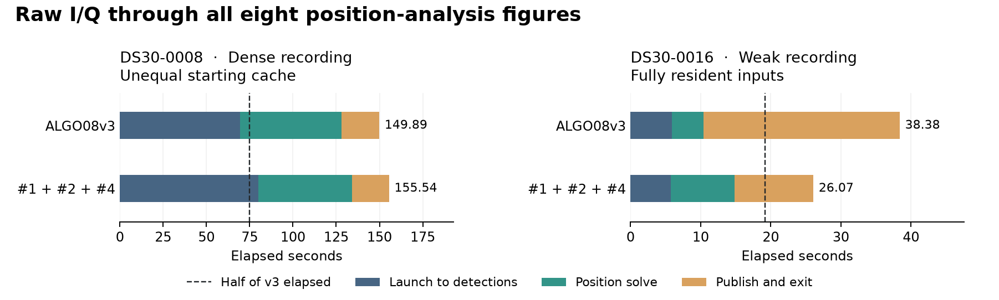

# How much time can the three ALGO08v3 shortcuts save together?

The prototype reproduced both calibrated positions and all eight PNGs on both saved DS30 recordings. It missed half of installed ALGO08v3's elapsed time on each recording. On the weak recording both arms started with fully cached inputs and the prototype used **0.162 s less CPU**. The larger elapsed difference came from variation during publication.

| Raw I/Q to process exit | ALGO08v3 elapsed | Prototype elapsed | ALGO08v3 CPU | Prototype CPU | Starting input residency, v3 / prototype |
|---|---:|---:|---:|---:|---:|
| Dense DS30-0008 | 149.89 s | 155.54 s | 109.10 s | 111.39 s | 76.75% / 0.95% |
| Weak DS30-0016 | 38.38 s | 26.07 s | 10.76 s | 10.60 s | 100% / 100% |

The weak control used the exact same three-change build as the dense pair. Both arms saw all 242,128 pages across 13 original compressed members in cache at launch. The prototype used the fixed layout 64 times and the fine-recovery guard rejected zero of 736 checks. Detections arrived in 5.76 s versus 5.94 s for v3. The subsequent solver interval took 9.06 s versus 4.44 s, while publication and exit took 11.25 s versus 28.00 s. The 16.75 s publication difference exceeded the 12.31 s total difference. One ordered pair per recording limits attribution and precision. [Dense receipt](measurements/bounds-DS30-0008-pair.json) · [Weak receipt](measurements/bounds-DS30-0016-pair.json) · [Figure script](bounds_pair_figure.py)

| Result reproduced by both builds | Ordered probes / selected factors | Fixed-zero / fitted horizontal error | Fixed-zero / fitted RF RMS |
|---|---:|---:|---:|
| DS30-0008 | 13,530 / 7,016 | 1.639 / 1.512 km | 129.703 / 129.663 Hz |
| DS30-0016 | 1,426 / 440 | 1.644 / 1.661 km | 109.375 / 109.479 Hz |

Both calibration arms produced the same assignments and path and grid results as v3. Each of the eight PNGs matched in file bytes and decoded pixels on each recording. Position errors use the same DS30 operator site reference in both builds. Both physical recordings came from the same location. On five separate saved solver controls, the region guard preserved v3's results, including its withholding decision for a far-omitted northern simulation. The simulations test the guard across locations. Transfer of the complete raw pipeline to another physical site remains unmeasured. [Geographic controls](../single-core-2x/regional-doppler-envelope.md)

## Dense recording budget

Installed ALGO08v3 used **109.103 CPU seconds** on DS30-0008. Halving that CPU cost would require saving **54.551 seconds**. We priced each change twice, first with work it could plausibly avoid, then with the more generous assumption that its entire enclosing operation costs zero.

| Shortcut | Work the rule can avoid on this input | Cost if the entire operation were free |
|---|---|---:|
| #1 Stop refining losing timing and frequency hypotheses | A free oracle that identifies every losing hypothesis saves an estimated 2.482 CPU s. A feasible stronger certificate is worth 1.189 s before paying for its checks. | 6.123 CPU s for the entire full-rate refinement bank |
| #2 Reuse fixed solver layouts | Of 228 constructions, 214 repeated an existing layout. Repeats cost 1.045 CPU s, or about 0.77 s after copying and validation. Robust updates still depend on the new fit. | 1.191 CPU s for all fixed-layout construction |
| #4 Use the offered region to exclude fine-recovery alternatives | The guard skipped 8,699 of 40,189 dense checks. It reduced the observed recovery elapsed time by 0.118 s. | 5.028 profiled s for all fine-alternative evaluation |

The refinement estimate scales 96 measured dense receiver lanes to the recording's 13,530 lanes. The fine-recovery cost comes from a separate profile of this recording with matching assignment digests and a different detector build. The fine-alternative loop excludes the subsequent repaired fit, avoiding overlap with the layout estimate. These assumptions give an optimistic estimate for this recording. [Receiver profile](refine-bound.md) · [Solver construction measurements](incremental-layout.md) · [Fine-recovery profile](../single-core-2x/restored-scout-0008-solver-profile.md) · [Region guard and transfer controls](../single-core-2x/regional-doppler-envelope.md)

Removing all three enclosing operations would save about **12.34 s**, leaving **96.76 s**, or **1.13×** the original CPU speed. That still leaves **42.21 s** to cut elsewhere to halve CPU. Restricting #1 to the free oracle cuts the combined estimate to **8.70 s**, or **1.09×**. The end-to-end qualification gates use elapsed time. I/O and publication can change elapsed time independently of these CPU estimates. [Whole-process clock and artifact verification](bounds-physical-pair.md)
