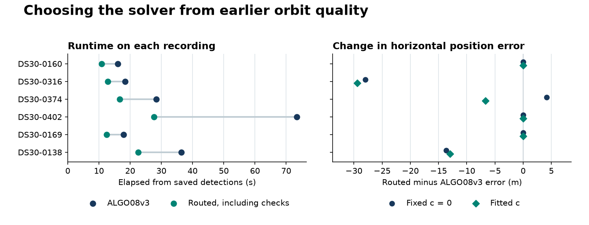

# Compatible waveform storage and a longer DS30 solver holdout

The indexed reader finished two physical recordings in **7.408 s**. Reading the same new files with the ordinary reader took **8.200 s**. Both used the same 20/8 ms receiver, routed solver and Cairo renderer. The **0.792 s** difference isolates the effect of the reader. Against the previously timed installed ALGO08v3 runs on the original encoding, the complete candidate reached **2.03× at the median and 1.65× by total time**. The 2× total-time target is 6.121 s. The candidate still needs to save 1.287 s. [Full positive comparison](https://github.com/misko/leo-tracker-reduxredux/blob/fc9c93d41840cd22cb9c60339e0c691e1fc73b45/reports/ALGO08/v3/visit-frame-raw-0016.md) · [Withholding comparison](https://github.com/misko/leo-tracker-reduxredux/blob/fc9c93d41840cd22cb9c60339e0c691e1fc73b45/reports/ALGO08/v3/visit-frame-raw-0107.md)

| Physical recording | Installed v3 on original files | Ordinary reader on new files | Indexed reader on same new files | Position result |
|---|---:|---:|---:|---|
| DS30-0107 | 1.497 s | 0.547 s | 0.518 s | All three withheld for insufficient curvature |
| DS30-0016 | 10.745 s | 7.653 s | 6.890 s | All three fixed |
| **Total** | **12.242 s** | **8.200 s** | **7.408 s** | **One fix and one withholding** |

The gains reflect one low-priority core. Each new archive is a standard recording that the installed reader can open. An optional authenticated table lets the indexed reader skip decoding unused sample tails. On DS30-0016 it reduced the receiver stage from **3.048 s to 2.352 s**. Both read modes used resident files and verified the same encoded input. They used the same candidate settings in a fixed order, ordinary reader first. Each timing is one process run.

### What first use costs

For the two existing DS30 recordings, adding original hydration, writing and sealing the new archives, independent full and prefix readbacks, and indexed analysis gives **16.133 s**. This is a sum of measured phases. A new capture could write the compatible encoding directly. On the larger recording, writing and sealing the compatible archive from already owned samples cost **2.046 s**. We have not measured a live capture-through-position clock. The historical files were replayed offline and the recorder stayed off. [Complete DS30-0016 writer and checks](https://github.com/misko/leo-tracker-reduxredux/blob/fc9c93d41840cd22cb9c60339e0c691e1fc73b45/reports/ALGO08/v3/visit-frame-recording-0016.md) · [Partial and zero-length visits on DS30-0107](https://github.com/misko/leo-tracker-reduxredux/blob/fc9c93d41840cd22cb9c60339e0c691e1fc73b45/reports/ALGO08/v3/visit-frame-recording-0107.md)

### What changed in the position and plots

On DS30-0016 the ordinary and indexed readers of the new archive produced identical detections, coordinates, frequency fits, owners, numerical grid and path, and eight byte-identical PNGs. Compared with the candidate on the historical encoding, all 115 observations per calibration arm matched by signed measurement, receiver and counter. Each kept its satellite and role. The new recording identity changed observation IDs and the recording titles on the eight images. Every pixel outside the title bands matched. Fixed and fitted horizontal errors were **490 m and 980 m**, versus **1,644 m and 1,661 m** for installed v3. A prior missing-region replay gave false fixes above 176 km in both pipelines. [Matched scientific outputs, image differences and first scoring attempt](https://github.com/misko/leo-tracker-reduxredux/blob/fc9c93d41840cd22cb9c60339e0c691e1fc73b45/reports/ALGO08/v3/visit-frame-raw-0016.md) · [Location control](https://github.com/misko/leo-tracker-reduxredux/blob/fc9c93d41840cd22cb9c60339e0c691e1fc73b45/reports/ALGO08/v3/history-risk-0016-omitted.md)

### Preserving the ordinary orbit plots

The full-Cairo renderer missed the visual tolerance on two gray orbit layers on a longer saved recording. A separate end-to-end DS30-0016 candidate used the compatible indexed reader, the four ordinary orbit sheets, faster residual/position/track layouts, and an orbit index built from an earlier recording. It took **7.379 s including readiness (1.46× vs installed v3)**. Its four orbit sheets were byte-identical to the ordinary renderer on the same titled scene. Catalogue preparation fell by about 0.26 s, while rendering rose from 0.502 to 0.980 s. This timing includes 0.052 s to export the scene for verification. It preserves all 115 assignments per arm and both positions. The full-Cairo cohort's 1.65× result therefore cannot be carried over to the stricter visual configuration. [Combined one-core replay, clock boundaries and visual comparison](https://github.com/misko/leo-tracker-reduxredux/blob/fc9c93d41840cd22cb9c60339e0c691e1fc73b45/reports/ALGO08/v3/frame-portable-0016.md)

### Representative saved solver timing

DS30-0138 was selected by proximity to the median visit count and compressed size before checking its availability. Its 8.24 GB of original I/Q remained on the archive. The comparison instead used its complete saved 20 ms detections and reconstructed its exact 50-entry causal catalogue from existing local copies. The routed solver took **22.604 s** including admission versus **36.432 s** for a fresh installed-v3 saved worker. Fixed and fitted horizontal errors fell from **305 and 361 m** to **291 and 348 m**. Conditional RF RMS rose by about **0.46 Hz** in both arms. The candidate retained all 4,645 installed assignments and added 73 per arm.

Across all six saved fixes, including DS30-0138, cumulative time fell from **190.357 s to 103.104 s**. This is **1.54× at the paired median and 1.85× by total time**. These clocks start at saved detections and cannot establish raw end-to-end speed on those six recordings. The two original-waveform cases and this longer saved comparison all use the same roof reference. [Holdout selection](https://github.com/misko/leo-tracker-reduxredux/blob/fc9c93d41840cd22cb9c60339e0c691e1fc73b45/reports/ALGO08/v3/duration-heldout.md) · [Six-case receipt and comparison](https://github.com/misko/leo-tracker-reduxredux/blob/fc9c93d41840cd22cb9c60339e0c691e1fc73b45/reports/ALGO08/v3/history-risk-0138.md)

### Where the six saved workers need to get faster

The routed workers already save 87.253 seconds in total. DS30-0402 contributes 45.696 seconds of that gain. Even making the two longest installed jobs, 0402 and 0138, instantaneous would give a paired median of only 1.58×. The shorter jobs determine whether a change improves the typical recording. The last column measures the saving each job would need to reach half its own baseline. The two panel gates use the median paired ratio and the ratio of summed times.

| Recording | Installed v3 | Routed with admission | Orbit preparation | Numerical inference | Seconds above half of v3 |
|---|---:|---:|---:|---:|---:|
| DS30-0160 | 15.999 s | 10.886 s | 1.677 s | 5.278 s | +2.89 |
| DS30-0316 | 18.358 s | 12.811 s | 2.459 s | 6.193 s | +3.63 |
| DS30-0374 | 28.324 s | 16.664 s | 2.433 s | 9.749 s | +2.50 |
| DS30-0402 | 73.351 s | 27.655 s | 2.548 s | 20.102 s | −9.02 |
| DS30-0169 | 17.893 s | 12.485 s | 1.991 s | 6.034 s | +3.54 |
| DS30-0138 | 36.432 s | 22.604 s | 2.655 s | 15.318 s | +4.39 |

Holding every other elapsed interval fixed, **6.78% less inference time on every case** would clear both 1.6× gates. **40.09% less** would clear both 2× gates. For a change limited to orbit preparation, 1.6× would require a 28.61% reduction. Even eliminating that stage entirely would leave the median at 1.80×. Eliminating every launcher admission would leave the median at 1.57×. The calculation recomputes the median after each hypothetical reduction so the middle recordings can change. It starts at saved detections and excludes acquisition. [Reproduce the sensitivity calculation](https://github.com/misko/leo-tracker-reduxredux/blob/fc9c93d41840cd22cb9c60339e0c691e1fc73b45/reports/ALGO08/v3/saved_stage_budget.py) · [Original elapsed times](https://github.com/misko/leo-tracker-reduxredux/blob/fc9c93d41840cd22cb9c60339e0c691e1fc73b45/reports/ALGO08/v3/measurements/history-risk-six-case.json.gz)

A separate instrumented replay of 0138 reproduced both positions, all 4,718 owners per arm, the full grid and all eight PNGs. It spent 4.989 CPU seconds ranking satellite assignments and 5.259 CPU seconds evaluating the standard evidence. The measured ceiling on the proposed local rank reuses was 0.468 CPU seconds. On two other saved scenes, removing redundant image-buffer restores saved only 6–7 ms of drawing work while reproducing every orbit PNG. These experiments narrow the next comparison to changes that can avoid or accelerate whole search passes and the publication of the remaining figures. [Solver profile](https://github.com/misko/leo-tracker-reduxredux/blob/fc9c93d41840cd22cb9c60339e0c691e1fc73b45/reports/ALGO08/v3/inference-0138-profile.md) · [Same-image rendering comparison](https://github.com/misko/leo-tracker-reduxredux/blob/fc9c93d41840cd22cb9c60339e0c691e1fc73b45/reports/ALGO08/v3/ordinary-orbit-reuse.md)
