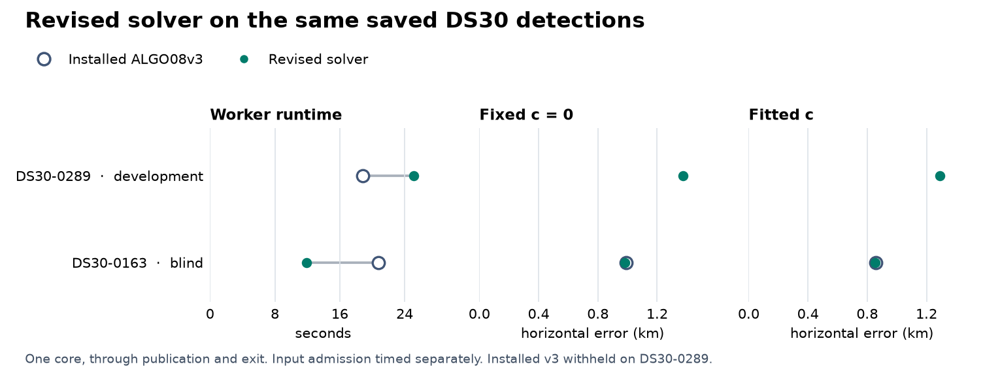
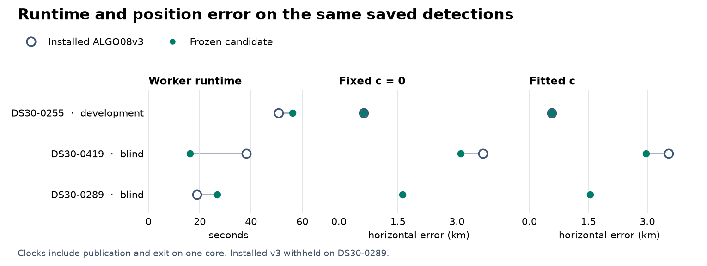
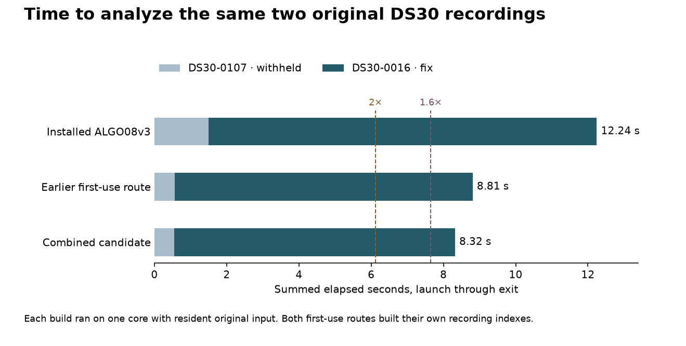
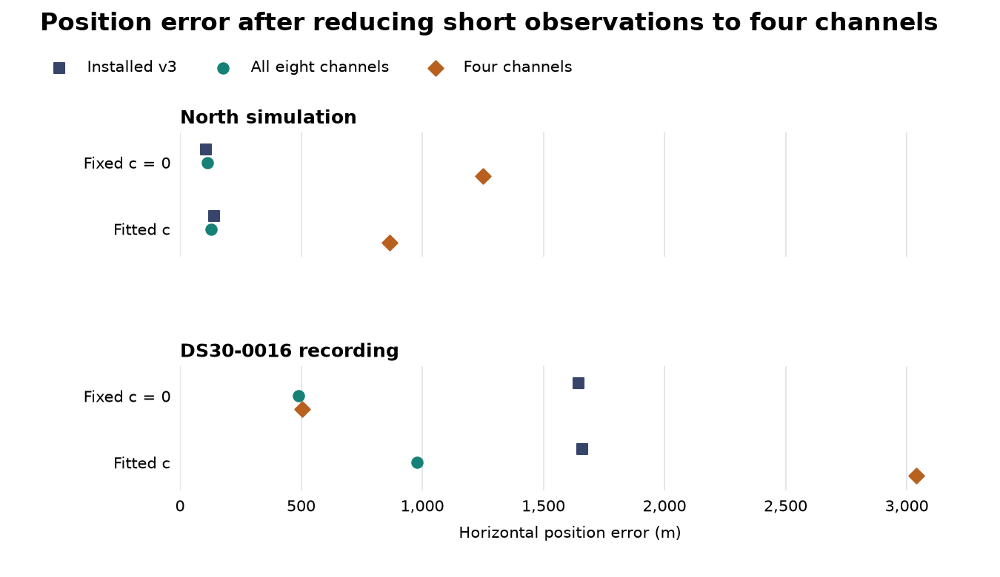
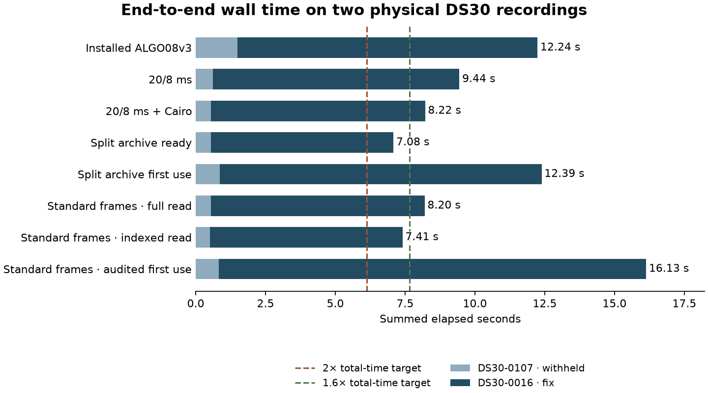

# Single-core ALGO08v3 successor on original recordings and blind solver cases

**Faster publication on the complete DS30-0016 recording.** Drawing the four orbit plots with the validated Cairo renderer reduced worker time from **7.862 to 7.447 s**, versus **10.745 s** for installed v3. All position estimates, RF residuals, satellite assignments, grid cells and the fit path matched the previous worker. All eight PNGs matched the independently validated Cairo output. With the previously measured 0.601 s withholding on DS30-0107, the estimated two-case speedup is **1.521× summed and 1.827× at the paired median**. DS30-0107 did not run again. This estimate is **0.397 s** short of 1.6× by total time. [Measured positive, visual validation and modeled pair](combined-successor-cairo.md)

**End to end on two complete physical recordings.** The revised receiver and solver took **8.464 s** from worker launch to exit, versus **12.242 s** for installed ALGO08v3. The summed speedup was **1.446×**, and the reciprocal median of paired time ratios was **1.764×**. Both fixed on DS30-0016 and withheld on DS30-0107. Fixed-zero / fitted position errors on DS30-0016 were **490 / 980 m** versus **1,644 / 1,661 m** for installed v3. The two original recordings were resident in memory. The candidate's separate research admission and startup probes took another **5.108 s** across the two successful runs, bringing its observed wall time including those steps to **13.572 s**. The primary comparison uses the archived installed worker clocks. [Input custody, timing boundaries and output checks](combined-successor-original.md)

**Two independent blind comparisons of the revised solver.** Both solvers fixed on DS30-0163 and DS30-0173 using identical original 20 ms detections. The revised solver took **27.122 s** through publication and exit across the pair, versus **47.563 s** for installed v3. The speedups were **1.754× by total time and 1.753× at the paired median**. Charging the measured common input setup to each gives **1.688× and 1.684×**. On DS30-0163 the revised solver reduced fixed-zero / fitted error by 7 / 5 m and preserved all 3,055 assignments in each arm. On DS30-0173 the reductions were **109 / 127 m**. It dropped 132 of 2,590 owners and conditional frequency RMS increased by about 2 Hz. Both cases published the complete grid, path and eight PNGs. A 0.053 s import-only first attempt reversed the timing order on DS30-0163. DS30-0173 ran in its prescribed order. [First blind pair](ds30-0163-combined.md) · [Second pair, individual errors and pooled gates](ds30-0173-combined.md)

**What can change when the receiver gets faster.** On DS30-0008 we changed only the first 64 of 6,772 visits from all-20 ms detections to measured 20/8 ms detections and ran the same guarded solver. Both produced a fix. Error increased from **1,086 to 1,363 m** at fixed zero and from **1,080 to 1,191 m** with fitted calibration. Both still improved on the installed v3 result of 1,639 / 1,512 m. All 525 satellite reassignments occurred later, among unchanged measurements, and involved the same pair of satellites. Eleven intact curves accounted for 503 of those changes. Only six switched rows had weak receiver margins. This is a reason to test ambiguity in the satellite assignments as well as checking the receiver's signal strength. [Matched full-solver comparison, costs and satellite roles](0008-prefix-transfer.md)

At the first calibrated centre, a survey-blind check of all feasible satellites found two almost tied curves among 111 on DS30-0008. Both identified the exact competing satellite pair later seen in the switched assignments. They accounted for **60 of the 503** switched observations on intact curves. The other nine curves lacked either candidate at this early state. The ordinary compact scorer had already retained both competitors on the flagged curves. The full check cost **0.093 CPU s** on DS30-0008 and **0.033 CPU s** on DS30-0316. The latter recording had no curves with two eligible candidates. This readout can nominate a pair for rechecking. The early winner was the opposite of the final all-20 ms assignment on both flagged curves. [Early readout and control](pre-finish-margin.md) · [Which alternatives the terminal traces preserved](0008-prefix-ambiguity.md)

**Revised solver on DS30-0289.** On the same original saved detections, using two initial centre fits and the revised grid computation cut runtime from **26.770 to 25.139 s**. Fixed-zero position error fell from **1,616 to 1,376 m** and fitted error from **1,542 to 1,292 m**. Both versions published all eight PNGs. Installed ALGO08v3 withheld in **18.820 s**. This recording was used to assess the revision, so its result is development evidence. [Matched solver comparison](combined-successor-0289.md)

**Two blind DS30 solver comparisons.** On original saved detections, the frozen candidate returned **two fixes in 42.948 s**. Installed v3 returned **one fix in 56.893 s**. The speedup was **1.325× by total time** and **1.083× at the paired median**. On DS30-0419, where both fixed, position error improved by **573 m** with fixed-zero calibration and **582 m** with fitted calibration. On DS30-0289, installed v3 withheld in **18.820 s**. The candidate's support repair succeeded, and it published in **26.770 s** with errors of **1,616 m and 1,542 m**. The figure includes DS30-0255 for context. That recording was used to tune the candidate and is excluded from both blind statistics. All three physical recordings are from the same site. [Newest blind result and scoring receipts](nomination-handoff-0289-local.md) · [First blind result](nomination-handoff-0419-local.md)

**Two changes to the original-file reader.** We tested all 13 resident members of DS30-0016 on one core. Reading each file on demand increased time to signed detections from **3.358 to 3.675 s** compared with ordinary one-file lookahead. Both emitted identical bytes. A separate four-file test reused decoded buffers and found no consistent acquisition benefit across reversed run orders. On DS30-0419 an idle-only copy staged 18 MiB of the first 75.50 MiB member before its time limit, so no receiver comparison ran there. The two blind solver cases would still need **250.5 MB/s** through detection publication even if the numerical solve ran twice as fast, assuming their downstream work otherwise stays the same. [Full-file A/B](resident-original-demand.md) · [Buffer reuse](owned-window-recycle.md) · [DS30-0419 transfer](first-member-0419-idle.md) · [Receiver and solver budget](release-stage-budget.md)

**Solver conditioning.** Rescaling the fallback linear system preserved the original iteration counts and reproduced residuals within 1.49 × 10⁻⁸ Hz on saved operands. The additional numerical checks made the tested fallback slower on both cases, by 37% on DS30-0008 and 65% on the simulated South recording. The existing fallback remains the faster measured option. [Numerical controls and paid timings](equilibrated-condition-fallback.md)

Two other experiments clarified where further time can be saved. Sparse carrier ranking preserved every signed native detection across 212 scheduled short lanes, but its measured per-lane saving projects to only **20–26 ms** on DS30-0016. Reusing causal orbit-body comparisons preserved both DS30-0289 positions and all 4,794 ordered assignments per arm, including support repair, but the preparation itself cost **14 ms more CPU** with setup. [Native receiver experiment](short-rank.md) · [Orbit preparation and exact fallback checks](causal-live-election.md)

**Missing-region challenge at a different location.** In the saved South simulation, the true receiver lay **100 m outside** the offered square. Both installed v3 and the frozen candidate published the same false fix. The fixed-zero and fitted positions landed **242 m and 183 m inside** the boundary, so the exterior check never ran. Their respective horizontal errors were **817 m and 1,102 m**. The candidate ran in **5.717 s** versus **7.891 s** for v3. This challenge demonstrates a geographical failure shared by both solvers. [Matched offsite omission, grid, assignments and output images](nomination-handoff-south.md)

The revised two-centre solver also reproduced the installed positions on both South offers: the near-boundary fix when the region contained the simulated site, and the false fix when it was missing. On the missing-region offer the revised solver took **5.993 s** versus the installed solver's **7.891 s**. All eight PNGs and the complete 137-point numerical grid verified on each offer. [Containing and omitted offers on the revised solver](combined-successor-south.md)

**First analysis of the original DS30 files.** On two complete physical recordings, combining the decoder, orbit-selection and numerical-grid changes reduced elapsed time from **8.806 s to 8.319 s**. Installed ALGO08v3 took **12.242 s** on those recordings. The combined candidate reached **1.47× by total time and 1.84× at the paired median**. Every build withheld on DS30-0107 and fixed on DS30-0016. The candidate's fixed-zero and fitted errors were **490 m and 980 m**, versus **1,644 m and 1,661 m** for installed v3. It reproduced the previous candidate's complete numerical results and all eight PNGs. The recordings were resident and neither candidate received per-recording seek tables. [Combined first-use result and activation by recording](legacy-first-map-finalist.md) · [Earlier first-use comparison](legacy-first-use-original-panel.md)

The combined candidate took **7.777 s** on the fix and **0.542 s** on the withholding. Its total would need to fall by another **0.667 s** to reach 1.6× and **2.198 s** to reach 2×. The installed clocks came from earlier runs. The successful withholding run came from the preceding candidate revision, before a correction to the publication code path that this recording never enters. The reported median is the reciprocal of the median paired candidate-to-v3 elapsed ratio. [Timed processes, attempted launches and scientific checks](legacy-first-map-finalist.md)

A simpler reader now verifies each original recording without generating an index for later replay. It took **8.575 s** on the same two recordings, compared with **9.136 s** for the fresh same-build control with index generation and **8.319 s** for the earlier indexed run. Both modes preserved the withhold, the fix, the complete grid and all eight figures. On DS30-0016 it removed **76 ms** of index work, but acquisition took **61 ms longer** and the downstream solve varied by **604 ms**. The measured **1.43× summed** speedup over installed v3 does not establish a repeatable timing advantage for the simpler reader. [Matched process clocks and integrity checks](legacy-verify-original.md)

**Independent saved-input holdout.** A hash rule selected DS30-0255 from 87 eligible release recordings before its results were opened. With identical original detections and search region, the routed solver took **66.777 s**, **31.7% longer** than the fresh installed-v3 solver at **50.721 s**. It spent 18.438 CPU seconds on an attempted fit before falling back to the original method. Both workers produced the same 3,704 ordered assignments per calibration arm and horizontal errors of **627.1 m and 564.9 m**. The physical pair measures the complete raw pipeline on two small recordings. This separate result shows how downstream fallback can reverse a speedup on a new recording. [Holdout selection, both clocks and accuracy](unseen-saved-holdout-0255.md)

After the holdout was scored, the fallback reused its verified scan, ranking and three partially completed candidate fits. That saved **10.545 s** and preserved both positions, assignments, grid, path and all eight routed PNGs. Even after that change it took **56.232 s**, **5.511 s longer** than installed v3 on the same saved packet. [Post-holdout change and verified results](nomination-handoff-0255.md)

The final result had zero predictive assignments. A timed replay of the original solver showed it had evaluated **40 proposed tracks with 702 observations**. The fixed-zero calibration accepted all 40. The fitted calibration accepted 39, so the paired rule discarded the predictive assignments. Those fits cost **2.202 CPU s**. A shortcut that applies when the *incoming* list is empty saves zero on this recording. [Proposals, acceptance decisions and measured stage time](empty-predictive-refit-0255.md)

Sharing the satellite projections for two nearby position trials preserved both calibration fits and their gate decisions on DS30-0255. The best measured version saved **23.5 ms CPU** on that optimizer slice and took **41.3 ms longer** when the first build and load were charged. The finite-difference evaluations cost **7.584 CPU s** through the measured cutoff. Only **0.474 s** of that was curved-orbit projection. [Exact optimizer comparison and timing breakdown](paired-secant-geometry.md)

A second prototype computed derivatives through every robust reweighting update on two saved South calibration inputs. Even with the base solve already paid, the derivative calculation took **38.5 and 41.2 ms CPU**, compared with **12.9 and 32.3 ms** for the existing two finite-difference queries. These timings cover the captured posterior calculation. The trial did not have the adjacent position and predictive inputs needed to measure a complete position update. [Robust derivative accuracy and costs](gamma-forward-sensitivity.md)

**Blind test of the frozen solver on DS30-0419.** The next hash-assigned recording gave the opposite timing result. With identical original detections, orbit catalogue and search region, the candidate finished in **16.178 s**, compared with **38.072 s** for installed v3, a **2.35×** saved-input speedup. Both published a fix, the grid, the path and all eight PNGs. Fixed-zero error fell from **3,664 to 3,091 m** and fitted error from **3,547 to 2,965 m**, even though the conditional frequency residuals rose slightly. The faster solver accepted its first route and never invoked fallback. DS30-0255 was a development case for this frozen build, while DS30-0419 was selected and scored blind. Both are physical DS30 recordings from the same site. [Blind comparison, ownership and image checks](nomination-handoff-0419-local.md)

Taken together, development case DS30-0255 and blind case DS30-0419 took **88.794 s for installed v3** and **72.410 s for the candidate**, or **1.23× by total time**. Both fixed each case. Charging the 0.762 s common admission only to the candidate on DS30-0419 gives **2.25×** for that case. All 48 orbit snapshots matched their original hashes after staging from the local NVMe collector. The comparison opened no waveform files. [Case-level timing gates and staging](nomination-handoff-0419-local.md)

**Why retaining both radios on half the channels failed.** A saved-input trial kept every long observation and continuously measured both radios on four of eight channels. North recovered enough observation history to publish, but it lost six of nine assigned satellite families. On DS30-0016, all 92 conditional assignments survived, but the sole family observed across two channels lost its 23 observations on the second channel. The fitted frequency residual improved slightly even as fitted position error rose by 2.06 km. This schedule failed the accuracy gate on both recordings. [Channel schedule, assignments and outputs](complete-rf-streams.md)

| Saved recording | All-channel error, fixed / fitted | Four-channel error, fixed / fitted |
|---|---:|---:|
| North | 112 / 128 m | 1,250 / 865 m |
| DS30-0016 | 490 / 980 m | 504 / 3,040 m |

Two smaller changes preserved scientific outputs but had limited timing benefit. Drawing the orbit sheets with fixed plot limits reproduced all 12 archived PNGs across three recordings. It saved 129 ms and 144 ms on the two larger scenes and cost an extra 72 ms on DS30-0016. In the solver, checking the fitted calibration first could skip one fit on DS30-0255. Both repair fits together cost only 0.908 CPU s, while the candidate needed to recover 5.473 CPU s to match installed v3 on that packet. An earlier rejection would also have redirected DS30-0169, whose repair succeeded. [Exact rendering and reversed-order clocks](agg-orbit-artists.md) · [Replay of the solver rejection](early-lean-refusal-0255.md)

Across the original 100-recording v3 release benchmark, 93 of the 95 jobs with stage timestamps spent more than half their elapsed time reaching the saved detections. Applying a uniform 1.5× speedup after detections would still require **2.35–2.44× before detections** to clear both 2× gates. The range includes all five failed jobs at their original elapsed times and bounds their unknown stage split. These are engineering targets calculated from prior runs. [100-recording stage distribution and timing requirements](release-stage-budget.md)

The indexed reader finished two physical recordings in **7.408 s**. Reading the same new files with the ordinary reader took **8.200 s**. Both used the same 20/8 ms receiver, routed solver and Cairo renderer. The **0.792 s** difference isolates the effect of the reader. Against the previously timed installed ALGO08v3 runs on the original encoding, the complete candidate reached **2.03× at the median and 1.65× by total time**. The 2× total-time target is 6.121 s. The candidate still needs to save 1.287 s. [Full positive comparison](visit-frame-raw-0016.md) · [Withholding comparison](visit-frame-raw-0107.md)

| Physical recording | Installed v3 on original files | Ordinary reader on new files | Indexed reader on same new files | Position result |
|---|---:|---:|---:|---|
| DS30-0107 | 1.497 s | 0.547 s | 0.518 s | All three withheld for insufficient curvature |
| DS30-0016 | 10.745 s | 7.653 s | 6.890 s | All three fixed |
| **Total** | **12.242 s** | **8.200 s** | **7.408 s** | **One fix and one withholding** |

The gains reflect one low-priority core. Each new archive is a standard recording that the installed reader can open. An optional authenticated table lets the indexed reader skip decoding unused sample tails. On DS30-0016 it reduced the receiver stage from **3.048 s to 2.352 s**. Both read modes used resident files and verified the same encoded input. They used the same candidate settings in a fixed order, ordinary reader first. Each timing is one process run.

### What first use costs

For the two existing DS30 recordings, adding original hydration, writing and sealing the new archives, independent full and prefix readbacks, and indexed analysis gives **16.133 s**. This is a sum of measured phases. A new capture could write the compatible encoding directly. On the larger recording, writing and sealing the compatible archive from already owned samples cost **2.046 s**. We have not measured a live capture-through-position clock. The historical files were replayed offline and the recorder stayed off. [Complete DS30-0016 writer and checks](visit-frame-recording-0016.md) · [Partial and zero-length visits on DS30-0107](visit-frame-recording-0107.md)

The original-file first-use comparison above reused an orbit index made from an earlier recording. Building it once cost 4.32 s separately. A later experiment reduced copies during original-file decoding and reused the existing hash state to verify the 8 ms prefix. On one saved DS30-0016 member it preserved all 114 native receiver outputs and the exact index. It saved **35.0 ms and 13.6 ms CPU** in reverse-order trials. The predeclared minimum was 20 ms in both orders before expanding to a whole recording. [Original decoder trial](legacy-first-history-fast.md)

### What changed in the position and plots

On DS30-0016 the ordinary and indexed readers of the new archive produced identical detections, coordinates, frequency fits, owners, numerical grid and path, and eight byte-identical PNGs. Compared with the candidate on the historical encoding, all 115 observations per calibration arm matched by signed measurement, receiver and counter. Each kept its satellite and role. The new recording identity changed observation IDs and the recording titles on the eight images. Every pixel outside the title bands matched. Fixed and fitted horizontal errors were **490 m and 980 m**, versus **1,644 m and 1,661 m** for installed v3. A prior missing-region replay gave false fixes above 176 km in both pipelines. [Matched scientific outputs, image differences and first scoring attempt](visit-frame-raw-0016.md) · [Location control](history-risk-0016-omitted.md)

A check using only observations available to the solver flagged the omitted DS30-0016 offer. Fitting the calibration coefficient increased mean squared frequency error **242×** on 23 observations assigned a predictive role, even as the conditional fit improved on the other 92. None of six evaluable valid publications tripped the same threshold, including a separate DS30 recording. On a southern simulated case the error ratio was **0.208** with the true region omitted and **0.209** with it included. Three false fixes had no predictive observations to score. These results support using the discrepancy to investigate a fit. They leave geographic withholding unresolved. [Frozen accuracy check and all control outcomes](calibration-prediction-check.md)

### Preserving the ordinary orbit plots

On the independent **North simulation** the first-use reader processed all **1,200 stereo visits** from the original files and published the result in **11.606 s**. Installed v3 took **18.201 s** with figure readback inside its clock, or **16.133 s** in an earlier run that verified its figures afterward. The corresponding complete-process speedups are **1.57×** and **1.39×**. Fixed-zero error changed from **105.7 to 112.0 m** and fitted error from **140.8 to 128.1 m**. Conditional RF RMS rose in both arms. The candidate matched the earlier 20/8 ms solver outputs, all 137 grid points, the path and all four ordinary orbit PNGs. These results cover another location and encoding in simulation. The original physical two-recording DS30 comparison at the top remains separate. [North timing, location truth and figure checks](legacy-first-map-north.md)

The full-Cairo renderer missed the visual tolerance on two gray orbit layers on a longer saved recording. A separate end-to-end DS30-0016 candidate used the compatible indexed reader, the four ordinary orbit sheets, faster residual/position/track layouts, and an orbit index built from an earlier recording. It took **7.379 s including readiness (1.46× vs installed v3)**. Its four orbit sheets were byte-identical to the ordinary renderer on the same titled scene. Catalogue preparation fell by about 0.26 s, while rendering rose from 0.502 to 0.980 s. This timing includes 0.052 s to export the scene for verification. It preserves all 115 assignments per arm and both positions. The full-Cairo cohort's 1.65× result therefore cannot be carried over to the stricter visual configuration. [Combined one-core replay, clock boundaries and visual comparison](frame-portable-0016.md)

### Representative saved solver timing

DS30-0138 was selected by proximity to the median visit count and compressed size before checking its availability. Its 8.24 GB of original I/Q remained on the archive. The comparison instead used its complete saved 20 ms detections and reconstructed its exact 50-entry causal catalogue from existing local copies. The routed solver took **22.604 s** including admission versus **36.432 s** for a fresh installed-v3 saved worker. Fixed and fitted horizontal errors fell from **305 and 361 m** to **291 and 348 m**. Conditional RF RMS rose by about **0.46 Hz** in both arms. The candidate retained all 4,645 installed assignments and added 73 per arm.

Across all six saved fixes, including DS30-0138, cumulative time fell from **190.357 s to 103.104 s**. This is **1.54× at the paired median and 1.85× by total time**. These clocks start at saved detections and cannot establish raw end-to-end speed on those six recordings. The two original-waveform cases and this longer saved comparison all use the same roof reference. [Holdout selection](duration-heldout.md) · [Six-case receipt and comparison](history-risk-0138.md)

### Where the six saved workers need to get faster

The routed workers already save 87.253 seconds in total. DS30-0402 contributes 45.696 seconds of that gain. Even making the two longest installed jobs, 0402 and 0138, instantaneous would give a paired median of only 1.58×. The shorter jobs determine whether a change improves the typical recording. The last column measures the saving each job would need to reach half its own baseline. The two panel gates use the median paired ratio and the ratio of summed times.

| Recording | Installed v3 | Routed with admission | Orbit preparation | Numerical inference | Seconds above half of v3 |
|---|---:|---:|---:|---:|---:|
| DS30-0160 | 15.999 s | 10.886 s | 1.677 s | 5.278 s | +2.89 |
| DS30-0316 | 18.358 s | 12.811 s | 2.459 s | 6.193 s | +3.63 |
| DS30-0374 | 28.324 s | 16.664 s | 2.433 s | 9.749 s | +2.50 |
| DS30-0402 | 73.351 s | 27.655 s | 2.548 s | 20.102 s | −9.02 |
| DS30-0169 | 17.893 s | 12.485 s | 1.991 s | 6.034 s | +3.54 |
| DS30-0138 | 36.432 s | 22.604 s | 2.655 s | 15.318 s | +4.39 |

Holding every other elapsed interval fixed, **6.78% less inference time on every case** would clear both 1.6× gates. **40.09% less** would clear both 2× gates. For a change limited to orbit preparation, 1.6× would require a 28.61% reduction. Even eliminating that stage entirely would leave the median at 1.80×. Eliminating every launcher admission would leave the median at 1.57×. The calculation recomputes the median after each hypothetical reduction so the middle recordings can change. It starts at saved detections and excludes acquisition. [Reproduce the sensitivity calculation](saved_stage_budget.py) · [Original elapsed times](measurements/history-risk-six-case.json.gz)

A separate instrumented replay of 0138 reproduced both positions, all 4,718 owners per arm, the full grid and all eight PNGs. It spent 4.989 CPU seconds ranking satellite assignments and 5.259 CPU seconds evaluating the standard evidence. The measured ceiling on the proposed local rank reuses was 0.468 CPU seconds. An attempt to rule out whole groups of starting guesses also failed. The first four guesses determine which corners get searched. Before that choice, every group has the same lower bound. By the time the assignments are known, all seven final score calculations together take just 0.236 CPU seconds. On two other saved scenes, removing redundant image-buffer restores saved only 6–7 ms of drawing work while reproducing every orbit PNG. [Solver profile](inference-0138-profile.md) · [Search-bound audit](rank-block-0138.md) · [Same-image rendering comparison](ordinary-orbit-reuse.md)

### Two checks on combining the changes

**Dense DS30-0008, with shorter receiver windows.** The complete saved packet contained 13,530 antenna probes and 7,336 selected signals. The routed solver took 29.935 s through exit, or 29.978 s with admission. An earlier solver on the identical packet took 26.947 s and recovered positions within 4 m of the routed result in both calibration arms. The routed result matched the earlier, more expensive final fit on all 4,367 assignments per arm. Its fixed and fitted errors were 915 and 854 m, versus 1,639 and 1,512 m for original ALGO08v3 on its full 20 ms windows. Conditional frequency RMS was about 11.3 Hz higher. The historical measured acquisition of this exact packet took 60.449 s. Adding it to the new saved run gives a 90.427 s budget across separate processes and cache conditions. The new combination has yet to be timed from waveform to exit on this recording. [Complete mixed-window comparison](history-risk-dense-mixed.md)

**Shorter DS30-0169, with the four ordinary orbit plots.** The verified saved run took 11.920 s with admission, versus 12.485 s for its previous routed control and 17.893 s for installed v3. This is 1.50× against v3, 0.737 s above the 1.6× target for this recording. The two routed runs used the same earlier orbit index. Both coordinates and RF residuals, all 2,236 ordered assignments per arm, and every grid and path result matched exactly. The candidate published eight verified PNGs. Its four orbit sheets matched the ordinary renderer byte for byte. Rendering the same scene in isolation saved 1.047 CPU seconds. The complete run includes 0.593 s spent writing verification data. Charging earlier orbit-index construction and catalogue staging brings first use to 16.743 s. [Matched publication and renderer checks](residual-portable-saved-0169.md)

### Does the optimized Doppler calculation depend on longitude?

We rotated the observer and the prepared satellite positions and velocities together about Earth's polar axis. This changes their longitude while preserving their relative geometry. The test reused 307 signed DS30-0008 observations from both receivers, 28 satellites, five local offsets and the two archived calibration phase vectors. At all four placements, including legal offers near +179.8° and −179.8°, original v3 and the candidate gave bit-identical Doppler, elevation and fixed-assignment residuals. Across rotations the largest Doppler difference was 2.40 × 10⁻⁹ Hz, and every horizon decision stayed the same.

The tested geometry handled a legal offer with its screening centre across the date line. The published request contract rejects a search square that itself straddles the date line. This check exercised fixed assignments on one rotated recording. Independent physical-site localization, the complete fit after rotation, and withholding when the true region is absent remain unverified by this test. [Rotational comparison, supported offers and tolerances](polar-projection.md)

### Subsequent tests on the original files and the clean solver

The two physical runs have 29 and 808 visits. A recording at the **6,772-visit DS30 median** exposed a solver regression. DS30-0004 was selected by visit count and case ID before inspecting its predictions. Both workers started from the same 5,852 signed detections and the same 47 causal orbit snapshots. The routed solver took **54.783 s** versus **44.760 s** for installed v3. It paid **10.472 CPU s** on a proposed repair, rejected it under the existing observation-loss limit, and invoked the original solver. Both produced identical outputs, including **3,430 assignments per arm**, the 179-point grid and eight PNGs. Fixed and fitted errors were **185 m and 104 m** for both. The routed run paid for request-specific orbit preparation because the available earlier test index postdated this capture. The comparison excludes waveform acquisition and stands separately from the six-recording panel that reused an existing index. [Median-size selection, costs and verification](history-risk-0004.md)

The rejected work explains almost the entire regression. The candidate used 54.322 CPU s and v3 used 44.660 CPU s. Removing all 10.472 CPU s spent on the unsuccessful attempt would leave about **43.85 CPU s**, roughly even with v3. A 2× solver result on this recording would also require a faster successful inference path. [Measured stage costs](history-risk-0004.md)

The fallback repeated the ranking of the same satellite assignments and the first two rounds of their fit. A research version passed those results to the original solver after checking the observations, offered region, catalogue, assignment order and fitted state. It retained the original tie rule, three remaining fit rounds and the acceptance gate. On DS30-0004 the complete saved worker took **47.738 s**, saving **7.045 s** against the 54.783 s routed run. It remained **2.978 s slower than direct v3**. The new run again reproduced the original historical terminal, both calibration and RF results, all 3,430 ordered assignments per arm, the grid, path and all eight PNGs. External admission took 0.410 s. The candidate and comparison processes ran separately, and the earlier routed process recorded one major page fault. [Rank reuse and matched fallback publication](nomination-handoff.md)

DS30-0316 exercised the other outcome. The same optional handoff saved all three nomination prefixes, but the initial solver succeeded and never requested them. Its complete saved worker took **12.246 s**, against **12.371 s** for the previous research route and **18.358 s** for installed v3. The equality checks and copies cost about 13 ms CPU. Variation in orbit preparation and the different rank implementation also contributed to the clocks. Both candidate runs matched in both calibration arms, all 2,002 ordered owners per arm, the 179-point grid and path, and eight PNGs. The newer process used 0.378 s of additional admission. [Accepting-route replay](nomination-handoff-0316.md) · [Which previous routes could reuse work](nomination-handoff-transfer.md)

On a saved DS30-0169 solver substage, reusing an identical posterior calculation and invariant covariance factors saved **0.174 CPU s** from about 1.96 s. All 128 hypotheses and their acceptance decisions matched bit for bit. The stock operations that the change could affect took 0.901 CPU s in total. [Held-family calculation and scope](held-family-fixed-state.md)

An alternative check could prove rejection once the fixed calibration arm had finished. Its 138 curved-observation losses already exceeded the allowed 124. The entire paired finish and repair preparation took 0.734 CPU s. Only a fraction of that work remained to skip. That limit explains why this late check alone offers little relief on the 10.472 CPU s rejected attempt. [Rejection proof and two accepting controls](repair-cap-prefix.md)

On the two physical recordings, the lighter audit writer moved the prepared candidate to **0.536 s on withholding and 7.359 s on the fix**. That yields **1.92× at the paired median and 1.55× by summed elapsed time** against installed v3. In a separate first-use experiment, building the maps during normal analysis on the fixing recording cost **8.038 s through exit**. Preparing the same maps in separate passes and then analysing had cost 11.993 s. [Paired clocks, first-use costs and plots](legacy-frame-coverage.md)

An optional seek index now supports selective reads on all 13 original DS30-0016 files. Five files contain only literals and the remaining eight need 13 exceptional blocks between them. The complete process took **7.093 s** versus **8.630 s** for the same solver and ordinary reads. All eight PNGs, the grid, path, assignments and both positions matched the ordinary reader exactly. The same entry took **0.967 s** on DS30-0107 and preserved its withholding decision. Across both original recordings this gives **1.53× at the paired median and 1.52× by summed time** against installed v3. Counting map creation and readiness gives **13.032 s** versus **12.242 s** for installed v3. [Original-file timings and figure](legacy-frame-coverage.md)

A fresh DS30-0169 comparison removed the diagnostic scene export and charged common setup to both pipelines. ALGO08v3 took **17.828 s** and the candidate **12.131 s**, a **1.47× speedup** from saved detections. The two calibration solutions and all 2,236 assignments matched. Each pipeline's eight PNGs matched its archived reference byte for byte. Caching fixed inputs in the 0169 grid evaluator was 0.72% slower in a separate strip test. Skipping search corners on the basis of agreeing initial seeds also failed to identify a saving on the larger eligible cases. [Clean saved comparison](clean-saved-0169.md) · [Grid test](grid-fixed-context.md) · [Search audit](center-corner-nomination-audit.md)
