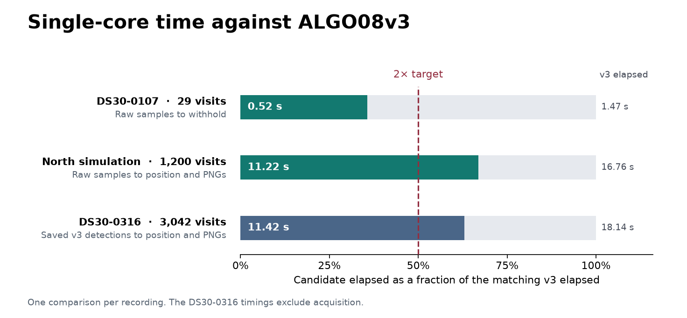

# Selective frequency refinement from original samples through publication

The guarded selective receiver produced a two-arm fix on the 1,200-visit North simulation in **11.224 s**, against **16.761 s for ALGO08v3** and **12.233 s for the same research solver and all-paid guarded receiver**. Selecting which frequency estimates to refine cut 996 calls to 396 and saved **0.538 CPU s** in the refinement itself. The complete 1.008 s elapsed improvement over the all-paid run includes variation between separate launches. The full 456-factor selected payload, both endpoints, the 137-node grid and all eight verified figures matched the all-paid build. [Raw North receipt, science and commands](continued-cfo-north.md)

North still needs **2.844 s** to reach half of v3. The candidate spent **5.349 s** in authenticated acquisition and **5.346 s** in decision and publication. Cutting each by **26.6%**, leaving other work fixed, would just reach the target. Alternatively, its full and short native detector calls consumed only **0.742 and 2.043 CPU s**. Even removing that entire 2.785 CPU s at one-for-one wall-time credit falls just short, before paying for a replacement. The remaining frequency tail cost 0.121 CPU s. These are ceilings on a single resident simulation. [Measured phase clocks](measurements/continued-cfo-north.json.gz)

## Physical recordings and geographic checks

* **DS30-0107, new complete 29-visit recording.** The identical guarded detector recipe used on North finished in **0.523 s**, against **1.466 s** for ALGO08v3. The exact selective receiver took 0.533 s. All withheld for lack of time span. The guarded receiver retained 20 signals, paid for zero CFO refinements and emitted no position or figures. One paced 33.60 MB copy from cold storage cost 8.012 s separately and was reused by both comparisons. Each timed process operated on the same fully resident original. [Original paired physical benchmark](continued-cfo-small-raw.md) · [Guarded transfer](guarded-cfo-small-raw.md)
* **DS30-0016, weak physical fix.** From the same saved selective detections, fixed-zero/fitted errors remained **976/1,452 m** and RF RMS **116.340/115.526 Hz**. A new exact historical-orbit optimization skipped 652,961 of 750,044 per-row visits. It preserved all 116 owners per arm and all eight figures, but its two matched full saved comparisons changed elapsed by **−0.05 and +0.02 s**. [Signed position and CFO comparison](continued-cfo.md) · [Matched saved-process experiment](regional-history-rows.md)
* **DS30-0316, 3,042 issued visits.** Starting both solvers from the same complete installed-v3 detections, the candidate finished in **11.420 s** against the historical named **18.140 s**. Both fixed. Fixed-zero/fitted errors went from **1,945/1,863 to 1,917/1,834 m**. RF RMS rose from **99.232/99.054 to 99.594/99.435 Hz**. The candidate retained all 1,976 named observations, added 26 conditional observations and produced the 179-node grid and eight figures. It kept exactly the same observations as the earlier cumulative solver, whose positions were 29/15 m closer on this case. The corrected worker completed one saved solve. A preceding inventory-path formatting failure cost 0.301 s before inference. [Current original-final-fit transfer](named-final-0316.md)
* **North, matched near omission.** The fresh guarded selective packet was reused on the translated offer with truth 100 m outside. Both calibration arms again returned a position on the limiting face, with **134/112 m** horizontal error and **5.249/5.067 Hz** RF RMS. The solver also placed both valid containing solutions on that face. Withholding solely on face contact would lose the valid fixes. The saved comparison took 5.791 s and verified the 137-node grid and eight figures. An initial 0.293 s attempt ended before solving. [Signed near-omission replay](continued-cfo-north.md)
* **South simulation.** Independent replay of the ordinary chronology kept the exact 456-factor payload already published for both offers. It would omit 237 of 633 CFO calls. The containing errors stayed **558/811 m**, versus **817/1,101 m** for v3. Both published a false fix with truth 100 m outside. There was no new South raw latency measurement. [Signed transfer and both offers](continued-cfo-south.md)

## Which optimizations survived

| Change | Measured outcome | Decision |
|---|---|---|
| Selective frequency refinement | 600 fewer North calls and 501 fewer exact tail retries, with identical selected frequencies and final outputs | Carry forward. Use the guarded pack in matched future pairs. |
| Block-scaled Q15 timing search | On signed dense and weak clips, the speculative complete scout was 88% and 84% slower than the original. The guarded path retried all 127 scouts. All 66 primary and 27 secondary final factors matched on these clips. | Retire this implementation. Guarding preserved science but added cost to an already slower transform. [Measured receiver study](q15-timing-scout.md) |
| Avoid expensive solver rescues | DS30-0402's current accepted rescue used 0.286 s for isolation and 1.093 s for predictive/paired work including the trim. DS30-0374 made no rescue fit. Exact reuse of the phase interpolation saved **118 ms** across 20 fine proposals on 0402 and preserved all 4,821 owners per arm. | Keep the exact improvement available. Charge it at the fine-proposal boundary. The current positive run measured it with a shadow control. [Solver and position evidence](rescue-phase-prepare.md) |
| Earlier regional restriction of historical orbits | 87% fewer downstream row visits, inconsistent through-exit change on DS30-0016 | Keep the reference path. The expensive initial sky still requires the full causal catalogue and original screening. [Matched cost](regional-history-rows.md) |

The next several seconds must come from reducing whole acquisition and discovery operations on positive fixes. On 0402, 0374 and 0008 the measured cold discovery was **6.875, 3.960 and 5.808 CPU s**. Of this, complete finalist fits cost **3.266, 1.501 and 1.367 CPU s**. Test a lower-cost exact assembly of the common full-observation terms across finalists, with original satellite assignments and robust weights retained for each trial. Price the common terms on both a weak and a dense case before building a new cache. Earlier time-moment approximations removed the true dense finalist from the shortlist. [Where the current solver spends time](rescue-phase-prepare.md) · [Cold-rank measurements and limits](cold-exact-budget.md) · [Lost assignments on a compressed shortlist](track-moment-exact-rescore.md)
