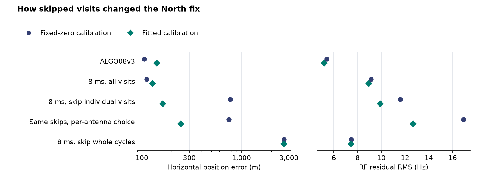

# Preserving whole signal-history cycles while reducing receiver calls

Grouping omissions into whole cycles preserved the 8 ms history decision on North and returned horizontal errors of **2,671/2,663 m**, against **112/128 m** on all visits. Only 48 of the 342 assigned observations remained, coming from two satellites. RF residuals fell to 7.45 Hz in both arms. The grouped saved solve finished in 4.476 s and verified all eight figures. Its accuracy result stopped the proposed weak and dense position transfers. [Full grouped position comparison](cycle-stereo-saved.md) · [Individual-visit results](whole-stereo-8ms.md)

A separate test kept the individual-visit mask and let each antenna choose its own history. Both original all-visit North and same-sign physical DS30-0016 controls reproduced their signed packets exactly. On the masked North input, the split decision returned 751/246 m errors and 171 assignments per arm. The fixed-zero error exceeded v3 by 645 m and stopped this route. [Per-antenna comparison](per-antenna-held-8ms.md)

Each antenna makes a full measurement every eighth admitted visit of a given pilot edge, channel and RF. The selector tests an anchor against the seven short measurements in its cycle. The grouped schedule keeps all full anchors and skips the seven short visits in every third cycle, on both antennas. Within an omitted cycle, neither history model gets votes from short visits and the two anchor predictions are equal. The chronological history across cycles can still change. The recording supplies all schedule inputs. [Implementation](cycle_stereo.py)

## What the detector sees

| Signed saved input | Issued stereo visits | Short antenna calls omitted | All visits → grouped, history selection | Original selected factors retained | Net modeled detector credit |
|---|---:|---:|---|---:|---:|
| 8 ms North | 1,200 | 672 | History → history | 240 of 456 | 0.550 CPU s |
| 8 ms physical DS30-0016 | 808 | 392 | Unfiltered → unfiltered | 369 of 506 | 0.287 CPU s |
| 12 ms physical DS30-0016 | 808 | 392 | Unfiltered → unfiltered | 345 of 475 | 0.377 CPU s |
| 12 ms physical DS30-0057 | 2,717 | 1,304 | Unfiltered → unfiltered | 1,450 of 1,996 | 1.275 CPU s |
| 12 ms physical DS30-0008 | 6,772 | 3,920 | Unfiltered → unfiltered | 5,215 of 7,336 | 4.100 CPU s |
| 12 ms North | 1,200 | 672 | History → history | 240 of 456 | 0.691 CPU s |
| 12 ms South | 1,200 | 672 | History → unfiltered | 288 of 456, plus 190 newly selected | 0.659 CPU s |

All five 12 ms rows use complete original signed observations. The timing estimate multiplies the exact omitted-call count by each recording's own mean measured short-call cost, then subtracts measured planning and selection. The 8 ms estimate also charges writing and rechecking the derived input. Neither credits storage, decompression, integrity checking or solver changes. On 12 ms North, 48 of the 216 lost factors were on visits we still paid for. On South, the resulting radio scores disagreed (−1.49 and +1.32 nats), so the common selector took its unfiltered branch. [Screening protocol](cycle-stereo-transfer-protocol.md) · [Code](cycle_stereo_transfer.py) · [Inputs, held scores and costs](measurements/cycle-stereo-census.json.gz)

## Which changes could reach half time?

North's raw v3 elapsed was 16.761 s, giving an 8.380 s target. On the accurate all-visit 8 ms run, even giving all 2,096 short calls away for free would leave **8.970 s** with unchanged downstream work. Halving the cost of *both* full and short native detectors would leave **9.483 s**, still **1.102 s** over target. On that path, 2.382 s of acquisition was outside the native full and short calls. On the different masked 12 ms path, removing the *whole* 4.154 s elapsed fallback at zero cost would leave **9.866 s** and the observed 820 m fixed error. The actual reusable fraction of fallback needs its own measurement. These are single-recording conditional ceilings from serial elapsed intervals. [Reproducible ceiling calculation](route_time_ceiling.py) · [Raw North routes](live-stereo-blocks.md)

The conservative 512-visit gate used full coverage on all three physical and both simulated inputs. It skipped zero calls. A separate attempt to buy back 80 omitted North visits where two earlier signed Doppler trajectories disagreed found zero visits with two supported trajectories. At equal cost, the resulting purchases recovered 12 original assignments per arm against 40 for the earliest-visit control and 20 for the uniform control. Those two rules stopped at the detector screen. [Prefix results](prefix-history-gate.md) · [Selective restoration](stereo-doppler-buy.md)

## Results from the exact solver changes

On the complete saved DS30-0057 input, combining duplicate-track removal, portable orbit indexing and grouped catalogue ranking reproduced 1,542 ordered assignments per calibration, the region check, grid, path and all eight PNGs. Fixed/fitted errors stayed at 240/297 m. The candidate took **10.011 s elapsed** versus **9.964 s** for the historical same-packet control. Ranking excluded 973,322 row profiles and portable indexing hit 16 of 26 catalogue bodies. Those counters did not translate into a measured overall speed gain. [Medium physical comparison](exact-solver-0057.md)

The masked North fallback contained **0.722 CPU s** of identical scoring and ranking after charging key construction, before cache copying and restoration. That limits the identified opportunity to 17.4% of the 4.152 CPU s fallback on this route. On the separate dense and hard physical signed fits, exact cross-arm or cross-iteration reuse in directly measured scopes covered about **8 ms per case**, including overlapping work. The four common curved projections had only a separate archived cost estimate. Most optimizer states and the final robust weights differed. The next solver experiment therefore targets arithmetic within distinct fits. [North fallback cost](north-fallback-overlap.md) · [Two physical signed fits](signed-state-ceiling.md)
