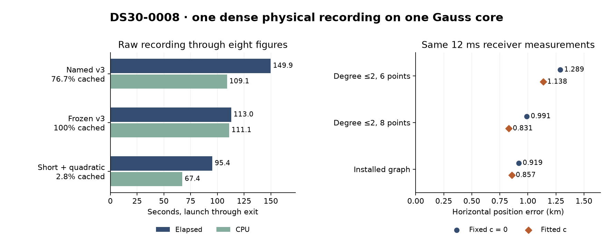

# The 12 ms receiver on a complete dense recording

The full candidate read the archived DS30-0008 I/Q, returned a position and published all eight web figures in **95.43 s elapsed and 67.35 CPU s**. Installed ALGO08v3 took **149.89 s elapsed and 109.10 CPU s** in the archived named-launcher run. Position error improved from **1.639 / 1.512 km to 1.289 / 1.138 km**, for fixed-zero and fitted calibration respectively. RF RMS increased from **129.703 / 129.663 Hz to 138.764 / 138.654 Hz**. The two arms shared 6,772 original issued visits, 6,765 admitted stereo visits, a causal orbit archive and the operator's offered square. Only the candidate made a fresh raw pass. [Raw protocol, timings and identities](dense-full-short-raw.md)



## Two historical controls on the same file

| Full process | Initial input pages cached | Elapsed (s) | CPU (s) | Candidate elapsed fraction |
|---|---:|---:|---:|---:|
| Installed v3, named launcher | 76.75% | 149.89 | 109.10 | 0.637 |
| Frozen v3, original qualification launcher | 100% | 113.02 | 111.08 | 0.844 |
| 12 ms candidate, six-point quadratic graph | 2.84% | 95.43 | 67.35 | — |

Both controls used the same frozen v3 specification and returned the same terminal, positions, owners, numerical evidence and eight PNGs. Their acquisition-stage elapsed times were 69.51 and 52.70 s, and their terminal-to-exit times were 21.95 and 3.34 s. A run's cache residency describes only the compressed-input pages before launch. It cannot separate storage latency, scheduling and publication delays. The candidate used **38.3% less CPU** than the named control, while its wall time exceeded that control's half-time budget by **20.49 s**. [Matched control receipt](measurements/dense-control-clocks.json) · [Archived qualification stage clocks](first-55/stage-clocks.csv)

## What changes with real short-receiver measurements

On the dense waveform the receiver returned 7,336 selected factors. The original pipeline returned 7,016. We exchanged the track graph while keeping the candidate's actual signed detections, two-antenna regional check, causal catalogue, solver and full position grid fixed. All three configurations produced both calibration arms and a complete 179-point grid. The numerical clocks below exclude acquisition and rendering. [Four receiver–graph combinations](dense-full-short-crossover.md) · [Degree-only protocol](degree-only-transfer-protocol.md) · [Degree-only dense results](measurements/degree-only-dense.json)

| Graph configuration on DS30-0008 | Numerical CPU (s) | Horizontal error, fixed / fitted (km) | RF RMS, fixed / fitted (Hz) |
|---|---:|---:|---:|
| Candidate quadratic, ≥6 points and 2 per coefficient | 30.245 | 1.289 / 1.138 | 138.764 / 138.654 |
| Degree ≤2, original support of ≥8 points and 4 per coefficient | 31.849 | 0.991 / **0.831** | 138.357 / 138.236 |
| Installed graph, degree ≤4 and original support | **25.566** | **0.919** / 0.857 | 140.961 / 140.950 |

The installed graph cut **4.679 CPU s** from the dense numerical solve and improved both positions compared with the six-point quadratic graph. On the weak physical DS30-0016 packet, the six-point quadratic graph was materially more accurate. Its fitted error was **0.861 km**, versus **1.692 km** for the degree-only change and **1.694 km** for the installed graph. The degree-only route passed the prespecified weak screen against installed v3, which gave 1.661 km, and withheld on the 52.5 km southern omission. These crossed results do not support selecting a graph from its RF residual or making one the general default. [Small physical and omitted-region screen](measurements/degree-only-screen.json) · [Earlier weak and southern graph comparison](short-graph-and-geography.md)

## How far the remaining stages are from half time

Of the candidate's 67.352 CPU seconds, **17.351 s** went to native waveform detection, **15.053 s** to other authenticated acquisition work, **30.245 s** to the numerical solve and **4.704 s** to everything else through process exit. Total acquisition was **60.449 s elapsed and 32.403 CPU s** for 8.182 GB compressed, or **135.35 MB/s** elapsed. This is a measured complete file. The fastest previous 192-visit prefix reached **231.52 MB/s**. [Stage budget, prices and both reader-rate transfers](measurements/dense-measured-budget.json)

| Graph and reader rate transferred to the same 55 historical clocks | Modeled median paired fraction | Modeled summed elapsed fraction |
|---|---:|---:|
| Six-point quadratic, observed dense reader | 0.743 | 0.760 |
| Installed graph, observed dense reader | 0.718 | 0.737 |
| Six-point quadratic, fastest prior prefix | 0.520 | 0.537 |
| Installed graph, fastest prior prefix | **0.496** | **0.514** |

The model uses the respective observed dense solve CPU fraction, charges one detector-file seal plus worker overhead, retains the historical terminal-to-exit times, and leaves three uninstrumented outcomes at their historical elapsed. A single reader rate applied across recordings is a sensitivity calculation. Even the fastest-prefix scenario with the installed graph misses the summed gate. That graph would require **242.44 MB/s** for the summed gate with other prices held fixed, equivalent to reading this 8.182 GB in **33.75 s**. The observed acquisition already consumed **32.40 s of CPU**. Both core work and waiting matter. The 4- and 16-recording evaluations remain gated. [Reproducible model](dense_measured_budget.py)

### Reproduction

The [raw publication runner](dense-full-short-raw.md) and [saved crossover runner](dense-full-short-crossover.md) document the archived inputs, source identities and Gauss lock. To reproduce just the degree-only comparisons, use the release environment for the solves and the repository environment for scoring, with the same low-priority single-core wrapper. `GEO_SO` must have the checked native projector digest, and `PREFIX` must identify fresh output directories.

```text
degree_only_transfer.py physical PREFIX-physical GEO_SO
degree_only_transfer.py south-far PREFIX-south-far GEO_SO
degree_only_score.py screen PREFIX SCREEN_JSON
degree_only_transfer.py dense PREFIX-dense GEO_SO --screen SCREEN_JSON
degree_only_score.py dense PREFIX DENSE_SCORE_JSON
dense_control_clocks.py NEW_CONTROL_JSON
dense_measured_budget.py NEW_BUDGET_JSON
```
