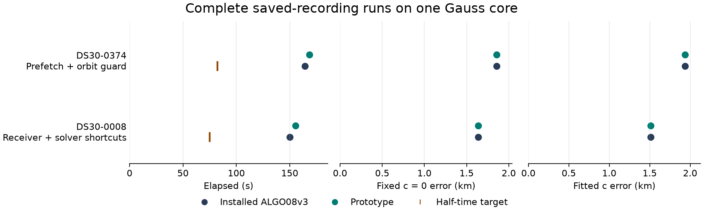

# ALGO08v3 successor qualification

The comparison starts at sealed raw I/Q and ends at process exit after the terminal result and required publications. The comparator is the installed versioned ALGO08v3 launcher, specification `6cdbac1e8496bfeaf8f3eefb90c936c65829629cc42d04b4a9bab7c6e97cf50f`. These development experiments use saved recordings and one low-priority core on Gauss.

## Development ledger

| Experiment | Physical evidence | Decision |
|---|---|---|
| Full-member prefetch and orbit-support guard | DS30-0374, 164.41 → 168.61 s. Both arms started cold. They reproduced the same detections, both fitted positions and all eight PNGs. | The orbit-support change has separate value on failures. This combination missed the latency gate. [Pair and limitations](../successor-physical-triage.md) |
| Receiver early stopping, solver layout reuse and regional rejection during fine recovery | DS30-0008, 149.89 → 155.54 s. The prototype ran first with substantially less input cached. Both calibration arms and all PNGs matched. | The measured component opportunities are small relative to the required saving. [Pair and limitations](../bounds-physical-pair.md) |



Each row is a different prototype on one physical recording. The paired error dots coincide horizontally where both builds returned the same location. Errors use the DS30 operator site reference. Pooling these rows would mix different algorithms.

## Saved-input structural experiments

| Change | Evidence against installed ALGO08v3 | Implication for a combined candidate |
|---|---|---|
| Fold the timing search onto two interleaved sample grids | Searching both grids preserved all 138 factors but consumed 2.1–3.2% more native CPU. Searching one grid saved 1.2–5.4% but lost 14 factors and the dense continuation. Even perfect advance knowledge of which lanes needed a full retry would turn that gain into 7.6–10.1% more CPU. | The FIR, mode construction, timing and carrier scout together account for about 13.0–13.3 projected dense CPU seconds. A redesign must also remove work elsewhere in acquisition. [Native controls, timings and fallback costs](../receiver-polyphase-timing.md) |
| Accelerate the repeated robust position fit by using the gradient of its objective | On dense DS30-0008 native likelihood CPU fell from 13.90 to 7.47 s. Two order-reversed pairs saved 1.08 and 5.48 CPU s through numerical evidence. Both calibration arms kept all 4,472 observation owners. Southern solve CPU rose from 4.77 to 5.00 s. | V3 spent 33.80 dense CPU s outside the entire likelihood wrapper. Even free likelihood evaluation alone leaves the solve above the 24 s budget. Grid scores shifted slightly. [Both calibration arms and per-stage attribution](../profiled-gamma.md) |
| Skip interleaved visits across the full recording, with a second variant that restores visits when carrier history is weak | On a signed 128-visit prefix, CPU was 0.988 s for v3, 0.874 s for the fixed schedule and 0.276 s with detector work removed. Dense fitted error rose from 1.512 km to 2.612 km with the fixed schedule and 2.579 km with the guarded schedule. | Both schedules fail geographic quality. On the northern distant omission the fixed schedule returned a false fix about 70 km from truth. On the southern distant omission the guarded schedule returned a false fix about 75 km from truth. [Saved CPU and position error plots, controls and receipts](../aperture.md) |
| Use position curvature and delete one satellite at a time to qualify the region boundary | The extra calculation took 0.127–0.231 CPU s for both fits. Across two simulated locations and both calibration arms, it preserved the two valid near-edge fixes but caught neither false fix where truth lay 100 m outside. | The change between the paired offers was only 0.206–0.259 standard deviations of the local likelihood. A common outward-clearance threshold would reject the northern valid fix before catching the southern omission. The distant omission, at 52.5 km, is a different test. [Signed replays and sensitivity analysis](../geographic-jackknife.md) |
| Run full two-scan searches on sparse anchors and predict signals on intervening visits | On two earlier full-factor ledgers, even granting perfect timing, free verification and advance knowledge of empty lanes, same-lane anchors plus necessary retries would cost 62.9–63.1% of original acquisition CPU. The installed dense v3 publication provided a separate budget check. | With a hypothetical 2× solver, the dense model leaves only 0.633 ms per selected non-anchor factor for verification and proposal work. The prior full verifier cost about 0.94 ms per factor. This rules out the tested schedule and verifier under those assumptions. [Oracle scope, earlier receiver identity and buffering cost](../anchor-orbit-census.md) |

## Cost budget before new raw runs

A full acquisition-only replay on DS30-0008 measured **37.34 CPU s in the stereo detector and 21.62 CPU s outside it**. The 848 anchor visits used 4.59 CPU s. With a hypothetical 2× solver the maximum budget per remaining selected signal was 0.529 ms on a CPU-only model with free publication, or 0.766 ms when transferring the measured callback CPU to the older warm elapsed run. All proposal generation, false attempts, residual verification and fallback must fit within that allowance. The instrumented run itself started with 1.89% of input pages cached, took 99.53 s to solver handoff, and reproduced the archived detection file byte for byte. [Measurement and scope of each budget](../acquisition-split.md)

| Further structural experiment | Measured outcome | Decision |
|---|---|---|
| Direct the verifier to a proposed signal time and signed carrier | Supplying the original scout's correct seeds reproduced all 138 factors on weak and dense saved samples. The dense exact verification cost 1.015 ms per matched factor even with known empty lanes. At ±1 sample and ±400 Hz seed errors the cheaper two-proposal check matched 73 of 80 dense factors, added seven unmatched factors and cost 0.728 ms per match. | The exact route exceeds both dense budgets. Misses and false proposals still need to be charged on the cheaper route. [Native timing, waveform gates and CPU per matched factor](../directed-verifier.md) |
| Use sparse measurements on other channels and causal satellite trajectories to predict timing and carrier | The physical DS30-0016 factor ledger generated 2,480 frequency proposals for 1,240 held lanes. The top-two list covered 233 of 694 factors when given the true timing; adding predicted timing from the same RF channel reduced coverage to 45. Foreign-channel proposals alone recovered zero factors in both timing and frequency. The southern simulation recovered zero of 463. | Both tests used complete factor ledgers from an earlier receiver. These are development nomination tests. They do not support a combined raw benchmark or an end-to-end position-error claim. [Frozen prediction and score receipts](../anchor-sky.md) |
| Solve jointly over candidate satellites, then fit all observations once | Dense proposal and one fit took 13.03 CPU s including preparation. The provisional fitted error was 1.815 km, but RF RMS exceeded 5.37 kHz and 19 tracks failed compatibility. All three tested offers required the full v3 fallback. The dense saved solve took 63.47 CPU s versus 54.72 s for the matched v3 control. | The checked implementation preserved the baseline decisions, including withholding on the southern omission. The quick provisional position fails its waveform checks. [Runtime and both calibration-arm error plots](../mixture-position.md) |

We projected the frozen ALGO08v3 stage clocks onto the original nested 4- and 16-recording assignments. For each recording the model multiplies acquisition and solver elapsed time by their proposed fractions, then adds the original publication time. The table gives the **minimum acquisition speedup** that satisfies both half-time gates if the solver reaches the indicated speedup.

| Hypothetical solver speedup | First 4 recordings | First 16 recordings |
|---|---:|---:|
| 1× | 5.19× | 5.50× |
| 1.5× | 2.62× | 2.91× |
| 2× | 2.11× | 2.35× |
| 3× | 1.77× | 1.98× |

Historical totals were 403.36 s and 1,715.13 s. Rank 13, DS30-0022, had a timed orbit-interpolation failure and lacks split clocks. Each 16-case projection charges the original 110.77 s in full. A successor that recovers its fix must include the real cost of doing so. Dropping solver time to zero for every split-clock recording, while retaining original acquisition and publication, leaves a 16-recording median paired ratio of **0.7014** and summed ratio of **0.7031**. Actual I/O, cache state, output costs and new decisions can move both gates. [Inputs, per-case assignments and computed fractions](stages.json)

Two further screens measured the remaining margin. Even an optimistic packed one-bit direct pilot search needs 6.42 ms per lane, against a projected whole-callback allowance of 0.581–0.689 ms. Giving the joint solver the correct curved satellite labels reduced dense RF RMS to 129 Hz, but its fitted horizontal error still worsened by 0.298 km or more and it missed the coverage gate. Earlier complete archived builds on the first four assignments also missed half time, even allowing selection with hindsight. [Low-bit cost model](../low-bit-pilot.md) · [Perfect-label solver control](../mixture-oracle.md) · [Four-recording runtime and error distributions](archived-four.md)

A perfect decision about which antenna visits to search saved 16.3% of authenticated acquisition time on the 128-visit dense prefix, with 54 unselected visits needed to support the 84 returned factors. A shared FFT filter bank also exceeded the receiver budget at the ranks needed to retain both pilot edges. A blind solver combining curved and predictive observations returned the southern containing fix faster and withheld on the omitted offer. Dense RF compatibility required fallback; the resulting saved solve cost 77.97 CPU seconds against the 54.72-second v3 control. [Exact skip schedule and timed replays](../continuation-skip.md) · [FFT span experiment](../shared-ambiguity.md) · [Joint solver costs and actual returned errors](../blind-joint.md)

One bounded repair admitted a dense fix without fallback. The same research build ran from raw I/Q through all eight figures on the southern simulation in 13.38 s against 14.36 s for installed v3. It improved both dense and southern position errors, while northern containing errors increased by 66 m and 83 m across the two calibration fits. [End-to-end pair, original position PNGs and five saved offers](joint-publication.md)

Feeding the same repaired solver with saved covariance detections produced a 41.60-second dense solve and 1.093 km fitted error. The alternate receiver's historical warm acquisition alone took 56.20 seconds. With the historical publication cost, the projected dense total is 101.14 seconds against v3's observed 113.02 seconds. [Matched detector packets, both calibration fits and timing boundaries](../receiver-crossover.md)

## Frozen scoring rules

1. Use the recorded 4-case prefix and then the 16-case prefix in [the assignment manifest](stages.json). Retain complete pairs from the first four only for the identical frozen implementation and timing boundary. Alternate first build according to the assignments. Record cache residence immediately before each build, charged reads, CPU, elapsed, exit and artifacts. Use a single shared lock across each pair, one pinned core, nice 15, best-effort I/O priority 7 and one numerical thread. Keep failed attempts in the ledger.
2. The timing gates are the median of per-recording candidate/v3 elapsed ratios and the ratio of summed elapsed times. Both must be ≤0.50. Report incomplete pairs explicitly and require complete coverage for a timing verdict. A crash or lost publication cannot qualify as a faster result. A fix must produce all eight readable standard figures, the reported decision, path and grid for the supplied region.
3. Freeze source, native libraries, configuration, fallback thresholds and the complete panel digest before held-out confirmation. Use the existing paired geographic procedure with the installed v3 comparator. Score independently for each site and each calibration arm, fixed-zero and fitted. On containing offers retain baseline fixes with no worse median or P90 horizontal error. On omitted offers count every false publication. Fresh geographic qualification requires containing fixes and withholding on every omitted offer. Report RF-fit RMS separately from position error. Record all-assignment cumulative position errors as well as error among returned positions. [Geographic protocol and scoring](../../single-core-2x/PROTOCOL.md)
4. Keep the blind site's reference and score outside inference. Use independent geographically separated simulated sites, both pilot edges and matched interior, near-face inside/outside and distant offers. Physical DS26, DS29 and DS30 form one geographic site. Physical off-site validation needs separately verified recordings and location authority. Only an integrated candidate with component timing and quality evidence justifies the next raw replay.

The plot and budget can be regenerated from this checkout on Gauss. The command reads the pinned panel and saved receipts without replaying a recording.

```sh
PYTHONPATH=.:src MPLBACKEND=Agg python -m reports.ALGO08.v3.staged_budget \
  /srv/bulk/leo-dev/algo08v2-ds30-100-6cdbac/panel.json /tmp/v3-staged-budget
```

For a fresh blind pair, pass `--baseline /opt/leo-algo08/algo08v3/run` to `tools.pipeline_eval.qualification.paired_publication`. It verifies the named launcher and payload and checks the baseline session and decision against its publication marker. During prediction locking, pass `--require-algo08v3` to `tools.pipeline_eval.qualification.score_paired_holdout lock` to bind the comparator alongside the candidate specification. A timed solver failure counts in elapsed statistics and fails the quality verdict.
