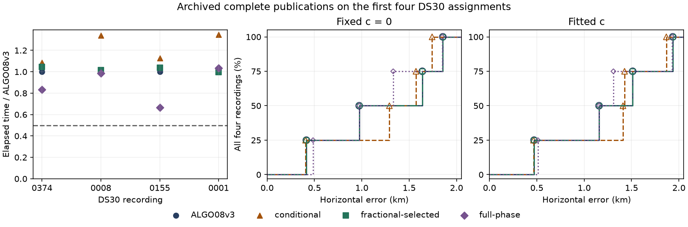

# What did earlier complete pipelines achieve on the same four recordings?

Three archived alternatives and ALGO08v3 returned four fixes each on the first four frozen DS30 assignments. Full-phase had the lowest total elapsed time, 87.6% of v3, and consumed 99.7% of v3 CPU. Even choosing the fastest of the four builds separately for each recording with hindsight gives 86.8% of summed v3 elapsed and 90.9% on the median paired ratio. The target is 50% on both measures.

| Archived build | Fixes | Median elapsed ratio | Summed elapsed ratio | Summed CPU ratio | Fixed-zero error P50 / P90 (km) | Fitted error P50 / P90 (km) |
|---|---:|---:|---:|---:|---:|---:|
| ALGO08v3 | 4/4 | 1.000 | 1.000 | 1.000 | 1.306 / 1.791 | 1.334 / 1.808 |
| Full-phase | 4/4 | 0.909 | 0.876 | 0.997 | 1.152 / 1.693 | 1.233 / 1.742 |
| Fractional-selected | 4/4 | 1.026 | 1.023 | 1.026 | 1.306 / 1.791 | 1.334 / 1.808 |
| Conditional | 4/4 | 1.233 | 1.229 | 1.131 | 1.431 / 1.691 | 1.418 / 1.735 |



Fractional-selected and v3 have identical position errors on every case. Full-phase improved fitted error from 1.512 to 1.308 km on DS30-0008 and worsened it from 0.470 to 0.511 km on DS30-0001. Measured fitted RF RMS on those two cases changed from 129.66 to 125.8 Hz and from 110.2 to 111.3 Hz, respectively. Each build's zero and fitted calibration arms used its own matched inputs and search settings.

These historical runs used the same saved raw authority, receiver session, orbit archive and supplied region on CPU 2. The source experiments paired each build with an earlier baseline in separate sessions. Run order, operating-system cache and other I/O conditions can differ from the archived v3 runs. This retrospective comparison cannot establish an algorithmic improvement in elapsed time or qualify a new build. Four physical recordings from the same site also cannot establish performance elsewhere. The 90th percentile interpolates between two observations on this small panel.

The census checks build and baseline pins, recording identity and the reported figure inventory for completed runs. Three other variants had only one or two eligible runs. Two releases lacked an orbit-archive binding. Their names, exclusions, original run orders, measured clocks, per-arm errors and RF residuals are in the [numeric receipt](archived-four.json). The three-shortcut successor was tested separately on [one fresh physical pair](../bounds-physical-pair.md).

Regenerate from saved publications in a research checkout:

```sh
PYTHONPATH=.:src MPLBACKEND=Agg python -m reports.ALGO08.v3.archived_frontier \
  /srv/bulk/leo-dev/algo08v2-ds30-100-6cdbac/publications /tmp/v3-archived-four
```
