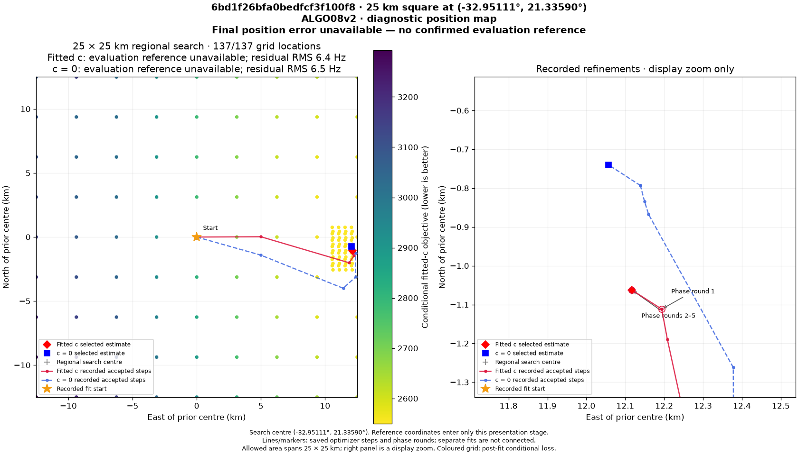
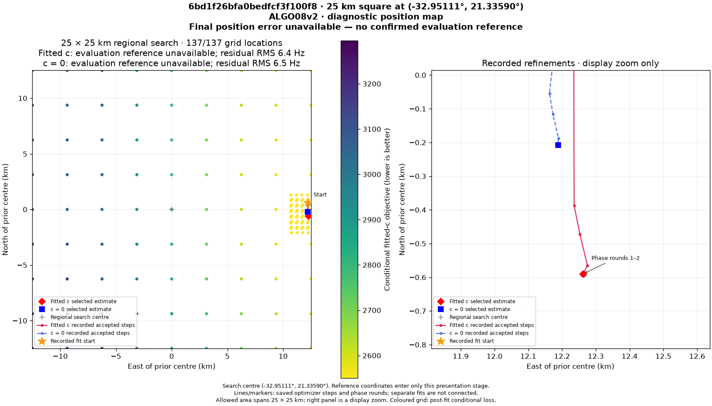
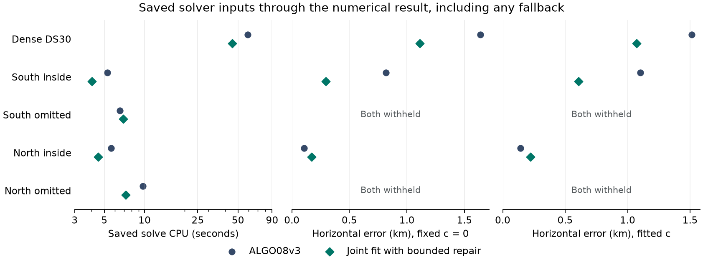

# Joint solver through the standard eight-figure publication

The bounded joint solver returned a fix from all 1,200 windows of the southern simulated recording in **13.38 s**, compared with **14.36 s for installed ALGO08v3**. Both ran the installed two-scan receiver on the same raw data. The candidate spent 93.2% of v3 elapsed and 93.5% of v3 CPU. This one end-to-end pair establishes that the solver runs through the standard publisher; the 2× target on this recording was 7.18 s. [Matched raw receipt](../measurements/joint-south-raw-pair.json) · [Candidate source pins and decision](../measurements/joint-south-candidate.json)

| Southern containing offer | Installed v3 | Joint solver |
|---|---:|---:|
| Raw I/Q to artifacts and process exit | 14.356 s | 13.383 s |
| Child CPU | 14.280 s | 13.352 s |
| Charged input blocks | 48 | 704 |
| Horizontal error with fixed-zero calibration | 0.817 km | 0.296 km |
| Horizontal error with fitted calibration | 1.101 km | 0.607 km |
| Curved RF RMS, fixed zero / fitted | 6.502 / 6.392 Hz | 6.470 / 6.373 Hz |
| Readable standard PNGs | 8/8 | 8/8 |

The candidate ran first. Both child processes used one pinned CPU at nice 15 and best-effort I/O priority 7, under one exclusive Gauss lock. The kernel denied cache-residency observations on all 19 simulated input members. Charged reads and CPU are available for both arms. There is one pair and no reversed-order timing. Physical cache conditions and large-panel runtime remain unmeasured for this build.

A separate experiment shared satellite-catalogue computations across the central starting points. Dense ranking fell from 6.923 to 5.090 CPU seconds and all three refined branch scores and positions matched. The extra per-track cache reached 110.9 MB. The timings above use the original ranking implementation. [Three saved ranking controls and memory costs](../blind-rank.md)

| Installed ALGO08v3 | Joint solver |
|---|---|
|  |  |

Both processes produced the same sealed detection file, including the raw authority and every selected factor. An independent run from the saved detector packet reproduced the joint terminal, both position-science digests, and all eight raw-run PNGs in encoded bytes and decoded pixels. The grid envelope includes an elapsed-time field; the comparison excludes that field from the scientific digest. The figures above are original publication files. All outputs were written to separate research roots and use the v3 publisher's existing on-disk model identifiers. [Independent artifact audit](joint-south-audit.json) · [Saved replay](../measurements/joint-south-saved.json)

### What the saved solver comparisons establish

On dense DS30-0008 the repaired solver improved fitted error from 1.512 to 1.070 km and saved 13.72 CPU s through numerical evidence. On the northern containing offer, fixed-zero and fitted errors increased by 0.066 and 0.083 km. Both northern arms kept all 302 original owners. Both northern and southern **distant** omissions withheld. The northern increase misses the no-worse regional accuracy target on the one tested containing offer. These geographic fixtures are public development simulations. [Dense and southern comparisons](../blind-joint-repair.md) · [Frozen northern transfer](../blind-joint-north.md)



### Reproduction on Gauss

The [research runner](../joint_publication.py) accepts a recording, causal archive, region JSON and a fresh output directory. Normal invocation reads raw I/Q. Two additional arguments, `--saved` and `--saved-digest`, select a signed detector replay. Add `--verify-images` to decode every returned PNG after publication. [Paired driver](../joint_raw_smoke.py) · [Audit script](../joint_publication_audit.py)

```sh
core=/tmp/leo-algo08v2-2x-bench/gauss.lock
python_bin=/home/mouse9911/gits/leo-tracker-reduxredux/.venv/bin/python
flock -x "$core" sudo -n -u leo ionice -c2 -n7 nice -n15 taskset -c 2 env \
  OPENBLAS_NUM_THREADS=1 OMP_NUM_THREADS=1 MKL_NUM_THREADS=1 NUMEXPR_NUM_THREADS=1 BLIS_NUM_THREADS=1 \
  MPLBACKEND=Agg PYTHONPATH="$PWD/reports/ALGO08/v3:$PWD:$PWD/src" \
  "$python_bin" -BPs reports/ALGO08/v3/joint_raw_smoke.py "$fresh_output"
```
