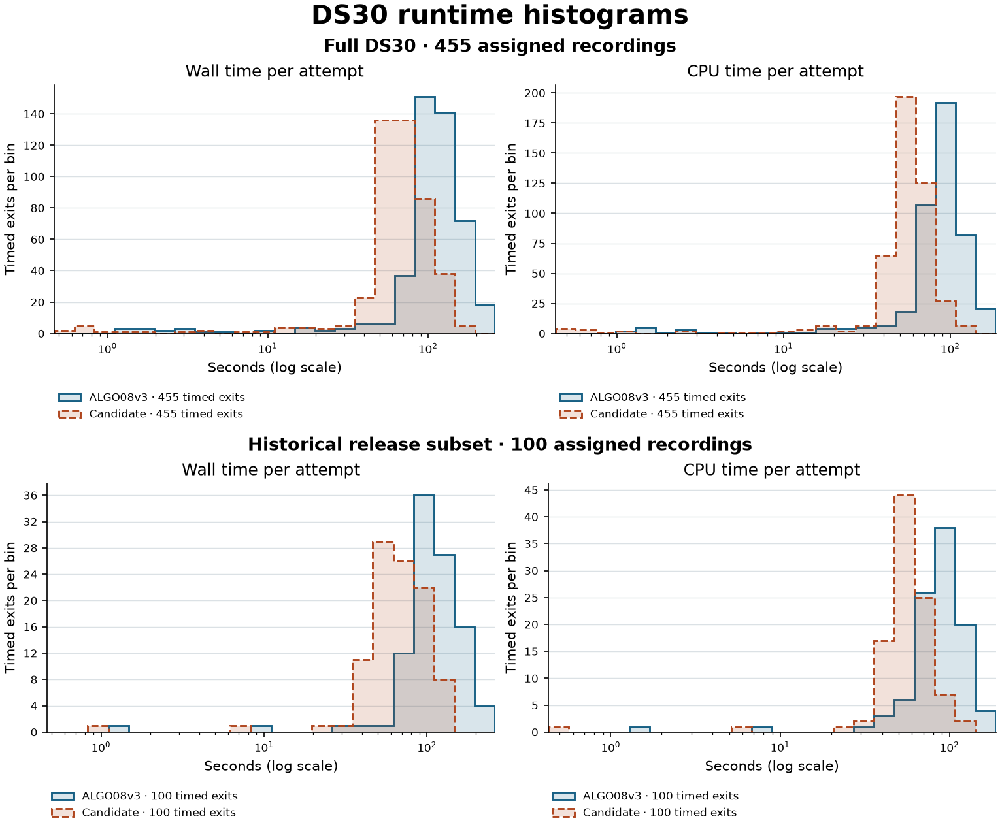
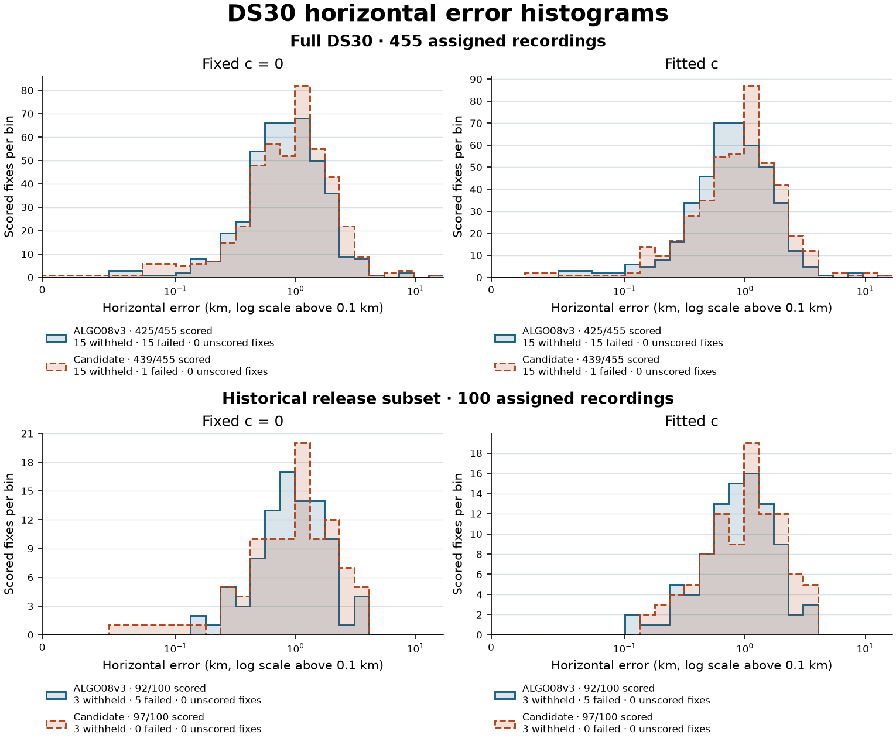
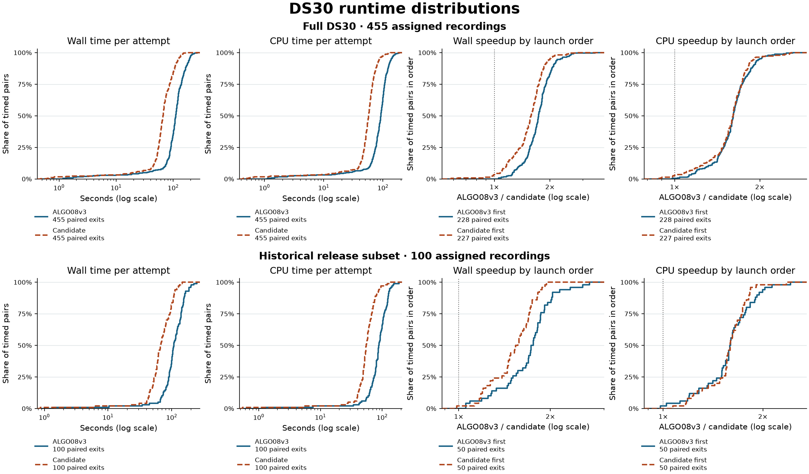
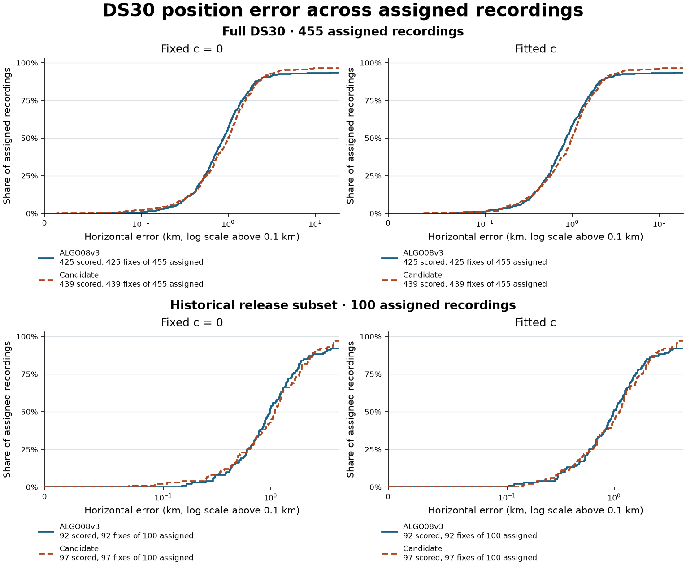
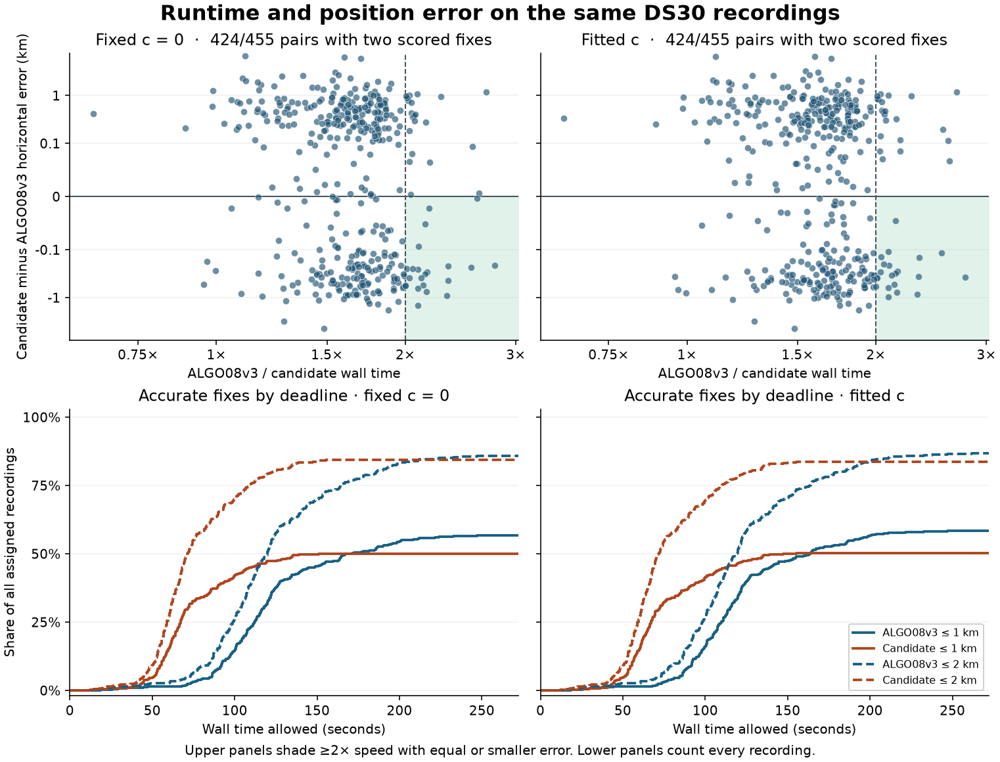

# DS30 field report · ALGO08v3 and the single-core candidate

Both pipelines were timed on the same **455 original recordings** from the Gauss rooftop. The summed wall-time speedup was **1.61×**. Speedup at the median paired ratio was **1.67×**. ALGO08v3 returned **425/455** fitted positions and the candidate returned **439/455**.

The candidate met **0 of 2** wall-time targets. The summed speedup fell below 2×. The median paired speedup fell below 2×. Across all 455 attempts, ALGO08v3 returned a fitted position within 1 km on **266** and the candidate did so on **229**. On **54** recordings only the candidate landed within 1 km. On **91** only ALGO08v3 did.

The benchmark uses the named ALGO08v3 research launcher. At enrollment, Gauss used ALGO08v2 for automatic analysis of new fast scans. Gauss subsequently deployed ALGO08v3 as the automatic default. Each benchmark pipeline used one core. Scheduling changed during the campaign. The candidate uses 8 ms primary signal searches between 20 ms two-scan anchors. Both builds read the original waveforms and use the same search region and causal orbit data for each recording. The 100-recording panels below use fresh paired measurements on the original release subset. [Frozen builds and benchmark protocol](https://github.com/misko/leo-tracker-reduxredux/blob/6e18e827eca1ae6caa78e65d2b0746c3b4f424b2/reports/ALGO08/v3/full-successor-field-protocol.md)

## Runtime and position error histograms

The runtime histograms count all measured exits, including withheld and failed attempts. Both clocks include the independent publication check whenever the run reached it. Each metric uses the same bin edges for both builds and cohorts.

The position histograms count scored fixes in shared bins. The legends report the assigned totals and the numbers withheld, failed or fixed without a scored reference.

## Runtime

| Cohort | Pairs | Summed wall speedup | Median paired wall speedup | Summed CPU speedup |
|---|---:|---:|---:|---:|
| All DS30 recordings | 455 | 1.61× | 1.67× | 1.58× |
| Original 100-recording release panel | 100 | 1.58× | 1.67× | 1.57× |
| Remaining recordings | 355 | 1.62× | 1.67× | 1.58× |
| Complete captures | 411 | 1.61× | 1.67× | 1.58× |
| Interrupted captures | 44 | 1.53× | 1.63× | 1.52× |
| Scheduled lower edge | 233 | 1.62× | 1.68× | 1.57× |
| Scheduled upper edge | 222 | 1.60× | 1.66× | 1.58× |
| ALGO08v3 ran first | 228 | 1.71× | 1.74× | 1.59× |
| Candidate ran first | 227 | 1.51× | 1.58× | 1.56× |
| Both arms in one benchmark slot | 371 | 1.60× | 1.66× | 1.57× |
| Benchmark slot reacquired between arms | 84 | 1.65× | 1.71× | 1.59× |
| Both builds reached publication verification | 440 | 1.62× | 1.67× | 1.59× |
| Both builds returned a fix | 424 | 1.62× | 1.67× | 1.59× |

Successful times cover process launch through exit and independent publication verification for both builds. A failure contributes wall and CPU through exit. The per-recording data give the child-only and verifier clocks separately. The summed ratio divides total ALGO08v3 seconds by total candidate seconds. The paired measure is the reciprocal of the median candidate-to-ALGO08v3 time ratio. The second worker can benefit from pages cached by the first.

Choosing the faster recorded exit on every recording would take 32,101.8 seconds and yield at most 1.615× summed speedup from switching between these two builds. This upper bound grants advance knowledge of both times, zero selection cost, and allows a failed or withheld exit to win. On the first 64 pairs, requiring the selector to preserve the fix count and the entire error distribution for both calibrations limited summed speedup to 1.408×. [First 64 paired choices and exact bound](https://github.com/misko/leo-tracker-reduxredux/blob/1eea99c6cb0cc144e7ca83597c4ee923fc9a295f/reports/ALGO08/v3/ds30-routing-first64.md)

| Run order | Wall seconds saved | CPU seconds saved | Change in remaining seconds |
|---|---:|---:|---:|
| All DS30 recordings | 19660.6 | 15008.4 | 4652.1 |
| ALGO08v3 ran first | 11405.0 | 7893.9 | 3511.1 |
| Candidate ran first | 8255.6 | 7114.5 | 1141.1 |

The following counts show when halving elapsed time also halved process CPU on the same recording. Each accuracy fraction counts equal or smaller candidate errors among shared scored fixes. The first two count columns include every timed outcome. The launch orders cover different recordings.

| Candidate used half the ALGO08v3 time or less | ALGO08v3 ran first | Candidate ran first | Equal or closer, fixed zero | Equal or closer, fitted |
|---|---:|---:|---:|---:|
| Wall and CPU | 9 | 6 | 4/8 | 4/8 |
| Wall only | 30 | 6 | 17/35 | 16/35 |
| CPU only | 2 | 2 | 1/2 | 1/2 |
| Neither | 187 | 213 | 156/379 | 153/379 |

### From the first pair of recordings to the full field trial

The first two recordings checked operation. Later stages followed the frozen hash order. The new recordings in each row appear in that row only. The cumulative column includes every earlier stage. The first 100 field pairs and the historical 100-recording release panel have different membership.

| New recording positions | New pairs | New pairs at half wall time | New pairs, summed / median wall speedup | Cumulative summed / median wall speedup | New within 1 km, fixed zero (v3 / candidate) | New within 1 km, fitted (v3 / candidate) |
|---|---:|---:|---:|---:|---:|---:|
| 1–2 | 2 | 1 | 1.47× / 1.98× | 1.47× / 1.98× | 0 / 0 | 0 / 0 |
| 3–8 | 6 | 1 | 1.60× / 1.52× | 1.60× / 1.52× | 4 / 4 | 5 / 4 |
| 9–30 | 22 | 5 | 1.66× / 1.75× | 1.64× / 1.72× | 12 / 9 | 14 / 10 |
| 31–100 | 70 | 5 | 1.66× / 1.71× | 1.65× / 1.71× | 39 / 33 | 42 / 32 |
| 101–455 | 355 | 39 | 1.60× / 1.65× | 1.61× / 1.67× | 203 / 181 | 205 / 183 |

### Replay time compared with recording duration

Each recording is counted once per build. A wall-time ratio of 0.4 means the replay took 40 seconds per 100 seconds of observation. A failed or withheld run can finish within the observing span. The last two columns also require a returned position within 1 km.

| Captures | Build | Finished within own observing span | Median / P90 wall time ÷ span | Within span and 1 km, fixed zero | Within span and 1 km, fitted |
|---|---|---:|---:|---:|---:|
| All | ALGO08v3 | 452/455 | 0.378 / 0.602 | 258/455 | 266/455 |
| All | Candidate | 455/455 | 0.228 / 0.378 | 227/455 | 229/455 |
| Complete | ALGO08v3 | 411/411 | 0.378 / 0.588 | 244/411 | 251/411 |
| Complete | Candidate | 411/411 | 0.226 / 0.371 | 219/411 | 222/411 |
| Interrupted | ALGO08v3 | 41/44 | 0.393 / 0.838 | 14/44 | 15/44 |
| Interrupted | Candidate | 44/44 | 0.258 / 0.418 | 8/44 | 7/44 |

The observing span comes from the audited capture start and end timestamps. Gauss processed the saved waveform after capture. Streaming first-fix latency and throughput on the embedded target require separate measurements.

Savings subtract candidate seconds from ALGO08v3 seconds. Wall time minus CPU time can include storage waits, scheduling delays and clock-accounting differences. As a sensitivity check, removing every positive wall-minus-CPU second from the candidate on each recording, while holding its CPU cost and the measured ALGO08v3 wall times fixed, would give **1.99×** summed and **1.94×** median paired. These are hypothetical speedups.

## Position error

| Calibration | Build | Fixes | Within 1 km | Within 2 km | Median / P90 error among scored fixes (km) | Median RF RMS (Hz) |
|---|---|---:|---:|---:|---:|---:|
| Fixed zero | ALGO08v3 | 425/455 | 258/455 | 391/455 | 0.828 / 1.857 | 115.60 |
| Fixed zero | Candidate | 439/455 | 227/455 | 384/455 | 0.977 / 2.177 | 146.71 |
| Fitted | ALGO08v3 | 425/455 | 266/455 | 395/455 | 0.814 / 1.868 | 115.59 |
| Fitted | Candidate | 439/455 | 229/455 | 381/455 | 0.967 / 2.146 | 146.49 |

The scan campaign scheduled upper- and lower-edge targets on the same roof. The signed recording identifier encodes the requested edge. Capture times and satellite passes vary between these groups. The counts below include every attempt in each group.

| Scheduled edge | Pairs | Within 1 km, fixed zero (v3 / candidate) | Within 1 km, fitted (v3 / candidate) | Within 2 km, fixed zero (v3 / candidate) | Within 2 km, fitted (v3 / candidate) |
|---|---:|---:|---:|---:|---:|
| Lower | 233 | 129 / 116 | 130 / 115 | 198 / 198 | 200 / 197 |
| Upper | 222 | 129 / 111 | 136 / 114 | 193 / 186 | 195 / 184 |

The cumulative curves also show where the candidate loses the most recordings. The displacement column gives a lower bound on the largest change to an existing candidate position required to match or exceed ALGO08v3 coverage at every distance, keeping the same scored recordings. It compares ranked errors and allows the order of recordings to change.

| Calibration | Largest coverage shortfall (recordings) | First distance at that shortfall | Required displacement of at least one position |
|---|---:|---:|---:|
| Fixed zero | 40 | 1.055 km | 0.199 km |
| Fitted | 44 | 0.842 km | 0.168 km |

### Variation by recording date

Each row groups recordings by their original UTC capture date. Coverage counts every attempt on that date. The last column recomputes both timing measures on the other dates.

| UTC date | Pairs | Summed wall speedup | Within 1 km, fixed zero (v3 / candidate) | Within 1 km, fitted (v3 / candidate) | Omitting date, summed / median paired speedup |
|---|---:|---:|---:|---:|---:|
| 2026-11-13 | 44 | 1.50× | 26 / 18 | 29 / 16 | 1.62× / 1.67× |
| 2026-11-14 | 62 | 1.61× | 36 / 30 | 33 / 29 | 1.61× / 1.67× |
| 2026-11-15 | 57 | 1.62× | 32 / 30 | 31 / 31 | 1.61× / 1.66× |
| 2026-11-16 | 60 | 1.73× | 39 / 32 | 41 / 35 | 1.60× / 1.66× |
| 2026-11-17 | 61 | 1.66× | 36 / 36 | 38 / 39 | 1.60× / 1.66× |
| 2026-11-18 | 62 | 1.58× | 31 / 33 | 32 / 31 | 1.62× / 1.67× |
| 2026-11-19 | 57 | 1.61× | 29 / 25 | 29 / 25 | 1.61× / 1.66× |
| 2026-11-20 | 52 | 1.57× | 29 / 23 | 33 / 23 | 1.62× / 1.67× |

All dates share the Gauss receiver site. Omitting a date measures how much that day's recordings affect the comparison. The JSON also gives 1 km coverage on each remaining set.

### Paired changes in position error

| Calibration | Shared scored fixes | Fixes gained / lost | Within 1 km gained / lost | Within 2 km gained / lost | Median / P90 change in error on shared fixes (m) |
|---|---:|---:|---:|---:|---:|
| Fixed zero | 424 | 15 / 1 | 54 / 85 | 28 / 35 | 118.4 / 889.8 |
| Fitted | 424 | 15 / 1 | 54 / 91 | 26 / 40 | 112.3 / 890.7 |

A gain at a distance threshold means only the candidate returned a scored position within that distance on the recording. A loss means only ALGO08v3 did. Error changes subtract the ALGO08v3 error from the candidate error.

### Position scatter at the Gauss roof

On shared fixes, each horizontal error gives a distance and bearing from the survey point. The radial RMS includes both the average displacement and the recording-to-recording scatter. Subtracting each build’s own average displacement gives the centered RMS. Their squared contributions add to the squared radial RMS.

| Calibration | Build | Shared fixes | Radial RMS (km) | Mean displacement magnitude (km) | Centered RMS (km) |
|---|---|---:|---:|---:|---:|
| Fixed zero | ALGO08v3 | 424 | 1.497 | 0.377 | 1.448 |
| Fixed zero | Candidate | 424 | 1.797 | 0.521 | 1.719 |
| Fitted | ALGO08v3 | 424 | 1.474 | 0.369 | 1.427 |
| Fitted | Candidate | 424 | 1.803 | 0.514 | 1.728 |

This diagnostic uses the survey only after scoring. It measures repeatability at one physical location and supplies no location correction to either build.

### Position repeatability on nearby recordings

The receiver stayed on the same roof. In frozen enrollment order, each recording was paired with the nearest unused earlier enrollee whose capture began within one hour. Each recording contributes to at most one pair. The medians use pairs where both builds fixed both recordings. A smaller separation means a more repeatable position. The survey-error plots measure accuracy.

| Calibration | Recording pairs | Both scans fixed, v3 / candidate | Both builds fixed both scans | Median separation, v3 / candidate (km) | Candidate separation larger |
|---|---:|---:|---:|---:|---:|
| Fixed zero | 204 | 179 / 192 | 179 | 1.112 / 1.333 | 113 |
| Fitted | 204 | 179 / 192 | 179 | 1.122 / 1.289 | 109 |

The supplied search square was 25 km wide. Returning its center on every recording would give **8.193 km** horizontal error. ALGO08v3 beat that distance on 424/455 recordings and the candidate on 435/455, using fitted calibration. The separate satellite screening center was 57.742 km from the surveyed receiver.

### When speed and accuracy coincide

On **51/455** recordings the candidate took half the ALGO08v3 wall time or less. Each dot compares two scored fixes on one recording. Lower dots indicate smaller candidate error. The table accounts for every recording that reached this speed, including cases without two scored fixes.

| Calibration | Equal or smaller error | Larger error | Lacking a paired error |
|---|---:|---:|---:|
| Fixed zero | 21 | 22 | 8 |
| Fitted | 20 | 23 | 8 |
| Both calibrations | 19 | 24 | 8 |

The last row requires equal or smaller error in both calibrations. The two timing targets at the start of the report apply to the whole panel.

The lower panels count a fix when the build has finished and the position is within the stated radius. Withheld positions, unscored fixes and late finishes all remain in the denominator. For example, allowing 60 seconds gives the following counts.

| Calibration | Radius | ALGO08v3 by 60 s | Candidate by 60 s | Assigned recordings |
|---|---:|---:|---:|---:|
| Fixed zero | 1 km | 6 | 69 | 455 |
| Fixed zero | 2 km | 12 | 122 | 455 |
| Fitted | 1 km | 7 | 69 | 455 |
| Fitted | 2 km | 12 | 120 | 455 |

| Capture state | Paired recordings | ALGO08v3 fitted fixes | Candidate fitted fixes | ALGO08v3 / candidate fitted P90 error among fixes (km) |
|---|---:|---:|---:|---:|
| Complete captures | 411 | 396 | 410 | 1.831 / 2.089 |
| Interrupted captures | 44 | 29 | 29 | 2.702 / 5.146 |

The largest fitted-error increases on shared fixes were DS30-0015 (+6.594 km), DS30-0058 (+6.512 km), DS30-0203 (+5.898 km), DS30-0266 (+3.213 km), DS30-0161 (+3.011 km).

Excluding just DS30-0058, the largest contributor to excess squared fitted error, leaves 423 shared fixes. On those same fixes the RMS error is **1.468 km for ALGO08v3** and **1.744 km for the candidate**. The primary results above retain this recording.

The candidate's fitted error increased by more than 1 m on 250 of 424 shared fixes. On **238 of those 250**, even the point closest to the reference on the shortest arc between its fixed-zero and fitted solutions still exceeded ALGO08v3's fitted error by more than 1 m. This retrospective bound applies to choosing or interpolating the published endpoints. A fresh nonlinear fit can move beyond them.

On the first 41 recordings, a separate diagnostic applied ALGO08v3’s calibration displacement to the candidate’s fixed-zero estimate on each shared fix. This increased 1 km coverage from 18 to 20, while worsening 22 of 36 shared positions and increasing median paired error by 25 m. All five cases with at least 1 km of excess fitted error remained at least 1 km worse. [Paired calibration displacement test](https://github.com/misko/leo-tracker-reduxredux/blob/635d9f2846eb61aa058901d2577b81f8c3959650/reports/ALGO08/v3/calibration-transport.md)

### Which receiver changes affected DS30-0049?

A separate crossover on DS30-0049 tested both solvers on each saved receiver output. Both solvers returned 1.420 km fitted error on the installed detections and 4.040 km on the candidate detections. The receiver change accounted for the difference on this recording. [DS30-0049 crossover and verification](https://github.com/misko/leo-tracker-reduxredux/blob/5dad70d7d0c273b2aa17fa546d622bcd8e490789/reports/ALGO08/v3/ds30-0049-saved-crossover.md)

Each intervention below starts from the same candidate detections and uses the installed measurements as a diagnostic reference. Each row has its own complete saved-input solve. The field runtime plots use the original, unmodified pair.

| DS30-0049 receiver input | Fixed-zero error (km) | Fitted error (km) |
|---|---:|---:|
| Original installed detections | 1.826 | 1.420 |
| Original candidate detections | 4.472 | 4.040 |
| Add all 10 detections from the phase-guided waveform search | 4.259 | 3.997 |
| Replace 284 closely matched short measurements | 4.196 | 3.847 |
| Replace 72 short measurements that chose a different carrier | 3.942 | 3.779 |
| Remove 161 candidate-only detections | 4.254 | 3.900 |
| Restore all 104 installed detections on empty short lanes | 4.148 | 3.663 |
| Restore those 104 detections and replace the 72 disagreeing winners | 3.532 | 3.204 |

The phase-guided search accepted 10 of 117 proposed signals on six saved waveform members. Six matched an installed measurement. Adding all ten before refitting reduced fitted error by 43 m. The two control phase estimates returned zero accepts. [Receiver and position evidence](https://github.com/misko/leo-tracker-reduxredux/blob/f8cc050e255facab30f9a3388afcf3a52a653f22/reports/ALGO08/v3/ds30-0049-directed-position.md)

Applying the two edits together recovered **940 m with fixed-zero calibration and 836 m with fitted calibration**. The joint gains exceeded the sums of the individual gains by 87 m and 198 m. The joint fit retained 318 of 320 original observation assignments with matching satellite and role. Its fitted error still exceeded ALGO08v3 by 1.783 km. [Joint saved-input test](https://github.com/misko/leo-tracker-reduxredux/blob/3435ca510dced361269178f61757cf192be4e46a/reports/ALGO08/v3/ds30-0049-joint-recovery.md)

The identical rule on DS30-0086 restored 564 missing detections and replaced 464 disagreeing winners. Fixed-zero error fell from 371 to 219 m and fitted error from 382 to 299 m. This second recording came from the same roof. The measured gains on both recordings required the original full-length receiver outputs as a reference. [DS30-0086 transfer test](https://github.com/misko/leo-tracker-reduxredux/blob/0488b1f9f405458c829b3d05b84e5db6213e07bb/reports/ALGO08/v3/ds30-0086-joint-recovery.md)

ALGO08v3 used 44 of the 104 missing measurements on DS30-0049 and 323 of the 564 on DS30-0086 in its final satellite assignments. Those measurements made up 13.8% and 13.0% of the assigned observations. Grouping observations by satellite, radio and tuning, the timing support for measuring Doppler curvature fell by 23.6% and 15.7%. The calculation held the satellite assignments fixed. [Missing observations and their times](https://github.com/misko/leo-tracker-reduxredux/blob/8d31ce0b915162d851b98e56222b8e7849979a5d/reports/ALGO08/v3/missed-owner-support.md)

On DS30-0086 alone, interpolating between neighboring candidate detections placed 65 of the 323 missing assigned observations within 250 Hz and two samples of the installed receiver. Holding the earlier arrival phase fixed matched one. The rule proposed 1,342 windows, including 1,139 where the installed receiver also found no signal above its threshold. These counts describe where a targeted receiver could search. [Predicted frequency and pilot arrival on saved measurements](https://github.com/misko/leo-tracker-reduxredux/blob/cd5c97fb9bab8f79a8ea198d57ac8ca032b824c6/reports/ALGO08/v3/empty-lane-arrival.md)

Restoring all 104 detections recovered 41 of the 44 missing installed assignments with the same satellite and role. Fitted error improved by 377 m and remained 2.243 km above ALGO08v3. The four changes were tested independently. [Matched measurements](https://github.com/misko/leo-tracker-reduxredux/blob/2ab7167229369484196b4ae1ed32924c35585e86/reports/ALGO08/v3/ds30-0049-matched-donor.md) · [Different carrier selections](https://github.com/misko/leo-tracker-reduxredux/blob/8d92f39455a247a8f383de41438ffdd9d2766dc9/reports/ALGO08/v3/ds30-0049-shifted-winner-repair.md) · [Candidate-only detections](https://github.com/misko/leo-tracker-reduxredux/blob/e9536f1014191a14b83676ff88a2baf244f034cd/reports/ALGO08/v3/ds30-0049-sparse-only-drop.md) · [Missing detections](https://github.com/misko/leo-tracker-reduxredux/blob/abc05f858d5c05b99bc94ed36201f1826b611eec/reports/ALGO08/v3/ds30-0049-empty-recovery.md)

A second control started from the installed detections. Adding just 12 extra detections from the candidate’s full-length anchor visits increased fitted error from **1.420 to 2.453 km**. Four of the 12 received satellite assignments. The fitted RF residual moved by only 0.29 Hz. This isolates the effect of these anchors with installed short-visit evidence. [Anchor-only control](https://github.com/misko/leo-tracker-reduxredux/blob/9c881a8106ceb548efc032fbfd4883f39c8018b6/reports/ALGO08/v3/ds30-0049-anchor-only.md)

### RF fit and position on the same recordings

Each RF residual uses that build’s own accepted observations. The counts below compare changes in conditional RF RMS with movement toward or away from the survey on shared scored fixes.

| Calibration | Paired | Lower RF RMS, closer | Lower RF RMS, farther | Higher RF RMS, closer | Higher RF RMS, farther | Either tied |
|---|---:|---:|---:|---:|---:|---:|
| Fixed zero | 424 | 0 | 0 | 178 | 246 | 0 |
| Fitted | 424 | 0 | 0 | 174 | 250 | 0 |

### Frequency correction on saved receiver outputs

The correction moves a measured carrier frequency halfway toward a prediction from neighboring visits when the two estimates agree within one frequency bin. The replay predicted odd visits after removing both receivers' measurements at those visits from the track fit. The replay adjusted 366 frequencies on DS30-0019, 499 on DS30-0274, 530 on DS30-0218 and 153 on DS30-0212, kept every detection and arrival time, rebuilt the tracks and refitted the position. All distances below are survey errors.

| Recording | Calibration | ALGO08v3 | Original candidate | With correction |
|---|---|---:|---:|---:|
| DS30-0019 | Fixed zero | 744 m | 435 m | 121 m |
| DS30-0019 | Fitted | 842 m | 375 m | 54 m |
| DS30-0274 | Fixed zero | 172 m | 889 m | 719 m |
| DS30-0274 | Fitted | 206 m | 934 m | 752 m |
| DS30-0218 | Fixed zero | 883 m | 1,057 m | 819 m |
| DS30-0218 | Fitted | 953 m | 1,125 m | 873 m |
| DS30-0212 | Fixed zero | 1,327 m | 1,068 m | 1,086 m |
| DS30-0212 | Fitted | 1,224 m | 977 m | 1,011 m |

The correction reduced position error on three recordings and increased it on DS30-0212 in both calibration arms. The fitted result crossed inside 1 km on DS30-0218 and outside 1 km on DS30-0212. Across all four saved comparisons, three fitted positions fell within 1 km with either method. DS30-0442 was also enrolled for a correction replay. Its required orbit data were unavailable from cache. It remains in the full comparison of the two original pipelines. [Preregistered DS30-0212 and DS30-0442 outcomes](https://github.com/misko/leo-tracker-reduxredux/blob/2fb6feae6059a0c81ce160ef2a38669abcbe9c9b/reports/ALGO08/v3/masked-cfo-next-two-results.md)

DS30-0274 still had 546 m more fitted error than ALGO08v3. Conditional RF RMS on the fitted solver's selected observations fell from 174.73 to 171.91 Hz on DS30-0019 and from 130.24 to 127.08 Hz on DS30-0274. Across all assigned observations on DS30-0274, fitted RF RMS rose from 152.65 to 153.20 Hz.

The corrected saved replays on DS30-0019 and DS30-0274 took 18.13 and 22.54 seconds, excluding acquisition and preparation of the frequency forecasts. Building and applying the forecasts to the unmodified candidate detections in a separate single-core measurement added 0.602 s on DS30-0019 and 0.781 s on DS30-0274. On DS30-0274 the unchanged saved control reproduced the original raw positions, assignments, grid and path. Its wall time was 22.60 seconds, with different cache conditions. The field distributions use the original builds. All three held recordings come from the same roof. [DS30-0019 replay](https://github.com/misko/leo-tracker-reduxredux/blob/2a087ff3f022a6f24d265d3f0ee80385a103e7b5/reports/ALGO08/v3/held-shrink-0019-ram.md) · [DS30-0274 control and replay](https://github.com/misko/leo-tracker-reduxredux/blob/d13e838d214bda451da743941d94b96b07e30874/reports/ALGO08/v3/held-shrink-0274.md) · [Forecast cost and exact input comparison](https://github.com/misko/leo-tracker-reduxredux/blob/7f7371cafbfdb59aa5e1d625dd56b3a610e8ec26/reports/ALGO08/v3/held-cfo-features.md)

On DS30-0218 the survey was opened after the ordinary and corrected publications were sealed. With the ordinary predictions and assignments held fixed, fitted-calibration frequency residual RMS fell from 141.61 to 95.18 Hz on the 442 edited observations used by the original fit. Refitting also changed which observations the solver used. The two saved replays took 22.876 and 23.521 seconds through exit, respectively. [DS30-0218 paired replay and signed residuals](https://github.com/misko/leo-tracker-reduxredux/blob/2e599c41d749687452d31f79eecc73d231a0830d/reports/ALGO08/v3/masked-cfo-0218-prospective.md)

Applying the same rule to the even short visits gave mixed receiver results. Among edited measurements with an ALGO08v3 counterpart, agreement within 250 Hz and two arrival samples went from 237 to 235 of 249 on DS30-0019 and from 360 to 371 of 384 on DS30-0274. The wider 2,250 Hz and six-sample counts held steady on both. The even-visit test measured receiver agreement only. [Complementary visits and full counts](https://github.com/misko/leo-tracker-reduxredux/blob/3002b00e870b68ccc3b6d8c7332368800f810cee/reports/ALGO08/v3/held-cfo-complement.md)

### Does the receiver effect repeat?

Both solvers processed the same two saved detector packets on each of three recordings. The table gives horizontal position error in km with fitted calibration. These targeted replays explain particular recordings. The runtime distributions use the original end-to-end runs.

| Recording | 20 ms receiver, ALGO08v3 solver | 20 ms receiver, candidate solver | Mixed receiver, ALGO08v3 solver | Mixed receiver, candidate solver |
|---|---:|---:|---:|---:|
| DS30-0049 | 1.420 | 1.420 | 4.040 | 4.040 |
| DS30-0086 | 0.410 | 0.457 | 0.378 | 0.382 |
| DS30-0220 | 0.369 | 0.369 | 0.546 | 1.371 |

On DS30-0049 the error followed the receiver packet under either solver. On DS30-0086 the mixed receiver placed both estimates closer to survey. At fixed-zero calibration its gains were 3 m with the ALGO08v3 solver and 80 m with the candidate solver. Conditional RF RMS increased by about 49–50 Hz despite the geographic improvement. [Paired solver inputs, position shifts and RF fits](https://github.com/misko/leo-tracker-reduxredux/blob/021fc1bca199524db12f05f5da233ab0a5dda0e8/reports/ALGO08/v3/field-receiver-solver-cross-0086.md)

On DS30-0220, switching receivers with the ALGO08v3 solver added 178 m of fitted error. Switching to the candidate solver on that same mixed packet added another 825 m. Both solvers gave exactly the same position on the original 20 ms packet, so the 825 m measures a receiver–solver interaction on this recording. At fixed-zero calibration the two steps added 275 m and 819 m. The fitted estimate moved 1.625 km when switching solvers on the mixed packet. [DS30-0220 four-way comparison](https://github.com/misko/leo-tracker-reduxredux/blob/3258963eb3aa9c134c0081ae4ab40287a9c16668/reports/ALGO08/v3/field-receiver-solver-cross-0220.md)

On that same DS30-0220 packet, the candidate provisionally assigned all 179 detections used only by the original solver's conditional fit to the same satellites. The second screen removed 156 and the later repair removed the other 23. The same stages removed 38 and 29 on DS30-0086, where the final geographic difference was small. The counts identify when the paths diverged. [Detection-by-detection screen replay](https://github.com/misko/leo-tracker-reduxredux/blob/ca74fa45e5e16028aa1d6012cd415fe689c8271a/reports/ALGO08/v3/pre-screen-owner.md)

Two saved runs stopped at the second screen to record its decisions. On DS30-0220, 139 of the 156 detections fell on curves that failed the slope and profile-noise checks. The remaining 17 passed their individual checks but lost support from another channel on the same radio. The same slope and noise checks also removed 38 on DS30-0086. [Measured rejection reasons](https://github.com/misko/leo-tracker-reduxredux/blob/8fa3872d7db96babacad8a5f2d12dfa449caa136/reports/ALGO08/v3/second-curve-gate.md)

Across the first 30 pairs excluding those two controls, retrying the original pipeline whenever this screen dropped at least 10% of the incoming observations would have added 600 wall seconds. It recovered one recording within 2 km in each calibration and gained none within 1 km. [Held and prospective tests of the retry rule](https://github.com/misko/leo-tracker-reduxredux/blob/51d8522310d81deac483b657769d5cea9ad091b9/reports/ALGO08/v3/ds30-second-screen-attrition.md)

### What would another speedup require?

Suppose a perfect selector knew which recordings to send to ALGO08v3 before spending any time. To use the candidate on a recording, both calibration arms must retain every baseline fix and stay within the stated increase in error. Each row assumes the same proportional time saving on every candidate run. A repair makes one more recording meet the accuracy condition at that assumed time. ALGO08v3 keeps its measured time throughout.

| Fraction of current candidate time | Recordings needing repair for 2×, zero excess error | Recordings needing repair for 2×, up to 250 m excess |
|---:|---:|---:|
| 100% | Unreachable | Unreachable |
| 80% | 252 | 171 |
| 75% | 208 | 129 |
| 50% | 106 | 37 |
| 0% | 40 | 0 |

A single number is the exact minimum for both summed and paired-median wall time. A range gives a proven lower bound and an attainable count. Unreachable means that even perfect accuracy on every recording would miss a timing target at that speed. This calculation uses the surveyed errors only to price these scenarios.

On the first 30 pairs, halving everything ALGO08v3 did before writing its detector packet would give **1.48× summed** end-to-end speedup. Keeping the original solver and subsequent work at their measured costs would require a **4.29×** speedup across that whole initial stage to reach both 2× targets. The model includes startup, reading, input verification, decoding and detection. [Measured stage boundaries and assumptions](https://github.com/misko/leo-tracker-reduxredux/blob/96451b64b82e48a1a0564816b45cec785c1f3f98/reports/ALGO08/v3/installed-receiver-first30.md)

For a future candidate, making the current native callbacks 1.5× faster and the entire solver 1.4× faster projects to 2.001× summed speedup on the first 30 and 2.085× on the next 16. This calculation holds all other measured costs and the current positions fixed. The first group has only 0.57 seconds of total margin. [Case-level timing budget](https://github.com/misko/leo-tracker-reduxredux/blob/73fe5a470c715022e864d8a3872c8f5aaa0b8b22/reports/ALGO08/v3/receiver-solver-targets.md)

On the first 62 pairs, the complete candidate position grids used 183.45 seconds of the 593.35 seconds that the candidate needed to save to halve total wall time. Even with zero-cost grids and a 1.5× faster native receiver, the projected speedup was 1.962× summed and 2.029× at the paired median. [Per-recording grid clocks and calculation](https://github.com/misko/leo-tracker-reduxredux/blob/2c156a5aea0b1688774ec05f5dea07df18eebfb9/reports/ALGO08/v3/grid-time-ceiling-first62.md)

A separate saved replay on DS30-0138 kept the original 20 ms detector packet and changed one calculation in the position grid. Grid CPU time fell from 4.477 to 3.659 seconds. Whole-solve CPU time went from 18.511 to 18.544 seconds. Both calibrations returned the same positions and satellite assignments, and all eight PNGs matched byte for byte. The ordinary worker incurred 242 major page faults and the modified worker incurred zero. [Complete map and matched timing](https://github.com/misko/leo-tracker-reduxredux/blob/83c3f5a941c0630ae91f35f25f818bd11242adcf/reports/ALGO08/v3/profiled-grid-export-0138-pair.md)

On a simulated southern recording, the same exporter reproduced all eight PNGs with either offered region. One fixed-zero grid score changed by 0.01660 when the region contained the receiver, exceeding the 0.005 limit. When the region excluded the receiver by 1 km, both exporters returned the same false fix. [Matched grids and images](https://github.com/misko/leo-tracker-reduxredux/blob/7fe7fdbc21f3113fdf6005d51523688d04654873/reports/ALGO08/v3/profiled-grid-export-south.md)

The two receivers agreed on 83,058 short-aperture peaks under the prespecified matching rule. A correction for when each receiver measured the carrier changed held disagreement from 97.480 to 97.460 Hz RMS after subtracting the mean for each recording and radio. The same timing model increased disagreement in fractional-sample alignment. These are receiver measurements on matching peaks. [Held predictions and unmatched peaks](https://github.com/misko/leo-tracker-reduxredux/blob/8860e704a759e549666eaa29667f0314c91fce98/reports/ALGO08/v3/first30-native-agreement.md)

### Changing the offered search region

Each recording keeps its original region and causal orbit inputs in both workers. Errors use the independently recorded site authority. All recordings come from the Gauss roof. The results measure repeatability at this site.

Two saved replays on the same physical DS30-0086 recording changed only the offered region. Moving its center 12.5 km east kept the receiver inside and moved the candidate’s fitted position by 0.16 m. Moving it 12.5 km west excluded the receiver by 5.204 km. The candidate still published on the east boundary, 5.406 km from the receiver. Its fitted RF RMS improved from 180.08 to 170.33 Hz on that false fix. These replays are outside the measured runtime distribution. [Offered regions, plotted fixes and sealed evidence](https://github.com/misko/leo-tracker-reduxredux/blob/f59d67e11d4a23615258b47cd2e042d5339dc1d4/reports/ALGO08/v3/field-offer-translation-0086.md)

A separate South simulation tested a different offered region on previously authenticated detector packets. With the receiver 1 km inside the north face, fitted errors were 1,099 m for ALGO08v3 and 363 m for the candidate. With the receiver 1 km outside, both published a false fix. The candidate's two estimates reached the north face and its 25 exterior probes still allowed publication. These saved-input trials are separate from the measured DS30 distributions. [South region test and verified products](https://github.com/misko/leo-tracker-reduxredux/blob/b8bbee45a207f6de4e766ae925de15a3dbf0c804/reports/ALGO08/v3/frozen-south-north-face.md)

### Outcomes on the same recording

| ALGO08v3 ↓ / Candidate → | Fix | Withheld | Solver failure | Total |
|---|---:|---:|---:|---:|
| Fix | 424 | 1 | 0 | 425 |
| Withheld | 1 | 14 | 0 | 15 |
| Solver failure | 14 | 0 | 1 | 15 |
| Total | 439 | 15 | 1 | 455 |

On DS30-0397 the installed solver and its retry stopped at the orbit interpolator's time boundary. The candidate extended its orbit grid with states propagated from the causal orbital elements and retried the interpolation inside that grid. Its fitted position was 0.878 km from the reference. [DS30-0397 solver and publication audit](https://github.com/misko/leo-tracker-reduxredux/blob/5bb0489d85435688e05c1b6f6419620e5565fe33/reports/ALGO08/v3/ds30-0397-orbit-support-audit.md)

On DS30-0210, ALGO08v3 stopped at the same interpolation check during initial corner ranking. The candidate also evaluated all four corners. Its trajectory stayed inside the existing orbit grid and required zero extensions. Its fitted position was 0.431 km from the reference. Both the receiver observations and the ranking procedure changed in this comparison. [DS30-0210 solver and publication audit](https://github.com/misko/leo-tracker-reduxredux/blob/e47094fcd614a19763408975fce2cf63f1b1e6de/reports/ALGO08/v3/ds30-corner-failure-0210.md)

For 9 recordings, the original directory moved after DS30 enrollment. Both builds reopened the same original data. The per-recording table retains the accession, historical and reopened input identities and the digest of each relocation proof.

The combined per-recording input has SHA-256 `2c0eeae3b8091360ffaebe401ee05ae5ea5b757b2356adca36940d9855eccd07`. Report renderer `8341c667bbbb`. [Reproduce the figures from the sealed export](https://github.com/misko/leo-tracker-reduxredux/blob/8341c667bbbb80d1954afcfa9586e5f76fc2dcee/reports/ALGO08/v3/full-successor-field-protocol.md)

[Per-recording results](recordings.csv) · [Machine-readable summary and provenance](summary.json)

## Timing by worker count

Gauss initially ran one recording at a time. The six-worker batch used separate cores, shared storage, and admitted work while the disks were busy. Recovered recordings ran serially. Both builds ran sequentially within each pair in their assigned order. The full histograms combine these conditions. The CSV identifies the scheduling phase of each run. The phases cover different recordings, so differences between their speedups cannot isolate the effect of concurrency.

| Scheduling | Pairs | Total wall speedup | Median paired wall speedup | Total CPU speedup |
|---|---:|---:|---:|---:|
| serial | 307 | 1.62× | 1.67× | 1.55× |
| six workers | 148 | 1.60× | 1.64× | 1.63× |
