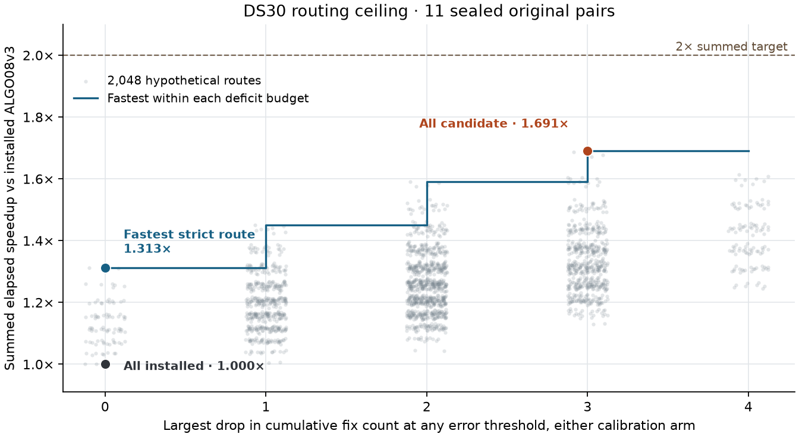

# Perfect whole-record routing on the first eleven sealed DS30 pairs

Even with perfect foreknowledge and zero routing cost, the fastest choice that preserves installed ALGO08v3’s empirical position-error curve in both calibration arms takes **771.353 s**, versus **1,012.713 s** for installed v3. It achieves **1.313× summed and 1.472× median paired wall speedup**. One route attains both optima. Even dropping the accuracy constraint keeps this cohort above the two 2× timing gates. [Frozen protocol](ds30-oracle-routing-protocol.md) · [Exact enumeration and checked inputs](measurements/ds30-oracle-routing.json.gz)

| Whole-record choice | Candidate selections | Wall total (s) | Summed / median paired wall speedup | CPU total (s) | Summed / median paired CPU speedup |
| --- | ---: | ---: | ---: | ---: | ---: |
| Installed v3 throughout | 0 | 1,012.713 | 1.000× / 1.000× | 884.463 | 1.000× / 1.000× |
| Candidate throughout and fastest unconstrained route | 11 | 599.004 | 1.691× / 1.554× | 546.819 | 1.617× / 1.525× |
| Fastest with at least the installed fix count and 1 and 2 km coverage | 8 | 674.056 | 1.502× / 1.551× | 611.387 | 1.447× / 1.497× |
| Fastest with at least the installed fix count and coverage at every distance | 7 | 771.353 | 1.313× / 1.472× | 690.131 | 1.282× / 1.376× |

All **2,048** choices use one measured worker per recording for both arms. The all-attempt denominator is eleven in each arm. The empirical curves only change at the union of the two builds’ finite errors, yielding **19** thresholds in each arm. Exact integer count comparisons at all those points cover every finite threshold. Fix totals are checked separately. The calibration arms share one route per recording. Wall time and paired wall median were optimized separately. CPU figures describe the selected wall routes.

The strict criterion admitted **84** routes. The summed optimum was unique, and two routes tied for best median. The same minimum-sum route attained the best median and minimized the worse of the two normalized wall ratios. It kept installed v3 on **DS30-0049, DS30-0274, relocated DS30-0452, and DS30-0220** and used the candidate on the other seven. Its additional fix on DS30-0397 came from the candidate, where installed v3 had a signed solver failure. Both builds withheld on DS30-0107. The all-attempt criterion allows improvements on one recording to cover an error increase on another.

Installed v3 produced **9/11** fixes. Each of the three optimized routes produced **10/11**. All-candidate dropped at least one cumulative fix below installed performance at **17/19** thresholds in each arm, with a worst deficit of three recordings. Its fixed-zero counts within 1 and 2 km were **5 / 8**, against **6 / 9** installed. Its fitted counts were **5 / 8**, against **7 / 9** installed. The relaxed route matched those installed cutoff counts and still fell below the full curve at **10** fixed-zero and **11** fitted thresholds. The strict route reached **7 / 9** fixed-zero and **7 / 9** fitted with zero deficit at every threshold. The frontier in the figure tests an allowed maximum count drop anywhere on either curve. This is a different positional criterion from enforcing only the two published distance cutoffs.

Strict preservation costs **172.349 s** above always using the candidate. Relaxing to 1 and 2 km coverage recovers **97.297 s** of that difference. Halving the installed sum requires **506.357 s**. The unconstrained route still needs **88.647 s** of additional reduction, and the strict route needs **264.996 s**. A better receiver or solver would have to change those measured outcomes or clocks before routing could close either gap.

The first twelve frozen execution positions start with the two smoke recordings, followed by the ranked assignments. The snapshot had eleven contiguous verified pairs and left DS30-0144 unpaired at the twelfth position. It uses the independently sealed generation-2 DS30-0452 overlay in its original position and verifies both attempts against the original plan, pair, attested raw authorities and metadata result receipts. The timings retain the published raw process and verification boundaries, including the signed failure and actual separate storage admissions. They describe the measured opportunities from these original Gauss recordings. The exact reference audit uses the recorded operator-site authority. The experiment read no waveform and launched neither worker. [Campaign protocol](full-successor-field-protocol.md) · [Relocated original validation](ds30-original-relocation.md)

Reproduce with `python -m reports.ALGO08.v3.ds30_oracle_routing` against the exact combined-export SHA-256 `bceb23d2c1cb3fe0a4e26c4e377ef69fdd8899fd57b990a32c983491c1facf5b`. The implementation uses the normal report’s error and attempt validation. The first metadata check found that withheld terminal receipts omit the optional RF field that the export supplies as null. The reader now applies the same normalization before comparing receipts. Route selection and input enrollment stayed frozen. [Calculator](ds30_oracle_routing.py) · [Focused tests](../../../tests/pipeline_eval/test_ds30_oracle_routing.py)
