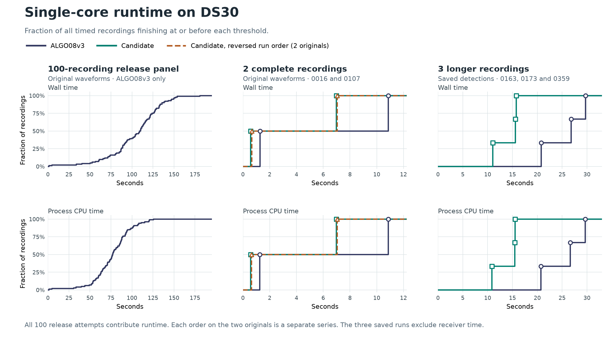
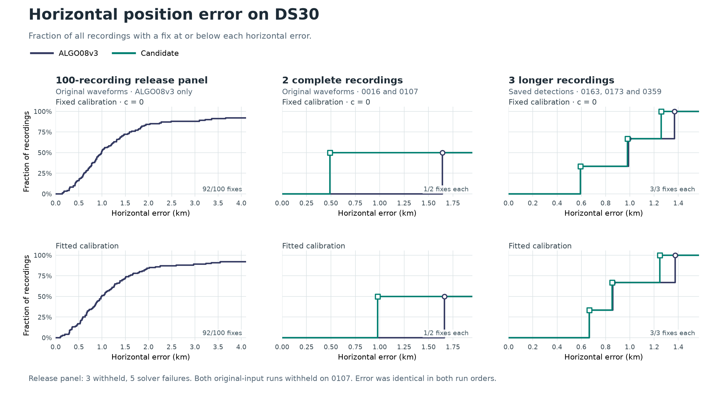

# DS30 runtime and horizontal position error

The ALGO08v3 release panel contains 100 DS30 recordings with complete timing records. The successor has matched original-waveform timings on **two other recordings** and matched solver timings from saved detections on **three of the 100**. A full 100-recording successor distribution from original waveforms is still unmeasured.

| Measurement | ALGO08v3 | Successor |
|---|---:|---:|
| Release panel, median / 90th percentile wall time | 109.55 / 135.96 s | Unmeasured |
| Release panel, fixes / recordings | 92/100 | Unmeasured |
| Original files, total wall time on 0016 and 0107 | 12.134 s | 7.562 s fix first, 7.712 s withhold first |
| Original files, fitted error on the sole shared fix (0016) | 1.661 km | 0.980 km |
| Saved detections, total wall time on 0163, 0173 and 0359 | 77.266 s | 42.343 s |
| Saved detections, fitted error on 0163 / 0173 / 0359 | 0.859 / 1.374 / 0.667 km | 0.854 / 1.247 / 0.667 km |

Each runtime curve includes every timed attempt in its panel through process exit. The two original-input orders use the integrated raw successor and the same fresh installed comparator. Repeated orders count separately in runtime and agree on both position decisions. The saved-input panels use the revised solver and renderer with identical original 20 ms detections in each pair. The installed 0359 clock was fresh and those for 0163 and 0173 are the earlier matched controls. Horizontal axes use different ranges to keep the matched measurements visible. Each error curve divides by all recordings assigned to that series. Its final height is the fix rate. [Release measurements](../ds30-100/README.md) · [Successor configurations and timing boundaries](../compatible-archive-transfer.md)

The [per-run CSV](recordings.csv) contains wall time, CPU time, terminal decision and both calibration errors. Run `python plot.py` from this directory with NumPy and Matplotlib to regenerate both figures. To rebuild the CSV, run `python extract.py PUBLIC_CHECKOUT RESEARCH_CHECKOUT` with the pinned main and research Git objects available. The historical release CSV used the build label `candidate` for the version later named ALGO08v3. The extractor resolves that label before joining the current studies. [Extractor](extract.py) · [Plotting script](plot.py)
