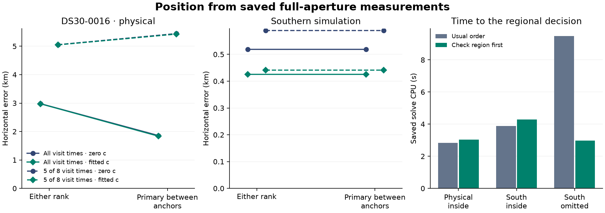

# Temporal coverage and early regional rejection

On DS30-0016, retaining measurements at every visit brought fitted error down from **5.427 to 1.836 km** under the same primary-selection rule. On the southern simulation the analogous change was **0.441 to 0.426 km**. Skipping times exposed a second failure on the displaced southern offer. The solver published a position **75.450 km** from the reference after its first attempt failed and the ordinary fallback returned an interior fix. Checking the supplied region before solving correctly withheld on the same detector packet in **2.97 CPU s**, down from **9.48 s** to the false fix. [Coverage ablation](mixed-aperture-crossed.md) · [Scored early decisions](measurements/early-region.json)



For the receiver comparison, a full anchor at the first of every eight per-channel visits could contribute either verified factor. The four intervening odd-numbered visits could contribute a primary. Each paid visit used both antennas. The availability test supplied the actual **20 ms** factor at each primary slot. The full-coverage counterfactual also offered a primary on the three intervening even-numbered visits. These replays isolate sampling time and availability of residual peaks while holding the graph and full satellite search fixed. The **12 ms** receiver was measured separately on 66 saved stereo visits. Its shortened primaries can differ in timing, frequency and availability. [Frozen receiver schedule](mixed-aperture-availability-protocol.md) · [Native waveform measurements](mixed-aperture-receiver.md)

| Offered region on the five-of-eight schedule | Earlier decision and error in km, zero / fitted | Region-first decision and error in km | CPU s, earlier → region first | Geographic probe CPU s |
|---|---|---|---:|---:|
| DS30-0016, containing | Fix, 5.445 / 5.427 | Same fix and numerical evidence | 2.826 → 3.027 | 0.306 |
| South, containing | Fix, 0.588 / 0.441 | Same fix and numerical evidence | 3.889 → 4.292 | 0.412 |
| South, displaced | False fix, 71.286 / 75.450 | Withheld before satellite ranking | 9.480 → 2.971 | 1.051 |

The early check used the complete causal catalogue already prepared for that packet. Both containing offers stopped after 25 probes under the ordinary inside-score rule. The displaced offer evaluated all 96. Independently for each antenna the best exterior point was 50 km beyond the nearest face. Both selected exactly the same point. Original region dimensions, geographic thresholds and both calibration arms were unchanged. On the earlier false fix, the final constrained coordinates were inside the offer, so the boundary-triggered check did zero probes. The corrected ordering avoids the expensive joint attempt and fallback when this far-exterior evidence is already decisive. These are development results for the same southern waveform under two offers. [Frozen ordering](early-region-protocol.md) · [Full paired evidence](measurements/early-region.json.gz)

On a different waveform-derived Indian development recording with the true position **1.5 km** outside the region, the existing rule lacks the required one-width exterior clearance. Even a complete search over its 96 probes placed both antennas' exterior maxima just **3.125 km** beyond the face of the 25 km offer. The original and full-catalogue solvers both published the erroneous fix. Moving this check earlier cannot fix that case. An RF-channel split caught the Indian omission but missed both 100 m controls. [India comparison](india-saved-transfer.md) · [Complete regional score comparison](india-regional-diagnostic.md) · [RF-channel transfer test](geographic-rf-fold.md)

The raw-to-publication timing gates are still open. The five-of-eight receiver missed its physical accuracy screen, so the full-recording raw trial stopped at the saved availability comparison. The zero-cost-primary projections and the independently measured cost of real short calls are listed separately in the [receiver budget](mixed-aperture-crossed.md).

## Reproduce

Use the pinned release and research checkout on Gauss. Use an empty output directory and run the scorer after all three receipts have sealed. During the original experiment an import initially preceded release setup and the saved one-attempt harness also rejected the first successful early withholding because no optimizer ran. Both issues were corrected. The final far-offer timer begins with a fresh input and includes the successful proof.

```sh
release=/opt/leo-algo08/bdb869682a2ea63af4b198a920b763a4c6a78c4c
out=$(mktemp -d)
export OMP_NUM_THREADS=1 OPENBLAS_NUM_THREADS=1 MKL_NUM_THREADS=1 NUMEXPR_NUM_THREADS=1 BLIS_NUM_THREADS=1
export PYTHONPATH="$PWD/reports/ALGO08/v3:/opt/leo-algo08/algo08v3/payload:$release/src:$release:$PWD"
gauss() {
  flock -x /tmp/leo-algo08v2-2x-bench/gauss.lock ionice -c2 -n7 nice -n15 taskset -c 2 "$@"
}
for offer in DS30-0016 south-containing south-far; do
  gauss "$release/venv/bin/python" -BPs reports/ALGO08/v3/early_region_trial.py run "$offer" "$out/$offer.json" || exit 1
done
export PYTHONPATH="$PWD/reports/ALGO08/v3:$PWD:$PWD/src"
gauss "$release/venv/bin/python" -BPs reports/ALGO08/v3/early_region_trial.py score "$out" "$out/summary.json" "$out/full.json.gz"
```
