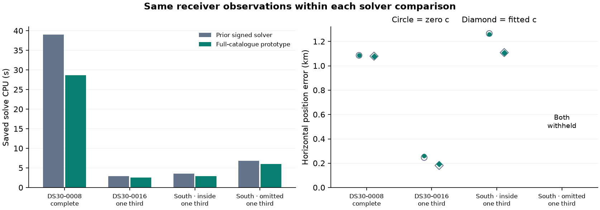

# Faster full-catalogue solving transfers to sparse southern inputs

On dense DS30-0008 the prototype used **28.68 CPU s** from saved detections through the numerical grid. Installed ALGO08v3 used **60.97 s** on the same packet, and the earlier full-catalogue signed solver used **39.04 s**. On a weak physical recording, searching the full satellite list also recovered an accurate fix lost by the reduced candidate list. The one-third receiver still lost enough information to violate the fixed-zero accuracy gate at the southern site. [Physical fits and satellite ownership](full-family-amortized.md) · [Southern trial protocol](full-family-south-protocol.md)



| Recording and receiver observations | Prior signed solve → prototype, CPU s | Prototype error in km, zero / fitted calibration | Complete receiver reference error in km, zero / fitted |
|---|---:|---:|---:|
| DS30-0008, complete packet | 39.045 → 28.680 | 1.088 / 1.079 | 1.639 / 1.512, installed v3 |
| DS30-0016, one-third stereo visits | 2.968 → 2.574 | 0.262 / 0.194 | 1.644 / 1.661, complete older two-scan signed control |
| Southern simulation, one-third stereo visits, containing offer | 3.568 → 2.962 | 1.261 / 1.108 | 0.817 / 1.101, installed v3 |
| Same southern packet, displaced offer | 6.801 → 5.990 | Both solvers withheld | Installed v3 withheld |

Each timing pair uses the same detector packet and geographical offer. The last column identifies a separate quality reference for each row. Sparse physical and southern observations came from the archived two-scan receiver before the final v3 continuation policy. The chart uses an open symbol for the prior signed fit and a filled symbol for the prototype. Neither raw acquisition nor PNG rendering is in these clocks. [Physical clocks](measurements/full-family-amortized-summary.json) · [Southern clocks and post-fit scores](measurements/full-family-south-summary.json)

The southern fit kept all 118 observation assignments and their roles from the earlier signed fit on the same sparse measurements. It returned a complete 165-point grid. Its fixed-zero and fitted RF RMS values were **6.394 and 6.312 Hz**; horizontal error changed by **−5 m and −2 m** versus the prior sparse fit. Against the complete receiver the changes were **+444 m and +6 m**. The fixed-zero result exceeds the 250 m allowance. On the displaced offer the initial repair hit its rejection limit. The ordinary fallback consumed 3.024 of the 5.990 CPU seconds, then both receivers supported withholding. The two offers shared a byte-identical detector packet, causal orbit archive and visit mask. They are two decisions on one simulated recording. [Full receipts](measurements/full-family-south.json.gz)

Two receiver tests narrow the next prototype. A forecast using two previous detections of the same satellite predicted **11 of 135** verified weak physical factors and **96 of 96** southern factors within 400 Hz and one sample. Even granting those hits, a second pass cost more CPU than replaying the added slots with a full search, before reading any extra raw data. The measured native verification of two entirely skipped recording members saved 24–25 ms CPU while retaining all decoded integrity checks. Both results favor testing a single pass with better observation coverage. [Directed forecast and charged costs](directed-donor.md) · [Cold input verification](native-verified-drain.md)

## Reproduction

From the research checkout on Gauss, set `release` to the pinned installed release and `out` to an empty directory. Each fit runs under the common single-core slot. Score after both fits finish. Use a fresh path for each generated file.

```sh
release=/opt/leo-algo08/bdb869682a2ea63af4b198a920b763a4c6a78c4c
out=$(mktemp -d)
export OPENBLAS_NUM_THREADS=1 OMP_NUM_THREADS=1 MKL_NUM_THREADS=1 BLIS_NUM_THREADS=1 NUMEXPR_NUM_THREADS=1
export PYTHONPATH="$PWD/reports/ALGO08/v3:/opt/leo-algo08/algo08v3/payload:$release/src:$release:$PWD"
for offer in south-containing south-far; do
  flock -x /tmp/leo-algo08v2-2x-bench/gauss.lock ionice -c2 -n7 nice -n15 taskset -c 2 \
    "$release/venv/bin/python" -BPs reports/ALGO08/v3/full_family_amortized_trial.py \
    run "$offer" control "$out/$offer.json" --paid-south || exit 1
done
PYTHONPATH="$PWD/reports/ALGO08/v3:$PWD:$PWD/src" python3 reports/ALGO08/v3/full_family_south_score.py \
  "$out" "$out/scores.json" "$out/receipts.json.gz" "$out/scores.png"
```
