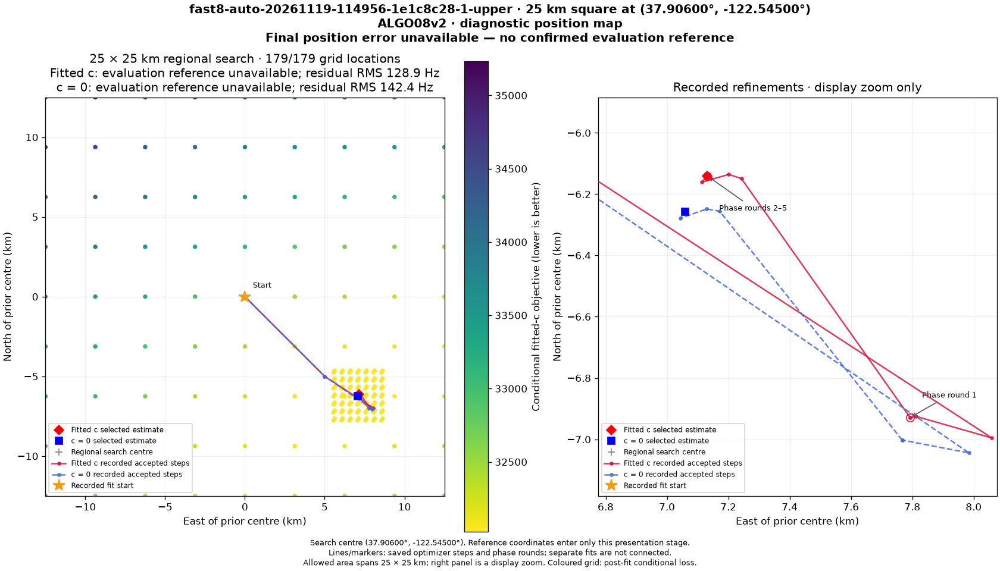
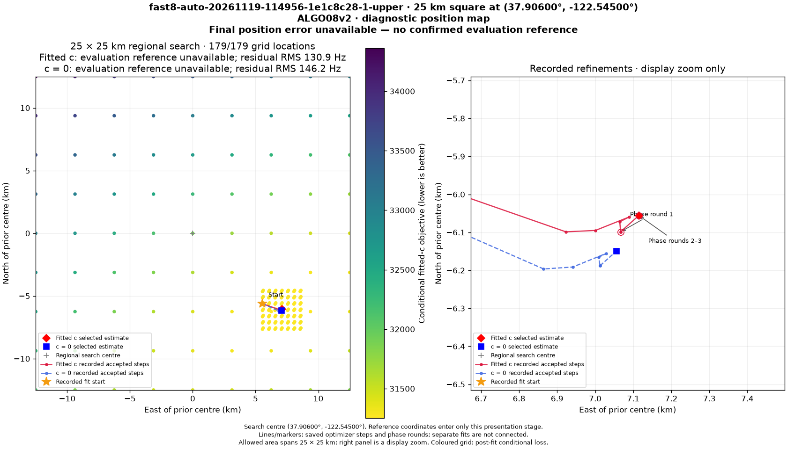

# Full-catalogue solver through web publication on DS30-0374

The prototype published all eight required figures from a second physical recording in **14.73 s** from the saved detector handoff, compared with **24.13 s** for installed ALGO08v3. Its horizontal error changed by **+4.2 m** with zero calibration and **−6.7 m** with fitted calibration relative to installed v3. All eight rendered files, decoded pixels, both fits, satellite assignments, numerical path and scientific grid matched the earlier signed solver on this recording. [Scored publication](measurements/full-family-web-DS30-0374.json) · [Preregistered comparison](full-family-web-protocol.md)

| Same physical detections and region | Installed ALGO08v3 | Earlier signed solver | Full-catalogue prototype |
|---|---:|---:|---:|
| Solve and numerical grid, CPU s | 21.38 | 16.62 | **12.16** |
| Saved handoff through publication, CPU s | 24.03 | 19.10 | **14.68** |
| Saved handoff through publication, elapsed s | 24.13 | 19.13 | **14.73** |
| Horizontal error, zero / fitted, km | 1.855 / 1.935 | 1.860 / 1.929 | 1.860 / 1.929 |
| Frequency residual RMS, zero / fitted, Hz | 101.536 / 101.520 | 101.577 / 101.594 | 101.577 / 101.594 |
| Grid points / PNGs | 179 / 8 | 179 / 8 | 179 / 8 |

The two comparator publications were collected earlier. This trial used their authenticated installed detections, original user-supplied region and capture-era orbit archive. Each run used one numerical core. The measured **1.64×** improvement against installed v3 covers processing and publication after the detector handoff. The full campaign target includes raw reads and both receiver scans. The recording was already in use for development. [Original saved publications](signed-0374-transfer.md) · [Source of the full-catalogue solver](full-family-amortized.md)

| Installed ALGO08v3 position PNG | Full-catalogue prototype position PNG |
|---|---|
|  |  |

The checked-in right-hand image has the same SHA-256 as the newly rendered file. The grid document digest changed from the previous signed publication because it includes elapsed time. Comparing those two documents field by field found only `elapsed_seconds` changed. The scientific grid digest and both objective replay residuals matched.

## Reproduction

Run from the research checkout using the recording archive's read-authorized account and an empty writable output path. `full_family_web.py run` verifies the saved physical input, calls `joint_publication.py --full-catalogue --verify-images` in the release environment and seals the candidate. The `score` step verifies the published store again before looking up the operator site reference.

```sh
release=/opt/leo-algo08/bdb869682a2ea63af4b198a920b763a4c6a78c4c
out=$(mktemp -d)
export OPENBLAS_NUM_THREADS=1 OMP_NUM_THREADS=1 MKL_NUM_THREADS=1 NUMEXPR_NUM_THREADS=1 BLIS_NUM_THREADS=1
export PYTHONPATH="$PWD/reports/ALGO08/v3:$PWD:$PWD/src"
gauss() {
  flock -x /tmp/leo-algo08v2-2x-bench/gauss.lock ionice -c2 -n7 nice -n15 taskset -c 2 "$@"
}
gauss "$release/venv/bin/python" -BPs reports/ALGO08/v3/full_family_web.py run "$out/publication"
gauss "$release/venv/bin/python" -BPs reports/ALGO08/v3/full_family_web.py score "$out/publication" "$out/score.json"
```
