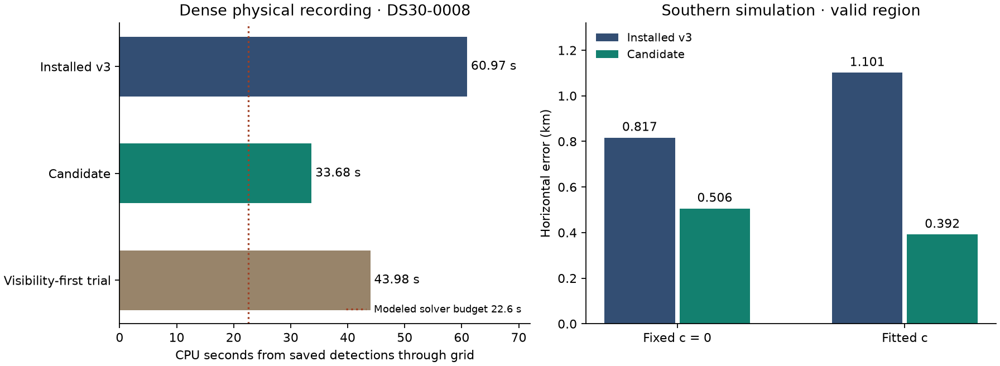

# How much time is left to save after the short receiver?

The complete candidate solve on dense DS30-0008 took **33.68 CPU s**, including **10.04 s** for the regional check before fitting. Installed ALGO08v3 used **60.97 CPU s** on the same saved detector input. An earlier 23.48 s comparison timed the finalist race under a different solver configuration. Using the complete route changes the most favorable historical projection with worker overhead to **0.539 median paired / 0.553 summed elapsed**, above the 0.5 target on both measures. [Matched dense solves and numerical evidence](live-inference-profile.md) · [55-recording calculation](measurements/full-short-live-budget.json)



## Receiver performance away from the DS30 site

The candidate processed the archived southern simulated waveform through the full 20/12 ms receiver, quadratic graph, full-catalogue solver and web publisher. All 1,200 stereo visits were admitted, with 304 full and 2,096 short native calls across the two antennas. The receiver selected 703 factors. The original containing square put the simulated receiver 100 m inside the nearest face. The same signed output from acquisition, causal archive and solver then ran on two previously published missing-region offers. Both replays used the public full-short research entry point and the ordinary terminal and figure store. [Prespecified cases and follow-up timing](full-short-south-protocol.md) · [Receiver and publication receipts](measurements/full-short-south.json)

| Supplied square | Published outcome | Horizontal error, fixed / fitted (km) | RF RMS, fixed / fitted (Hz) | Solve CPU (s) | Process elapsed (s) |
|---|---|---:|---:|---:|---:|
| Containing, archived installed v3 | Fix | 0.817 / 1.101 | 6.502 / 6.392 | — | — |
| Containing, candidate from raw I/Q | Fix, 8 PNGs | **0.506 / 0.392** | 9.682 / 8.631 | 4.627 | **13.491** |
| True position 52.5 km outside, saved candidate detections | Withheld before fitting | — | — | 3.831 | **5.025** |
| True position 100 m outside, saved candidate detections | Fix, 8 PNGs | 0.506 / 0.392 | 9.683 / 8.632 | 4.748 | **8.433** |

The valid fix used 519 observations per calibration arm and a complete 137-point grid. Its acquisition consumed 5.348 CPU s. Publication, including acquisition, solve and figures, took 11.909 CPU s and 12.127 elapsed s. The entire process took 13.255 CPU s. The far offer used all 96 regional probes. Both antennas independently supported withholding. On the near omission, the check stopped after 25 probes and the solver published a fix. The geographic error of that fix is small, but the regional decision is wrong. The containing and near-missing solutions used exactly the same radio evidence. These are public development fixtures. The first scoring process could not import the repository scorer after both original terminals sealed. Scoring was recovered from those outputs using the repository environment. [Runner and independent scoring](full_short_south.py)

## The remaining single-core budget

The model below uses the measured complete dense solve fraction of **0.5524**, the measured signed reader rates, one seal and worker overhead per recording, and the 55 historical v3 elapsed denominators. The three failed recordings without stage instrumentation retain their observed elapsed. The historical tail through process exit stays charged. Dense solve fraction and prefix reader rate are transfers across recordings. Actual whole-recording timing for the physical short candidate remains the single DS30-0016 pair. [Matched physical pilot](full-short-physical.md) · [Seal calibration](full-short-seal-scaling.md)

| Measured reader throughput | Seal assumption | Modeled median / summed elapsed fraction | Dense solve budget to pass both |
|---:|---|---:|---:|
| 167.9 MB/s | Optimistic | 0.657 / 0.672 | No positive solve time fits |
| 167.9 MB/s | Stressed | 0.668 / 0.683 | No positive solve time fits |
| 231.5 MB/s | Optimistic | 0.539 / 0.553 | 22.61 CPU s |
| 231.5 MB/s | Stressed | 0.550 / 0.564 | 20.25 CPU s |

At the faster measured reader rate, the favorable model needs another **11.07 s** from the 33.68 s solve. Even a free regional check would leave **23.64 s**, above the 22.61 s allowance. Holding the solver fixed instead requires **278.5 MB/s** effective reader throughput under the optimistic seal and **291.0 MB/s** under the stressed seal for the summed gate. These calculations use observed stage prices and constrain the next candidate. They do not establish cohort performance. [Reproducible model](full_short_live_budget.py)

Three bounded trials tested specific costs. Evaluating Doppler only for visible cells preserved every tested result, but scattered reads made the regional check **19.82 s** versus **10.04 s**. Reusing compressed buffers sped up the first saved prefix pair and slowed the reversed pair. Skipping a preliminary rendering traversal reduced median eight-PNG CPU by **0.106 s** on DS30-0016; the difference varied with run order. All 96 generated PNGs matched the archived bytes. [Visibility-first trial](live-inference-profile.md) · [Signed ingress](signed-ingress-reuse.md) · [Saved publication](saved-publication-layout.md)

## Reproduce on Gauss

From the research checkout, use the previously built short library with SHA-256 `06570a53032c770d99cc9678b8660e1bb502b71f30fc47c8b1a4a8e31bc19ba9`. Each candidate publication requires a fresh output path. The regional test driver starts raw analysis only for the containing offer. The near check reads that saved packet again. [Build recipe](mixed-aperture-receiver.md) · [General runner accepting a recording, archive and region](full_short_run.py)

```sh
here="$PWD/reports/ALGO08/v3"
trial=$(mktemp -d /var/tmp/leo-full-short-south.XXXXXXXX)
py=/home/mouse9911/gits/leo-tracker-reduxredux/.venv/bin/python
short=/var/tmp/leo-mixed-aperture.pdUjDb1S/build-v2/short-primary.so
gauss() {
  flock -x /tmp/leo-algo08v2-2x-bench/gauss.lock ionice -c2 -n7 nice -n15 taskset -c 2 env \
    OMP_NUM_THREADS=1 OPENBLAS_NUM_THREADS=1 MKL_NUM_THREADS=1 BLIS_NUM_THREADS=1 NUMEXPR_NUM_THREADS=1 \
    MPLBACKEND=Agg PYTHONPATH="$here:$PWD:$PWD/src" "$@"
}
gauss "$py" -BPs "$here/full_short_south.py" "$trial/publication" --binary "$short"
gauss "$py" -BPs "$here/full_short_south.py" "$trial/publication" --near-replay
gauss "$py" -BPs "$here/full_short_live_budget.py" "$here/measurements/live-inference-profile-summary.json" "$trial/model.json"
```
