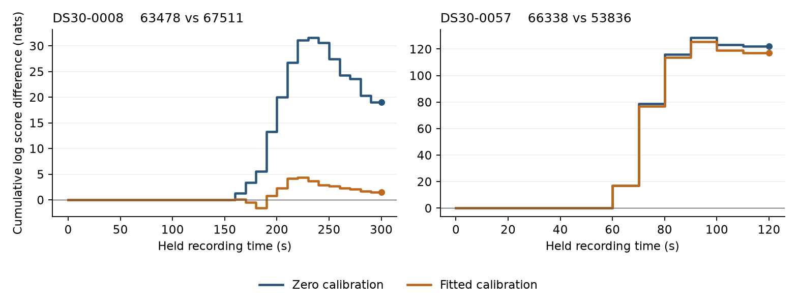

# Where a shorter recording analysis loses evidence

The all-visit 20/8 ms receiver and compact solver remain the research comparison. Across the North and South simulations they used 21.294 s from original I/Q through publication and exit, versus 30.503 s for installed ALGO08v3. That leaves **6.04 s** to remove from the pair. The paired median time fraction was 0.700 and the summed fraction was 0.698. A complete physical withhold reached 2.79×. A representative physical panel with both timing fractions at or below 0.500, preserved fix rate and preserved location accuracy remains open. [Complete paired results and physical-position interventions](physical-transfer-and-raw-time.md)

## Which satellite did the unseen frequency support?

On dense DS30-0008, switching the satellite assignment on 222 identical observations moved the fixed-zero and fitted-calibration errors by 337 and 341 metres. To check the choice, we removed one frequency from both radios **before** constructing tracks, nominating satellites or fitting nuisance parameters. Forecasts from seven frequencies were sealed before evaluation on the eighth. We repeated the procedure on DS30-0057, recorded 21 hours later, with its own independently nominated rivals. Both recordings come from the same physical site. [Controlled position comparison](dense-family-refit.md) · [Training and nomination](dense-family-holdout.md) · [Forecasts, calibration and absolute scores](dense-family-holdout-offline.md)

Positive values favor the first satellite in each title. Each increment is the difference in log predictive score over one ten-second interval on the held frequency. The graph uses separate vertical scales. Repeated measurements on one trajectory provide correlated evidence. Removing a block below holds both training forecasts fixed and drops only its contribution to the held score. These are sensitivity checks on the same recording. [Figure and deletion calculation](held_interval_sensitivity.py)

| Recording and calibration | First minus second, all held data (nats) | Weakest result after removing 10 s | Weakest after removing 30 s | First satellite versus clutter, all held data |
|---|---:|---:|---:|---:|
| DS30-0008, zero | +19.04 | +11.31 | **−2.12** | +660.54 |
| DS30-0008, fitted | +1.53 | **−0.93** | **−4.25** | +687.27 |
| DS30-0057, zero | +122.15 | +60.63 | +6.13 | **−47.36** |
| DS30-0057, fitted | +116.96 | +56.81 | +3.42 | **−50.14** |

On DS30-0008, dropping the 180–210 s interval reverses both calibration arms. Dropping just one ten-second bin reverses the fitted result in two of 30 possible starts. RX2 also favors the other satellite in both calibrations. On DS30-0057 the relative order survives every tested deletion, yet **both satellites predict the held frequency worse than the pure-clutter model**. That distinction matters for a fast solver considering whether to discard a rival. This experiment produced no independent transmitter identity or new position. Cold preparation plus first scoring cost 15.12 and 5.88 CPU s. The dense repair we sought to avoid cost 0.738 CPU s. [Held observations and cost](dense-family-holdout-offline.md) · [Original dense repair](dense-8ms-prefix.md)

A second prototype scored the joint Doppler residual across multiple tracks after removing allowed receiver drift. Once given the candidate states, it needed about 2 ms per dense pair. It reproduced the signed objective's preference for the **less accurate** dense assignment and its preferred branch on the South 100 m omission that published a false fix. Both results include fixed-zero and fitted calibration. The experiment skipped zero discovery passes. A faster evaluation of those two states offers no measured saving in generating them. [Fixed-state replay, aborted-run costs and reference checks](curvature-projector.md)

## What paid for acquisition and regional checks

| Experiment | Measured result | Decision |
|---|---|---|
| Four-frame ordinary receiver, preserving full two-scan anchors | 6.6444 ms is the shortest tested window supporting all four frame origins. It retained 41/61 signed 8 ms factors on a DS30-0008 member and 35/45 on DS30-0169, losing seven and four strong factors. Native short search saved 5.5–8.6 CPU ms, while all four complete worker pairs took longer through exit. | Retain 8 ms. Both independent physical signal checks failed before a position trial. [Signed factors and timings](four-frame-primary.md) |
| Original 20/8 ms acquisition on DS30-0169 | In **296.9 CPU ms**, the detector used 127.6, decoding 77.6, decoded hashes 23.8, compressed hash/framing 17.5, descriptor and transfer 36.0, and all other work 14.4. The native detector already borrowed views of the decoded windows. | Any input saving must address transfer or decoding/authentication while charging all original bytes. Eliminating a conversion at the native handoff offers negligible time. [Reader attribution and supply of already-decoded samples](ingress-eight-audit.md) |
| Feed that 20/8 ms receiver incrementally on real read demand | The first verified stereo callback arrived **30–31 ms earlier**, and peak memory fell **74.3 MiB** in both orders. Complete acquisition CPU moved **+4.57 / −1.84 ms**. The two fresh incremental processes took 2.142 and 2.186 s through exit versus 2.033 and 2.068 s for the original reader. | The memory result matters for embedded development. Keep the original reader in the end-to-end speed comparison. All signed detections and 64 input digests matched. [Paired actual reads and failure checks](incremental-live-eight.md) |
| Select four actual epochs per track to propose 16 satellites | The proposal retained every original winner, ungated nominee and compatible candidate across **2,416** replayed calls on DS30-0008 and DS30-0316. Rescoring and conservative fallback added **0.561 / 0.195 CPU s**. Even with a free decision about fallback, the measured curve work offers only 0.204 / 0.065 s, overlapping an existing optimization. | The method shows how little data some nominations need. Computing the full-rank inputs early still consumes the main cost. Each shadow call handed the original result to the running search. [Recall, changed aliases and disjoint cost ceilings](geometry-subset-probe.md) |
| Bound the unfinished exterior likelihood, retaining exact fallback | On dense, the bound reduced 3,050 receiver-1 track evaluations to 1,490. Geometry had already been computed, and CPU rose from 699 to 767 ms against the current implementation. Medium and South near saved 24 and 13 ms. South far withheld correctly and added 15 ms. | Keep the existing regional implementation as the timing reference. A lazy projection would have to avoid unique orbit-time evaluations before taking credit for them. [Regional scopes and four actual decisions](regional-decision-bound.md) |
| Implement selective orbit projection in native code for that bound | On dense the native implementation actually computed **34.3% fewer cells** and matched retained values bit for bit. Across two orders it cost **1.781–1.809 CPU s**, versus **0.678–0.691 s** for the existing fused calculation. Selective projection itself cost at least 1.594 s. | The dense, contiguous implementation remains faster. This comparison charges the work needed to obtain a sparse answer. [Native measured cells and timings](regional-decision-bound.md) |

The missing full physical positive comparison still requires access to a complete authenticated recording. DS30-0016's former NVMe path resolves to the busy bulk volume. Its stopped stage still lacks 891,159,550 bytes. Across eight exact physical recordings with 92–808 scheduled visits, zero of 804,172 payload pages and zero of 1,815 index pages were resident. Twelve previously used staging and derived-output directories contained no complete matching recording. The check opened no waveform bodies. [Source custody](remote-custody-0016.md) · [Physical enrollment and exact extents](next-resident-8ms.md)

## A complete dense solver comparison

The earlier DS30-0008 hybrid report described a final ALGO08v3 fit that its worker never requested. Its measured 27.699 s and published positions stand. The new comparison ran the verified catalogue index, exact grouped search, both direct renderers and the actual ALGO08v3 final fit together on the same signed packet. It used **28.402 s** through eight decoded PNGs and exit, including **2.316 CPU s** for the two final fits. Both arms kept all 4,369 assignments. Errors improved from 587/530 m to **573/516 m**, compared with 1,639/1,512 m for installed ALGO08v3 using its own original receiver measurements. The fitted calibration lowered the candidate's position error by 57 m and raised its terminal RF RMS by 0.016 Hz. The new saved process reused a verified index. Serial first use including its earlier measured producer would take **32.722 s**. [Corrected dense report](dense-8ms-prefix.md) · [Complete full-layout run](dense-hybrid-combined.md)

On that same input, changing the post-fit position map reduced elapsed time to **26.769 s**. The research map evaluated 101 of the original 179 coordinates in both arms. It preserved both endpoints, their assigned observations, the path, both grid minima and every original location within 4.5 loss units of its arm's minimum. Seven figures were byte-identical. The eighth displays the measured adaptive sample and identifies its layout. The study keeps this research product distinct from the original full-grid publication. [Adaptive map trial](live-adaptive-grid.md)

On independent physical DS30-0316 the same layout saved **0.797 s** through exit (11.209 to 10.412 s). It sampled 108 of 179 coordinates, retained every low-loss and invalid location, and preserved both endpoints, all 2,002 assignments per arm and the other seven PNGs. Applying the frozen sampling rule separately to four sealed 20/8 ms simulation maps retained **78/137** points on North containing, **82/137** on North with the true location 100 m outside, and **79/137** on both South offers. All full-layout minima, low-loss points and failures survived both calibrations in every case. This geographic check used archived map scores. Both near omissions had already produced false positions before map construction. Unmeasured coordinates can conceal a second minimum on new inputs. [Independent live publication](live-adaptive-grid.md) · [Four authenticated geographic controls](measurements/adaptive-geographic-transfer.json) · [Replay](adaptive_geographic_transfer.py)

For scale, half of the separately measured resident raw v3 clock on DS30-0008 is **56.51 s**. Charging these saved worker clocks against that budget leaves **28.11 s** for the original 8,182 MB with the full grid or **29.74 s** with the adaptive map. The implied verified acquisition rates are **291 or 275 MB/s** with the index available, and **344 or 322 MB/s** if this request pays its full 4.320 s production cost. The original two-scan/8 ms receiver delivered **269 and 284 MB/s** on the same resident 64-visit member in reversed orders. Those two observations bracket the adaptive target with the index available. Sustained acquisition over the full recording and the resulting full 8 ms solver input remain unmeasured. The timed saved packet substitutes true 8 ms ordinary measurements only on the first 192 of 6,772 visits. [Original member times](dense-8ms-anchors.md) · [Dense raw denominator](exact-solver-0008.md)
