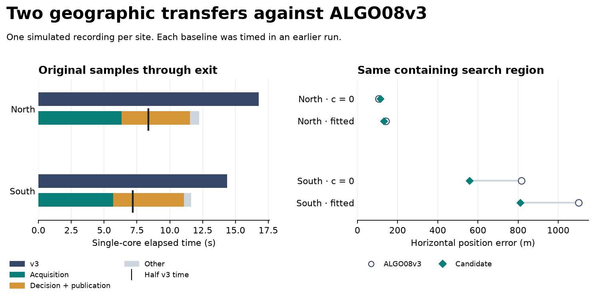

# Where ALGO08v3 can still lose half its runtime

The current receiver and solver finished in **12.233 s on North** and **11.614 s on South**. The historical installed ALGO08v3 runs on those same simulated recordings took **16.761 s** and **14.370 s**. The remaining gaps to half of named time are **3.852 s** and **4.429 s**. Each site has one positive recording, one core and a containing search region. The latest North build uses guarded phase recurrence. South uses the exact receiver. Keep the two comparisons separate. [North recording](joint-held-north-raw.md) · [South recording and missing-region control](south-cfo-route.md)

| Recording and evidence | Single-core elapsed, v3 → research | Horizontal error at zero calibration | Horizontal error at fitted calibration |
|---|---:|---:|---:|
| North, simulated raw samples | 16.761 → 12.233 s (1.37×) | 106 → 113 m | 141 → 132 m |
| South, simulated raw samples | 14.370 → 11.614 s (1.24×) | 817 → 558 m | 1,101 → 811 m |
| DS30-0016, physical saved detections, all refinements | No new paired raw timing | 1,644 → 1,010 m | 1,661 → 1,558 m |
| Same DS30-0016, selective refinement | No new paired raw timing | 1,644 → 976 m | 1,661 → 1,452 m |

Both raw simulations produced a complete grid and eight verified figures. On South, moving the offered boundary to exclude truth by 100 m still produced a false fix in both algorithms. An initial South launch failed after acquisition and cost an additional 6.364 s of experiment time. On weak physical DS30-0016, the all-refined saved replay reproduced the prior refined result, including both positions, 116 ordered observations in each arm and all eight images. The prospective physical case DS30-0191 was selected by visit count before scoring. Its 1.514 GB of original samples were cold during high server I/O pressure. Its available clock packet contains no detector measurements. [Weak physical transfer](held-cycle-0016-saved.md) · [Prospective recording preflight](select-before-cfo-0191-preflight.md)

## What changed in the receiver

The receiver can use the original frequency estimates to decide which detections form a consistent signal history across time, then use more precise frequencies to position the receiver. Both radios must independently support the history. That rule retained 456 of 1,078 North factors, 456 of 703 South factors and all 475 weak physical factors. It uses neither receiver coordinates nor a list of satellites known to be correct. North's earlier all-refined discovery had worsened fitted position error by 393 m. The change in ordering recovered the position on this transfer. Calibration and RF residuals remain separate outcomes. On North, fitting calibration reduced residual RMS from 5.242 to 5.065 Hz but increased horizontal error from 113 to 132 m. [Before-and-after northern contrasts](north-cfo-contrasts.md) · [North receiver and full publication](joint-held-north-raw.md)

## The time budget

The earlier three-shortcut prototype preserved both positions and all eight figures on its dense and weak physical pairs. Early receiver rejection saved only 2.0–2.6% of native CPU, reusable solver matrices left about 0.77 CPU s of dense opportunity, and rejecting 8,699 impossible recovery trials saved only 0.12 s in that stage. Combined dense CPU was 111.39 s against 109.10 s for v3. Weak CPU was 10.60 s against 10.76 s. Cache residency differed sharply in the dense pair. These results favor eliminating whole searches or fits and measuring the full cost of the replacement. [Original three-change comparison](bounds-combined.md) · [Per-change ceilings](bounds-physical-pair.md)

| Current elapsed stage | North | South |
|---|---:|---:|
| Authenticated raw acquisition | 6.330 s | 5.693 s |
| Decision, position solve and publication | 5.218 s | 5.378 s |
| All other time through process exit | 0.684 s | 0.543 s |
| Half of installed v3 | **8.380 s** | **7.185 s** |

The frequency-refinement kernel consumed **0.659 CPU s** on North and **0.463 CPU s** on South, already inside acquisition. Even eliminating the entire kernel leaves several seconds to find. For scale, removing **32% of acquisition and 50% of decision and publication**, leaving everything else fixed, projects **7.60 s North and 7.10 s South**. South would clear its target by only 0.082 s. These are engineering budgets, not measured improvements. Historic dense cases have a different mix. On 52 physical fixes with separate clocks, acquisition took 67.1% of elapsed time in aggregate. [Sealed clock inputs and plot generator](held_transfer_budget.py) · [Physical recording census](twofold-budget-after-0402.md)

A matched live test on one resident 64-visit piece of physical DS30-0169 gives the selective-refinement idea a measured price. It made **7 instead of 45** fine-frequency calls. Refinement dropped from **36.0 to 8.3 ms CPU**, the decision cost **0.74 ms**, and verified detection output was ready **22.7 ms sooner**. Fresh process elapsed through exit moved only **716.1 to 715.3 ms**, with process CPU **699.7 to 675.2 ms**. Both arms selected the same 56 signals, and 29 retained their original frequency in the selective arm. This single pair ends at detector output. Its position effect is unmeasured on 0169. [Measured member comparison](continued-cfo-live.md)

## Ten directions, ranked for the next small experiments

The rankings balance available seconds, evidence that the science can be preserved, and the cost of disproving an idea. Each change must be timed on the current candidate because some historical costs have already been removed. An earlier guarded integer FIR reproduced all 2,400 northern measurement rows and the same position with the same solver. The new precision experiment targets the timing transforms further downstream. [Earlier integer-filter attribution](../single-core-2x/north-edge-q15-repair-attribution.md)

| Rank | Direction | First experiment and decision |
|---:|---|---|
| 1 | **Compute the broad timing search at lower precision, then verify ambiguous peaks at full precision.** Keep all eight timing lags and all epochs. Try a block-scaled integer transform and conservative error intervals around the score comparisons, including each circular peak exclusion. | Four timing rows supplied by an answer key saved 25% of native time on a dense prefix. An affordable fixed low-rank basis captured only about 4% of operator power, and a one-lag confidence gate retried almost every lane. Lower precision attacks the cost per evaluated hypothesis without assuming which ones can be dropped. First price conversion, scaling, saturation detection and exact retries on one weak and one dense member. Check every signed winner, including cancellation. [Timing ceiling](timing-only-oracle.md) · [Rank bound](timing-rank-ceiling.md) · [Earlier confidence gate](precarrier-timing-gate.md) |
| 2 | **Give the solver a cheap way to disprove an expensive rescue.** Start with the failing tracks and compute a conservative feasibility bound over the allowed parameter range. | On saved DS30-0402, v3 spent 31.96 CPU s on three satellite-reassignment fits it ultimately rejected. Measure how much comparable work actually survives in the fast solver. Replay one rejected and one accepted rescue, with a full fit for every inconclusive bound. Check both calibration arms and every accepted owner. [Profile](named-roster-0402.md) |
| 3 | **Stream verified samples directly into pilot extraction for both radios.** Target a complete repeated pass over waveform bytes. | On North, 2.66 CPU s fell outside the three detector kernels. On an earlier dense prefix, decoding and the two required digest operations accounted for 84% of the corresponding remainder. Reusable buffers had already lost time. First count the *removable* processing on one member. Compare from compressed input through detector seal with identical factors and integrity checks. Stop if the proposal only changes buffer sizes or hash batching. [Dense attribution](dense-ingress-attribution.md) · [Buffer experiment](../single-core-2x/receiver-decoded-ingress.md) |
| 4 | **Buy fine frequency measurements only for signals that the receiver can continue.** Use the original frequencies for deciding signal history. | The saved North decision needs 396 of 996 short-positive refinements for an identical selected packet. On weak physical DS30-0016, 308 of 401 refined calls preserved all 116 assigned observations and improved position by 34/106 m against paying for every refinement. Time the live conditional call on one weak and one strong member and include all fallbacks. Cap its contribution at the measured refinement cost. [Saved comparison](continued-cfo.md) |
| 5 | **Share orbit and derivative evaluations across the two calibration fits.** Give each arm its own optimizer and robust weights, with an exact cache for common evaluation coordinates, tracks and epochs. | Count exact intersections and their CPU cost on one saved weak fix and one dense fit before writing a cache. Validate both objective values, accepted observations and final positions. Earlier fixed-matrix layout reuse alone left about 0.77 CPU s of dense opportunity. [Matrix experiment](incremental-layout.md) |
| 6 | **Avoid rebuilding the same observations between detector, solver and plotter.** Carry one verified column-oriented observation table through their existing interfaces, and keep the existing persisted products. | On a saved positive, count full passes and bytes converted per stage. Change the two most expensive conversions first. Measure through the eight verified PNGs and grid. North rendering alone took 0.700 CPU s, so drawing by itself cannot fund the downstream target. |
| 7 | **Expand four expensive signed timing candidates progressively.** Use exact evidence from the first candidate to set the cutline for the others, and perform a whole additional refinement only when it can change the winner. | Price on weak and dense signed members including the extra bookkeeping. The earlier per-hypothesis early-exit bound saved only 2.0–2.6% of native CPU, and simple partial-dot bounds rejected zero coarse timing groups. Continue only if the new rule skips entire candidate evaluations at the same output. [Bound ceilings](bounds-physical-pair.md) · [Failed coarse bound](whole-group-receiver-bound.md) |
| 8 | **Warm-start the original final fit from fast discovery, and protect fragile satellite assignments.** Preserve multiple plausible assignments where the fast solver disagrees across time segments. | Saved DS30-0402 and 0169 reproduced both v3 positions within 0.05 mm with a fast discovery and original finish. DS30-0374 lost 83 owners on a different route. Replay those disagreements, charge every additional branch, and require a whole-process improvement on both a sparse and a dense positive. [Matched final fits](original-final-fit-transfer.md) · [Transfer limit](named-final-0374.md) |
| 9 | **Retain only the waveform samples needed for a later frequency correction.** This lets the solver identify useful observations before paying for their precise frequencies. | Packing reproduced all diagnostics for 23 North observations, but retaining all potential positives still costs 1.07 GB on dense DS30-0008. North's projected pack, refit and exterior check cost 0.584 CPU s against about 0.531 s for immediate exact gathering. Consider bounded chunks only if enough decisions can be made before end of recording. [Measured storage and CPU](compact-cfo-support.md) · [Post-assignment fit](owned-cfo.md) |
| 10 | **Prove an early withhold when the observation geometry cannot support a fix.** Look for a second conservative condition on time span and independent tracks after authenticated acquisition. | Existing certificates reached 2.20× and 2.32× on two short physical withholds. Pair each proposed shortcut with a weak valid fix and a near-boundary pair. Count a lost valid fix or a new missing-region false fix as a regression. [Time-span controls](original-final-fit-transfer.md) · [Geographic failure modes](local-exterior-descent.md) |

I would combine precision-adaptive timing, conditional frequency refinement and fast discovery with the original final fit first, after timing each through its component boundary. Charge every full-precision fallback, including those triggered by weak detections and cancellation. Price the solver rescue bound separately on dense cases where it runs. A different compressed format shifts work to capture or conversion and must pay for that work on first use. A prepared seekable sidecar broke even only after about eight mixed analyses on one member. [Measured conversion cost](seekable-member.md)

The next timing comparison should freeze one implementation and alternate run order on the same small set of meaningful cases: a weak physical fix, a dense fix and a withhold. Measure process CPU and elapsed through all required products, both position errors and the rate of returning a fix on every recording. Keep the held geographical positives and missing-region controls separate. Advance to a larger matched panel only after the small cases justify it. The two acceptance statistics are median paired candidate/v3 time and summed candidate time divided by summed v3 time, both at most 0.50.
