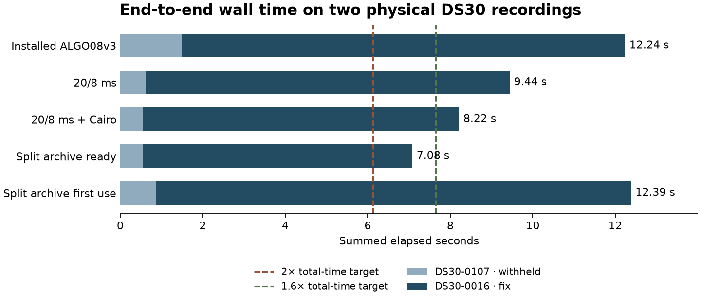
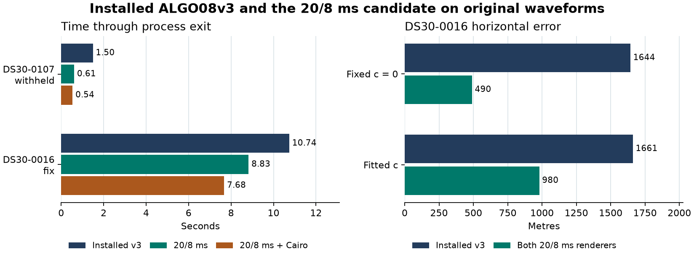

# Original-waveform timing on two DS30 recordings

**A verified split archive gave the fastest replay.** On the same two recordings, installed ALGO08v3 took **12.242 s** and the 20/8 ms candidate with split storage and Cairo took **7.084 s**, including the candidate's archive checks. The summed speedup was **1.73×**. Preparing both archives from the original files and verifying them brought first use to **12.388 s**, slightly slower than installed v3. Both pipelines fixed one recording and withheld the other. A separate wrong-region test on the fix produced errors above 176 km in both pipelines. These results do not support a release.

| 20/8 ms receiver and Cairo publication | DS30-0107 | DS30-0016 | Sum | Median paired speedup | Summed speedup |
|---|---:|---:|---:|---:|---:|
| Installed v3 comparator | 1.497 s | 10.745 s | 12.242 s | 1.00× | 1.00× |
| Original storage | 0.540 s | 7.677 s | 8.217 s | 1.86× | 1.49× |
| Verified split archive ready | 0.542 s | 6.542 s | 7.084 s | 2.06× | 1.73× |
| First use, including conversion and verification | 0.861 s | 11.527 s | 12.388 s | 1.21× | 0.99× |

The prepared row includes candidate-specific setup. Charging the candidate for common custody checks as well gives **1.97× median and 1.70× summed**. Including those checks on first use gives **1.18× and 0.98×**. For the total-time 2× target, the two recordings must finish in **6.121 s** combined. The prepared archive still needs **0.963 s** of savings, or **1.072 s** with common checks charged. [Two-case storage comparison](strict-cairo-0107.md)

### Original storage with the standard renderer

The 20/8 ms receiver and routed solver completed the two enrolled replays in **9.443 s** versus **12.242 s** for installed ALGO08v3. That gives **1.30× by total time** and **1.62× by the reciprocal of the median candidate-to-v3 wall ratio**. The combined time misses the 1.6× release threshold. Both methods returned one position and withheld once. Only one position contributes to the accuracy comparison.

| Physical recording | Installed v3 wall / CPU | Candidate wall / CPU | Wall speedup | Both decisions |
|---|---:|---:|---:|---|
| DS30-0107 | 1.497 / 1.496 s | 0.615 / 0.611 s | 2.43× | Withheld for insufficient curvature |
| DS30-0016 | 10.745 / 10.742 s | 8.829 / 8.824 s | 1.22× | Fix with eight PNGs |

The two recordings were enrolled by known outcome before the positive replay. Each pair used the same original waveform files, input opportunities, supplied region, and causal catalogue on Gauss. The candidate ran first, then installed v3, on the same single core at low priority with numerical libraries limited to one thread. Clocks cover process entry through exit, including decoding, native detection, both fits when applicable, and publication. The files were resident. Offline admission took 0.108 s for DS30-0107 and 0.100 s for DS30-0016. The 0.616 median and 0.771 summed wall ratios exceed the 0.50 target. These two selected recordings share a roof. They cannot establish other-site performance or estimate a DS30-wide fix rate. [Enrollment and scoring code](history_risk_physical_cohort.py) · [Two-case receipt](measurements/history-risk-physical-cohort.json.gz)

### Position and frequency on the recording that fixed

| Calibration | Installed horizontal error | Candidate horizontal error | Installed conditional RF RMS | Candidate conditional RF RMS |
|---|---:|---:|---:|---:|
| Fixed `c = 0` | 1,643.7 m | 490.1 m | 109.38 Hz | 134.02 Hz |
| Fitted `c` | 1,661.4 m | 980.0 m | 109.48 Hz | 133.74 Hz |

Errors use the operator's station reference. Both calibration arms use the same observations, candidates and budgets within each pipeline. The receiver change alters the observations between pipelines. Each candidate fit retained 115 assignments versus 109 for v3, with 104 in common. Shared assignments kept their satellite family and role. Candidate errors improved in both arms while their conditional frequency residuals increased. Each build reproduced its own sealed scientific outputs and eight reference PNGs. [Positive replay and figure checks](measurements/history-risk-0016-raw.json.gz) · [Withheld replay](history-risk-0107-raw.md)

On DS30-0016 the candidate spent **3.218 s** acquiring detections from the original files and **5.045 s** deciding and publishing. Reaching 2× on that recording would require another **3.456 s** end to end. A previous estimate stitched together separately timed stages and predicted 7.511 s. The measured 8.829 s supersedes it. The first raw attempt stopped after 4.795 s because the checkout's scanner and position modules shadowed the installed pair. The corrected replay used the installed modules and retained the frozen adapter bytes. Both builds were timed afresh. [First attempt including failure](measurements/history-risk-0016-raw-failed.json.gz)

### Changing the renderer

With the Cairo option enabled on **both** recordings, the candidate took **8.217 s** versus **12.242 s** for v3. That is **1.86× at the paired median and 1.49× by total time**. Charging the candidate's separate admission checks gives **1.74× and 1.47×**, respectively. On DS30-0107 the candidate withheld both arms in **0.540 s** before entering a renderer. The 0.074 s difference between the two candidate clocks on this recording therefore cannot be attributed to drawing PNGs. [Cairo pair, controls and clocks](history-risk-0107-cairo.md)

The same candidate with Cairo rendering finished in **7.677 s wall / 7.659 s CPU**, saving **1.152 s** against the ordinary candidate and reaching **1.40×** against the same 10.745 s v3 comparator. It ran after the ordinary pair on the same original input and single core. Separate offline admission cost 0.036 s. Its decision and publication stage fell from 5.045 to 3.844 s. It still needs **0.961 s** to reach 1.6× on this fix, or **2.304 s** to reach 2×.

The renderer preserved both coordinates, frequency fits, all 115 assignments per arm and the grid and path values. Four orbit sheets and two residual sheets used Cairo. The position and track sheets used the revised layout. The eight PNGs matched the corresponding saved renderer reference. All eight differ in pixels from the ordinary layout. The saved visual check found differences in residual tick labels while preserving plotted values and axis limits. [Full raw renderer score](measurements/history-risk-0016-cairo-raw.json.gz) · [Saved visual comparison](history-risk-cairo-physical.md)

### Splitting the stored waveform

The split format lets the short receiver read only the samples it consumes. On DS30-0016 it cut acquisition from **3.188 s to 2.156 s**. The complete run, including candidate-specific setup, took **6.542 s (1.64×)** with a verified split archive ready. Starting with the ordinary recording, conversion and independent readback took another **4.985 s**, bringing first use to **11.527 s (0.93×)**. All 506 detection factors, both positions, both frequency fits, the numerical grid and path, and all eight Cairo PNGs matched the original-format candidate. At this recording's measured 1.134 s saving per ready replay over original-format Cairo, conversion pays back on the fifth analysis. [Physical storage comparison and measured costs](strict-cairo-0016.md)

### When the correct region is missing

Holding the DS30-0016 detections fixed and shifting the supplied 25 km region two degrees east made the candidate return a false fix. Horizontal errors were **183.656 km** at fixed calibration and **176.717 km** with fitted calibration. The corresponding installed-v3 control also returned false fixes (**179.490 and 183.656 km**). The candidate kept all 115 observations and their roles, but changed every satellite assignment. Its 24 exterior checks allowed publication. The contained-region improvement on this one roof therefore gives little evidence about robustness at unfamiliar sites. This saved-detection control is separate from the two timed raw replays. [Controlled omission, assignments and frequencies](history-risk-0016-omitted.md)

### Longer recording and remaining compute

On DS30-0402, a separate saved-detection test preserved the positions, all 4,821 ordered assignments and roles per calibration arm, the 179-point grid and the fit path. Cairo saved **1.100 s** in publication outside the solve. Two gray RX1 channel 2 layers reached **96.00% and 95.76%** Cairo-to-ordinary pixel support at two pixels, below the preset 98% in each direction. The other 62 layers passed. The saved worker timings include a faster solve shared by both algorithms, so only the publication difference supports a renderer saving. [Dense recording comparison and layer-level checks](history-risk-cairo-0402.md)

A verified index from an earlier recording saved **0.219–0.240 s** during exact catalogue preparation on DS30-0016. The reference and candidate produced the same numerical banks and validated the same 99 reads. That stage saving alone covers about a quarter of the prepared two-recording shortfall to 2× if it carries through to a full replay. Retaining parsed orbit objects in memory showed no reliable gain. [Catalogue preparation experiment](validated-satrec-reuse.md)

### Cost of writing future archives

An offline writer replay fed all 808 saved DS30-0016 visits to each writer on one core. Writing the standard archive and independently reading it back took **3.583 s**. Writing the split archive directly from the same samples and reading it back took **2.549 s**. The installed reader rejected the private split archive at manifest discovery. Keeping both archives adds the split writer's cost. On the measured per-replay saving that would take **three analyses** to repay with full independent readback. The writer and analysis clocks were measured separately.

A small compatibility test produced a standard Zstandard archive with one frame per nonempty visit and a block boundary at 8 ms. The unmodified installed reader returned the complete signed samples. A second reader could stop decoding at 8 ms, with the whole compressed member still authenticated. The test covered shortened and empty visits. Physical replay timing of this compatible encoding is the next check. [Full writer comparison and compatibility tests](owned-capture-0016.md)
