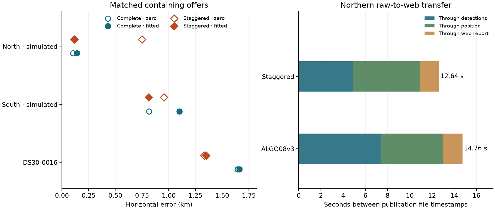

# Sparse antenna scheduling on three locations

One-core replay from northern simulated I/Q produced the eight standard web figures and shortened the common acquisition-lock to report interval from **14.76 to 12.64 s**. Fixed-zero error increased by **643 m**, exceeding the 250 m tolerance. A second sparse policy exposed an interior false fix on the displaced southern offer. Running the existing exterior test on interior solutions corrected that decision in the integrated research solver. The measured candidates fall short of the twofold raw-to-exit target and geographic requirements. [Northern publication and PNG audit](north-interlaced-raw.md) · [Missing-region test and matched fixes](measurements/causal-extra-checked.json)

## Sampling both antennas at different times

For each RF stream, measure the two antennas at different times within each group of three visits. This spends the same number of native searches as measuring one stereo pair per group. The schedule uses the RF ordering and chronological opportunity number. The complementary schedule exchanges antenna identities on every RF. Both schedules, the quadratic graph and both calibration arms were specified before comparing outcomes. [Schedule and decision rules](interlaced-lanes-protocol.md)

| Recording and region | Complete position error, zero / fitted (km) | Staggered position error, zero / fitted (km) | Complementary schedule, zero / fitted (km) |
|---|---:|---:|---:|
| DS30-0016, containing | 1.644 / 1.661 | 1.334 / 1.350 | 3.789 / 3.685 |
| Southern simulation, containing | 0.817 / 1.101 | 0.955 / 0.813 | 0.981 / 0.823 |
| Same southern recording, displaced | Withheld | Withheld | Withheld |
| Northern simulation, containing | 0.106 / 0.141 | 0.749 / 0.118 | Unmeasured |

The physical and southern comparisons use authenticated, older pre-continuation two-scan ledgers and fresh position fits. Both sparse schedules charged 476/1,426 physical and 800/2,400 southern lane calls, touching 473/713 and 800/1,200 stereo buffers respectively. The northern comparison used the installed v3 receiver and genuine I/Q for every paid lane. Both northern runs produced a 137-point objective grid and eight decoded PNGs. Acquiring detections took 7.360 versus 4.908 s, while detections to terminal took 5.661 versus 6.031 s. A post-run audit error lost the external elapsed and resource counters. The chart uses the recovered in-publication file timestamps. The driver now persists launch counters before auditing. [Saved geographical comparisons and RF scores](measurements/interlaced-lanes.json) · [Raw northern pair and timing boundaries](north-interlaced-raw.md)

The faster dense solver and the sparse receiver also interacted. On DS30-0016 the same original sparse detections yielded 36 assigned observations and 0.182 km fitted error with the full signed solver, versus 18 and **8.621 km** when combined with the faster family search. RF RMS fell from 121.379 to 112.390 Hz as the assignments changed. The original complete packet retained its fix in both solver routes. On the southern sparse packet, the faster search also lost accuracy in both arms. The six solver runs include an instrumentation cost. A subsequent preparation-only audit reproduced the prepared numerical inputs exactly and separates that cost from projected solve times. [Solver interaction and preparation audit](paid-certified.md)

## Using earlier measurements to buy additional waveform checks

The first same-time schedule left 75 of 109 complete physical owners and 176 of 266 southern owners on unpaid lanes. Among the common southern measurements, both fits agreed on satellite, role and alias. This motivated a streaming alternative. After two recent, compatible, signed frequencies on a measured base lane, the detector may search another lane before the next base measurement. A per-stream credit limit caps the extra calls and no orbital solution is needed to trigger one. The solver uses the measured waveform result. [Fixed-support and nuisance ablation](quadratic-support.md) · [Causal receiver specification](causal-extra-protocol.md)

| Saved recording | Extra calls / extra nonempty returns | Complete error, zero / fitted (km) | Adaptive error, zero / fitted (km) | Adaptive decision with unconditional exterior test |
|---|---:|---:|---:|---|
| DS30-0016 | 129 / 56 | 1.644 / 1.661 | 0.291 / 0.427 | Both fixes retained |
| Southern containing | 82 / 72 | 0.817 / 1.101 | 1.108 / 0.988 | Both fixes retained |
| Same southern data, displaced | 82 / 72 | Withheld | 61.730 / 56.132 | Both withheld |

On the displaced offer neither endpoint touched the region face, so the usual trigger skipped the external probes. The unchanged two-receiver test withheld after evaluating all 96 probes when enabled on the same numerical inputs. The research implementation then repeated all three saved fits with that decision inside the solver. Both containing solutions retained their positions and the false fix was withheld. The check adds about 1.9 CPU seconds to the two containing solves. The southern fixed-zero deterioration is still 291 m, exceeding tolerance by 41 m. The projected acquisition-plus-solve CPU with the active check is 8.80 versus 10.37 s on the physical case and 11.33 versus 14.31 s on the southern containing case. These estimates combine earlier per-lane native clocks, fixed remaining acquisition costs and newly measured solve CPU. They omit raw I/O waits and web publication. [Unchecked measurements](measurements/causal-extra.json) · [Integrated decisions and calibration ablation](measurements/causal-extra-checked.json) · [Probe protocol](causal-extra-exterior-protocol.md)

## Input throughput required for the overall timing gates

On three private XFS copies of authentic DS30-0008 members, each measured acquisition verified 232.084 MB and searched the first 64 of 192 visits. Reading the next compressed member ahead saved 114 ms in the first cold pair and cost 2 ms in the reverse order. All four runs had empty compressed-file page cache at launch, reproduced all 384 probe rows and sustained **263–303 MB/s** through this short acquisition. Storage cache below Linux was unmeasured. [Input, cache and CPU receipts](sparse-cold-input.md)

We used the 55 previously timed DS30 recording inventories and verified their signed segment manifests without reading waveform payloads. The median recording contained 8.235 GB of compressed I/Q. The table assumes every successful numerical stage scales to 25.661/60.966 of its original elapsed time, publication keeps its full cost, and the two failed runs and one withholding keep their original elapsed charges. It translates the two historical time gates into required **effective acquisition throughput**, including detector work and validation. All sizes and rates use decimal MB. [Manifest sizes, stage clocks and calculation](measurements/acquisition-throughput.json)

| Historical group | Count | Throughput required for median paired gate | Throughput required for summed gate |
|---|---:|---:|---:|
| All assigned recordings | 55 | 216 MB/s | 228 MB/s |
| Initially over 95% resident | 12 | 310 MB/s | 313 MB/s |
| Initially under 20% resident | 31 | 189 MB/s | 194 MB/s |

The warm baselines finished earlier, which makes their half-time limits tighter. The short cold input rates clear the historical all-recording requirement under the assumed solver scaling. Transferring either the short acquisition rate or the dense solver fraction across recordings remains unverified. The measured sparse-solver combination above shows why adding independent component improvements can mispredict both timing and position quality.

## Reproduction

Use the pinned release and the [single-core Gauss wrapper](sparse-consensus.md). Run `interlaced_lanes.py CASE MODE OUT/CASE-MODE.json` for the interlaced and swapped schedules on DS30-0016, south-containing and south-far. Run `causal_extra.py CASE OUT/CASE-causal_extra.json` and `causal_extra_exterior.py CASE OUT/CASE-causal_extra_checked.json --integrated` for the same offers. Run the scorer once per sealed comparison, using `interlaced_score.py OUT SCORED.json` or `interlaced_score.py OUT CHECKED.json --checked`. The clean checkout environment is sufficient for scoring. The throughput calculation needs read-only access to archived manifests as the ordinary recording account. [Throughput calculator](acquisition_throughput.py) · [Raw northern reproduction](north-interlaced-raw.md)
